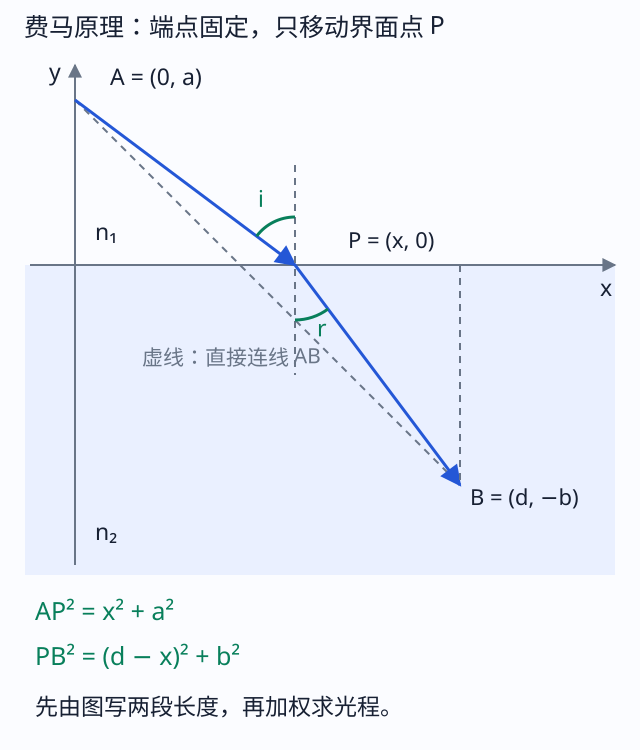
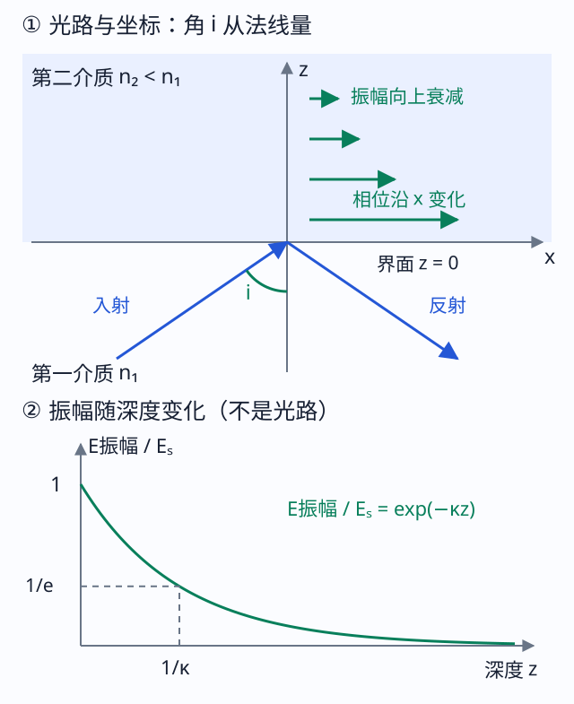
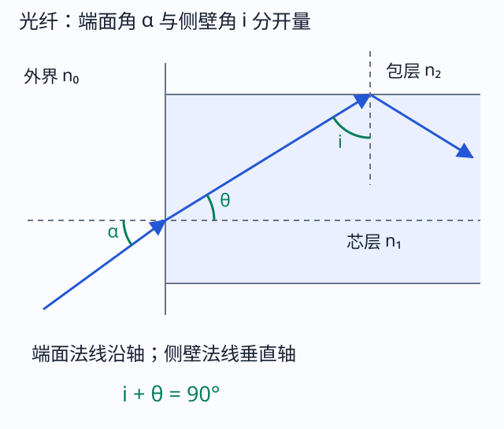
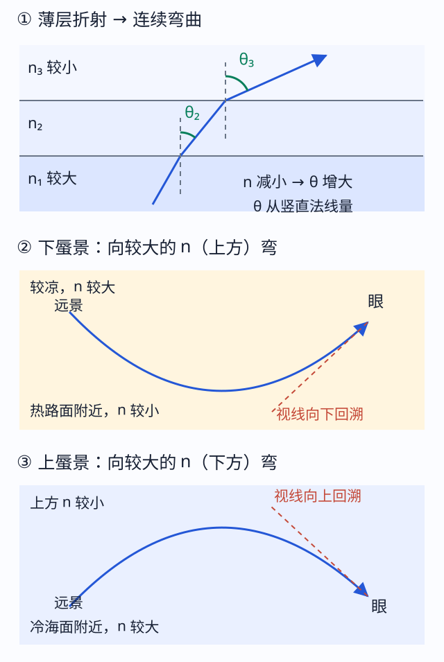

# 二、基础定律、费马原理与全反射

来源：教材§3.1—3.3、§3.6；3-2 PPT第1—11、33—36、51—53页，3-3 PPT。图为已有讲义依据教材与课件的教学重绘。

## G01 反射、折射、直线传播与可逆性

均匀各向同性介质中光线沿直线；曲面界面的法线是该点球心连线，不能用整面镜的光轴代替。入射线、反射线、法线共面，反射角等于入射角；折射满足共面条件与

$$n_1\sin i=n_2\sin r.$$

$i,r$从局部法线量。进入高$n$介质，折射角较小；频率不变、波长变短。互易介质中把实际光线反向，仍满足同一规律；涉及反射或多面折射时，反向必须重画传播方向和角度基准。几何光学要求特征尺度远大于波长，不能用“单根无限细光线”否定衍射。

**变式：界面矢量法。** 对指向入射介质的单位法线$\hat{\mathbf N}$与入射传播单位矢量$\hat{\mathbf v}$，反射方向

$$\hat{\mathbf v}_r=\hat{\mathbf v}-2(\hat{\mathbf v}\cdot\hat{\mathbf N})\hat{\mathbf N}.$$

它保留切向分量、翻转法向分量，适合角反射器或空间折叠；$|\hat{\mathbf v}_r|=1$是快速检查。不要把两个截面各反一次误当成空间所有分量均反向。

## G02 光程、传播时间与费马原理

光程把不同传播速度的路段换算到同一相位尺度：

$$
\begin{gathered}
L_{\rm opt}=\int_A^B n(\mathbf r)\,\mathrm d\ell \\
L_{\rm opt}=\sum_jn_j\ell_j \\
\text{（分段均匀）}.
\end{gathered}
$$

$\mathrm d\ell$为微小几何长度，$L_{\rm opt}$仍是长度，积累相位$k_0L_{\rm opt}$。在无色散或相应相速度模型下，传播时间$L_{\rm opt}/c$；色散脉冲的包络延迟需群速度，不能与相速度时间混为一谈。

**费马原理：** 静止、透明、各向同性介质的几何光学中，固定端点，真实路径相对于邻近允许路径的光程取驻值：

$$\delta L_{\rm opt}=0.$$

这里$\delta$是路径微扰的一阶变化，不是光程本身，不是两路光程差。比较路径必须遵守所讨论的界面、反射次数等约束；驻值可为极小、极大或恒定，不能改写成“任何情形都走几何最短路”。

图中$A=(0,a)$、$B=(d,-b)$固定，交点$P=(x,0)$可沿界面移动。法线竖直，上下两段的正弦分别为$x/AP$与$(d-x)/PB$。因此

$$L_{\rm opt}(x)=n_1\sqrt{x^2+a^2}+n_2\sqrt{(d-x)^2+b^2},$$
$$L_{\rm opt}'(x)=\frac{n_1x}{\sqrt{x^2+a^2}}-\frac{n_2(d-x)}{\sqrt{(d-x)^2+b^2}}=0\ \Longrightarrow\ n_1\sin i=n_2\sin r.$$

两端都在镜面同侧、两段介质相同，按同样步骤得到反射角等于入射角。均匀介质无界面时驻值路径为直线。**推导用途：** 面对不熟悉的几何问题，可以先写光程，以交点、入射高度等作变量求驻值，而不用猜哪条路“更直”。

**带练。** 图取$a=3,b=4,d=7$ cm，$n_1=1,n_2=4/3$。令$x=4$ cm，两段均长5 cm，$n_1\sin i=4/5=n_2\sin r$；真实光程$35/3$ cm。直接连线的光程$25\sqrt2/3$ cm更大，尽管其几何距离更短。两项二阶导数均正，本例确为最小；“最小”是由本例性质得到的，不是费马原理的一般定义。

## G03 理想成像、单心光束与等光程

单心光束是所有光线或其延长线同过一点的光束。实际发散自一点为实物；本来会聚到一点的入射束为虚物；出射光实际会聚为实像，反向延长会聚为虚像。屏可接收实像；眼睛接收到相应光束也可观察虚像。

共轭物像点是系统彼此成像的一对点；互易条件下可反向交换。物空间、像空间是用于描述入射与出射光束的空间模型，**不是简单把装置切成左半、右半**，折返系统两者可重叠。

理想成像要求同一物点的连续光线族对应同一像点，并在相应近似阶次具有相同的光程。费马仅要求每条真实路径一阶驻值，**不保证任意两条独立路径的驻值数值相等**。在实物—实像连续成像族中，若

$$L_{\rm opt}(h)=L_0+ah+bh^2+\cdots,$$

消除选线高度$h$的影响需相应系数为零。C02、C07给出分别匹配折射与反射构型的具体展开。大孔径会出现更高阶项，不能由近轴等光程推出任意大光束都严格成点。

<!-- QUESTIONS -->
配套原题与讲授问答：[G01 找物点、像点，判断四种实虚组合](../题库/光学PPT与作业题解.html#G01)；[G02 笛卡尔符号与图中正长度](../题库/光学PPT与作业题解.html#G02)。
<!-- /QUESTIONS -->

## G04 全反射、临界角与边界条件

光从$n_1$入射到$n_2$，只有$n_1>n_2$才存在临界角：

$$\sin i_c=\frac{n_2}{n_1}.$$

$i<i_c$有传播折射波；$i=i_c$对应折射角90°的掠射边界；$i>i_c$没有携带平均法向能流进入无限深第二介质的传播折射波，称全反射。普通折射定律中的$\sin r>1$不是可以继续反正弦的实角。

**带练。** 玻璃$n_1=1.5$到空气，$i_c=41.81^\circ$，45°入射可全反射；同一玻璃放入$n_2=1.33$水中，$i_c\approx62.46^\circ$，45°不能全反射。全反射棱镜先逐面找入射角再检查，不是“玻璃里面的45°永远反射”。

<!-- QUESTIONS -->
配套原题与讲授问答：[P01 临界角、附加条件与直角棱镜](../题库/光学PPT与作业题解.html#P01)。
<!-- /QUESTIONS -->

## G05 倏逝场：为什么全反射外面仍然有场

“倏逝”表示向一个方向指数衰减。设界面$z=0$，第二介质位于$z>0$，$x$沿界面。先把波长换成波数$k_0=2\pi/\lambda_0$（W01），因为要计算相位在$x,z$方向如何变化。

图左的入射、反射光在第一介质，图右第二介质的场沿$x$有相位变化，而幅度沿$+z$衰减；竖直曲线不是一条折射光线。界面所有$x,t$处相位匹配，给切向分量$k_x=k_0n_1\sin i$。第二介质均匀波动方程要求$k_x^2+k_z^2=(k_0n_2)^2$；超临界时右边不足以容纳切向波数，故

$$
\begin{gathered}
k_z=\mathrm i\kappa \\
\kappa=k_0\sqrt{n_1^2\sin^2i-n_2^2}>0.
\end{gathered}
$$

选择正$\kappa$才能使无源半无限介质内的场向远处衰减。代回相位因子，

$$
\begin{gathered}
E\propto e^{-\kappa z}e^{\mathrm i(k_xx-\omega t)} \\
d_E=\frac1\kappa \\
d_I=\frac1{2\kappa}.
\end{gathered}
$$

$d_E$是振幅降到界面值$1/e$的深度；平方后光强按$e^{-2\kappa z}$衰减，$d_I$是强度降到$1/e$的深度，两者相差2倍。理想无吸收半无限第二介质平均法向能流为零，不等于电磁场为零；若第二界面靠得很近，可发生受抑全反射和能量耦合，本节的半无限条件随之改变。

**带练。** $\lambda_0=600$ nm，$n_1=1.5,n_2=1,i=45^\circ$，根号为$\sqrt{0.125}$，$\kappa\approx3.7024\times10^6\ \mathrm{m^{-1}}$，$d_E\approx270.1$ nm，$d_I\approx135.0$ nm。单位检查：$k_0$是$m^{-1}$，深度取倒数才是m；$i\to i_c^+$时衰减长度增大。

## G06 光纤接收角与数值孔径

阶跃型光纤芯$n_c$、包层$n_s<n_c$，外介质$n_0$；只讨论通过轴的子午光线。外部光与轴夹角$\alpha$，芯内夹角$\theta$。入端折射给$n_0\sin\alpha=n_c\sin\theta$；芯壁法线与轴垂直，所以壁上入射角$i=90^\circ-\theta$。要全反射需$\cos\theta\ge n_s/n_c$，于是

$$\mathrm{NA}=n_0\sin\alpha_{\max}=\sqrt{n_c^2-n_s^2}.$$

图中$\alpha$从轴量，$i$从壁上法线量；两者不是同一个角。等号是临界边界，稳定导引一般取边界内。若算得右边大于$n_0$，外部可实现的角仍受$\sin\alpha\le1$限制。数值孔径是无量纲量，不是几何孔径直径；斜光线、波导模式和有限纤芯细节超出该子午光线模型。

<!-- QUESTIONS -->
配套原题与讲授问答：[P10 光纤为何导光，接收角怎样求（配套整理）](../题库/光学PPT与作业题解.html#P10)。
<!-- /QUESTIONS -->

## G07 渐变折射率、分层不变量与蜃景

渐变型光纤的$n$还可沿离轴半径连续下降，光线不断向高$n$的轴心附近弯回，轨迹不再是芯壁上生硬折返的折线。适当分布能使走较长外侧路径的光同时经过较低$n$、较快区域，减小不同路径的到达时间差；并非任意渐变分布都使所有模式严格同时到达。下面水平大气分层是同一梯度弯曲规律的另一种空间构型。

若$n=n(z)$仅随高度变，各水平层界面平行，$\theta$相对竖直法线量，逐层斯涅耳定律给

$$n(z)\sin\theta(z)=C.$$

读图先找竖直$z$轴，再看每层法线相互平行。进入较低$n$层时$\sin\theta$增大，光更接近水平；到$n=C$时$\theta=90^\circ$可转向。连续梯度中的光线平滑弯曲，不一定撞到一个真实反射面。

一般光线方程为

$$\frac{\mathrm d}{\mathrm d\ell}\left(n\frac{\mathrm d\mathbf r}{\mathrm d\ell}\right)=\nabla n.$$

$\ell$为路径弧长，$\mathbf r(\ell)$为位置，$\mathrm d\mathbf r/\mathrm d\ell=\hat{\mathbf t}$是单位切向，$\nabla n$指向折射率增加最快的方向。由$\int n|\mathbf r'|\mathrm dq$的驻值，欧拉方程给$\mathrm d(n\mathbf r'/|\mathbf r'|)/\mathrm dq=|\mathbf r'|\nabla n$，除以$\mathrm d\ell/\mathrm dq$即上式。取垂直切向分量得到$n\,\mathrm d\hat{\mathbf t}/\mathrm d\ell=\nabla_\perp n$，因此光向高$n$侧弯曲。

近地面热空气$n$较小，来自天空或远物的光弯后进入眼睛，眼睛按到达方向反延，可形成下蜃景；冷的高$n$下层可产生相反的弯曲和上蜃景。**判断像在哪里要把到眼睛的最后一段反延，不能只背“光弯向哪里”。**

<!-- QUESTIONS -->
配套原题与讲授问答：[P09 分层介质中的传播与蜃景](../题库/光学PPT与作业题解.html#P09)。
<!-- /QUESTIONS -->
