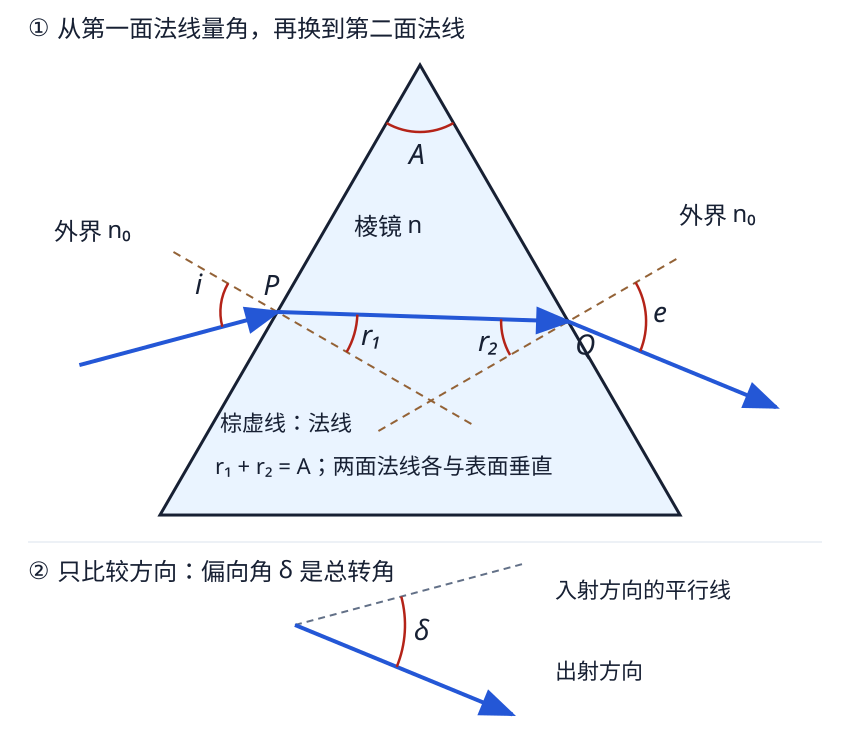
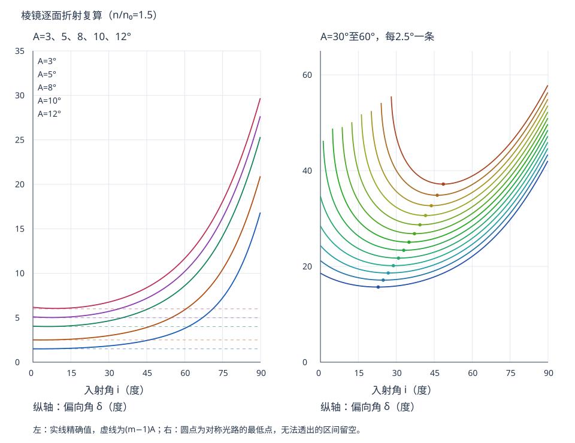
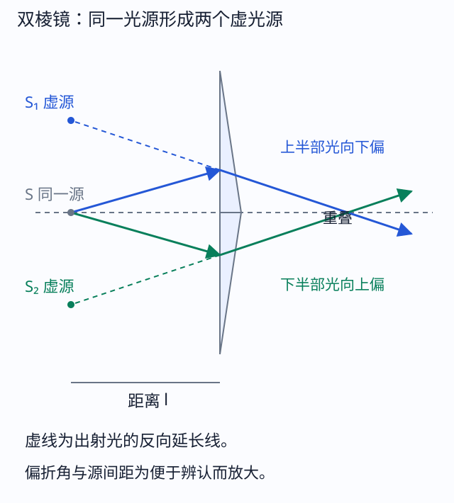
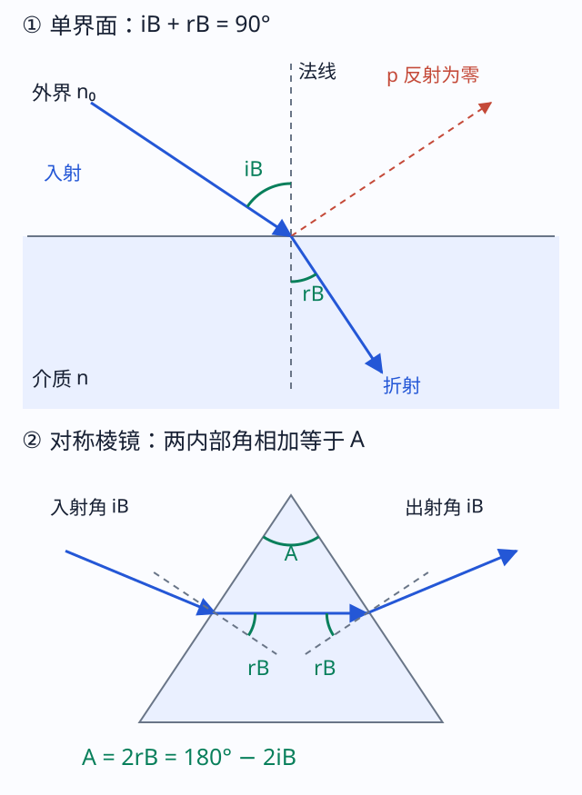
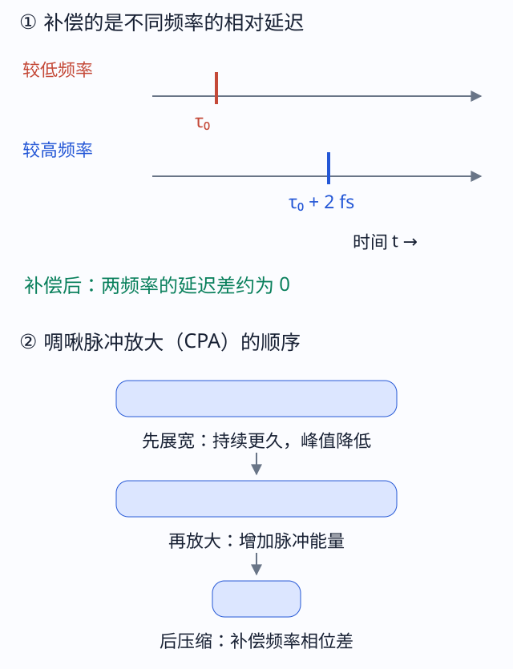
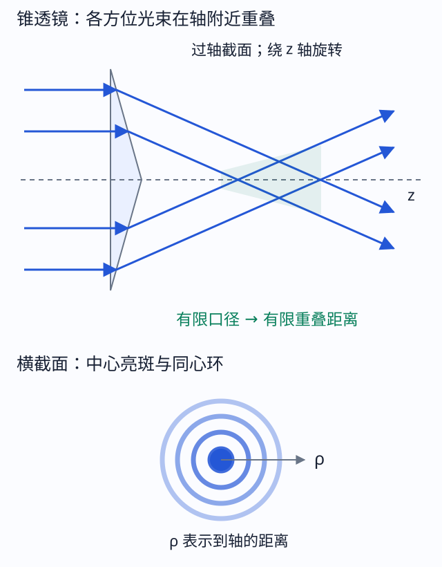
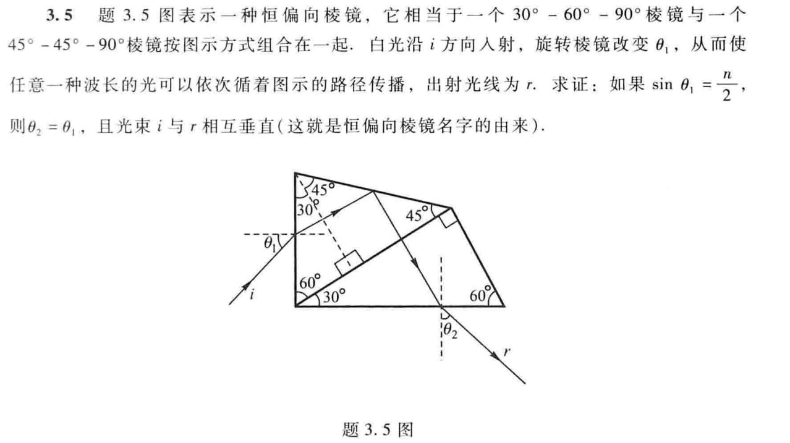

# 三、棱镜、色散与相关应用

来源：3-2 PPT第12—53页，教材§3.2及相应例题。此处保留课件展开的布儒斯特棱镜、双棱镜、色散补偿、锥透镜等内容；这些内容不能因“暂无指定作业”就自动删去。

## P01 一般棱镜：先逐面折射，再找偏向

外介质$n_0$、棱镜$n$，相对折射率$m=n/n_0>1$；顶角$A$，第一面入射$i$、内部折射$r_1$，第二面内部入射$r_2$、出射$e$。普通穿过两折射面的构型满足

$$
\begin{gathered}
\sin i=m\sin r_1 \\
r_1+r_2=A \\
\sin e=m\sin r_2 \\
\delta=i+e-A.
\end{gathered}
$$

图中$r_1,r_2$分别从两面法线量。两法线夹角与顶角的几何关系给$r_1+r_2=A$；把第一次偏折$i-r_1$与第二次$e-r_2$相加，才得总偏向$\delta$。对不处于普通内部角分支的光路，角可能有向且$r_2<0$，应按实际图确认，不能硬取绝对值。

**一般计算链**：$i\to r_1=\arcsin(\sin i/m)\to r_2=A-r_1\to e=\arcsin(m\sin r_2)\to\delta$。第二次反正弦前检查$|m\sin r_2|\le1$，还要确认实际打到指定第二面。

**带练。** 空气中$m=1.5,A=60^\circ,i=30^\circ$。$r_1=19.4712^\circ,r_2=40.5288^\circ$，未超过$41.8103^\circ$的临界角，所以$e=77.0958^\circ$，$\delta=47.0958^\circ$。出射很斜但仍可透射；它不是最小偏向光路。

<!-- QUESTIONS -->
配套原题与讲授问答：[P02 棱镜偏向角怎样随入射角变化](../题库/光学PPT与作业题解.html#P02)；[P05 编程画偏向曲线，怎样处理不能出射的区间](../题库/光学PPT与作业题解.html#P05)。
<!-- /QUESTIONS -->

## P02 最小偏向角：条件、推导和反求折射率

固定顶角、材料与波长，改变入射方向，普通可透射分支的最小偏向发生在对称光路：

$$
\begin{gathered}
i=e=i_m \\
r_1=r_2=A/2 \\
\delta_{\min}=2\arcsin[m\sin(A/2)]-A,
\end{gathered}
$$
$$\boxed{m=\frac{\sin[(A+\delta_{\min})/2]}{\sin(A/2)}}.$$

最小偏向不是“入射角最小”，也不是“出射角为零”。证明不能仅靠光路可逆：可逆只给交换$i,e$后的同偏向。令$g(r)=\arcsin(m\sin r)$，则$\delta=g(r_1)+g(A-r_1)-A$，

$$
\begin{gathered}
g'(r)=\frac{m\cos r}{\sqrt{1-m^2\sin^2r}} \\
g''(r)=\frac{m(m^2-1)\sin r}{(1-m^2\sin^2r)^{3/2}}>0.
\end{gathered}
$$

对普通$0<r<\arcsin(1/m)$分支，$g'$严格增加，驻值$g'(r_1)=g'(A-r_1)$只能给$r_1=A/2$，二阶导数正，故为最小。要求$m\sin(A/2)<1$才能非掠射地透过。

**带练。** $m=1.5,A=60^\circ$，$i_m=48.5904^\circ$，$\delta_{\min}=37.1808^\circ$；反代测量式重得$m=1.5$。空气外改成水外，公式求的是$n/n_0$，不能把它直接当棱镜绝对折射率。

<!-- QUESTIONS -->
配套原题与讲授问答：[P03 最小偏向角如何测折射率，液体容器壁怎么办](../题库/光学PPT与作业题解.html#P03)。
<!-- /QUESTIONS -->

## P03 可透射的入射角边界，与最小偏向分开

设$r_c=\arcsin(1/m)$。普通分支第二面要$r_2\le r_c$，而$r_2=A-r_1$，故$r_1\ge A-r_c$。因此

$$
\begin{gathered}
i_{\rm lim}=\arcsin[m\sin(A-r_c)] \\
(A>r_c).
\end{gathered}
$$

$A\le r_c$时可从$i=0$进入；$A>2r_c$时普通两面透射分支不存在。$i=i_{\rm lim}$给第二面掠射，实际非掠射取稍大角。改变光路分支、从另一侧面入射时要重画。

**带练。** $A=60^\circ,m=1.5$，$i_{\rm lim}=27.9205^\circ$，而$i_m=48.5904^\circ$；两数回答不同问题。若题目只问“能否从另一面射出”，先查临界角，不必先算最小偏向。

<!-- QUESTIONS -->
配套原题与讲授问答：[B04 3.4 两种“最小”（配套，未确认指定）](../题库/光学PPT与作业题解.html#B04)。
<!-- /QUESTIONS -->

## P04 薄棱镜近似与偏向曲线

当$A,i,r_1,r_2,e$均小到可用弧度近似，$i\approx mr_1,e\approx mr_2$，代几何关系得

$$\delta\approx(m-1)A.$$

近似到一阶时偏向与入射角无关；真实精确曲线仍有变化和最小值。只说“顶角小”还不足以保证大入射角也能用上式。

横轴是入射角、纵轴是偏向角；每条曲线只画可透射区。谷底是最小偏向，曲线左端是第二面临界出射，不是同一个点。$A=5^\circ,m=1.5$时一阶结果$2.5^\circ$；精确最小偏向约$2.503^\circ$。若要求一般精确偏向，还需要入射角。

<!-- QUESTIONS -->
配套原题与讲授问答：[P04 薄棱镜的5度例题与近似条件](../题库/光学PPT与作业题解.html#P04)；[P05 编程画偏向曲线，怎样处理不能出射的区间](../题库/光学PPT与作业题解.html#P05)。
<!-- /QUESTIONS -->

## P05 色散、柯西公式与角色散的两种求法

色散表示折射率依赖频率或波长。透明波段常见正常色散$\mathrm dn/\mathrm d\lambda_0<0$，短波通常偏折更多；吸收附近可有反常色散，不能把正常色散当普适定律。柯西经验式

$$
\begin{gathered}
n(\lambda_0)=a+\frac b{\lambda_0^2}+\frac c{\lambda_0^4} \\
\frac{\mathrm dn}{\mathrm d\lambda_0}=-\frac{2b}{\lambda_0^3}-\frac{4c}{\lambda_0^5}.
\end{gathered}
$$

$a$无量纲，$b,c$的单位分别随所选波长单位的平方、四次方；不能把μm拟合参数和nm直接混算。它只适用于拟合的透明波段。

**随波长重新调到最小偏向：** 对P02直接求导（假定$n_0$在该波段不变），

$$D_{\min}=\frac{\mathrm d\delta_{\min}}{\mathrm d\lambda_0}=\frac{2\sin(A/2)}{n_0\sqrt{1-m^2\sin^2(A/2)}}\frac{\mathrm dn}{\mathrm d\lambda_0}.$$

**固定入射角：** 对$\sin i=m\sin r_1$求导得$\mathrm dr_1/\mathrm dm=-\tan r_1/m$，$r_2=A-r_1$，再对$\sin e=m\sin r_2$求导，

$$\left.\frac{\partial\delta}{\partial\lambda_0}\right|_i=\frac{\sin A}{n_0\cos r_1\cos e}\frac{\mathrm dn}{\mathrm d\lambda_0}.$$

在中心波长恰对称时两式一阶相同，但固定装置不可能让宽谱各波长都严格处于各自最小偏向。导数角度单位是rad；小波段可用$\Delta\delta\approx D\Delta\lambda_0$，窄角近似$D\approx A\,\mathrm dm/\mathrm d\lambda_0$。注意比较分光能力常看$|D|$，不是只看负数大小。

**带练。** $A=60^\circ,n_0=1,n=1.5$，若局部$\mathrm dn/\mathrm d\lambda_0=-4.0\times10^{-5}\ \mathrm{nm^{-1}}$，则$D_{\min}\approx-6.0474\times10^{-5}$ rad/nm；相差10 nm，两出射方向相差约$6.0474\times10^{-4}$ rad，负号表示波长增大时偏向减小。分光仪用准直管提供平行光，棱镜偏转，望远镜读方向，测出$A,\delta_{\min}$再反推$n$，不是凭屏上距离直接当角。

<!-- QUESTIONS -->
配套原题与讲授问答：[P06 分光系统怎样把颜色分开](../题库/光学PPT与作业题解.html#P06)；[P07 角色散的意义、推导及顶角影响](../题库/光学PPT与作业题解.html#P07)。
<!-- /QUESTIONS -->

## P06 角反射器、全反射棱镜与双棱镜

**全反射棱镜**通过一面或多面全反射折叠光路；转向角由反射几何决定，是否全反射再由材料与外介质检查。棱镜还可用于像的旋转、倒像、偏振分束等；不同功能不能都解释为“最小偏向”。

**三面角反射器。** 三个相互垂直反射面依次把传播矢量的三个正交分量各翻转一次，

$$ (v_x,v_y,v_z)\longrightarrow(-v_x,-v_y,-v_z).$$

出射与入射反向平行，通常存在横向平移，不保证沿原来同一直线。若只反射两个面，只翻两个分量，第三分量不为零时不能空间原路反向。证明前要确认光确实依次打到三面，玻璃角锥还需逐面满足反射条件。

**菲涅耳双棱镜。** 两个小顶角薄棱镜共底组成，来自同一源的两部分波分别偏折，反延为两个相干虚源。

源到双棱镜距离$\ell$，小偏折$\varepsilon\approx(m-1)A$，每个虚源横移约$\ell\varepsilon$，间距$d_s\approx2\ell(m-1)A$。$\ell$不是虚源到屏的距离。若屏距虚源平面$Z\gg d_s$，由近轴路差$\Delta R\approx d_s x/Z$得条纹间距$\Delta x\approx\lambda Z/d_s$。先查两束在屏上确有重叠，再求条纹；虚源是反延点，不画成新的实发光体。

<!-- QUESTIONS -->
配套原题与讲授问答：[P08 三面角反射器证明与用途](../题库/光学PPT与作业题解.html#P08)；[P12 其他棱镜装置各做什么（应用整理）](../题库/光学PPT与作业题解.html#P12)。
<!-- /QUESTIONS -->

## P07 布儒斯特角棱镜与色散补偿

偏振是电矢量振动方向的性质。入射面由入射线和法线张成；$p$偏振电场平行入射面，$s$偏振垂直入射面。在无吸收、非磁、各向同性界面，$p$反射系数为零时，反射光与折射光互相垂直，即$i_B+r_B=90^\circ$。结合斯涅耳定律，

$$\tan i_B=m.$$

对于同一外介质中的中心波长，若同时取对称透射，$r_1=r_2=r_B$，则$A=2r_B=180^\circ-2i_B$，两面均可满足相应的$p$低反射条件，并位于最小偏向。$s$仍反射，宽谱不会全部精确同角。**最小偏向不意味着色散达到一个普遍最大值**；色散还受顶角、材料和损耗约束。

**相位补偿。** 不同颜色的材料折射率和几何光路不同，积累总谱相位$\phi(\omega)$。它在中心频率附近展开为

$$
\begin{gathered}
\phi=\phi_0+\tau_g(\omega-\omega_0)+\tfrac12\phi_2(\omega-\omega_0)^2+\cdots \\
\tau_g=\frac{\mathrm d\phi}{\mathrm d\omega} \\
\phi_2=\frac{\mathrm d^2\phi}{\mathrm d\omega^2}.
\end{gathered}
$$

$\tau_g$是群延迟（s），$\phi_2$是群延迟色散（s²）：不同频率的延迟差使短脉冲展宽；棱镜对使不同颜色走不同几何路径以补偿。正常色散的$\mathrm dn/\mathrm d\lambda_0<0$与“群延迟色散为正”是不同定义，不能只看负号互相代替。若传播长度$\ell$，$\phi=k(\omega)\ell$，包络群速度$v_g=(\mathrm dk/\mathrm d\omega)^{-1}=c/[n+\omega\mathrm dn/\mathrm d\omega]$，这里的群折射率不同于相折射率$n$。

图的核心是频率与到达时间的对应，不是只把各色空间上合拢。啁啾脉冲放大CPA依次为展宽降峰值→放大→压缩；压缩必须补偿频率相位差。该原理属于课件物理内容，奖项人物等历史叙述另行排除。

<!-- QUESTIONS -->
配套原题与讲授问答：[P11 布儒斯特棱镜的条件（应用整理）](../题库/光学PPT与作业题解.html#P11)。
<!-- /QUESTIONS -->

## P08 锥透镜、贝塞尔光束与“无衍射”的边界

锥透镜把入射平行光偏成一束锥角近似相同的光线。小底角$\alpha$、相对折射率$m$时，偏折锥角$\eta\approx(m-1)\alpha$。不同方位的锥形平面波相干叠加，可形成轴附近近似$J_0(k_\perp\rho)$的场，$k_\perp=k\sin\eta$；$J_0$是零阶贝塞尔函数，表示有中心亮斑与同心环的径向振幅。

半径$a$的有限照明孔径只能在有限长度约$z_{\max}\sim a/\tan\eta$内形成重叠区；理想无限长贝塞尔波需要无限横向能量。环纹、长焦深、自重建等来自锥波干涉，不能说有限器件产生永远不衍射、能量无限集中的一根线。该部分以机制和条件辨析为主；若题目另给精确锥面角，应回到逐面折射，不能用小角公式冒充精确式。

<!-- QUESTIONS -->
配套原题与讲授问答：[P12 其他棱镜装置各做什么（应用整理）](../题库/光学PPT与作业题解.html#P12)。
<!-- /QUESTIONS -->

## P09 其他棱镜与含反射的恒偏向变式

五角棱镜利用两次反射及指定进出面实现约90°转向；屋脊、道威等涉及像的翻转或旋转，须逐面检查反射对各方向的作用；非偏振分束立方主要靠界面膜分束，偏振棱镜利用偏振相关传播/反射，不是普通色散自动将任意两偏振分开。变形棱镜对在某一横向维度压缩或扩展束宽，可把椭圆束整形；耦合棱镜以相位匹配把光耦入薄膜/波导，和自由空间直接透射不同。课件产品图的作用表是机制分类，不是各型号都满足相同数值角度的定理。

**液体空心棱镜。** 若容器壁在每个窗口内外两面平行，把空气→玻璃→液体两次斯涅耳式串联，玻璃折射率消去；同理出射端也消去。因此外部角关系可等效为空气—液体棱镜。壁有厚度会改变位置，若两壁不平行则角关系也不能照消。这解释题册P03的“容器壁怎么办”。

**恒偏向90°（教材3.5原图）。**

原图的实际次序是左面折射→上方斜面反射一次→底面折射；内部拼接线不是第二块反射镜。取水平向右方向角0、逆时针为正，第一面外角$\theta_1$满足$\sin\theta_1=n/2$，所以内部入射方向$r_1=30^\circ$。图上反射斜面方向为$-15^\circ$，镜面反射方向角等于“2×镜面方向角−入射方向角”，因而反射后为$2(-15^\circ)-30^\circ=-60^\circ$。

底面的向下法线方向为$-90^\circ$，内部入射角也是30°，出射给$\sin\theta_2=n/2$，故所示分支$\theta_2=\theta_1$。外部入射方向为$\theta_1$，出射方向为$-90^\circ+\theta_2$，相差90°。若内部靠向空气全反射，反射点入射角45°要求$n>\sqrt2$；同时进出非掠射要求$n<2$。这类题考的是“反射加两次折射后的方向关系”，不能直接套普通棱镜$\delta=i+e-A$。

<!-- QUESTIONS -->
配套原题与讲授问答：[P03 最小偏向角如何测折射率，液体容器壁怎么办](../题库/光学PPT与作业题解.html#P03)；[P12 其他棱镜装置各做什么（应用整理）](../题库/光学PPT与作业题解.html#P12)；[B05 3.5 恒偏向棱镜（配套，未确认指定）](../题库/光学PPT与作业题解.html#B05)。
<!-- /QUESTIONS -->
