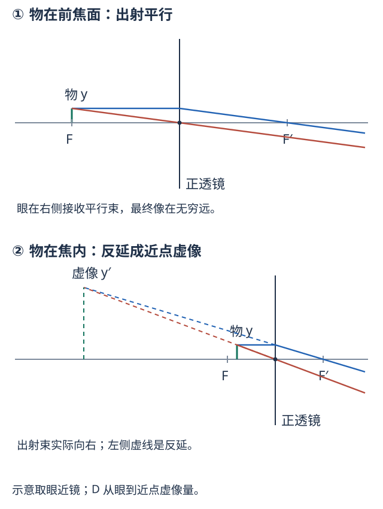
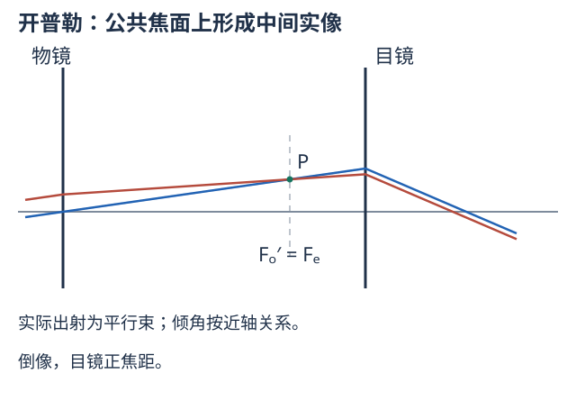
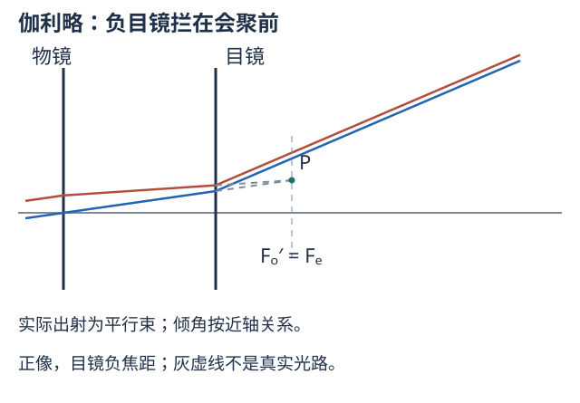

# 七、眼睛、放大镜、显微镜与望远镜

来源：仪器PPT第1—10、14—18、32—74页；教材§4.1—4.5。纯历史、人物与照片展示不作为公式条目；照片中涉及成像原理的内容仍保留。目镜基点计算见T07，下面给使用方法。

## I01 眼睛、调节与眼镜的理想成像模型

角膜、房水、晶状体与玻璃体共同成像，视网膜接收实像。晶状体改变曲率进行调节：放松时可看清的最远点叫远点，最强调节时可看清的最近点叫近点；正常眼远点近似无穷远，近点随年龄和个体变化。明视距离$D=25$ cm是比较视角的常用约定，**不等于每个人的近点**。瞳孔限制通光，视网膜杆细胞偏重弱光、锥细胞偏重颜色和细节。

眼镜的成像目标是把真实物体变成眼睛可清楚接收的虚像。忽略眼镜与眼的间距，镜片光焦度$P=1/F$（$F$用m，单位D）；日常镜片“度数”为$100P$。

上图无穷远光经负镜变为仿佛从近视远点发散，下图25 cm实物经正镜成像到较远近点；虚线是反延，不是屏可接的真实会聚光。

**远点$R$有限的近视模型：**$s\to-\infty,s'=-R$，故$F=-R,P=-1/R$。$R=0.5$ m给$P=-2$ D（-200度）。**近点$N>D$的近读模型：**$s=-D,s'=-N$，$P=1/D-1/N$；$D=0.25,N=0.50$ m给$+2$ D。近点后移并不能单独判断真实眼睛的全部屈光状态；这里处理的是课件成像题。

**镜眼间距变式。** 若镜片在眼前$e$，所有点的位置仍从眼测量，远点到镜片距离为$R-e$，故近视镜$P=-1/(R-e)$；把眼前距离$D$的物成像在近点$N$，则$P=1/(D-e)-1/(N-e)$。先换到同一镜片原点，别把$e$凭记忆加减。

<!-- QUESTIONS -->
配套原题与讲授问答：[I01 远点0.5米的近视眼，眼镜怎样取焦距](../题库/光学PPT与作业题解.html#I01)；[I02 近点0.5米，怎样看清25厘米处物体](../题库/光学PPT与作业题解.html#I02)。
<!-- /QUESTIONS -->

## I02 视角放大率与放大镜的不同观察条件

助视仪器的放大本领比较视网膜上的像，近似等于有、无仪器时的视角比：$M=\theta'/\theta$。看近物以裸眼明视距离$D$为基准，物高$y$有$\theta\approx y/D$。它不是一般的线倍率$\beta$；放大镜最终像在无穷远时，线像高不有限，角倍率仍有限。

图上半物在前焦面，出射平行，眼睛放松；下半物在焦内，出射发散，反延到眼前$D$处。眼贴镜时两种结果分别为

$$
\begin{gathered}
M_\infty=\frac D F \\
M_D=1+\frac D F \\
(F>0).
\end{gathered}
$$

推导：无穷远时$u=F$，过光心线给$\theta'\approx y/F$；近点时$s'=-D$，薄镜式给$u=-s=DF/(D+F)$，视角$\theta'\approx y/u$，所以$M=D/u$。

眼在镜后$e$、最终虚像在眼前$D$时，镜片像距$s'=e-D<0$。像高$y'=\beta y$，眼见角为$y'/D$，故

$$M_D=\beta=1+\frac{D-e}{F}.$$

无穷远条件的近轴角倍率仍为$D/F$，但实际视场受眼位与孔径影响。$F=5$ cm、$D=25$ cm，放松观察5倍，近点6倍；不能见“5 cm放大镜”便给一个无条件唯一倍率。

<!-- QUESTIONS -->
配套原题与讲授问答：[I03 放大镜的放大率到底比较什么](../题库/光学PPT与作业题解.html#I03)。
<!-- /QUESTIONS -->

## I03 有限筒长显微镜：先物镜成像，再目镜看像

物镜焦距$F_o>0$短，目镜焦距$F_e>0$。物放在物镜前焦点外很近，物镜成倒立放大的中间实像；目镜再将其变成可观察的虚像或平行束。照明光路把光送到样品，成像光路把样品信息送到眼或探测器，两者不能用一条反延线混画。

图上方蓝、红两线从同一物点出发，经物镜交于倒立的中间像；中间像在目镜前焦面时，目镜后两线平行，最终像在无穷远。下方放大物镜前很短的间隔：物略在$F_o$之外，不是物恰在焦点。光线高度作显示放大，不据图量倾角；有限近点条件的中间像位置略有变化，按下文公式计算。

定义光学间隔$\Delta=\overline{F_o'F_e}$，镜片间距$L=F_o+\Delta+F_e$。$\Delta$不是物镜到目镜的机械距离。

**最终像在无穷远（眼放松）。** 中间像在目镜物方焦面，物镜像距$v_o=F_o+\Delta$。由薄镜式$1/u_o+1/v_o=1/F_o$，

$$
\begin{gathered}
\beta_o=-\frac{v_o}{u_o}=-\frac{v_o-F_o}{F_o}=-\frac\Delta{F_o} \\
\boxed{M_\infty=-\frac\Delta{F_o}\frac D{F_e}}.
\end{gathered}
$$

物镜提供线放大，目镜提供视角放大，总倍率为乘积。负号表示相对原物倒立。

**最终虚像在眼前$D$（眼贴目镜）。** 目镜的正物距$u_e=DF_e/(D+F_e)$，物镜像距$v_o=L-u_e=F_o+\Delta+F_e^2/(D+F_e)$，所以精确到薄透镜模型，

$$M_D=-\frac{\Delta+F_e^2/(D+F_e)}{F_o}\left(1+\frac D{F_e}\right).$$

若$F_e^2/(D+F_e)\ll\Delta$才约为$-(\Delta/F_o)(1+D/F_e)$。课件第18页放松眼式与第38页近点式条件不同，不能混用。调节最终像时物镜中间像位也略有变化，不能一面把它钉在$F_e$，一面又说最终像在有限近点。

**带练。** $F_o=0.5,F_e=2.5,\Delta=16,D=25$ cm。无穷远$M=-320$，$v_o=16.5$ cm，原物距大小$u_o=F_ov_o/(v_o-F_o)=0.515625$ cm，确在焦点外很近。近点时修正项$6.25/27.5=0.22727$ cm，$M_D\approx-357.0$；略修正式给-352，需按题目精度选用。

<!-- QUESTIONS -->
配套原题与讲授问答：[I04 显微镜作图及与两个焦距、光学间隔的关系](../题库/光学PPT与作业题解.html#I04)。
<!-- /QUESTIONS -->

## I04 无限远校正、数值孔径与正弦条件

无限远校正显微镜把样品放在物镜前焦面附近，物镜输出近似平行束，再由管镜成中间像。中间空间可放滤片、分束器等。若管镜焦距$F_t$，对小物高$y$，物镜输出角$\theta\approx-y/F_o$，管镜像高$y'=F_t\theta$，所以$\beta_o\approx-F_t/F_o$；不要把有限系统的$\Delta$不加辨别地代进来。课件“等焦”意为换物镜后焦面位置近似保持，**不表示不同倍率物镜焦距全部相等**。

$$\mathrm{NA}=n\sin u.$$

$u$为样品一侧接收锥的半角，$n$为样品工作介质折射率。高NA收集更多光，也通常有更小景深、较严格对焦要求。NA无量纲，不是焦比$F/D_a$。平行平界面的同一束边缘光按斯涅耳定律可保持$n\sin u$；任意曲面、物像两侧的孔径不能不考虑放大率便宣称相同。

**阿贝正弦条件。** 对已校正轴上球差、希望轴附近小视场也良好成像的系统，各孔径光线应满足与孔径无关的

$$\frac{n\sin u}{n'\sin u'}=|\beta|.$$

这里$u,u'$取锥角正大小，$\beta$是相应小物的横向倍率。它将近轴拉格朗日的角度关系推广到大孔径，表达消除近轴小视场彗差的关键条件；**不是任意大孔径系统天然具备的恒等式**。给不同孔径线对时可用这个比值是否恒定作检验，不等于“把物镜口径放大就自动清晰”。

油浸使$n$增加且减少玻片后大角度光的全反射损失，可使NA大于1；空气中NA不超过1。分辨距离约$\lambda_0/(2\mathrm{NA})$或按瑞利判据$0.61\lambda_0/\mathrm{NA}$，具体条件见A07。单纯增大目镜倍率只把模糊像放大，不增加样品已被物镜记录的细节。

<!-- QUESTIONS -->
配套原题与讲授问答：[I08 数值孔径、油浸和分辨率（推导整理）](../题库/光学PPT与作业题解.html#I08)。
<!-- /QUESTIONS -->

## I05 望远镜、筒长、角倍率与扩束

两图实线向右实际传播；伽利略图灰虚线是没有负目镜时原本会聚的目标，实际光已被目镜改变方向。两图的角度和高度为便于阅读作显示放大，结论按近轴关系理解。

望远镜看远物，物镜接近平行入射，目镜把物镜的焦面像送到眼。无焦条件为物镜像方焦点与目镜物方焦点重合，带符号间距

$$
\begin{gathered}
L=F_o+F_e \\
\boxed{M_\theta=\frac{\theta'}\theta=-\frac{F_o}{F_e}}.
\end{gathered}
$$

推导：入射小角$\theta$经物镜在公共焦面成高$h\approx F_o\theta$，目镜输出角$\theta'\approx-h/F_e$。$F_e<0$时公共点在目镜后方，只是原会聚目标，没有实际中间交点。

| 系统 | 条件与像 | 筒长与分划板 |
| --- | --- | --- |
| 开普勒 | $F_o>0,F_e>0,M<0$，倒像 | $L=F_o+F_e$，公共实焦面可放分划板 |
| 伽利略 | $F_o>0,F_e<0,M>0$，正像 | $L=F_o-|F_e|$，需$F_o>|F_e|$；无镜间实焦面 |

光束扩展从短焦端输入，输出直径与输入直径之比$D_{\rm out}/D_{\rm in}=|F_{\rm long}/F_{\rm short}|$；理想无损同介质下相应小发散角反比缩小。这与看远物方向的角倍率互为倒数，不把同一个倍率同时乘到束宽和发散角上。扩束保持能量不意味着单位面积照度不变。

若物镜直径$D_o$是孔径光阑，出瞳是它经后续目镜所成的像，直径约$D_{\rm exit}=D_o/|M_\theta|$。眼睛放在出瞳处可接收较完整视场；开普勒出瞳可在目镜外，伽利略出瞳通常为镜内虚像，所以可见视场受眼瞳位置限制。**带练：**$F_o=100,F_e=+5$ cm，倍率-20、筒长105 cm；换$F_e=-5$ cm，倍率+20、筒长95 cm。

<!-- QUESTIONS -->
配套原题与讲授问答：[I07 开普勒与伽利略望远镜的光路、角倍率和扩束](../题库/光学PPT与作业题解.html#I07)。
<!-- /QUESTIONS -->

## I06 显微成像方式：考机制时怎样回答

| 方式 | 信息怎样变成图像，主要辨析 |
| --- | --- |
| 明场/暗场 | 明场接收直接透射与样品改变后的光；暗场挡掉直接照明，主要收散射光，散射结构在暗背景上显亮。暗场不是把光源关暗 |
| 相衬 | 透明样品主要改变相位；相位板和照明结构改变未偏转参考光与样品衍射光的相对相位，经干涉转成强度差。纯相位信息本身不是已可见的明暗 |
| 偏光 | 起偏与检偏控制偏振，利用双折射等使样品方向、结构转成透过强度差；不是所有透明样品都产生同样色彩 |
| 荧光 | 激发一定波段，样品发出荧光；分色镜、激发滤片和发射滤片分开强激发光与弱信号，典型发射波长较长；不同标记通道分别采集再合成 |
| 共聚焦 | 聚焦照明、与焦点共轭的探测针孔抑制离焦光，扫描重建图像，改善光学切片；并非“换成激光就自动共聚焦” |
| 双/多光子 | 高峰值局部光场触发非线性激发，主要发生于焦点附近；不能用线性$I_1+I_2$解释激发概率。课件只概览，未提供完整非线性定量模型 |
| 正立/倒置、立体 | 前两者主要改变物镜和样品的相对布置，倒置便于某些容器样品；“倒置”不直接等于最终像倒立。立体镜用不同方向的两路观察形成空间感 |
| 电子、扫描探针与近场 | 电子镜用电子而非可见光；AFM利用探针力，STM利用隧穿电流，近场光学利用局域近场；不能一律套远场圆孔$1.22\lambda/D$判所有仪器极限 |

光镊用聚焦光场对微粒传递动量。对于折射率较高的适当粒子，梯度力使其趋向高强度处，散射/辐射压力沿传播方向推；三维稳定捕获需回复作用克服推力与扰动。示意光线的入射与出射方向改变对应光动量改变，粒子受相反反作用。不能把“光有能量”直接等同“任何光束都能稳定夹住任何粒子”。

<!-- QUESTIONS -->
配套原题与讲授问答：[I09 不同显微成像机制辨认（应用整理）](../题库/光学PPT与作业题解.html#I09)。
<!-- /QUESTIONS -->
