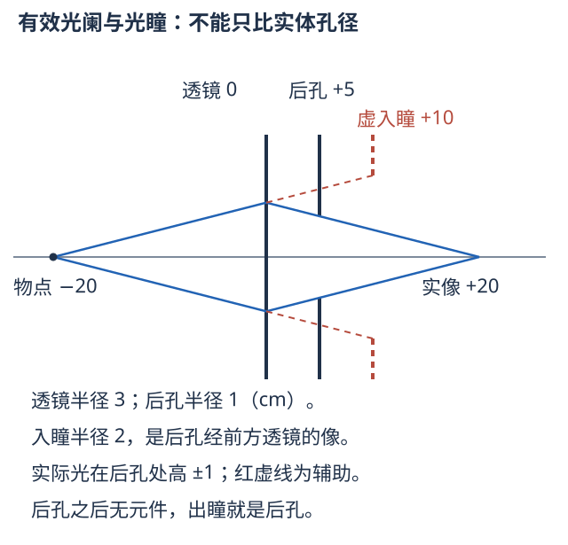
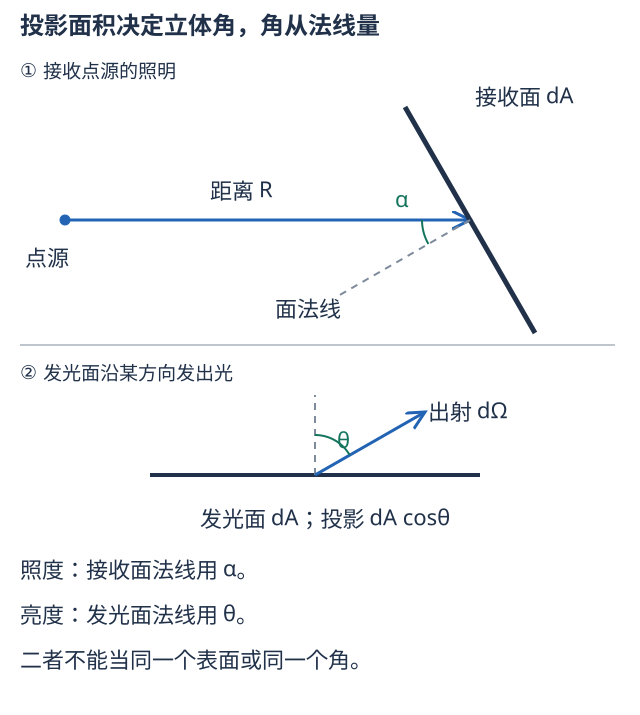
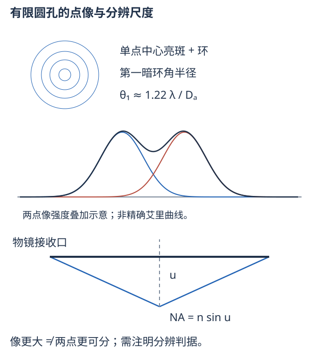

# 八、光阑、光度、聚光与分辨

来源：教材§4.6—4.8、§4.10（书页180—196、198—203），仪器PPT第32—36、68—74页，反射PPT有关望远镜与口径思考。光阑与光度学的完整定量部分为教材补全，未据文件名认定教师已全部讲授；NA与分辨关系是课件明确内容。

## A01 孔径光阑、入瞳、出瞳与视场光阑

孔径光阑限制某物点所能发出的有效光锥，决定进光量与孔径角；视场光阑限制可被完整成像的物点范围，决定视野。镜片边缘也能当光阑，不一定另有一块黑片。哪个孔最小**不能只比物理直径**：要从物点比较各孔及其前方系统所成的像张开的角。

**入瞳**是有效孔径光阑经其前方光学系统向物方所成的像；**出瞳**是经其后方系统向像方所成的像。没有前/后系统时相应光瞳就是光阑本身。瞳可能实、可能虚，不是又新增了一块实体孔。通过入瞳中心的主光线用来描述视场，瞳边缘的孔径光线描述通光锥；视场光阑的物方、像方像分别叫入射窗、出射窗。

图中正透镜在0，孔在$x=5$ cm，物点在$-20$ cm。透镜半径3 cm，后孔半径1 cm。后孔经透镜向左观察成位于$x=10$ cm的虚入瞳、半径2 cm；蓝色入射线的前向虚延长指向它，实际折射线则收向右侧像点。后孔没有后续元件，出瞳就是自身。不要把虚瞳画成实际截光板。

**带练与选法。** 上图$F=10$ cm。从物点看透镜边缘的孔径斜率$3/20=0.15$；看后孔入瞳边缘为$2/30=0.0667$，较小者限制通光，所以后孔才是孔径光阑。对应边缘线在透镜高$4/3$ cm，折射后到后孔高1 cm，验算确实通过；像在$x=20$ cm。若换物距，张角比会变，有效光阑也可能改变。

缩孔径光阑主要减少锥角、像差与光量，可能增大景深；缩视场光阑主要裁掉边缘视野。渐晕是离轴光束被部分遮挡、边缘亮度下降，不等同整体失焦。仪器要让眼瞳放在合适出瞳处才能接收较完整视场（I05）。

## A02 光度学各量：先分能量、方向、面积与人眼响应

辐射量按物理能量计，光度量按人眼明视觉响应加权。辐射通量$\Phi_e=\mathrm dQ/\mathrm dt$是功率，单位W；光通量$\Phi_v$单位lm。若$\Phi_{e,\lambda}$是每单位波长的辐射功率，$V(\lambda)$为归一化明视觉函数，

$$\Phi_v=683\ \mathrm{lm/W}\int V(\lambda)\Phi_{e,\lambda}\,\mathrm d\lambda.$$

单色光为$\Phi_v=683V(\lambda)\Phi_e$；$V$在555 nm附近达1，不同色同瓦数不必同流明。暗视觉使用另一响应函数，不直接套明视觉峰值。电光源光效$\Phi_v/P_{\rm 电}$的单位lm/W，不是能量转化效率这个无量纲比值。

**立体角**$\mathrm d\Omega=\mathrm dA_\perp/R^2$，表示从一点看小面元张开的空间角，单位sr；全空间为$4\pi$ sr。球坐标$\mathrm d\Omega=\sin\theta\,\mathrm d\theta\,\mathrm d\varphi$。

| 量 | 定义、单位 | 题干中的对应问题 |
| --- | --- | --- |
| 发光强度$I_v$ | $\mathrm d\Phi_v/\mathrm d\Omega$，cd=lm/sr | 某方向一束空间角里有多少光通量 |
| 照度$E_v$ | $\mathrm d\Phi_v/\mathrm dA_{\rm 接收}$，lx=lm/m² | 单位受光面积收到多少通量 |
| 光出射度$M_v$ | $\mathrm d\Phi_{v,\rm 发出}/\mathrm dA$，lm/m² | 单位发光表面向外总共发出多少通量 |
| 亮度$L_v$ | $\mathrm d^2\Phi_v/(\mathrm dA\cos\theta\,\mathrm d\Omega)$，cd/m² | 面光源沿某方向单位投影面积的发光强度 |

书中与W05的归一化“光强”$I=A^2$、发光强度$I_v$、表观“明亮”是不同层次，不能只因都叫强度就相互代换。辐射度学也有对应的W/sr、W/(m²·sr)等量，方法相同但不进行视觉加权。

## A03 照度平方反比、余弦定律与朗伯发光体

图左点源到受光小面元距离$R$，接收面法线与来光夹角$\alpha$；从源看该面元的垂直投影为$\mathrm dA\cos\alpha$。$\mathrm d\Omega=\mathrm dA\cos\alpha/R^2$，代入$\mathrm d\Phi_v=I_v\mathrm d\Omega$，得

$$\boxed{E_v=\frac{I_v\cos\alpha}{R^2}}.$$

适用于源可视为点源、小接收面、无遮挡且传输损耗可忽略；各向异性源的$I_v$要取对应方向。若有反射或吸收，再乘实际通量系数。距离翻倍照度为四分之一；面法线与来光60°夹角另乘1/2；不是把光线与面本身的夹角直接代入余弦。

**朗伯余弦定律。** 若某发光或漫反射面亮度$L_v$与观察方向无关，则面元的方向发光强度$\mathrm dI_v=L_v\mathrm dA\cos\theta$，有余弦分布。它不是“各方向发光强度相同”，不与接收面的余弦定律混为一个角。向半空间积分，

$$M_v=\int_{\rm 半球}L_v\cos\theta\,\mathrm d\Omega=2\pi L_v\int_0^{\pi/2}\cos\theta\sin\theta\,\mathrm d\theta=\pi L_v.$$

若理想漫反射面接收照度$E_v$、反射率$\rho$，则$M_v=\rho E_v$，所以$L_v=\rho E_v/\pi$；镜面反射不适用此式。

**带练。** 各方向发光强度60 cd的点源，距接收面6 m，$\alpha=60^\circ$，照度$60\times0.5/36=0.8333$ lx。若加一块反射率0.8的理想平面镜，按镜像源确定反射后的$R,\alpha$，再把该路径强度乘0.8，不能沿折线路程随意分两次平方反比。镜面像源的角几何必须与实际路径一致。

## A04 亮度定理、光学扩展量与聚光公式

**亮度传递。** 理想无损、互易的几何成像系统沿相应光束保持折合亮度

$$\frac{L_v'}{n'^2}=\frac{L_v}{n^2}=L_{v0}.$$

两侧同介质时亮度不增加；系统可把很多方向的光汇入一个像面区域，增大照度，却不能无源增加同一相空间束的折合亮度。损耗透过率$\tau$只会使它降低。这里相空间束可用小面积与角锥的乘积$n^2\cos\theta\,\mathrm dA\,\mathrm d\Omega$计量，称光学扩展量；小角下它与拉格朗日不变量的平方关系相通。

对均匀朗伯小物面$\mathrm dA$，入瞳张开半角$u$，直接积分可收集通量为

$$\mathrm d\Phi_v=2\pi L_v\mathrm dA\int_0^u\cos\theta\sin\theta\,\mathrm d\theta=\pi L_v\sin^2u\,\mathrm dA.$$

若像面小面积$\mathrm dA'=\beta^2\mathrm dA$，无损时$\mathrm d\Phi_v'=\mathrm d\Phi_v$，所以

$$\boxed{E_v'=\pi\frac{L_v}{n^2}\frac{\mathrm{NA}^2}{\beta^2}}.$$

它解释为什么相同倍率下NA越大像越亮；相同NA下线倍率增大，能量分到更大像面积、照度下降。像方也可写$E_v'=\pi L_v'\sin^2u'$；利用满足正弦条件的成像关系$n\sin u=|\beta|n'\sin u'$可得亮度定理。公式不把有严重渐晕、非朗伯方向分布或不同探测响应的情况一概忽略，实际损耗另乘$\tau$。

## A05 相对孔径、f数、近摄曝光与孔径权衡

远物成像时，像方孔径半角小，像距近$f'$，出瞳直径$D_{\rm exit}$决定$\sin u'\approx D_{\rm exit}/(2\ell')$。简单镜或瞳倍率接近1时，常用相对孔径$D_a/F$，倒数

$$N=\frac F{D_a}\quad\text{（f数）}.$$

远物、空气、无损近轴模型给$E_v'\approx\pi L_v/(4N^2)$。所以f数增大$\sqrt2$倍，像面照度减半；例如常用序列1、1.4、2、2.8、4、5.6、8每档相差约2倍通光。$F$与$D_a$必须同单位；f/2不是焦距2 mm，也不是NA=2。

**近摄变式。** 同介质空气，设瞳倍率$P=D_{\rm exit}/D_{\rm entrance}>0$，横向成像倍率$\beta<0$，教材的近轴式为

$$
\begin{gathered}
E_v'\approx\frac{\pi L_v}{4}\left(\frac{D_{\rm entrance}}F\right)^2\left(\frac P{P-\beta}\right)^2 \\
N_{\rm eff}=N\left(1+\frac{|\beta|}P\right).
\end{gathered}
$$

它来自像方孔径角的实际出瞳距离，不能把所有近物仍按焦距计算。简单镜$P\approx1$，1:1成像$|\beta|=1$时$N_{\rm eff}=2N$，照度约为远物时四分之一，同曝光量需约4倍时间。主要用于理解教材聚光、摄影参数，不用相机当前型号经验替代光学关系。

缩光阑会减少球差、彗差等几何影响、通常增加几何景深，但衍射斑变大、光量下降；不能推论越小越清晰。增大透镜直径能收更多光，不必同时提高视角倍率。离轴照度还可受投影、渐晕等影响，不把轴上公式无条件推广到整个大视场。

## A06 分辨本领和倍率、像差分别是什么

分辨本领衡量分开两个邻近细节的能力；最小可分角/距离越小，分辨越好。倍率只把已有像放大；像差是实际几何成像偏离理想；即使所有几何像差校正，有限孔径仍有衍射，点像是光斑。

左图是单点的中心亮斑及环；中图用两个不相干点像的**强度**相加说明分辨。右图的孔径锥半角$u$从轴量，NA等于$n\sin u$。不要把两星的“像强度相加”误换成两束同相激光的场相加。

<!-- QUESTIONS -->
配套原题与讲授问答：[I08 数值孔径、油浸和分辨率（推导整理）](../题库/光学PPT与作业题解.html#I08)。
<!-- /QUESTIONS -->

## A07 圆孔瑞利判据、显微镜分辨距离与有效倍率

均匀圆孔直径$D_a$，远场衍射强度形状为$[2J_1(\xi)/\xi]^2$，$\xi=\pi D_a\sin\theta/\lambda$；$J_1$是一阶贝塞尔函数，由圆孔内各小波按相位积分产生，描述中心峰与同心环。其第一个正零点$\xi\approx3.8317$，故第一暗环角半径

$$\theta_1\approx1.22\frac\lambda{D_a}.$$

取一个点的中央极大落在另一点第一暗环，定义瑞利“刚可分辨”。两点应近似等亮、不相干、像差较小，判据不是任何样品结构的绝对分界。圆孔若给半径$R$，等价$0.61\lambda/R$，不要把系数再错乘2。角度用rad；空气中取$\lambda\approx\lambda_0$。焦面中心到暗环的半径$\rho_1\approx1.22\lambda F/D_a=1.22\lambda N$。

显微镜把物方角锥用NA表示，满足正弦成像条件时将像面间距换回物面，得

$$d_{\rm Rayleigh}\approx0.61\frac{\lambda_0}{\mathrm{NA}}.$$

课件常用的阿贝尺度$d\approx\lambda_0/(2\mathrm{NA})$对应周期结构及相应照明衍射级次条件；一般更明确的阿贝表达为周期下限约$\lambda_0/(\mathrm{NA}_{\rm objective}+\mathrm{NA}_{\rm illumination})$，两者匹配时给$1/(2\mathrm{NA})$。它与两个点源的瑞利0.61系数对象、判据不同，不是两本书算错了同一个量。NA已经含$n$，分子用真空波长，不能再把它除$n$。

**带练。** $\lambda_0=550$ nm、NA=0.8，瑞利尺度约419.4 nm，阿贝匹配照明尺度约343.8 nm。把目镜从10倍换20倍不会让同一物镜获得更多已丢失的空间频率；提高物镜NA、改变波长或成像机制才改变相应尺度。$D_a=0.10$ m望远镜在550 nm下$\theta_1\approx6.71\times10^{-6}$ rad，约1.38角秒。

眼睛典型角分辨约1角分，在$D=25$ cm处相当约$D\theta\approx0.073$ mm（实际依照明与对比度而变）。显微镜有效总倍率需让物镜刚能分开的细节在最终视角上也能被眼分开；再增倍率只能“空放大”。教材的常用数量级估算为总倍率约几百到千倍NA，不能脱离物镜、照明、眼与显示器条件视为严格上下界。

射电干涉阵列的角分辨尺度约$\lambda/B$，$B$为最大有效基线；它测量不同接收点之间的相关信息。稀疏阵列不能当作直径$B$的填满圆孔直接套1.22，也不因此获得同等收光面积。反射PPT中的“大口径”应区分角分辨、集光面积与有效基线三件事。

<!-- QUESTIONS -->
配套原题与讲授问答：[I08 数值孔径、油浸和分辨率（推导整理）](../题库/光学PPT与作业题解.html#I08)。
<!-- /QUESTIONS -->
