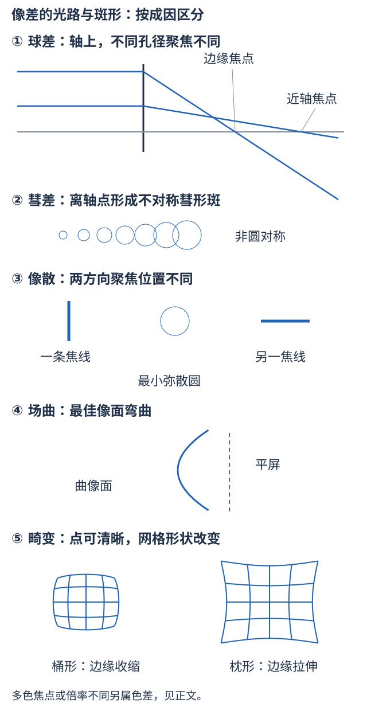

# 九、像差、校正条件与概念辨析

来源：像差PPT全15页；教材§4.9；正弦条件见仪器课件提及及本手册I04。下列“阶次”与消色差代数用于理解变式，是推导补充，不冒充课件给定的数值设计题。

## A08 理想像的三个要求与五种单色像差

课件理想成像条件：单心束出射后仍单心（点到点）；垂轴物面仍成垂轴像面；同一像面横向倍率为常数。放松这些要求会产生不同问题。色差另由$n(\lambda)$引起；只用单色光可消除色差来源，但不能自动消除几何像差。

图的光路与斑形是辨识示意，不表示任意透镜都具有相同正负或固定焦线先后。先分轴上/离轴、孔径/视场、单色/多色，再判断现象。

| 类型 | 破坏了什么、怎样看图 | 用什么量描述与怎样修正 |
| --- | --- | --- |
| 球差 | 轴上宽束的边缘与近轴线不在同一点聚焦；屏前后移动都不能使全束严格成点 | 纵向球差是不同孔径线轴交点差，横向球差是选定像面上的弥散半径；收光阑、适当配曲、组合或真正设计的非球面可改善 |
| 彗差 | 离轴点的不同孔径区域产生不同横向位置，斑像彗星尾，常不对称 | 由孔径与小视场共同引起；调光阑位置、组合作用、满足相应正弦条件可校正，不因轴上球差消除就自动消失 |
| 像散 | 离轴细束的子午和弧矢方向聚焦位置不同，沿轴先后见不同方向焦线，中间为最小弥散圆 | 量两焦线轴向间隔及其焦面；按中心光线与光轴定义子午面，不按屏上固定水平/竖直死记 |
| 像场弯曲 | 不同视场点的最佳像位置连成曲面，平屏中心与边缘不能同时对焦 | 场曲可在像散已校正时仍存在；平场设计或合适接收面，单纯整体移平屏不能同时解决 |
| 畸变 | 各点本身可清晰，但倍率随离轴高度变化，方格被拉弯 | 边缘$|\beta|$增大呈枕形，减小呈桶形；比较倍率大小，不以倒立的负号判断；对称设计在相应对称共轭条件下可抵消奇视场项 |

球差主要随孔径增大变严重，畸变主要看视场；不能把所有边缘问题都称球差。课件“慧差”规范名为“彗差”。“最小清晰圆”仍是有大小的弥散斑，不是所有方向都已成理想点像。

**近轴之后的阶次怎样理解。** 旋转对称系统的横向像差可按孔径高度$h$与视场高度$y$展开，典型项有球差$\propto h^3$、彗差$\propto yh^2$、像散/场曲$\propto y^2h$、畸变$\propto y^3$；系数依设计而异。它解释为什么收孔径对球差特别有效、对畸变通常不能靠同样方式解决；不是给一个系数缺失的多项式就能算任意镜头实际像差。

**校正条件别删掉。** 正负透镜组合可相互补偿某些像差，但不保证所有像差同时归零。平凸镜常在平行光一侧朝凸面可减小球差，“凸面永远朝物”或“曲率比1:6对任何物距最优”都不成立；最佳配曲依折射率与共轭位置。菲涅耳透镜只是分区减厚的结构形式，不自动等于无球差的非球面设计。对称镜头中置光阑也须匹配设计与共轭条件，不能由外形对称断言任何物距无畸变。

<!-- QUESTIONS -->
配套原题与讲授问答：[A01 理想成像的三个要求各管什么](../题库/光学PPT与作业题解.html#A01)；[A02 球差与彗差怎样区分，缩光阑能做什么](../题库/光学PPT与作业题解.html#A02)；[A03 像散的两条焦线与最小模糊圆](../题库/光学PPT与作业题解.html#A03)；[A04 场曲与像散、离焦有什么不同](../题库/光学PPT与作业题解.html#A04)；[A05 畸变会让点像一定模糊吗](../题库/光学PPT与作业题解.html#A05)。
<!-- /QUESTIONS -->

## A09 纵向、横向色差与消色差双合镜

正常色散时单片正镜短波光焦度通常更大、焦距更短；不同颜色轴上交点不同叫纵向色差，不同颜色倍率不同叫横向色差。两者有联系而不是同一句话；离轴彩边不能只靠移焦解决。纯反射几何系统不因材料折射率变化产生通常的折射色差，但仍有单色像差、衍射与可能的镀膜频谱效应。

**薄双合镜推导。** 空气中两片贴合，定义形状因子$K_j=1/r_{j1}-1/r_{j2}$，则$\Phi_j(\lambda)=[n_j(\lambda)-1]K_j$，总$\Phi=\Phi_1+\Phi_2$。要使选定蓝、红两波长具有相同总光焦度，要求

$$K_1[n_{1B}-n_{1R}]+K_2[n_{2B}-n_{2R}]=0.$$

选参考波长$\lambda_c$，定义色散系数$V_j=(n_{jc}-1)/(n_{jB}-n_{jR})$（相应规定谱线下就是常用阿贝数），则

$$
\begin{gathered}
\boxed{\frac{\Phi_{1c}}{V_1}+\frac{\Phi_{2c}}{V_2}=0} \\
\Phi_{1c}+\Phi_{2c}=\Phi_c.
\end{gathered}
$$

解得$\Phi_{1c}=\Phi_cV_1/(V_1-V_2)$、$\Phi_{2c}=-\Phi_cV_2/(V_1-V_2)$。要有非零总焦度并同时抵消这两色差，材料色散通常需不同；同材料任意凹凸两片贴合不自动消色差。

**带练。** 设计$F=10$ cm的正组合，$\Phi_c=10\ \mathrm{m^{-1}}$，取$V_1=60,V_2=30$。则$\Phi_1=20,\Phi_2=-10\ \mathrm{m^{-1}}$，单片焦距分别+5、-10 cm；$20/60-10/30=0$。只保证指定两波长的一阶焦度匹配，不能保证全谱任意像高全部无色差，更不能保证球差彗差等同时消失。

<!-- QUESTIONS -->
配套原题与讲授问答：[A06 纵向色差与横向色差怎样识别](../题库/光学PPT与作业题解.html#A06)。
<!-- /QUESTIONS -->

## A10 概念辨析题：先补全条件，再判断

| 陈述 | 判断与必须说明的理由 |
| --- | --- |
| 光总走最短距离 | 错；费马比较光程、固定端点与邻近允许路径，要求驻值 |
| 不考物理学史，所以人名定理不考 | 不成立；名字不是内容类别，费马、拉格朗日等是物理原理 |
| 独立传播说明光强直接相加 | 错；先矢量叠场，交叉项平均为零才可加光强 |
| 同频两光一定能观察到干涉 | 错；还要相位关联及适当偏振和探测条件 |
| 反相两光一定完全暗 | 错；要求合适偏振、强度相等；否则极小非零 |
| 全反射所以界面外没有电磁场 | 错；有倏逝场，理想半无限无损情形无平均法向传播能流 |
| 最小偏向即最小入射角 | 错；分别由对称透射与出射临界条件确定 |
| 正常色散就是正群延迟色散 | 不能等同；分别是$n(\lambda)$斜率与谱相位的二阶导数 |
| 平面折射总成等大像 | 仅近法线小物的近轴结论；斜束有像散等问题 |
| 缩孔径就一定满足所有近轴条件 | 错；大物高、远轴视场仍可能不满足一级成像 |
| 凹透镜必发散，负镜不能成实像 | 都不成立；相对折射率决定焦度，虚物会聚束可经负镜成实像 |
| 过系统主点的光一定不偏折 | 两侧同介质的相应近轴等效条件才与节点重合；一般要用节点 |
| 厚透镜像距从后表面算 | 高斯式从$H'$算；还需加$p'$还原后顶点距 |
| 惠更斯负目镜的总焦距为负 | 错；本课组合总焦距正，物方焦点在内部 |
| 放大镜倍率就是虚像高/物高 | 一般错；助视倍率比较视角，两者只在特定近点条件下相等 |
| 无穷远显微像和近点显微像用同一倍率 | 错；调节条件及中间像位置不同 |
| 像差都消除就可无限分辨 | 错；有限孔径仍有衍射，光谱、探测与样品条件也限制 |
| 畸变必然模糊，场曲必然像散 | 错；畸变可点像清晰，场曲与像散可以分别存在 |
| 光阑开小总能使像更清晰更亮 | 错；光量下降、衍射增强，与几何像差存在权衡 |
| 无源透镜聚光增加照度就是增加亮度 | 错；二者定义不同，理想传输保持折合亮度 |

这些是依据材料整理的辨析变式，**并非已知的往年那道题**。目前只有“往年某道概念辨析错得多”的通知，没有题干，不能据此押定某一条。
