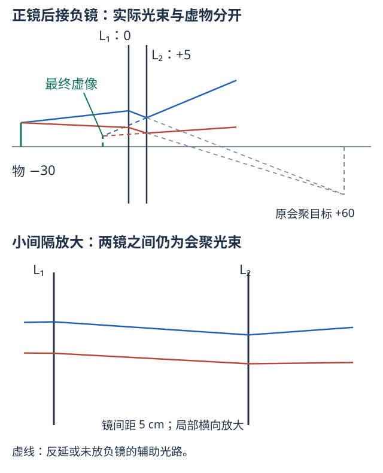

# 十、综合题怎样调用公式

以下均为本手册的补充变式，答案包含在题后。教师与教材的原题原图见独立题册，不以这些变式替代原题。

## Q01 棱镜加透镜：把角分离转成位置分离

**题意与目标。** 空气中60°棱镜，中心波长折射率1.5，中心光取最小偏向；邻近谱线相差10 nm，局部$\mathrm dn/\mathrm d\lambda_0=-4.0\times10^{-5}\ \mathrm{nm^{-1}}$。出射束进入焦距20 cm的正薄透镜，光轴沿中心波长出射方向。求后焦面谱线间距。

**条件转量与选法。** 棱镜先把波长差转角差（P05），透镜将斜平行束送到不同后焦面点（L03）；不是让两种颜色分别当作普通有限物距。

$$D_\delta=\frac{1}{\sqrt{1-1.5^2/4}}\frac{\mathrm dn}{\mathrm d\lambda_0}\approx-6.0474\times10^{-5}\ \mathrm{rad/nm},$$
$$
\begin{gathered}
\Delta\theta\approx D_\delta\Delta\lambda_0=-6.0474\times10^{-4}\ \mathrm{rad} \\
\Delta y\approx F\Delta\theta=-0.12095\ \mathrm{mm}.
\end{gathered}
$$

间距取大小约0.121 mm；负号表示长波偏向一侧。$F=200$ mm才与结果mm一致。中心处可用对称点的一阶导数，宽带大跨度则需对每种$n(\lambda_0)$逐面折射，不沿用局部线性结果。

<!-- QUESTIONS -->
配套原题与讲授问答：[P07 角色散的意义、推导及顶角影响](../题库/光学PPT与作业题解.html#P07)。
<!-- /QUESTIONS -->

## Q02 一片正镜、一片负镜：中间像在第二镜后

**题意与目标。** 空气中第一镜$F_1=+20$ cm，第二镜$F_2=-10$ cm，间距5 cm。轴上小横向物在第一镜左30 cm，求最终像位和总横向倍率。

图按一个水平坐标尺度画。第一镜输出本要在$x=60$ cm会聚，但先遇到$x=5$ cm的负镜，故60 cm处只是第二镜的虚物位置。蓝实线经负镜后发散，向左反延得最终虚像；灰虚线是没放第二镜时的原会聚目标，不是实际通过第二镜后的光。

**逐次法。** 第一镜$s_1=-30$，$1/s_1'=1/20-1/30$，故$s_1'=60$ cm，$\beta_1=-2$。第二镜$s_2=60-5=+55$ cm，是虚物；$1/s_2'=1/55-1/10=-9/110$，故$s_2'=-110/9$ cm。最终全局$X'=5-110/9=-65/9\approx-7.2222$ cm，$\beta_2=(-110/9)/55=-2/9$，总$\beta=4/9$，正立缩小虚像。

**组合检验。** 总$F=20(-10)/(20-10-5)=-40$ cm，$p=20,p'=10$ cm，故$H=20,H'=15$。相对主点物距$s=-50$，像距$s'=Fs/(s+F)=-200/9$ cm；全局$15-200/9=-65/9$，$\beta=s'/s=4/9$，与逐次法相同。反直觉的主点落在镜外是允许的，不应把它们强行挪回镜间。

<!-- QUESTIONS -->
配套原题与讲授问答：[B23 3.23* 直角棱镜加两片透镜](../题库/光学PPT与作业题解.html#B23)。
<!-- /QUESTIONS -->

## Q03 长度沿轴时，不能拿横向倍率直接乘

**题意与目标。** 正薄镜$F=10$ cm，沿轴短线段两端在$s_a=-21,s_b=-20$ cm，求像段长度。

**条件转量与选法。** 物段沿轴，不是物高。分别求两端：$s_a'=210/11\approx19.0909$ cm，$s_b'=20$ cm，所以像段长$10/11\approx0.9091$ cm。像位顺序不翻转，虽然各端小横向物的$\beta$均为负。

若只要求很短物段近似，可在中点$s=-20.5$ cm取$\beta=10/(-10.5)=-20/21$，纵向倍率$\beta_\parallel=\beta^2=400/441$，预测约0.9070 cm。两端精确法与局部微分法的差异来自有限1 cm物长；不能用$|\beta|\approx0.9524$直接当轴向长度倍率。教材3.23的纵向物也按此原则逐端追迹。

<!-- QUESTIONS -->
配套原题与讲授问答：[B23 3.23* 直角棱镜加两片透镜](../题库/光学PPT与作业题解.html#B23)。
<!-- /QUESTIONS -->

## Q04 清晰度判断：缩光阑与放大目镜各会改变什么

**题意与目标。** 相同光谱和倍率下，把显微镜有效NA从0.8收至0.4，或仅将目镜倍率加倍，比较光量与分辨。

**方法。** 先分开物镜采集、成像面积与观察角。理想轴上均匀朗伯物、固定$\beta$、无额外损耗时$E_v'\propto\mathrm{NA}^2$，NA减半，像面照度变为1/4；瑞利尺度$d\propto1/\mathrm{NA}$变为2倍，衍射分辨变差。几何球差等可能改善，净清晰度需看原系统的限制，不能只据一个公式断言更清晰。

仅提高目镜倍率会使已有细节看起来更大，也可能便于眼辨认，但不会恢复物镜未传递的空间细节；对固定物镜的衍射尺度不变。若题目问“为什么NA提高而不是一味加倍率”，先说物镜采集角锥与空间频率，再说眼的视角阈值。

<!-- QUESTIONS -->
配套原题与讲授问答：[I08 数值孔径、油浸和分辨率（推导整理）](../题库/光学PPT与作业题解.html#I08)；[A02 球差与彗差怎样区分，缩光阑能做什么](../题库/光学PPT与作业题解.html#A02)。
<!-- /QUESTIONS -->

## Q05 交卷前的五类检查

1. **模型条件**：近轴、薄镜、同外介质、无损、相干、非掠射、无穷远/近点，实际满足哪几项？
2. **原点与方向**：顶点还是主点，前焦点还是镜片，局部法线还是光轴；反射是否已折回？
3. **单位与量纲**：波长nm先转所需单位；导数角度rad；光焦度用$m^{-1}$时距离用m；强度穿透深度是否比振幅深度小一半？
4. **结果性质**：像在何侧、实虚、正倒、倍率大小；棱镜是否满足透射域，输出究竟发散还是会聚？
5. **独立检验**：原式回代；换高斯/牛顿或逐次/主面互证；$d\to0,n_g\to n_0,i\to0$等极限是否合理？条件不足时保留参数，不替题目偷偷补数值。

考试复习以原题全量独立作答检验调用能力。能看懂本手册不等于已经能不看答案完成题目；不会选法时先定位表中题干信号，不用从头翻整本资料。

## Q06 固定物与屏：为什么有零个、一个或两个清晰镜位

物、屏在同一轴上，相距$L>0$，空气正薄透镜置于二者之间。设物到镜的正距离$u=-s$，镜到屏$v=s'$，则$u+v=L$。系统结构固定，镜位置原有一个自由参数；“屏上清晰”再给成像约束：

$$
\begin{gathered}
\frac1u+\frac1v=\frac1F,\qquad uv=FL \\
u(L-u)=FL \\
u=\frac{L\pm\sqrt{L^2-4FL}}2.
\end{gathered}
$$

必须同时$0<u<L$、$F>0$。$L>4F$有两个镜位，交换$u,v$；$L=4F$两位置合并在中点；$L<4F$无实镜位。**二次方程两根不是两个像同时落在同一屏上，而是移动镜片后分别成像。**

两镜位相距$a=|u_2-u_1|=\sqrt{L^2-4FL}$，故位移法反求

$$F=\frac{L^2-a^2}{4L}.$$

**带练。** $L=90,a=30$ cm给$F=20$ cm；两物距30、60 cm，倍率分别$-2,-1/2$，两次倍率乘积为1。若给$L=60,F=20$ cm，根号为负，正确结论是不能靠移动这片正镜使该固定屏清晰，不是选一个“最接近”的位置。

厚系统的主面间隔$a_H=X_{H'}-X_H$固定时，全局物屏距为$L=a_H+s'-s$，因此高斯式内使用的有效距离是$L-a_H$，还要检查镜片实际能否放在物屏之间。不要把薄镜位移法未经换算直接用于厚镜表面距离。

配套原题：[3.28* 位移法](../题库/光学PPT与作业题解.html#B28)；对应练习[E13](#E13)。

## Q07 倍率、移动与反演：先消像距，再求结构

空气薄镜用$\beta=s'/s$消去$s'$：

$$
\begin{gathered}
s=F\left(\frac1\beta-1\right),\qquad s'=F(1-\beta) \\
s_2-s_1=F\left(\frac1{\beta_2}-\frac1{\beta_1}\right).
\end{gathered}
$$

若镜片不动、实物向镜移动$a>0$，就有$s_2-s_1=a$，由两次倍率直接反求$F$。必须给倍率的正负；“都成实像”能帮助确定正镜实物分支的负号。

**缺条件示范。** 一片正镜已知$F=10$ cm，只说像倒立，无法定物距，因为所有$s<-10$ cm都满足。即使给“放大”，仍有$-20<s<-10$ cm这一整段。只有确定$\beta=-2$等数值关系后，才得到$s=-15,s'=30$ cm。

**结构反演也可能不唯一。** 对一个已知光轴的同介质薄镜，给一对离轴共轭点可作出光心（D06）；但只给一对轴上物像位置，没有镜片位置，则存在不同的镜位和焦距组合。厚系统若主面未知，单凭一对物像点更不足以恢复整个结构。题目里的“光轴已知”“主面已给”都是有效条件，不是装饰。

配套原题：[薄镜两次移动](../题库/光学PPT与作业题解.html#L04)；对应练习[E12](#E12)、[E27](#E27)。

## Q08 多面系统：用全局坐标传递，不用“上一像距直接照抄”

每一步在纸上保留四栏：**当前面位置与传播方向｜当前物坐标｜当前像坐标｜下一步物距**。同向透射时

$$
\begin{gathered}
s_j=X_{j-1}'-x_j \\
X_j'=x_j+s_j' \\
s_{j+1}=s_j'-(x_{j+1}-x_j).
\end{gathered}
$$

前一步预测的像尚未形成便遇到下一面时，下一面的入射束正在会聚，该目标就是虚物；不需要在那里真的放一个物体。是否虚物先看光束，再确认$s_{j+1}$符号。

玻璃棒例：$s_1'=16$ cm、两顶点相隔12 cm，第二面物距$+4$ cm。第二面$n=1.6,n'=1,r=-2$ cm，$s_2'=10/7$ cm，$\beta_2=4/7$。这个$4/7$只比较第二次像和中间像；总倍率还乘第一次的$-2$，得到$-8/7$。

反射时全局轴不必改，但实际传播方向改变；若用镜像展开，就必须把曲面位置、曲率和最后像一起折回。光程求和中实际几何长度为正；成像公式里的$s,r$是有向坐标，两者不能混。遇$s_j'=\infty$，换成平行束继续，不做$\infty-d$后的倍率数值乘法。

配套图见[T01](#T01)、[T06](#T06)；对应练习[E16](#E16)、[E17](#E17)、[E28](#E28)。

## Q09 角度与波长的路径：棱镜、焦面与干涉不是一套原点

棱镜内部：先用两面局部法线把$i$送到$r_1,r_2,e$，再算偏向$\delta$。外介质改变要先换$m=n/n_0$；最小偏向时再加入对称条件。**入射角是可以调的参数，偏向角是结果；最小化的是结果，不是把入射角设为最小。**

分光加聚焦的路径：$\lambda_0\to n(\lambda_0)\to\delta(\lambda_0)\to y(\lambda_0)$。若透镜光轴沿中心光，后焦面上$y\approx F\Delta\delta$；若光轴不沿中心光，用$y=F\tan\theta$并声明近轴近似。导数中的角度必须是rad。

干涉的路径：$\lambda_0,n_j,\ell_j\to L_{\rm opt}\to\Delta\varphi\to I$。不要把光程差再乘一次折射率；真空波长配光程，介质波长配同介质几何路差。反射附加相位和初相位若存在要另外保留。把$n\ell$叫“光走过的实际距离”，会在这里重复计算$n$。

光纤与显微镜都出现NA，但约束不同：光纤先由端面折射和侧壁全反射确定接收锥；显微镜NA由物方介质与物镜接收半角确定。两者不能仅因字母相同便把$n_c^2-n_s^2$搬到显微镜题里。

配套练习[E02](#E02)、[E05](#E05)、[E07](#E07)、[E08](#E08)、[E23](#E23)。

## Q10 解不出来时：分清缺条件、无解、退化和模型失配

| 症状 | 应怎样诊断 | 不能怎样补救 |
| --- | --- | --- |
| 只给一个焦距，却问唯一物像位置 | 尚有一个自由参数，给参数解或说明缺条件 | 自行添加“物在二倍焦距” |
| 物屏问题根号为负 | 所选实像/镜位条件无解 | 取绝对值开方 |
| 棱镜$|m\sin r_2|>1$ | 第二面不能按普通传播折射出射 | 把反正弦截成90° |
| 透镜$s=-F$，像距分母为零 | 输出平行，改用角度或会聚度 | 说没有光/没有任何成像意义 |
| 组合$\Phi=0$ | 无焦系统，不能用有限主点位置公式除以零 | 把主点任意设在镜中心 |
| 轴上物高$y=0$导致$y'/y$形式不定 | 用相邻小物的极限或光线传递定义倍率 | 宣布倍率一定为零 |
| 大视场或大孔径，各光线交点不同 | 检查像差或精确追迹，一级公式不再给全束精确点像 | 增加小数位冒充更准确 |
| 一道题有多个符号分支 | 分别检查实物、实像、器件位置和透射条件 | 先把所有量改为绝对值 |

“条件有几条”与“答案有几个”不是同一问题。合适的最后一句应是结果的物理解释，例如“负镜削弱了原本会聚的入射束，所以最后仍成实像”，而不是只写一个带单位的数。
