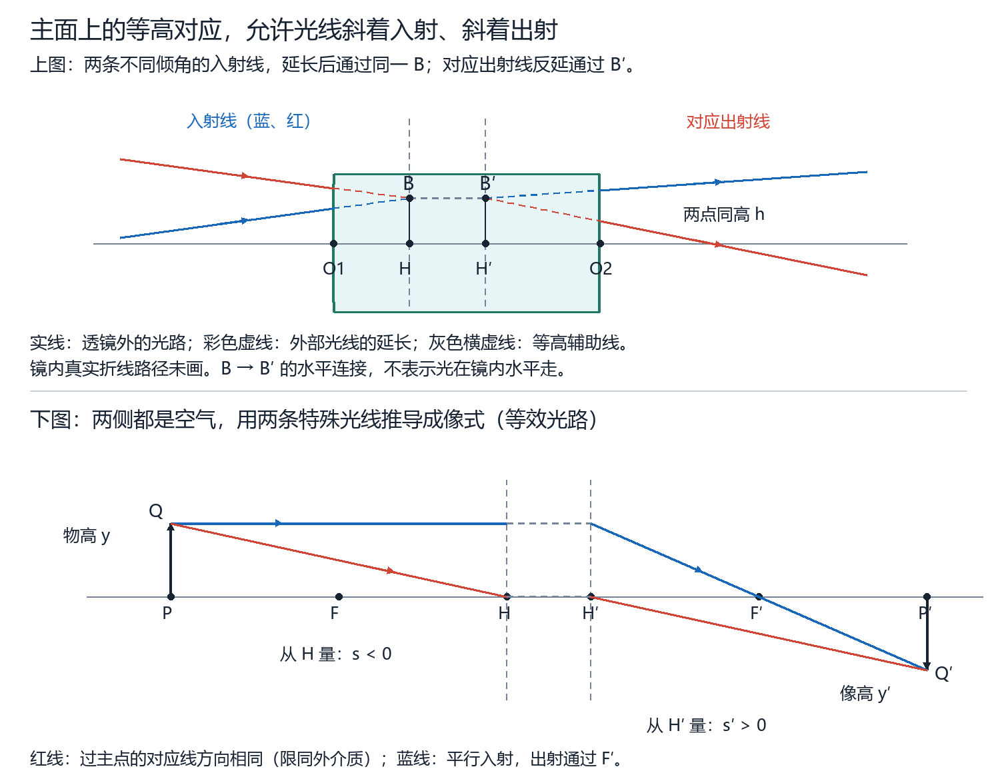
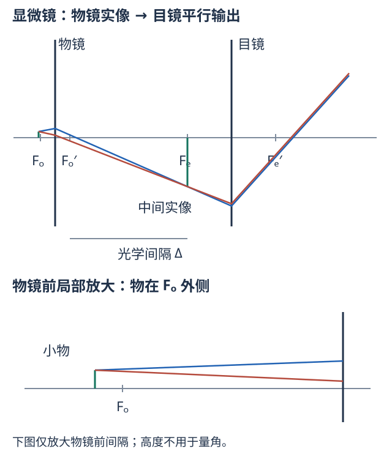
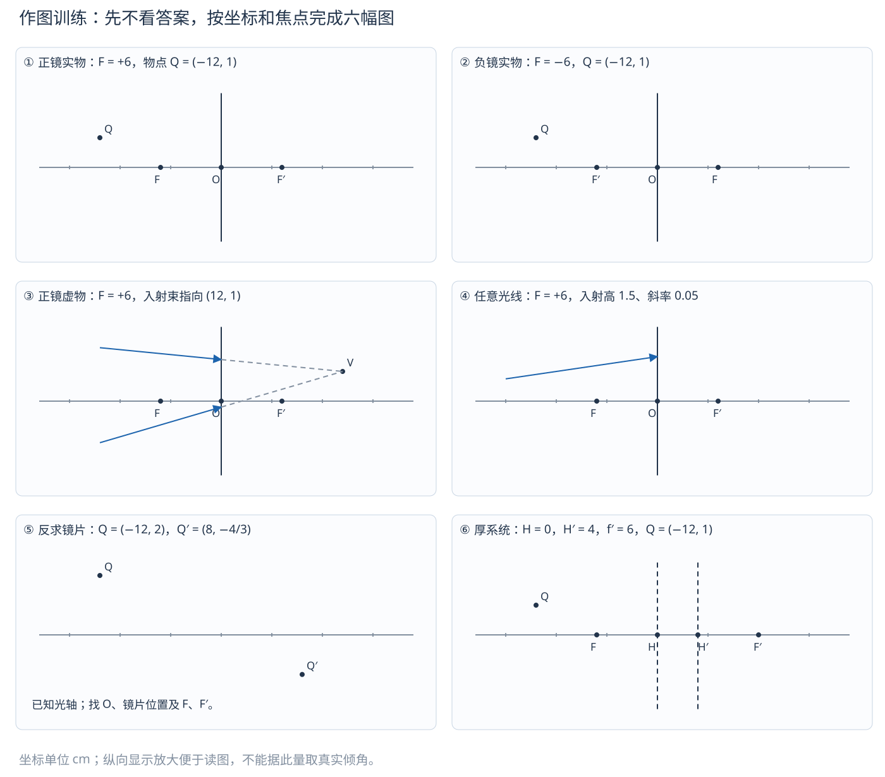
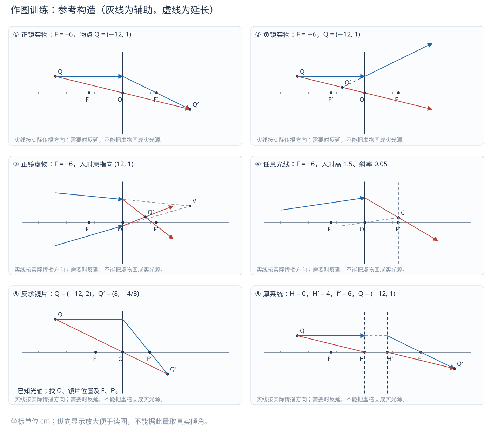

# 十一、作图：用几何约束找到唯一的出射方向

来源：3-4第22—32页、3-5成像光路、3-6第10—16页、3-7第19—27页、3-9全6页、4-1第37及71—72页；教材3.6、3.18、3.19、3.25、3.26、3.29。D10集中保留原题原图，D11为本册另编六幅图，不能代替原题。

## D01 为什么一条光线不够，两条才够，第三条用来检查

在一个确定的出射平面，光线的高度若已给，仍有一个方向自由度。光学系统的性质再给一个约束，才能定出射方向。反过来找像点时，一条出射线只把像限制在一条直线上；第二条独立出射线才确定交点。任意两条线虽能相交，但不保证其余光线也交在那里；第三条用于检验同一模型的一致性。

**固定作图顺序。** 先画光轴、器件、实际传播箭头；再标$O$或$H,H'$、$F,F'$以及给定物像点；选两条独立特殊线；实际传播用实线、反延或预期目标用虚线；最后写像的实虚、正倒和位置。辅助线有自己的作用，要与真实光路区分。

会聚透镜的光心线与从同一物点出发的平行轴线通常独立；重复画同一条线的延长不算第二条约束。物点恰在轴上时，两条“过光心线”可能都退成光轴；应改取有非零入射高度的平行线或焦点线，或者先对小横向物作图。

## D02 空气薄透镜：三条特殊线及正负镜的分支

| 可选入射线 | 出射规律 | 负镜尤其注意 |
| --- | --- | --- |
| 平行光轴 | 出射线或反延线通过像方焦点$F'$ | $F'$在入射侧，用出射线反延经过它 |
| 通过或指向物方焦点$F$ | 出射平行轴 | $F$可在镜后，“指向”是入射束的目标，不是光先到镜后再回来 |
| 通过光心$O$ | 同外介质近轴方向不变 | 不因负镜就把这一线反转 |

找正镜焦内物的虚像时，仍先画实际出射线向右走，再向左反延。图上虚像常画在左，但它不是一个使光向右重新出发的真实物体。虚物正好相反：实线入射正在会聚，镜后虚线表示不放器件时原本会聚的目标。

## D03 任意一条入射光线：两种辅助焦面构造

**像方焦面法。** 已知光线在镜片交点$B$及其入射方向。过光心作与入射线平行的辅助线，交像方焦平面于$C$。同方向的平行束在$C$成像，因此所求出射线通过$B,C$；$C$为虚焦面点时，按传播方向画出射线，反延才指向$C$。

**物方焦面法。** 把入射直线延长到前焦平面，交点为$A_0$。从$A_0$指向光心的辅助线不改方向；同一个焦面点发出的各线出射互相平行。因此从$B$作平行于$A_0O$的出射线。

两种构造是同一成像约束的两种用法，不是说原光线必须实际经过光心。负镜、反向倾角也用同一程序。外介质不同或厚系统不能直接用薄镜“光心不偏折”，改看D05节点或主面传递。

## D04 球面折射与球面反射：把法线和折返补进图

球面折射可选平行轴、物方焦点、球心法线三条线。过球心的直线在球面处沿法线入射，无折向；它不是一般厚系统的光心线。空气到玻璃与玻璃到空气，曲率外形相同也可能有相反光焦度，先用$n'-n$和$r$判断焦点。

凹面镜平行轴线反射过焦点；过焦点线反射平行轴；过球心线沿原路返回。凸面镜的焦点和球心在镜后，通常是反延线经过它们。实线到镜面必须折返，不能把镜面题画成光向右穿透器件。

平面折射一般不严格保持单心。近法线细束可用表观深度作近似虚像；斜束要区分子午和弧矢方向。两条纸面内反延线的交点不是对整个三维光束的自动证明。球心物点在球面镜上严格原路返回，是“球面宽束一般有球差”的重要例外。

## D05 厚透镜和一般光具组：两张主面不能压成一张

入射外部直线延长到$H$所在平面交于高度$h$，对应出射外部直线延长到$H'$所在平面也在高度$h$。等高连线只是辅助，不是光在镜内水平传播。主面不是球面与镜片水平边的接点，不从透镜外形猜位置。

三条作图线：平行轴入射→在$H$取高→转到$H'$同高→出射经$F'$；过/指向$F$入射→转移→出射平行轴；指向节点$K$→从$K'$同方向出射。两侧同介质才有$K=H,K'=H'$，这时“过主点对应线方向相同”可用。

若给任意入射线，先取它在$H$的交高，再用一条与它同方向的辅助线在后焦平面找到目标焦面点，最后从$H'$同高点连接目标；辅助线过节点时方向不变。不同外介质须保留节点与主点的区别，不把薄镜光心法直接照搬。

## D06 给物像点反求镜片位置：哪些条件使作图唯一

已知同介质薄镜的**光轴和一对离轴共轭点**$Q,Q'$，连接$QQ'$与光轴交于$O$，即可定位光心，过$O$作垂直光轴的镜片面。原因是通过光心的共轭光线不改方向。

再从$Q$作平行轴的入射线，交镜片于$A$；出射线$AQ'$与光轴的交点就是$F'$（虚像时用适当反延）。由同外介质$f=-f'$在轴另一侧得到$F$。或交换物像反向作图求$F$，两种结果应一致。

**不可唯一的情况。** 若给的是轴上物像点，两点连线与整个光轴重合，不能定唯一$O$；若$QQ'$与光轴平行且不交，也须检查退化或给法是否不足。厚系统的两主面不能由这一薄镜构造独自恢复。原题若已给主面，应直接利用它们，不再乱找一个光心。

## D07 给一条完整折射路径，再求另一条：把已知路径变成系统条件

先辨认题给的线是**同一条光线的入射与出射部分**，还是一对物像点的连线。两侧空气薄镜中：交点确定折射发生的镜片面位置；过光心作平行于已知入射段的辅助线，落到后焦面，已知出射段必须经过该焦面点。这样可先定焦点/焦面，再处理新入射线。

对已给两主面的系统，已知入射线在前主面的交高与出射线在后主面的交高必须相等，且出射方向还受焦点约束。不要连接“入射段与出射段任意交点”就宣布那里是厚镜光心。

若图只给一条入射线而没有任何出射信息、焦点、物像或系统参数，出射方向仍有自由度，不能唯一作答。作图也是解约束，不是所有几何题都能凭一条线猜完。

## D08 仪器作图：先定位中间像，再决定最后观察条件

显微镜：物在物镜前焦点外很近→物镜成倒立放大实像→把这个实像作为目镜的物。放松眼时中间像落在目镜前焦面，出射平行；近点观察时中间像稍在目镜焦内，出射发散，反延到眼前近点。不要把“最终虚像”误画成物镜的中间虚像。

开普勒：两正镜，公共实焦面在两镜之间，先有中间实像再经目镜输出平行，最终倒像。伽利略：负目镜在物镜预期焦点前截获会聚束，公共焦点是虚物目标，镜间没有实际中间实像，最终正像。两者均先检查带符号无焦间距$L=F_o+F_e$。

扩束：画准直束两条边缘线，从短焦端输入，经过第二镜后仍平行，量的是束宽而非物高。不能把观察望远镜的放大本领直接当作相同传播方向的束宽倍率。

## D09 原题作图训练路线与验收标准

按以下次序做；每道先遮住解析，在纸上画完再对照。B开头为教材原题编号，其他编号来自题册，不是本手册同名公式节号。

| 先练什么 | 原题入口 | 做完必须能检查 |
| --- | --- | --- |
| 单球面三条线 | [G08](../题库/光学PPT与作业题解.html#G08) | 法线经过球心，焦点两侧折射率是否正确 |
| 镜面实像与虚像 | [B06](../题库/光学PPT与作业题解.html#B06)、[B07](../题库/光学PPT与作业题解.html#B07) | 实线在镜面折返，虚线只作反延 |
| 任意入射线 | [L02](../题库/光学PPT与作业题解.html#L02)、[B25](../题库/光学PPT与作业题解.html#B25) | 是构造平行辅助线，还是错误地挪动原光线 |
| 斜平行与焦面点 | [B18](../题库/光学PPT与作业题解.html#B18) | 斜平行像在离轴焦面；负镜左焦面实源不是平行输出 |
| 由物像反求透镜 | [B19](../题库/光学PPT与作业题解.html#B19) | 光轴给定；找$O$后再找$F,F'$ |
| 厚系统的新物点 | [B26](../题库/光学PPT与作业题解.html#B26)、[B29](../题库/光学PPT与作业题解.html#B29) | 两主面、等高转移与实虚分支 |
| 不同介质与节点 | [T06](../题库/光学PPT与作业题解.html#T06) | 过主点不自动不偏折 |
| 显微镜两次成像 | [I04](../题库/光学PPT与作业题解.html#I04) | 中间实像、最后近点/无穷远分开 |
| 望远镜与扩束 | [I07](../题库/光学PPT与作业题解.html#I07) | 开普勒/伽利略公共焦点与镜间距带符号 |

自检不是“画得像答案”。须说清每条线为何有这个方向；两线交点与成像式数值吻合；实虚线不替代传播方向；所有标注从相应原点量，不能凭示意图比例制造原题未给的厘米数。

## D10 作图原题原图集中练习

下面保留原题区，解析折叠在各题之后。原图若有原件错误，保留原样并在解析中说明；不会默改原题。定性讲授页与补充整理题按原题册的来源性质标识，不把它们算作新增指定作业。

<!-- DRAW-ORIGINALS -->

### 作图原题 01 · P02 棱镜偏向角怎样随入射角变化

来源：棱镜第12—16页的几何与曲线提问。

**课件原题／原文与题图**

展开原题的分析、构造与答案

蓝实线按$P\to Q$传播，棕虚线为两面法线。$i,r_1$从第一面法线量，$r_2,e$从第二面法线量；课件的$i_1,i_2,i_2',i_1'$依次对应这四角。$A$为顶角，下方$\delta$比较入/出射方向。

取$m=n/n_0>1$。先用第一面折射得$r_1=\arcsin(\sin i/m)$；再由两面法线的几何关系得$r_2=A-r_1$；检查第二面后才算$e=\arcsin(m\sin r_2)$。两个面的方向改变相加：

$$\delta=(i-r_1)+(e-r_2)=i+e-A.$$

所以$i$改变会同时改变两次折射，不能将$e$当常数。普通可透射光路中的曲线先降后升，最小处$i=e,r_1=r_2=A/2$。在该内部角非负的分支，令$g(r)=\arcsin(m\sin r)$，则$\delta=g(r_1)+g(A-r_1)-A$，且

$$g''(r)=\frac{m(m^2-1)\sin r}{(1-m^2\sin^2r)^{3/2}}>0.$$

对称点是极小值。光路可逆性只说明交换$i,e$得到同一偏向，单靠可逆性不能证明极小。取$A=60^\circ,m=1.5$检查：最小处$i=e=48.59^\circ$，$\delta_{\min}=37.18^\circ$。非对称的$i=30^\circ$给$r_1=19.47^\circ,r_2=40.53^\circ,e=77.10^\circ,\delta=47.10^\circ$，确实更大。

[原题册定位](../题库/光学PPT与作业题解.html#P02)

### 作图原题 02 · P05 编程画偏向曲线，怎样处理不能出射的区间

来源：棱镜第21、32页练习与作业。

**课件原题／原文与题图**

degrees：度；图中横轴为入射角、纵轴为偏向角。

degrees：度；Deviation angles for prisms with apex angle 30~60 degrees：顶角30°至60°的棱镜的偏向角；The step of apex angle is 2.5 degrees：顶角步长为2.5°。

展开原题的分析、构造与答案

题意分析：画$\delta(i)$；第21页含$A=3^\circ,8^\circ,10^\circ,12^\circ$，第32页含$30^\circ$至$60^\circ$、步长$2.5^\circ$的曲线族，考虑第二面全反射。

**算法：** 固定$n/n_0$，扫描$i$，执行P02四步。若$|m\sin r_2|>1$，反正弦无实数解，该点留空；等于1只标为临界边界。采用带符号的折射角时$r_2$允许为负，不能把所有负角都误删。第32页通常正内部角分支的下界，在$A>r_c=\arcsin(1/m)$时为

$$i_{\mathrm{lim}}=\arcsin[m\sin(A-r_c)].$$

若$A\le r_c$，从$i=0$就可能出射；若$A>2r_c$，无普通非掠射的两面透射光路。取$m=1.5$，$A=60^\circ$应得到$i_{\mathrm{lim}}=27.92^\circ$，最低点为P02数值，这是程序验算点。

本题没有给每条曲线的独立材料数据，配图按同一普通玻璃$m=1.5$复现；换材料应改输入。[可运行的完整程序](../题库/棱镜曲线.py)用标准Python直接生成[曲线图](../题库/assets/棱镜曲线.svg)及CSV，正文图为程序实际输出。程序角度接口用度，内部三角计算转成弧度。

横轴入射角、纵轴偏向角；左图比较薄棱镜精确值与近似水平线，右图为大顶角曲线族，空白区对应不能从第二面透出。各最低点随顶角增大而升高，不是每条曲线都能从零入射画起。

[原题册定位](../题库/光学PPT与作业题解.html#P05)

### 作图原题 03 · P08 三面角反射器证明与用途

来源：棱镜第49—52页；第52页指定赵凯华教材第一章第3题。

**课件原题／原文与题图**

展开原题的分析、构造与答案

题意分析：由立方体切角制成的棱镜，光经三面反射后为何反向？用于何处？

Corner prism意为角锥棱镜。三反射面两两垂直；光实际依次打到三个面，出射线通常与原线平行但错开。

设三面法线分别沿$x,y,z$，入射方向$\mathbf v=(v_x,v_y,v_z)$。反射只翻转法向分量：

$$(v_x,v_y,v_z)\to(-v_x,v_y,v_z)\to(-v_x,-v_y,v_z)\to(-v_x,-v_y,-v_z)=-\mathbf v.$$

任意反射次序结果相同，前提是三面各反射一次。入出斜面时若同一均匀外界、同一平面界面，结合折射可逆性，外部入出方向同样相反。用途为测距回归目标、自行车回归反射标志等。两块垂直镜只翻转两个分量，不能把任意三维方向反向；“方向相反”也不保证“沿原直线”。玻璃面需满足全反射条件或镀反射膜，且光路确实覆盖三面。

[原题册定位](../题库/光学PPT与作业题解.html#P08)

### 作图原题 04 · G08 球面折射怎样作图，角放大率怎样读

来源：折射第31—33页，含“其他例子自己练习”。

**课件原题／原文与题图**

展开原题的分析、构造与答案

从物点画平行轴的线，折射线通过$F'$；画通过$F$的入射线，折射后平行轴；再用过$C$的法线入射线核对。两条出射实线相交得实像，反向延长相交得虚像。图的蓝、紫、绿三线各自对应同一条入/出射光线，不能把不同颜色半条拼起来。过$C$不偏折与薄透镜“过光心”是不同的几何理由。

近轴曲线分类：对会聚球面$\Phi>0$且左实物，$s<f<0$（物在物方焦点以外）得右实像；$s=f$出射平行；$f<s<0$得左虚像。对发散球面$\Phi<0$、左实物，一般得左虚像。具体正倒和倍率仍按G04计算。第33页角放大率为$\gamma=s/s'$；两侧介质不同时不能误写成$1/\beta$。

[原题册定位](../题库/光学PPT与作业题解.html#G08)

### 作图原题 05 · R01 自行推导球面镜成像公式

来源：反射第2—4、10—11页。

**课件原题／原文与题图**

展开原题的分析、构造与答案

题意分析：仿照球面折射讨论反射成像、焦距、牛顿式与放大率。

以$n'=-n$作代数形式变换，折射关系$n\sin i=n'\sin i'$变成$i'=-i$，即反射定律。代入折射物像式得

$$\frac1s+\frac1{s'}=\frac2r,\qquad f=f'=r/2,\qquad\beta=-\frac{s'}s.$$

这里负折射率只是把反射统一进代数算法的技巧，不是宣称镜后真的有负折射率材料。以$s=f+x,s'=f+x'$代入，得$xx'=f^2$。同一左入射坐标下，凹面镜$r<0$，平行入射成左实焦点；凸面镜$r>0$，成右虚焦点。作图用平行轴线经焦点反射、过球心线沿原线返回，见B06实例。

[原题册定位](../题库/光学PPT与作业题解.html#R01)

### 作图原题 06 · L01 放大率的牛顿形式怎样由图得到

来源：薄透镜第10页问号；第11—12页性质提问。

**课件原题／原文与题图**

展开原题的分析、构造与答案

题意分析：说明$\beta=-f/x=-x'/f'$并判断成像性质。

同介质中$f=-f'$，$x=s-f,x'=s'-f'$。一条从物顶经$F$的光线出射平行轴，另一条平行轴入射后经$F'$，两侧相似三角形直接给$\beta=-f/x=-x'/f'$；也可由$\beta=s'/s$与牛顿式$xx'=ff'$验证。必须从相应焦点量$x,x'$，不能直接拿顶点物距代入。

令会聚透镜$f'=F>0$、实物距大小$u=-s>0$：

| 物的位置 | 像距 | 性质 |
| --- | --- | --- |
| $u>2F$ | $F<s'<2F$ | 倒立、缩小实像 |
| $u=2F$ | $s'=2F$ | 倒立、等大实像 |
| $F<u<2F$ | $s'>2F$ | 倒立、放大实像 |
| $u=F$ | 无穷远 | 出射平行，无有限共轭像 |
| $0<u<F$ | $s'<0$ | 正立、放大虚像 |
| 虚物$s>0$ | $0<s'<F$ | 正立、缩小实像 |

课件“虚像一定放大”仅适用于该会聚透镜的相应分支，不能推广到所有透镜。上述结果都可由$s'=Fs/(s+F)$及$\beta=F/(s+F)$检查。

[原题册定位](../题库/光学PPT与作业题解.html#L01)

### 作图原题 07 · L02 任意入射光线如何作出射线

来源：薄透镜第13—16页，含第15页“仿照前面例子”练习。

**课件原题／原文与题图**

展开原题的分析、构造与答案

设题给光线$AB$在$B$穿过透镜，$O$为光心。**像方焦面法：** 过$O$作与$AB$平行的辅助线，方向不变；它与像方焦平面交于$C$。同方向入射平行光共轭于$C$，所以所求出射线是$BC$，虚焦点时用延长线。

**物方焦面法：** 将$AB$与物方焦平面交于$A_0$；过$O$作$A_0O$，它方向不变。由焦面点出发的光经透镜后互相平行，故从$B$作平行于$A_0O$的线即得出射线。相反倾斜方向、实/虚交点都按相同程序构造，不靠猜折向。两侧介质不同时，薄透镜顶点的光线一般不能假定方向不变，应改用一般光具组的节点和主面。

[原题册定位](../题库/光学PPT与作业题解.html#L02)

### 作图原题 08 · L06 薄正透镜实物实像的最小间距

来源：薄透镜第24页思考1。

**课件原题／原文与题图**

末页两道思考题原样保留；本题对应其中第1问。

展开原题的分析、构造与答案

题意分析：求物像最小距离，画随物距变化的曲线。

取正物距大小$u=-s>F=f'>0$，像距$v=s'>0$，$v=Fu/(u-F)$。物像分在两侧，总间距

$$L(u)=u+v=u+F+\frac{F^2}{u-F}.$$

令$t=u-F>0$，有$L=t+2F+F^2/t\ge4F$，等号$t=F$，即$u=v=2F$。也可求导$L'=1-F^2/(u-F)^2$，在$2F$前负、后正。$u\to F^+$和$u\to\infty$时$L\to\infty$，故曲线有单个最低点。

图以$u/F$作横轴、$L/F$作纵轴，最低点$(2,4)$。不能把虚像分支的两点距离拿来突破实物实像条件。

[原题册定位](../题库/光学PPT与作业题解.html#L06)

### 作图原题 09 · B06 3.6 凹面镜像的位置、高度与作图

来源：教材书页161；反射第21页指定。

**教材原题（原文及原图）**

展开原题的分析、构造与答案

题意分析：物高5 cm，距凹面镜顶点12 cm，镜焦距大小10 cm，求像的位置、高度并画光路。

**条件转量：** 左入射坐标下$s=-12$ cm，凹面镜$r=-20$ cm、$f'=r/2=-10$ cm。$1/s'=2/r-1/s=-1/10+1/12=-1/60$，所以$s'=-60$ cm。

$$\beta=-s'/s=-5,\qquad y'=\beta y=-25\ \mathrm{cm}.$$

像在镜前60 cm、倒立放大5倍实像，像高大小25 cm。不能将镜前实像写成正像距再代同一笛卡尔式。

从物顶画蓝色平行轴线，反射后过焦点；绿色线先经过焦点，反射后平行轴。两反射线在左侧相交于像顶；图下方列轴向坐标，物像高度按示意比例显示，不按图量角。题设物高相对焦距不很小，这里按教材指定的理想近轴成像模型作答，不据此宣称真实大孔径球面镜严格单心。

[原题册定位](../题库/光学PPT与作业题解.html#B06)

### 作图原题 10 · B18 3.18 斜平行光与左焦平面点源

来源：教材书页162；薄透镜第24页指定。

**教材原题（原文及原图）**

展开原题的分析、构造与答案

题意分析：会聚、发散透镜焦距大小均10 cm。(1)一束与轴成30°的平行光入射，像在哪？(2)各镜左焦平面上离轴1 cm置点源，像在哪？均作图。

**第(1)问：** 取入射向右上30°。过光心辅助线斜率$\tan30^\circ$，与相应像方焦平面相交：会聚镜$s'=+10$ cm、$y'=+10\tan30^\circ=+5.7735$ cm，实像；发散镜$s'=-10$ cm、$y'=-5.7735$ cm，虚像。若改为向右下入射，两像高度符号反转。30°已非严格近轴小角，以上为题目理想薄透镜作图模型的$\tan$几何值，不宣称真实球面镜片在大视场无像差。

**第(2)问：** 两点源都在几何左焦平面$x=-10$ cm、$y=+1$ cm。会聚镜出射平行，$\tan\theta'=-1/10$，方向向右下、约$-5.7106^\circ$，像在无穷远。发散镜左焦点是像方焦点，而非物方焦点；取$s=-10,f'=-10$，得$s'=-5$ cm、$\beta=1/2,y'=+0.5$ cm，为左侧正立缩小虚像。

作图：斜平行束用过光心平行线找到焦面点；点源题用过光心线及平行轴线。不能因两点都叫“左焦平面”就都判出射平行。

[原题册定位](../题库/光学PPT与作业题解.html#B18)

### 作图原题 11 · B19 3.19 从一对物像点找薄透镜及焦点

来源：教材书页162图3.19(a)(b)；共轴第2页重复练习。

**教材原题（原文及原图）**

展开原题的分析、构造与答案

题给主轴$MM'$、光源$S$与像$S'$，求光心和焦点。两侧同介质的薄透镜，过光心线不偏折，故$O=SS'\cap MM'$，过$O$垂直轴作镜面。过$S$平行轴到镜面于$A$，直线$AS'$与轴交于$F'$；若$S'$是虚像，真实出射方向与指向$S'$相反，但同一延长直线仍可用。再过$S'$平行轴到镜面于$B$，直线$BS$与轴交于$F$。

原图(a)物像分在轴两侧，对应倒立实像、会聚透镜；(b)同在轴上方且像更靠近透镜，正立缩小虚像，对应发散透镜。检查空气中$OF=-OF'$、两焦距大小相等。只连接$S,S'$定位$O$而没作出两个焦点，不算完成题目。

[原题册定位](../题库/光学PPT与作业题解.html#B19)

### 作图原题 12 · B21 3.21* 切去中间1厘米再拼接

来源：教材书页162—163；薄透镜第24页指定。

**教材原题（原文及原图）**

展开原题的分析、构造与答案

题意分析：会聚透镜$f'=10$ cm，切去中间宽1 cm区域，将剩下上下两部分粘合；点源在对称轴上、前方5 cm，求像位置。

**思路：** 每块仍保留原曲率和焦距，但它们各自原光心的位置发生横向平移。单块对$s=-5$ cm成$s'=-10$ cm、$\beta=2$的虚像。

取拼合后对称轴为$y=0$，上半片原光心随平移到$c_\mathrm上=-0.5$ cm，下半片原光心到$c_\mathrm下=+0.5$ cm。相对各自光心成像，再换回全局高度：$y'=c+\beta(0-c)=-c$。因此两虚像分别在镜前10 cm、高$+0.5$和$-0.5$ cm处，间隔1 cm。

黑色线标两半片的实际孔径，灰点是各自原光心平移后的位置，不一定在玻璃实体内。蓝实线为经两片后的光，虚线反延到两个虚像。不能把拼合后的整个元件当作一个光心未变的完整透镜。两束来自同一点源，有重叠和相干条件时可干涉；原题未给波长和观察面，不能编造唯一条纹间距。

[原题册定位](../题库/光学PPT与作业题解.html#B21)

### 作图原题 13 · B22 3.22* 镀银弯月镜为何等效平面镜

来源：教材书页163；薄透镜第24页指定。

**教材原题（原文及原图）**

展开原题的分析、构造与答案

题意分析：$n=1.5$薄透镜，凸面半径5 cm、凹面半径15 cm并镀银，从凸面入射，证$s'=-s,\beta=1$。

**条件与推导：** 按题图同一左入射坐标，$r_1=+5,r_2=+15$ cm。将返回段镜像展开，在薄厚度极限三次作用发生于近似同一高度：两次前面折射总贡献$2(n-1)/r_1$，后面从玻璃内反射的展开贡献$-2n/r_2$。合成焦度

$$\Phi_\mathrm{round}=\frac{2(n-1)}{r_1}-\frac{2n}{r_2}=\frac{1}{5}-\frac{3}{15}=0.$$

因而返回展开束没有额外的会聚/发散角改变，折回后与平面镜的物像关系相同：$s'=-s$、$\beta=1$，左实物给右虚像。不能只把镜面当空气中的$r_2$球面镜：反射发生在玻璃中，两次折射也不可漏掉。该等效是在近轴、薄透镜条件下，不意味着厚透镜或大孔径也严格无像差。

[原题册定位](../题库/光学PPT与作业题解.html#B22)

### 作图原题 14 · B23 3.23* 直角棱镜加两片透镜

来源：教材书页163图3.23；薄透镜第24页指定。

**教材原题（原文及原图）**

展开原题的分析、构造与答案

题意分析：等腰直角棱镜$n=1.5$、图示边长6 cm；正透镜$f_1'=20$ cm、负透镜$f_2'=-10$ cm，镜距5 cm，正镜距棱镜10 cm；棱镜上方物长1 cm，近端距上表面6 cm，求最终像位置、大小。

依图，物沿入射轴的1 cm经过转向后是**沿后续光轴的长度**，不是横向物高；必须分别追踪两个端点。把45°全反射后的返回方向展开，棱镜等效厚6 cm平行板；其像移$6(1-1/1.5)=2$ cm。近端到正透镜的几何展开距离$6+6+10=22$ cm，等效物距大小$22-2=20$ cm；远端为21 cm。

| 端点 | 正镜$s_1$ | 正镜$s_1'$ | 负镜$s_2=s_1'-5$ | 最终$s_2'$ |
| --- | --- | --- | --- | --- |
| 近端A | $-20$ | $+\infty$（平行） | 入射平行 | $-10$ |
| 远端B | $-21$ | $+420$ | $+415$（虚物） | $-830/81=-10.2469136$ |

远端第一步$1/s_1'-1/(-21)=1/20$，第二步$1/s_2'-1/415=-1/10$，逐步得到表值。最终两端在负镜左10.0000和10.2469 cm，轴向虚像长$20/81=0.246914$ cm。用两端像距相减，不能用一个横向放大率乘1 cm代替有限纵向物长。若实物箭头所指另一端为近端，只交换A/B名称，两个位置和像长不变。

[原题册定位](../题库/光学PPT与作业题解.html#B23)

### 作图原题 15 · B25 3.25* 已知一条折射路径，求另一条

来源：教材书页163—164图3.25；共轴第3页重复练习。

**教材原题（原文及原图）**

展开原题的分析、构造与答案

题给透镜位置$L$、轴$MM'$和完整路径$ABC$，求$DE$出射路径。$O=L\cap MM'$。过$O$作平行于$AB$的线，与已知出射直线$BC$（必要时延长）交于$P$；同方向入射的光共轭于同一焦面点，所以过$P$垂直轴作像方焦平面。再过$O$作平行于$DE$的辅助线，与该焦面交于$Q$。所求出射光线经过$E,Q$，按真实从左到右的传播方向画箭头；若$Q$位于虚焦面，延长线通过$Q$。

关键不是先猜焦点，而是用已知一条完整路径恢复焦平面。过光心不偏折采用题目薄透镜、两侧同介质模型；换成一般厚光具组则需用主面/节点转接。

[原题册定位](../题库/光学PPT与作业题解.html#B25)

### 作图原题 16 · B26 3.26 已知两主面和一对物像点

来源：教材书页163—164图3.26；作图第6页指定。

**教材原题（原文及原图）**

展开原题的分析、构造与答案

题给$H,H'$及共轭点$S_1,S_1'$，求任意物$S_2$的像$S_2'$；图中并未直接给出焦点。

灰线先用已知点恢复焦点：从$S_1$画平行轴线到$H$的$A$，转接到$H'$等高的$A'$；$A'S_1'$与轴交于$F'$。反过来从$S_1'$平行轴到$H'$的$B'$，转接到$H$等高的$B$；$BS_1$与轴交于$F$。这个步骤用的是理想主面的等高共轭，焦点由已知条件构造出来，没有擅自假设未知焦点。

再画蓝色$S_2$平行轴入射线：在$H'$等高转接后通过$F'$；另一条从$S_2$经$F$入射线：在$H'$等高转接后平行轴。两出射线交点为$S_2'$，必要时延长取虚像。原题无数值，答案是这个作图结果；教学重绘展示关系，不据图测出任意厘米值。只用一个“过光心不偏折”的薄镜套路忽略两主面，会漏掉主面间距。

[原题册定位](../题库/光学PPT与作业题解.html#B26)

### 作图原题 17 · B29 3.29* 厚透镜三种物的位置

来源：教材书页164；作图第6页指定。

**教材原题（原文及原图）**

展开原题的分析、构造与答案

题意分析：厚透镜$f'=60$ mm、两焦点相距125 mm；(1)物在物方焦点左20 mm；(2)物在物方焦点右20 mm；(3)虚物在像方焦点右20 mm，求各像并画光路。

按教材题通常的两侧空气条件，$f=-60$ mm，$HH'=125-120=5$ mm。以$H=0$，则$H'=5,F=-60,F'=65$ mm。该外介质条件需保留：若两侧介质不同，仅给$f'$与两焦点间距不足以作以下唯一数值计算。

| 情形 | 物全局坐标 | $x=\overline{FP}$ | $x'=ff'/x$ | $s'=x'+f'$（从$H'$） | $\beta=-f/x$ |
| --- | --- | --- | --- | --- | --- |
| (1) | $-80$ | $-20$ | $180$ | $240$ | $-3$ |
| (2) | $-40$ | $+20$ | $-180$ | $-120$ | $+3$ |
| (3) | $+85$ | $145$ | $-720/29$ | $1020/29$ | $12/29$ |

所以(1)像在$H'$右240 mm（全局245），倒立放大3倍实像；(2)在$H'$左120 mm（全局$-115$），正立放大3倍虚像；(3)在$H'$右$35.1724$ mm（全局$40.1724$），正立缩小实像。第(3)问物距从$H$量是85，不是从$H'$量的80，也不能把虚物距取负。

各图用平行轴入射线与过节点线交叉核验；本题两侧空气，节点与主点重合。中间主面间虚连接是等效转接；第(2)图反延得到左虚像；第(3)图入射线朝右虚物会聚，系统提前截住，因此画到虚物的段为辅助虚线，不能当作先到虚物再返回。

[原题册定位](../题库/光学PPT与作业题解.html#B29)

### 作图原题 18 · T06 两侧介质不同的理想光具组例题

来源：作图第3—5页。

**课件原题／原文与题图**

展开原题的分析、构造与答案

题意分析：$f=-5$ cm、$f'=6$ cm，物在$H$左20 cm，求像的位置性质并判断能否用空气式。

物顶发出平行轴线到$H$，在$H'$等高转接后过$F'$；另一条过$F$的线在$H'$等高转接后平行轴；过$K$的线从$K'$同方向出射用于复核。两主面间的虚辅助连接不是实际内部光路。

从$F$量$x=-20-(-5)=-15$ cm，牛顿式$x'=ff'/x=2$ cm。因此像在$F'$右2 cm，也即$H'$右8 cm。高斯式$(-5)/(-20)+6/s'=1$给$s'=8$ cm，独立复核。

$\beta=-f/x=-1/3$，倒立缩小实像。由$f'/f=-n'/n$得$n'/n=6/5$，两侧介质不同；不能用$1/s'-1/s=1/f'$，也不能用$\beta=s'/s=-0.4$。本题节点相对各自主点向右$f+f'=1$ cm。

[原题册定位](../题库/光学PPT与作业题解.html#T06)

### 作图原题 19 · I04 显微镜作图及与两个焦距、光学间隔的关系

来源：仪器第16—18、37—38页例题。

**课件原题／原文与题图**

展开原题的分析、构造与答案

题意分析：物在物镜焦点外、靠近焦点，画两次成像，分析与$f_o',f_e',\Delta$的关系。

上图蓝线先经物镜形成倒立放大的中间实像，再由目镜放大观察；红虚线是目镜出射束的反向延长，最终为倒立放大虚像。$\Delta=\overline{F_o'F_e}$为两焦点间距，不等于两个镜片间距$L=f_o'+\Delta+f_e'$。

**最终像在无穷远：** 中间像恰在$F_e$，物镜像距$v_o=f_o'+\Delta$，由薄透镜式得$\beta_o=-(v_o-f_o')/f_o'=-\Delta/f_o'$；目镜视角放大率$D/f_e'$，所以

$$M_\infty=-\frac\Delta{f_o'}\frac D{f_e'}.$$

**最终像在眼前$D$：** 目镜物距大小$u_e=Df_e'/(D+f_e')$，则$v_o=L-u_e=f_o'+\Delta+f_e'^2/(D+f_e')$。精确薄透镜乘积为

$$M_D=-\frac{\Delta+f_e'^2/(D+f_e')}{f_o'}\left(1+\frac D{f_e'}\right).$$

课件第38页的$-\Delta(1+D/f_e')/f_o'$还近似忽略了$f_e'^2/(D+f_e')$相对$\Delta$的修正；第18页则使用放松眼公式。定性上，通常增大光学间隔、缩短两焦距会增大倍率大小，负号表示相对原物倒立，但不能忽略实际调焦与像差条件。

[原题册定位](../题库/光学PPT与作业题解.html#I04)

### 作图原题 20 · I07 开普勒与伽利略望远镜的光路、角倍率和扩束

来源：仪器第68—74页，含第71页两道作图题。

**课件原题／原文与题图**

展开原题的分析、构造与答案

题意分析：远处斜入射平行光与轴夹角$u$，画出两种望远镜光路，求出射角$u'$关系。

看I04图的中、下两图。两系统都令物镜像方焦点与目镜物方焦点重合，入射平行、出射仍平行。斜入射束先由物镜指向公共焦平面点$P$；开普勒的$P$是两镜之间真实中间像，伽利略的$P$在目镜后，只是未被目镜截住时才会到达的交点，画成虚辅助线。

为与图中向上的高度一致，先用逆时针为正的几何倾角$\theta,\theta'$；课件的顺时针倾角则是$u=-\theta,u'=-\theta'$。中间像高近似$h=f_o'\theta$，目镜出射角$\theta'=-h/f_e'$，故

$$M=\frac{\theta'}\theta=\frac{u'}u=-\frac{f_o'}{f_e'},\qquad L=f_o'+f_e'.$$

开普勒两焦距正，$M<0$、倒立，筒长为两焦距之和，实中间像可放分划板。伽利略目镜焦距负，$M>0$、正立，$L=f_o'-|f_e'|$；图示成立通常需物镜正焦距更长，保证正筒长。

**扩束：** 将准直光从短焦镜一侧输入，经过长焦镜后仍准直，光束直径放大$D/d=|f_\mathrm{long}'/f_\mathrm{short}'|$，反向则缩束。无损近轴系统的光束直径倍率与相应角倍率互为倒数，不是光束直径和发散角同时扩大同倍。扩束原理图中的内部会聚点，开普勒构型实际存在，伽利略构型不存在。

[原题册定位](../题库/光学PPT与作业题解.html#I07)

## D11 六幅配套作图题：先画再计算

以下均为本册编写。坐标单位cm，薄镜两侧空气，近轴模型；图的纵向显示放大，不据图量实际倾角。

1. 正镜$F=6$，物点$Q=(-12,1)$。作像，并标实虚、正倒及像点坐标。
2. 负镜$F=-6$，同一物点。画实际出射线和必要反延，不能把虚像当真实发光体。
3. 正镜$F=6$，入射光本来指向镜后$V=(12,1)$。图给两条入射线，作最终像，判断负/正倍率是否只由“虚物”决定。
4. 正镜$F=6$，一根入射线在镜面高度1.5、向右上倾斜率0.05。用两种焦面构造求出射线，求它在$x=6$处的高度。
5. 已知光轴与$Q=(-12,2),Q'=(8,-4/3)$，透镜位置和焦距未知。作出光心、镜片、两焦点，再用公式校验。
6. 厚系统$H=0,H'=4,f=-6,f'=6$，物点$Q=(-12,1)$。保留两主面求像，再解释为什么“从后顶点量”仍需额外给顶点位置。

## D12 六幅参考构造与为什么这样画

展开六幅答案与检查点

1. $s=-12,F=6$，$s'=12,\beta=-1$，故$Q'=(12,-1)$。平行轴线过$F'$，光心线不改方向，两者在右侧实际交会。
2. $s'=-4,\beta=1/3$，故$Q'=(-4,1/3)$。出射实际发散，左侧反延交于虚像；像正立缩小。
3. $s=+12$为虚物，$s'=4,\beta=1/3$，故$Q'=(4,1/3)$。入射束会聚，正镜增强会聚，使真实交点提前；不能把镜后目标当成向左发光的物体。
4. 同方向平行束的后焦面点$C=(6,6\times0.05)=(6,0.3)$。连接镜面点$(0,1.5)$与$C$得出射斜率$-0.2$。也可用$\theta'=\theta-h/F=0.05-1.5/6$检查。倾角为近轴近似，图上刻意放大。
5. $QQ'$与轴交于$O=(0,0)$。平行轴入射线在$(0,2)$处折向$Q'$，与轴交于$F'=(4.8,0)$，故$f'=4.8,f=-4.8$。$\beta=-2/3$与$8/(-12)$相符。
6. 主点物距$-12$，像方主点距$+12$，全局像点$Q'=(4+12,-1)=(16,-1)$。若后顶点$O_2$未给，不能把12 cm称为距后表面的像距；若$O_2=5$，后顶点像距才为11 cm。

图与数值不是两套答案。每一条参考线都要能用“平行—焦点”“节点方向”或“主面等高”说明，数值用高斯式和倍率反查；两者不一致就先检查原点和实虚线。

