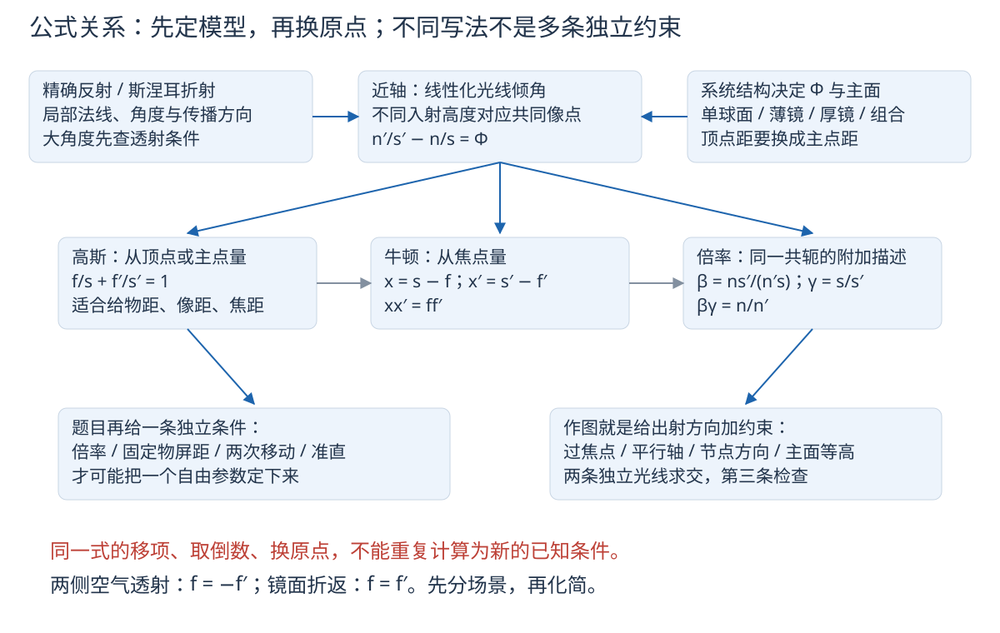
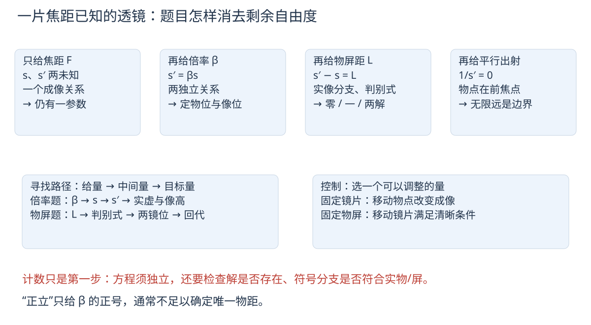
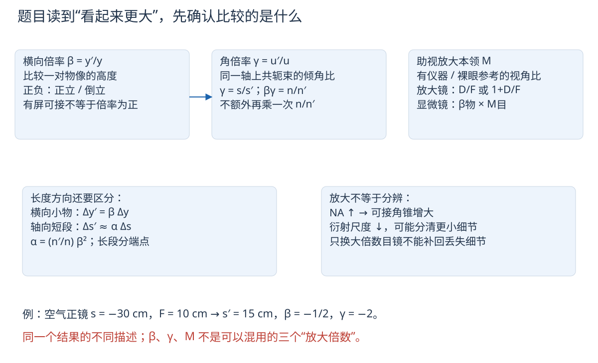
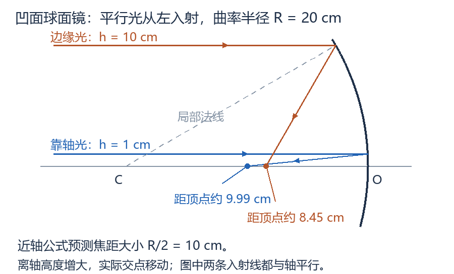

# 光学公式图解与解题路径

2026-10-27 · 公式关系、独立约束、作图与训练 · 以已讲PPT为主，结合姚启钧《光学教程》第五版及两份补充PDF。

这份手册把公式的含义、条件、关键推导、变式和题目入口放在一起。覆盖收到的波动与相干、第三章几何光学、常用仪器及像差课件；第四章的光阑、光度学、聚光与分辨本领另列为教材补全，不把它们全部认定为教师已讲。物理学史不列入复习正文。

先读S04—S08建立选法，再按题型读相应公式；需要把图画出来时读D01—D12，最后做E01—E32。卡在某一公式时返回其推导，不必重读整章。每个编号都能单独定位；“带练”和E组均为本册编写，不冒充教师原题。全部PPT题和指定作业的原题、原图与完整解析保留在[原题题册](../题库/光学PPT与作业题解.html)，本册D10集中收录其中的作图原题。没有往年试卷，不能把其他资料的“必考”字样当作本班通知。

第四章按已讲PPT：眼睛、助视仪器、目镜、显微技术、NA/分辨、望远镜/扩束及像差。A01—A05完整光阑光度定量内容是教材补充，可用页面的范围按钮暂时收起；NA与分辨仍在I04、A06—A07及训练中保留。V01—V06给每份资料的覆盖与勘误，正文采用核对后的式子。

## S01 先统一符号：同一个字母不承担两种物理意义

| 符号 | 含义、单位与约定 |
| --- | --- |
| $n,n'$ | 入射侧、出射侧折射率，无量纲；单色光的相折射率 |
| $\lambda_0,\lambda$ | 真空、介质中的波长，m；$\lambda=\lambda_0/n$ |
| $\nu,\omega,k$ | 频率Hz、角频率rad/s、波数rad/m；$\omega=2\pi\nu,\ k=2\pi/\lambda$ |
| $L_{\rm opt}$ | 光程，长度；与镜片间隔$L$、亮度$L_v$区分 |
| $s,s'$ | 物、像到本次成像参考点的有向距离；单面用顶点，厚系统用相应主点 |
| $r,r_1,r_2$ | 球心相对于球面顶点的有向坐标，不是永远取正的几何半径 |
| $f,f'$ | 物方、像方有向焦距；折射系统通常异号；$F$专指两侧同介质透镜的像方焦距$f'$ |
| $y,y',h$ | 物高、像高、光线在界面的入射高度，三者不可混写 |
| $\beta,\gamma,M$ | 横向放大率$y'/y$、同一共轭轴上光束的角放大率、助视仪器的视角放大率，均无量纲 |
| $\Phi$ | 折射光焦度，$n'/s'-n/s$，单位$m^{-1}$；$n=n'=1$时等于$1/F$ |

本手册透射主图取光从左向右、$x$轴向右为正，$y$向上为正。实物在左，所以$s<0$；透射实像在右，所以$s'>0$。虚物是入射光本来将会聚的位置；虚像是出射光反向延长线的交点。**实虚由光束决定，不由纸面左右单独决定。**

反射章保留同一条向右的$x$轴，反射后实际光向左。凹面镜实物、实像通常都在左侧，$s,s'<0$。若另把反射后的正方向改成向左，必须同时变换位置、曲率和角度；不能只改一个负号。

光线的几何斜角记$\theta$，从$+x$轴逆时针为正，近轴时斜率$\mathrm dy/\mathrm dx\approx\theta$。原PPT部分成像角$u$用顺时针为正，两者满足$u=-\theta$；两角的比值不因同时换号而变。棱镜的$i,r$另按各局部法线量非负角或明确的有向角，不套光轴倾角。

## S02 解题前先判断模型，避免“公式记得对，场景套错”

| 题目给出的线索 | 首选模型 | 先检查什么 |
| --- | --- | --- |
| 波长、时间、相位、复振幅 | W01—W05波动 | 真空/介质波长、时间因子正负号 |
| 叠加、条纹、明暗、相干 | W06—W09 | 偏振方向、频率、相位稳定性、初相位 |
| 入射角、临界角、棱镜顶角 | G01、P01—P07 | 从法线量角；每个界面能否透射 |
| 单球面、平界面、视深 | C01—C06 | 两侧$n$、曲率符号、近轴条件 |
| 凹面镜、平面镜、往返 | C07—C09、T06 | 保留坐标还是展开光路，反射次数 |
| 薄透镜、屏、放大率 | L01—L06 | 同介质？参考点在镜片？实物还是虚物？ |
| 厚透镜、多镜、主点节点 | T01—T05 | 顶点距与主点距区别；中间像转成下一次物 |
| 眼睛、显微镜、望远镜 | I01—I06 | 最终像在无穷远还是近点；线倍率还是角倍率 |
| 孔径、视野、光通量、清晰度 | A01—A09 | 限制的是锥角、视场、能量、像差还是衍射 |

通用顺序：画实际传播方向和实虚线→给参考点与符号→把题目条件变成量→选方程并说明依据→统一单位代入→用成像性质、极限和回代检查。$\infty$不是“很大但随便取10000”，遇到准直束直接令$1/s=0$，或保留光束斜率计算。

## S03 本手册会用的最小数学工具

**弧度与近似。** 弧度定义为弧长除半径。$180^\circ=\pi$ rad。小角度才有$\sin\theta\approx\tan\theta\approx\theta$、$\cos\theta\approx1-\theta^2/2$；代入右边的$\theta$必须用弧度。近轴不仅限制孔径$|h/r|$和光线倾角，也限制离轴物高与视场；只缩光阑不能把大视场自动变成一级成像。

**展开。** 当$|\varepsilon|\ll1$，$\sqrt{1+\varepsilon}\approx1+\varepsilon/2$。例如$\sqrt{a^2+b^2}\approx a+b^2/(2a)$要求$a>0,|b/a|\ll1$。二次光程项用于推出一次成像关系，不能因为“近轴”就连它也删掉。

**导数与驻值。** 导数$\mathrm dQ/\mathrm dx$衡量参数小改动引起的变化。内部极值必须满足一阶导数为零；它也可能只是驻点，还要看二阶导数或单调性。$Q''>0$给局部极小。偏导$\partial Q/\partial x$表示其余独立变量固定，例如固定入射角求角色散，不等于让入射角随波长调到最小偏向。

**复数。** $\mathrm i^2=-1$；$e^{\mathrm i\varphi}=\cos\varphi+\mathrm i\sin\varphi$。复数$U=X+\mathrm iY=Ae^{\mathrm i\alpha}$把振幅$A=\sqrt{X^2+Y^2}$与相位$\alpha=\operatorname{atan2}(Y,X)$同时储存。$\mathrm i$是虚数单位，入射角$i$是实角；复表示只为简化线性叠加，测量电场仍取实部。$|U|^2=UU^*$，星号表示复共轭。

## S04 先数自由度：哪些量真的还能独立改变

本册所说的自由度，是在给定模型、已有独立约束之后，仍可独立选择的参数数目。它不是把题目所有字母数一遍，更不等于动力学里机械自由度的直接照搬。先区分三层：**结构参数**决定系统，**状态参数**决定这次怎样入射，**观测量**是要计算的结果。

| 系统固定了什么 | 仍可选什么 | 被公式决定什么 |
| --- | --- | --- |
| 单球面$n,n',r$，即光焦度$\Phi$ | 一个物距$s$ | $s'$与$\beta$；两者不是任意独立指定 |
| 空气薄镜焦距$F$ | 一个物距$s$ | $s'=Fs/(s+F)$、$\beta=F/(s+F)$ |
| 厚镜结构及两主面、焦距 | 全局物坐标$X$ | 换算$s=X-X_H$后得到$X'$；不是再自由选择主面 |
| 棱镜$A,n/n_0$与波长 | 入射角$i$ | 两内角、出射角和偏向角；还要查透射域 |
| 望远镜两个焦距 | 镜间距$L$ | 若再要求无焦，$L=F_o+F_e$，间距不再独立 |
| 两束光频率、强度与偏振 | 相位差或光程差 | 干涉强度；初相位未给时不一定唯一 |

**实例：只给$F=10$ cm，问物、像在哪。** 未知是$s,s'$，成像式只有一个独立关系，不能唯一求解。补上“像倒立且为物的二分之一”，即$\beta=-1/2$，才多出$s'=-s/2$，解得$s=-30,s'=15$ cm。补上“正立”则只给$\beta>0$，仍有连续多个解。

**不要重复计数。** 高斯式、牛顿式和由它们变形得到的$s'=Fs/(s+F)$是同一条成像约束。用它们互相检查很好，但把三式当作三条独立已知，会误以为缺条件的题能唯一解。

计数不是充分条件。两个独立方程可能无实根、存在多个分支或落在不允许的虚物/虚像构型。方程确定后还必须检查模型条件、定义域、题干的实物/屏幕限制。

## S05 题干怎样翻译成等式、不等式和边界

下表沿用$s<0$表示左侧实物的透射场景；反射先看实际光向。$D=25$ cm为明视距离，$L$是题目明确给的物屏间距。

| 题干写法 | 数学条件 | 必须补读的细节 |
| --- | --- | --- |
| “像高是物高的$m$倍” | $|\beta|=m$ | 未给正倒时先留$\beta=\pm m$，再用实虚分支筛选 |
| “倒立缩小一半” | $\beta=-1/2$ | 不是$+1/2$；“缩小一半”若语义不明需对照原题 |
| “正立等大” | $\beta=+1$ | 有限焦距单薄镜的普通有限共轭一般不能满足；不能只凭等大令$s'=-s$ |
| “像在屏上” | 真实出射光会聚于屏，透射主链$s'>0$ | 屏必须在实际出射空间；反射实像通常$s'<0$ |
| “物与屏固定，相隔$L$” | $s'-s=L$（空气薄镜在二者之间） | 物距和像距不是分别等于$L$；厚镜须计两主面间隔 |
| “物向镜移动$a$” | 原点固定时$s_2=s_1+a$ | 镜也移动时先用全局坐标重算，不能直接沿用这一式 |
| “平行入射” | 轴向平行：$1/s=0$ | 斜平行还要给倾角，像在焦平面离轴点，不一定在轴上焦点 |
| “出射平行” | $1/s'=0$ | 轴向平行对应物方焦点；有限像高倍率此时要取极限 |
| “放松眼观察” | 最终像在无穷远 | 目镜中间像在前焦面，使用$D/F_e$ |
| “最终虚像在近点” | 相对眼的位置为$-D$ | 眼贴镜时$s_e'=-D$；有镜眼距$e$则$s_e'=e-D$ |
| “恰好能出射/刚好全反射” | 先判临界面，$i=i_c$为边界 | 不能混成最小偏向条件$i=e$；严格超临界全反射$i>i_c$ |
| “移动后仍清晰” | 每次各有一个成像条件 | 还需把两次坐标用移动量联系，不能共享原来的物距 |
| “两像重合” | 同一全局位置，必要时还需同像高 | 只让两种局部像距数值相等不够；原点可能不同 |
| “两镜间距/光学间隔” | $d=\overline{H_1'H_2}$，$\Delta=d-f_1'+f_2$ | $\Delta$是焦点间距，不能拿机械筒长替代 |
| “沿轴放置的小物段” | 对两端各成像，或用$\alpha=ds'/ds$ | 不是横向物高；长段不能整体乘一个局部纵向倍率 |
| “最小偏向” | $r_1=r_2=A/2,i=e$ | 对外介质相同、普通可透射分支成立 |

遇到语言条件，先写出这一列数学关系，再计算。每多写一条，问一句：它是否来自一个新的事实，还是刚才那条式子的另一种写法？

## S06 同一组变量，三种不同任务：正算、反求、控制

**正算**：结构和物位已知，求像。例如$F,s\to s'\to\beta$。**反求**：给像或倍率，反求结构/物位。例如$(s,\beta)\to s'=\beta s\to F$。**控制**：选择能调的旋钮，让结果满足目标。例如移动目镜，让中间像落在它的前焦面，实现放松眼观察。

| 目标与给法 | 最短路径 | 容易多绕的一步 |
| --- | --- | --- |
| 给$s,F$求像位与性质 | 高斯正算→倍率→实虚/正倒 | 先求$x,x'$再绕回$s'$，没有增加信息 |
| 给$F,\beta$找物、像 | $s=F(1/\beta-1)$，$s'=F(1-\beta)$ | 先猜正物距再修符号 |
| 给物到焦点距离$x$ | $x'=ff'/x$→$s'=x'+f'$ | 把$x$直接代进$s$ |
| 给厚镜前/后表面距离 | 全局坐标→主点距→高斯→换回要求原点 | 把后顶点焦距当等效焦距 |
| 给两次倍率和物移动量 | 每次用$s_i=F(1/\beta_i-1)$→相减求$F$ | 用两次独立数值解重复引入不必要未知 |
| 让第二镜输出平行 | 第一次像位→第二镜前焦点→求间距 | 先随意设第二次像距为很大有限数 |
| 指定望远镜倍率和筒长 | 无焦条件+角倍率，两式定两个焦距 | 忘记伽利略目镜焦距带负号 |
| 降低能被分开的最小物间距 | 提NA或缩短波长，检查像差和照明 | 只增大目镜倍率 |
| 让不同颜色到达时间一致 | 调材料/几何的频率相位，检查群延迟 | 只把各色在空间重新合到一起 |

**控制有代价。** 增大口径可收更多光，也可能增加球差；缩小光阑可减弱部分几何像差，却增大衍射斑。不要把“调一个参数使某一项改善”误写成“所有指标同时改善”。

**路径遇到无穷远时换坐标。** $s'=\infty$并不是物理结果不确定，而是当前用像距描述不方便。改用出射倾角、会聚度$n'/s'$或逐条光线斜率，便可继续传递到下一系统。T01、T05给不经过$0\times\infty$的做法。

## S07 倍率关系图：尺寸、角锥、轴向长度与人眼视角

对同一近轴透射共轭，固定系统后：

$$
\begin{gathered}
\beta=\frac{y'}y=\frac{ns'}{n's}=-\frac f x=-\frac{x'}{f'} \\
\gamma=\frac{u'}u=\frac{s}{s'}=\frac f{x'}=\frac x{f'} \\
\beta\gamma=\frac n{n'} \\
\alpha=\frac{ds'}{ds}=\frac{n'}n\beta^2.
\end{gathered}
$$

$\gamma$的$u,u'$是相应轴上孔径光线相对光轴的近轴角；不是界面入射角与折射角之比，也不是把同一条任意离轴线的倾角直接相除。新总览第5页将球面折射$\gamma$写成$ns/(n's')$，会破坏同页的$\beta\gamma=n/n'$，这里已纠正。

例如$n=1,n'=1.5,r=10,s=-30$ cm，C03给$s'=90$ cm：$\beta=-2,\gamma=-1/3,\alpha=6$。三者描述的对象不同；不能把像高乘6，也不能把轴向短段乘2。代入$\beta\gamma=2/3$与$n/n'$一致，是非常有效的自检。

**助视放大本领$M$另有参考。** 它比较用仪器和不用仪器时眼睛接收的视角，基准观察位置必须规定。显微镜$M=\beta_oM_e$中的两项甚至不是同一种倍率；望远镜的无焦角倍率不是把$s=s'=\infty$直接塞进$\gamma=s/s'$得到的“1”。应从平行束方向或焦面高度推导。

## S08 一眼调用表：先选行，再选已知量的写法

各项适用近轴条件；精确角度问题用斯涅耳式。$\bar s,\bar s'$从外表面顶点量；厚系统$p=\overline{O_1H},p'=\overline{O_2H'}$。

| 场景 | 轴向成像 | 焦距/结构 | 横向倍率与特殊边界 |
| --- | --- | --- | --- |
| 单球面折射 | $n'/s'-n/s=\Phi$ | $\Phi=(n'-n)/r;f=-n/\Phi;f'=n'/\Phi$ | $\beta=ns'/(n's)$；$n'=n$时无光焦度 |
| 平面折射 | $s'=(n'/n)s$ | 无有限焦点 | $\beta=1$仅近法线小束；斜视见C05 |
| 球面反射 | $1/s+1/s'=2/r$ | $f=f'=r/2$ | $\beta=-s'/s$；凹镜$r<0$，实像$s'<0$ |
| 平面反射 | $s'=-s$ | 无有限焦点 | $\beta=+1$；一般位置$X'=2a-X$ |
| 薄镜，一般外介质 | $n_2/s'-n_1/s=\Phi$ | $\Phi=(n_g-n_1)/r_1+(n_2-n_g)/r_2$ | $\beta=n_1s'/(n_2s)$；薄度不是近轴条件的替代 |
| 同外介质薄镜 | $1/s'-1/s=1/F$ | $1/F=(n_g/n_0-1)(1/r_1-1/r_2)$ | $\beta=s'/s$；$s=-F$输出轴向平行 |
| 厚镜/共轴系统 | $f/s+f'/s'=1$ | 从两主面量；空气中见T04 | $s=\bar s-p,s'=\bar s'-p'$；不是简单把厚度加进薄镜式 |
| 换焦点原点 | $xx'=ff'$ | $x=s-f,x'=s'-f'$ | 无焦系统$\Phi=0$不能强行用有限焦点形式 |
| 两个空气薄镜组合 | $1/F=1/F_1+1/F_2-d/(F_1F_2)$ | $p=dF/F_2,p'=-dF/F_1$ | $d=F_1+F_2$无焦；或逐次成像 |

镜面可用形式上的$n'=-n$从折射式推出，但不是实际材料折射率为负；镜面$f=f'$与透射同外介质$f=-f'$不能混。牛顿式不是比高斯式“更高级”，选择取决于题目从哪里量距离。

**几何级数。** $1+q+\cdots+q^{N-1}=(1-q^N)/(1-q)$，要求$q\ne1$；$q=1$时和为$N$。振动合成中把$q$换成相位因子，不可以漏掉这个退化分支。

---

# 一、波动、电磁能流与相干叠加

来源：电磁理论PPT第2—23页；叠加相干PPT全13页；教材第一章对应的光波表示、叠加与相干部分。有限积分时间、可见度是为完整说明条件所作的推导补充。

## W01 波长、频率、波数：它们怎样进入计算

简谐振动每隔周期$T$重复，$\nu=1/T$；同相位沿传播方向走一个波长$\lambda$，耗时$T$。因而

$$
\begin{gathered}
v=\lambda\nu \\
n=\frac cv \\
\lambda=\frac{\lambda_0}{n} \\
\omega=2\pi\nu \\
k=\frac\omega v=\frac{2\pi}{\lambda}=nk_0 \\
k_0=\frac{2\pi}{\lambda_0}.
\end{gathered}
$$

$k$是**每走1 m增加多少相位**，单位rad/m；引入它是为了把路程$R$直接换成相位$kR$。在静止界面折射时，频率不变，速度与波长改变；相位必须在每个时刻匹配，不能两侧各振各的频率。可见光课件给约390—760 nm，边界不是突然截断；光子能量$\mathcal E=h\nu=hc/\lambda_0$，$h$为普朗克常量，能量单位J，不能用介质波长直接写$hc/\lambda$。

**带练。** 真空波长600 nm进入$n=1.5$玻璃，求波动参数。先换$600\mathrm{nm}=6.00\times10^{-7}\mathrm m$；$\nu=c/\lambda_0\approx5.00\times10^{14}$ Hz，$v\approx2.00\times10^8$ m/s，$\lambda=400$ nm，$k_0\approx1.0472\times10^7$ rad/m，$k\approx1.5708\times10^7$ rad/m。走1 μm玻璃的相位为$k\times10^{-6}\approx15.708$ rad。查验：介质波长缩短、频率没变。

<!-- QUESTIONS -->
配套原题与讲授问答：[W01 传播滞后怎样进入波的表达式](../题库/光学PPT与作业题解.html#W01)。
<!-- /QUESTIONS -->

## W02 简谐波、波矢、波面与传播方向

光是电磁波。在普通各向同性透明介质的传播平面波中，电场$\mathbf E$、磁场$\mathbf H$与传播方向彼此垂直，$\mathbf E\times\mathbf H$指向能量流方向；不是说任意复杂电磁场都逐点满足这幅平面波图。

点光源先作$E_S(t)=A\cos(\omega t+\varphi_0)$，距离$R$处收到的是$t-R/v$时发出的振动，所以

$$E(P,t)=A(P)\cos(\omega t-kR+\varphi_0).$$

这就是“相位滞后$kR$”的来源。平面波沿单位向量$\hat{\mathbf s}$传播时，$\mathbf k=k\hat{\mathbf s}$，

$$E(\mathbf r,t)=A\cos(\omega t-\mathbf k\cdot\mathbf r+\varphi_0).$$

固定$t$，同相位集合为波面。平面波满足$\mathbf k\cdot\mathbf r=\text{常数}$，球面波满足$R=\text{常数}$。在各向同性介质中光线沿波面法线。球面波各点$|\mathbf k|$可相同而方向不同，不能把它写成全空间同一常矢量。

图中先读点源到观察点的真实距离$R$；再读斜平面波的波矢方向与等相位线，它们互相垂直。等相位线标的是相位，不是亮条纹：单一均匀平面波时间平均光强处处相同。最后的相量图用于W06的振动合成，不是空间光路。

<!-- QUESTIONS -->
配套原题与讲授问答：[W01 传播滞后怎样进入波的表达式](../题库/光学PPT与作业题解.html#W01)；[W04 斜平面波的“条纹”看得见吗](../题库/光学PPT与作业题解.html#W04)。
<!-- /QUESTIONS -->

## W03 复振幅：先规定时间因子，再谈正负号

全册取

$$E(\mathbf r,t)=\operatorname{Re}\{U(\mathbf r)e^{-\mathrm i\omega t}\}.$$

于是上节传播波的复振幅为$U=Ae^{\mathrm i(kR-\varphi_0)}$；平面波$U=Ae^{\mathrm i(\mathbf k\cdot\mathbf r-\varphi_0)}$。取实部得到$A\cos(kR-\varphi_0-\omega t)$，利用余弦为偶函数就回到原实波式。若选$e^{+\mathrm i\omega t}$作时间因子，空间指数全部相反；两种约定都可，但不能拼接。

求物理振幅用$|U|$，求光强用$UU^*$，求相位用辐角。**不要把复振幅$U$本身当作可测的实电场，也不要拿$U^2$代替$|U|^2$。**

**变式：倾斜平面波。** 在$xz$平面与$+z$轴成角$\alpha$传播，$\mathbf k=k(\sin\alpha,0,\cos\alpha)$，故$U=Ae^{\mathrm ik(x\sin\alpha+z\cos\alpha)}$。在$z=0$平面，相位为$kx\sin\alpha$，相位每增加$2\pi$对应$\Delta x=\lambda/|\sin\alpha|$。若与$+x$轴成30°，应写$k_x=k\cos30^\circ,k_z=k\sin30^\circ$；先看角起点，不能机械套正弦。

<!-- QUESTIONS -->
配套原题与讲授问答：[W01 传播滞后怎样进入波的表达式](../题库/光学PPT与作业题解.html#W01)；[W02 离轴点光源在一个平面上的复振幅](../题库/光学PPT与作业题解.html#W02)；[W03 焦点发散与会聚球面波的符号](../题库/光学PPT与作业题解.html#W03)；[W04 斜平面波的“条纹”看得见吗](../题库/光学PPT与作业题解.html#W04)。
<!-- /QUESTIONS -->

## W04 球面波的振幅与二次相位

各向同性点源在无吸收均匀介质中，半径$R$球面总功率不变，而面积为$4\pi R^2$，故强度$\propto1/R^2$、振幅$\propto1/R$。远离源点的标量发散球面波为

$$
\begin{gathered}
U_{\rm div}=\frac C R e^{+\mathrm ikR} \\
U_{\rm conv}=\frac {C'}R e^{-\mathrm ikR}.
\end{gathered}
$$

第二式描述向固定会聚点靠拢的波，$R$是到该点的正距离。令相位保持不变可验证第一式等相面向外走、第二式向内走。$R=0$处不能用点源奇异表达式描述真实焦斑。

点源$S=(x_0,y_0,z_0)$，观察面$z=z_1$：$R=\sqrt{(z_1-z_0)^2+(x-x_0)^2+(y-y_0)^2}$。记$\ell=|z_1-z_0|>0,\rho^2=(x-x_0)^2+(y-y_0)^2$。近轴展开给

$$
\begin{gathered}
R\approx\ell+\frac{\rho^2}{2\ell} \\
U_{\rm div}\approx\frac C\ell e^{\mathrm ik\ell}e^{\mathrm ik\rho^2/(2\ell)}.
\end{gathered}
$$

振幅近似常数要求$\rho/\ell\ll1$，相位截断还需遗漏相位$k\rho^4/(8\ell^3)\ll1$。因为$k$很大，“距离误差很小”不自动保证相位误差很小。

在焦距$F>0$的薄正透镜前，前焦点发出的波有正二次相位$+k\rho^2/(2F)$；透镜后会聚到后焦点的波有负二次相位$-k\rho^2/(2F)$。薄透镜本身对入射平面波提供的相位因子为$t(\rho)\propto e^{-\mathrm ik\rho^2/(2F)}$，常数相位不影响聚焦。这里相位因子是理想薄透镜模型，不是把镜片厚度直接等同$F$。

<!-- QUESTIONS -->
配套原题与讲授问答：[W02 离轴点光源在一个平面上的复振幅](../题库/光学PPT与作业题解.html#W02)；[W03 焦点发散与会聚球面波的符号](../题库/光学PPT与作业题解.html#W03)。
<!-- /QUESTIONS -->

## W05 能流与光强：何时能把振幅平方直接相加

玻印亭矢量$\mathbf S=\mathbf E\times\mathbf H$是单位面积、单位时间通过的电磁能量，单位W/m²。非磁、无吸收介质内单一行进平面波，$H=n\varepsilon_0cE$；简谐场平均$\langle\cos^2\rangle=1/2$，所以

$$\langle S\rangle=\frac12n\varepsilon_0cA^2.$$

$\varepsilon_0$是真空介电常量。课件定义归一化光强$I=A^2=2\langle E^2\rangle=UU^*$，把同一介质中的公共比例系数略去。跨不同$n$比较真实功率时要恢复该系数；穿过斜界面的法向功率还乘$\cos i$。**无损界面的能量守恒是入射功率等于反射加透射功率，既不保证$I$本身守恒，也不保证电场振幅不变。**

观测时间$\tau\gg T$才可去掉光学快振动。相干叠加先加电场再平方，非相干条件下交叉项平均为零才可直接加$I$。

<!-- QUESTIONS -->
配套原题与讲授问答：[W07 光强定义与“光强守恒吗”](../题库/光学PPT与作业题解.html#W07)。
<!-- /QUESTIONS -->

## W06 两个同频同向振动的合成：振幅和相位都要求

令$E_j=A_j\cos(\omega t+\alpha_j)$，在本册时间约定下$U_j=A_je^{-\mathrm i\alpha_j}$。线性叠加$U=U_1+U_2$，或将余弦展开成$X\cos\omega t-Y\sin\omega t$，其中

$$
\begin{gathered}
X=A_1\cos\alpha_1+A_2\cos\alpha_2 \\
Y=A_1\sin\alpha_1+A_2\sin\alpha_2.
\end{gathered}
$$

因此$E=A\cos(\omega t+\alpha)$，

$$
\begin{gathered}
A^2=X^2+Y^2=A_1^2+A_2^2+2A_1A_2\cos(\alpha_1-\alpha_2) \\
\alpha=\operatorname{atan2}(Y,X).
\end{gathered}
$$

只写$\tan\alpha=Y/X$会丢象限。若$A=0$，合振动为零，相位没有定义。同相$A=A_1+A_2$；反相$A=|A_1-A_2|$，不能把负振幅当最终振幅。**带练：**$3\cos\omega t+4\cos(\omega t+\pi/2)=5\cos(\omega t+\arctan(4/3))$。相位约53.13°；代$t=0$，右边为3，回代成立。

<!-- QUESTIONS -->
配套原题与讲授问答：[W05 两个同方向、同频振动如何合成](../题库/光学PPT与作业题解.html#W05)。
<!-- /QUESTIONS -->

## W07 等振幅、等相位差的N个振动

对$E_j=a\cos(\omega t+j\delta)$，$j=0,\ldots,N-1$，把复振幅按几何级数求和：

$$U=a\sum_{j=0}^{N-1}e^{-\mathrm ij\delta}=a\frac{1-e^{-\mathrm iN\delta}}{1-e^{-\mathrm i\delta}}=a\frac{\sin(N\delta/2)}{\sin(\delta/2)}e^{-\mathrm i(N-1)\delta/2}.$$

将分子、分母分别提出中间相位，即得到最后式。记实系数$B=a\sin(N\delta/2)/\sin(\delta/2)$，则

$$
\begin{gathered}
E=B\cos[\omega t+(N-1)\delta/2] \\
A=|B| \\
I=a^2\frac{\sin^2(N\delta/2)}{\sin^2(\delta/2)}.
\end{gathered}
$$

$B<0$时，若改写成正振幅形式需给相位加$\pi$。$\delta=2m\pi$是分式的可去奇点，回原和式得$A=Na,I=N^2a^2$；零强度要求$N\delta/2=\ell\pi$而$\delta\ne2m\pi$。不要见分子为零就判所有情况都暗。

**带练。** $N=3,\delta=2\pi/3$，三个相量首尾围成闭三角形，和为零；改成$\delta=2\pi$，三者同相，振幅$3a$而非0。课件电磁第19页下方复指数正负号应与前面和式一致，按本时间约定必须取上式负号。

<!-- QUESTIONS -->
配套原题与讲授问答：[W06 等振幅、等相位递增的N个振动](../题库/光学PPT与作业题解.html#W06)。
<!-- /QUESTIONS -->

## W08 独立性、叠加性、相干条件与可见度

**独立传播**：在线性介质中各波通过重叠区后保持原传播特性。**叠加原理**：重叠区总电场是各场的矢量和。**相干**：相关相位在观测时标内稳定，从而交叉项不被平均掉。三者并不互相排斥。

两束线偏振波的单位电矢量夹角$\psi$，振幅$A_1,A_2$，同频且相位差$\Delta\varphi$稳定时，展开$2\langle(\mathbf E_1+\mathbf E_2)^2\rangle$得到

$$I=I_1+I_2+2\sqrt{I_1I_2}\cos\psi\cos\Delta\varphi.$$

相干条件是同频、相位差稳定、偏振不正交（若要出现非零交叉项）；并非必须两波矢相同，亦非非要两振幅相等。同介质同频给相同波数模$k$，传播方向仍可不同。正交偏振、相位随机或足够长时间平均的不同频波，交叉项为零，$I=I_1+I_2$。

若$\cos\psi<0$，极大与极小的相位条件互换；可把负号吸收为附加$\pi$相位。一般极值与条纹可见度为

$$
\begin{gathered}
I_{\max,\min}=I_1+I_2\pm2\sqrt{I_1I_2}|\cos\psi| \\
V=\frac{I_{\max}-I_{\min}}{I_{\max}+I_{\min}}=\frac{2\sqrt{I_1I_2}|\cos\psi|}{I_1+I_2}.
\end{gathered}
$$

同向偏振时，$I_{\max}=(\sqrt{I_1}+\sqrt{I_2})^2$、$I_{\min}=(\sqrt{I_1}-\sqrt{I_2})^2$；完全暗还要求两强度相等。**带练：**$I_1=9,I_2=4$，同向偏振，则$I_{\max}=25,I_{\min}=1,V=12/13$；不是“反相一定零”。

**观测时间变式。** 频差$\Delta\omega$的干涉项含$\cos(\Delta\omega t+\eta)$，在以$t_c$为中心、宽$\tau$的曝光时间内平均后为

$$
\begin{gathered}
\operatorname{sinc}(\Delta\omega\tau/2)\cos(\Delta\omega t_c+\eta) \\
\operatorname{sinc}x=\frac{\sin x}{x}.
\end{gathered}
$$

这是直接积分余弦所得。$|\Delta\omega|\tau\gg1$时通常平均掉；短时或差频可分辨时能看到拍频，不能把“不同频率绝无任何可测交叉项”当绝对定理。

<!-- QUESTIONS -->
配套原题与讲授问答：[W08 独立传播与叠加是否矛盾](../题库/光学PPT与作业题解.html#W08)；[W09 从叠加原理推导干涉项及相干条件](../题库/光学PPT与作业题解.html#W09)；[W10 干涉极大、极小及是否全暗](../题库/光学PPT与作业题解.html#W10)。
<!-- /QUESTIONS -->

## W09 光程差、初相位和两点源干涉

定义两路光程$L_1,L_2$，$\delta=L_2-L_1$。采用实波相位$\omega t-k_0L_j+\varphi_{0j}$，便有

$$\Delta\varphi=\varphi_1-\varphi_2=\frac{2\pi}{\lambda_0}\delta+(\varphi_{01}-\varphi_{02})+\Delta\varphi_{\rm extra}.$$

最后项包括反射等额外相位，题目给了就必须计入。平行偏振、同初相且无额外相位时，亮$\delta=m\lambda_0$、暗$\delta=(m+1/2)\lambda_0$；均匀介质中改用几何路差$\Delta R$，则亮$\Delta R=m\lambda$。**光程差配真空波长，几何路差才配同介质波长。**

两点源发出的场分别有振幅$C_1/R_1,C_2/R_2$，代入W08即得完整$I(P)$。当这两个振幅在条纹尺度上近似不变时，恒定$R_2-R_1$对应明暗纹：三维为以两源为焦点的旋转双曲面，零路差为中垂面；平面截线随截面位置变化。几何上$|R_2-R_1|\le d_s$，$d_s$为源间距，求条纹级数还要检查能否实现。

**方法入口。** 先列总相位差，再求整数条件，最后检查偏振、振幅和几何允许区；不能先背“整波长亮”再忽略初相位。若两源初相差$\pi$，原中央亮变暗；若$R_1,R_2$变化显著，等相位加强面不必精确等于实际光强的局部最大面。

<!-- QUESTIONS -->
配套原题与讲授问答：[W11 两点源的明暗面为什么是双曲面](../题库/光学PPT与作业题解.html#W11)；[W12 相位差与光程差的关系](../题库/光学PPT与作业题解.html#W12)。
<!-- /QUESTIONS -->

---

# 二、基础定律、费马原理与全反射

来源：教材§3.1—3.3、§3.6；3-2 PPT第1—11、33—36、51—53页，3-3 PPT。图为已有讲义依据教材与课件的教学重绘。

## G01 反射、折射、直线传播与可逆性

均匀各向同性介质中光线沿直线；曲面界面的法线是该点球心连线，不能用整面镜的光轴代替。入射线、反射线、法线共面，反射角等于入射角；折射满足共面条件与

$$n_1\sin i=n_2\sin r.$$

$i,r$从局部法线量。进入高$n$介质，折射角较小；频率不变、波长变短。互易介质中把实际光线反向，仍满足同一规律；涉及反射或多面折射时，反向必须重画传播方向和角度基准。几何光学要求特征尺度远大于波长，不能用“单根无限细光线”否定衍射。

**变式：界面矢量法。** 对指向入射介质的单位法线$\hat{\mathbf N}$与入射传播单位矢量$\hat{\mathbf v}$，反射方向

$$\hat{\mathbf v}_r=\hat{\mathbf v}-2(\hat{\mathbf v}\cdot\hat{\mathbf N})\hat{\mathbf N}.$$

它保留切向分量、翻转法向分量，适合角反射器或空间折叠；$|\hat{\mathbf v}_r|=1$是快速检查。不要把两个截面各反一次误当成空间所有分量均反向。

## G02 光程、传播时间与费马原理

光程把不同传播速度的路段换算到同一相位尺度：

$$
\begin{gathered}
L_{\rm opt}=\int_A^B n(\mathbf r)\,\mathrm d\ell \\
L_{\rm opt}=\sum_jn_j\ell_j \\
\text{（分段均匀）}.
\end{gathered}
$$

$\mathrm d\ell$为微小几何长度，$L_{\rm opt}$仍是长度，积累相位$k_0L_{\rm opt}$。在无色散或相应相速度模型下，传播时间$L_{\rm opt}/c$；色散脉冲的包络延迟需群速度，不能与相速度时间混为一谈。

**费马原理：** 静止、透明、各向同性介质的几何光学中，固定端点，真实路径相对于邻近允许路径的光程取驻值：

$$\delta L_{\rm opt}=0.$$

这里$\delta$是路径微扰的一阶变化，不是光程本身，不是两路光程差。比较路径必须遵守所讨论的界面、反射次数等约束；驻值可为极小、极大或恒定，不能改写成“任何情形都走几何最短路”。

图中$A=(0,a)$、$B=(d,-b)$固定，交点$P=(x,0)$可沿界面移动。法线竖直，上下两段的正弦分别为$x/AP$与$(d-x)/PB$。因此

$$L_{\rm opt}(x)=n_1\sqrt{x^2+a^2}+n_2\sqrt{(d-x)^2+b^2},$$
$$L_{\rm opt}'(x)=\frac{n_1x}{\sqrt{x^2+a^2}}-\frac{n_2(d-x)}{\sqrt{(d-x)^2+b^2}}=0\ \Longrightarrow\ n_1\sin i=n_2\sin r.$$

两端都在镜面同侧、两段介质相同，按同样步骤得到反射角等于入射角。均匀介质无界面时驻值路径为直线。**推导用途：** 面对不熟悉的几何问题，可以先写光程，以交点、入射高度等作变量求驻值，而不用猜哪条路“更直”。

**带练。** 图取$a=3,b=4,d=7$ cm，$n_1=1,n_2=4/3$。令$x=4$ cm，两段均长5 cm，$n_1\sin i=4/5=n_2\sin r$；真实光程$35/3$ cm。直接连线的光程$25\sqrt2/3$ cm更大，尽管其几何距离更短。两项二阶导数均正，本例确为最小；“最小”是由本例性质得到的，不是费马原理的一般定义。

## G03 理想成像、单心光束与等光程

单心光束是所有光线或其延长线同过一点的光束。实际发散自一点为实物；本来会聚到一点的入射束为虚物；出射光实际会聚为实像，反向延长会聚为虚像。屏可接收实像；眼睛接收到相应光束也可观察虚像。

共轭物像点是系统彼此成像的一对点；互易条件下可反向交换。物空间、像空间是用于描述入射与出射光束的空间模型，**不是简单把装置切成左半、右半**，折返系统两者可重叠。

理想成像要求同一物点的连续光线族对应同一像点，并在相应近似阶次具有相同的光程。费马仅要求每条真实路径一阶驻值，**不保证任意两条独立路径的驻值数值相等**。在实物—实像连续成像族中，若

$$L_{\rm opt}(h)=L_0+ah+bh^2+\cdots,$$

消除选线高度$h$的影响需相应系数为零。C02、C07给出分别匹配折射与反射构型的具体展开。大孔径会出现更高阶项，不能由近轴等光程推出任意大光束都严格成点。

<!-- QUESTIONS -->
配套原题与讲授问答：[G01 找物点、像点，判断四种实虚组合](../题库/光学PPT与作业题解.html#G01)；[G02 笛卡尔符号与图中正长度](../题库/光学PPT与作业题解.html#G02)。
<!-- /QUESTIONS -->

## G04 全反射、临界角与边界条件

光从$n_1$入射到$n_2$，只有$n_1>n_2$才存在临界角：

$$\sin i_c=\frac{n_2}{n_1}.$$

$i<i_c$有传播折射波；$i=i_c$对应折射角90°的掠射边界；$i>i_c$没有携带平均法向能流进入无限深第二介质的传播折射波，称全反射。普通折射定律中的$\sin r>1$不是可以继续反正弦的实角。

**带练。** 玻璃$n_1=1.5$到空气，$i_c=41.81^\circ$，45°入射可全反射；同一玻璃放入$n_2=1.33$水中，$i_c\approx62.46^\circ$，45°不能全反射。全反射棱镜先逐面找入射角再检查，不是“玻璃里面的45°永远反射”。

<!-- QUESTIONS -->
配套原题与讲授问答：[P01 临界角、附加条件与直角棱镜](../题库/光学PPT与作业题解.html#P01)。
<!-- /QUESTIONS -->

## G05 倏逝场：为什么全反射外面仍然有场

“倏逝”表示向一个方向指数衰减。设界面$z=0$，第二介质位于$z>0$，$x$沿界面。先把波长换成波数$k_0=2\pi/\lambda_0$（W01），因为要计算相位在$x,z$方向如何变化。

图左的入射、反射光在第一介质，图右第二介质的场沿$x$有相位变化，而幅度沿$+z$衰减；竖直曲线不是一条折射光线。界面所有$x,t$处相位匹配，给切向分量$k_x=k_0n_1\sin i$。第二介质均匀波动方程要求$k_x^2+k_z^2=(k_0n_2)^2$；超临界时右边不足以容纳切向波数，故

$$
\begin{gathered}
k_z=\mathrm i\kappa \\
\kappa=k_0\sqrt{n_1^2\sin^2i-n_2^2}>0.
\end{gathered}
$$

选择正$\kappa$才能使无源半无限介质内的场向远处衰减。代回相位因子，

$$
\begin{gathered}
E\propto e^{-\kappa z}e^{\mathrm i(k_xx-\omega t)} \\
d_E=\frac1\kappa \\
d_I=\frac1{2\kappa}.
\end{gathered}
$$

$d_E$是振幅降到界面值$1/e$的深度；平方后光强按$e^{-2\kappa z}$衰减，$d_I$是强度降到$1/e$的深度，两者相差2倍。理想无吸收半无限第二介质平均法向能流为零，不等于电磁场为零；若第二界面靠得很近，可发生受抑全反射和能量耦合，本节的半无限条件随之改变。

**带练。** $\lambda_0=600$ nm，$n_1=1.5,n_2=1,i=45^\circ$，根号为$\sqrt{0.125}$，$\kappa\approx3.7024\times10^6\ \mathrm{m^{-1}}$，$d_E\approx270.1$ nm，$d_I\approx135.0$ nm。单位检查：$k_0$是$m^{-1}$，深度取倒数才是m；$i\to i_c^+$时衰减长度增大。

## G06 光纤接收角与数值孔径

阶跃型光纤芯$n_c$、包层$n_s<n_c$，外介质$n_0$；只讨论通过轴的子午光线。外部光与轴夹角$\alpha$，芯内夹角$\theta$。入端折射给$n_0\sin\alpha=n_c\sin\theta$；芯壁法线与轴垂直，所以壁上入射角$i=90^\circ-\theta$。要全反射需$\cos\theta\ge n_s/n_c$，于是

$$\mathrm{NA}=n_0\sin\alpha_{\max}=\sqrt{n_c^2-n_s^2}.$$

图中$\alpha$从轴量，$i$从壁上法线量；两者不是同一个角。等号是临界边界，稳定导引一般取边界内。若算得右边大于$n_0$，外部可实现的角仍受$\sin\alpha\le1$限制。数值孔径是无量纲量，不是几何孔径直径；斜光线、波导模式和有限纤芯细节超出该子午光线模型。

<!-- QUESTIONS -->
配套原题与讲授问答：[P10 光纤为何导光，接收角怎样求（配套整理）](../题库/光学PPT与作业题解.html#P10)。
<!-- /QUESTIONS -->

## G07 渐变折射率、分层不变量与蜃景

渐变型光纤的$n$还可沿离轴半径连续下降，光线不断向高$n$的轴心附近弯回，轨迹不再是芯壁上生硬折返的折线。适当分布能使走较长外侧路径的光同时经过较低$n$、较快区域，减小不同路径的到达时间差；并非任意渐变分布都使所有模式严格同时到达。下面水平大气分层是同一梯度弯曲规律的另一种空间构型。

若$n=n(z)$仅随高度变，各水平层界面平行，$\theta$相对竖直法线量，逐层斯涅耳定律给

$$n(z)\sin\theta(z)=C.$$

读图先找竖直$z$轴，再看每层法线相互平行。进入较低$n$层时$\sin\theta$增大，光更接近水平；到$n=C$时$\theta=90^\circ$可转向。连续梯度中的光线平滑弯曲，不一定撞到一个真实反射面。

一般光线方程为

$$\frac{\mathrm d}{\mathrm d\ell}\left(n\frac{\mathrm d\mathbf r}{\mathrm d\ell}\right)=\nabla n.$$

$\ell$为路径弧长，$\mathbf r(\ell)$为位置，$\mathrm d\mathbf r/\mathrm d\ell=\hat{\mathbf t}$是单位切向，$\nabla n$指向折射率增加最快的方向。由$\int n|\mathbf r'|\mathrm dq$的驻值，欧拉方程给$\mathrm d(n\mathbf r'/|\mathbf r'|)/\mathrm dq=|\mathbf r'|\nabla n$，除以$\mathrm d\ell/\mathrm dq$即上式。取垂直切向分量得到$n\,\mathrm d\hat{\mathbf t}/\mathrm d\ell=\nabla_\perp n$，因此光向高$n$侧弯曲。

近地面热空气$n$较小，来自天空或远物的光弯后进入眼睛，眼睛按到达方向反延，可形成下蜃景；冷的高$n$下层可产生相反的弯曲和上蜃景。**判断像在哪里要把到眼睛的最后一段反延，不能只背“光弯向哪里”。**

<!-- QUESTIONS -->
配套原题与讲授问答：[P09 分层介质中的传播与蜃景](../题库/光学PPT与作业题解.html#P09)。
<!-- /QUESTIONS -->

---

# 三、棱镜、色散与相关应用

来源：3-2 PPT第12—53页，教材§3.2及相应例题。此处保留课件展开的布儒斯特棱镜、双棱镜、色散补偿、锥透镜等内容；这些内容不能因“暂无指定作业”就自动删去。

## P01 一般棱镜：先逐面折射，再找偏向

外介质$n_0$、棱镜$n$，相对折射率$m=n/n_0>1$；顶角$A$，第一面入射$i$、内部折射$r_1$，第二面内部入射$r_2$、出射$e$。普通穿过两折射面的构型满足

$$
\begin{gathered}
\sin i=m\sin r_1 \\
r_1+r_2=A \\
\sin e=m\sin r_2 \\
\delta=i+e-A.
\end{gathered}
$$

图中$r_1,r_2$分别从两面法线量。两法线夹角与顶角的几何关系给$r_1+r_2=A$；把第一次偏折$i-r_1$与第二次$e-r_2$相加，才得总偏向$\delta$。对不处于普通内部角分支的光路，角可能有向且$r_2<0$，应按实际图确认，不能硬取绝对值。

**一般计算链**：$i\to r_1=\arcsin(\sin i/m)\to r_2=A-r_1\to e=\arcsin(m\sin r_2)\to\delta$。第二次反正弦前检查$|m\sin r_2|\le1$，还要确认实际打到指定第二面。

**带练。** 空气中$m=1.5,A=60^\circ,i=30^\circ$。$r_1=19.4712^\circ,r_2=40.5288^\circ$，未超过$41.8103^\circ$的临界角，所以$e=77.0958^\circ$，$\delta=47.0958^\circ$。出射很斜但仍可透射；它不是最小偏向光路。

<!-- QUESTIONS -->
配套原题与讲授问答：[P02 棱镜偏向角怎样随入射角变化](../题库/光学PPT与作业题解.html#P02)；[P05 编程画偏向曲线，怎样处理不能出射的区间](../题库/光学PPT与作业题解.html#P05)。
<!-- /QUESTIONS -->

## P02 最小偏向角：条件、推导和反求折射率

固定顶角、材料与波长，改变入射方向，普通可透射分支的最小偏向发生在对称光路：

$$
\begin{gathered}
i=e=i_m \\
r_1=r_2=A/2 \\
\delta_{\min}=2\arcsin[m\sin(A/2)]-A,
\end{gathered}
$$
$$\boxed{m=\frac{\sin[(A+\delta_{\min})/2]}{\sin(A/2)}}.$$

最小偏向不是“入射角最小”，也不是“出射角为零”。证明不能仅靠光路可逆：可逆只给交换$i,e$后的同偏向。令$g(r)=\arcsin(m\sin r)$，则$\delta=g(r_1)+g(A-r_1)-A$，

$$
\begin{gathered}
g'(r)=\frac{m\cos r}{\sqrt{1-m^2\sin^2r}} \\
g''(r)=\frac{m(m^2-1)\sin r}{(1-m^2\sin^2r)^{3/2}}>0.
\end{gathered}
$$

对普通$0<r<\arcsin(1/m)$分支，$g'$严格增加，驻值$g'(r_1)=g'(A-r_1)$只能给$r_1=A/2$，二阶导数正，故为最小。要求$m\sin(A/2)<1$才能非掠射地透过。

**带练。** $m=1.5,A=60^\circ$，$i_m=48.5904^\circ$，$\delta_{\min}=37.1808^\circ$；反代测量式重得$m=1.5$。空气外改成水外，公式求的是$n/n_0$，不能把它直接当棱镜绝对折射率。

<!-- QUESTIONS -->
配套原题与讲授问答：[P03 最小偏向角如何测折射率，液体容器壁怎么办](../题库/光学PPT与作业题解.html#P03)。
<!-- /QUESTIONS -->

## P03 可透射的入射角边界，与最小偏向分开

设$r_c=\arcsin(1/m)$。普通分支第二面要$r_2\le r_c$，而$r_2=A-r_1$，故$r_1\ge A-r_c$。因此

$$
\begin{gathered}
i_{\rm lim}=\arcsin[m\sin(A-r_c)] \\
(A>r_c).
\end{gathered}
$$

$A\le r_c$时可从$i=0$进入；$A>2r_c$时普通两面透射分支不存在。$i=i_{\rm lim}$给第二面掠射，实际非掠射取稍大角。改变光路分支、从另一侧面入射时要重画。

**带练。** $A=60^\circ,m=1.5$，$i_{\rm lim}=27.9205^\circ$，而$i_m=48.5904^\circ$；两数回答不同问题。若题目只问“能否从另一面射出”，先查临界角，不必先算最小偏向。

<!-- QUESTIONS -->
配套原题与讲授问答：[B04 3.4 两种“最小”（配套，未确认指定）](../题库/光学PPT与作业题解.html#B04)。
<!-- /QUESTIONS -->

## P04 薄棱镜近似与偏向曲线

当$A,i,r_1,r_2,e$均小到可用弧度近似，$i\approx mr_1,e\approx mr_2$，代几何关系得

$$\delta\approx(m-1)A.$$

近似到一阶时偏向与入射角无关；真实精确曲线仍有变化和最小值。只说“顶角小”还不足以保证大入射角也能用上式。

横轴是入射角、纵轴是偏向角；每条曲线只画可透射区。谷底是最小偏向，曲线左端是第二面临界出射，不是同一个点。$A=5^\circ,m=1.5$时一阶结果$2.5^\circ$；精确最小偏向约$2.503^\circ$。若要求一般精确偏向，还需要入射角。

<!-- QUESTIONS -->
配套原题与讲授问答：[P04 薄棱镜的5度例题与近似条件](../题库/光学PPT与作业题解.html#P04)；[P05 编程画偏向曲线，怎样处理不能出射的区间](../题库/光学PPT与作业题解.html#P05)。
<!-- /QUESTIONS -->

## P05 色散、柯西公式与角色散的两种求法

色散表示折射率依赖频率或波长。透明波段常见正常色散$\mathrm dn/\mathrm d\lambda_0<0$，短波通常偏折更多；吸收附近可有反常色散，不能把正常色散当普适定律。柯西经验式

$$
\begin{gathered}
n(\lambda_0)=a+\frac b{\lambda_0^2}+\frac c{\lambda_0^4} \\
\frac{\mathrm dn}{\mathrm d\lambda_0}=-\frac{2b}{\lambda_0^3}-\frac{4c}{\lambda_0^5}.
\end{gathered}
$$

$a$无量纲，$b,c$的单位分别随所选波长单位的平方、四次方；不能把μm拟合参数和nm直接混算。它只适用于拟合的透明波段。

**随波长重新调到最小偏向：** 对P02直接求导（假定$n_0$在该波段不变），

$$D_{\min}=\frac{\mathrm d\delta_{\min}}{\mathrm d\lambda_0}=\frac{2\sin(A/2)}{n_0\sqrt{1-m^2\sin^2(A/2)}}\frac{\mathrm dn}{\mathrm d\lambda_0}.$$

**固定入射角：** 对$\sin i=m\sin r_1$求导得$\mathrm dr_1/\mathrm dm=-\tan r_1/m$，$r_2=A-r_1$，再对$\sin e=m\sin r_2$求导，

$$\left.\frac{\partial\delta}{\partial\lambda_0}\right|_i=\frac{\sin A}{n_0\cos r_1\cos e}\frac{\mathrm dn}{\mathrm d\lambda_0}.$$

在中心波长恰对称时两式一阶相同，但固定装置不可能让宽谱各波长都严格处于各自最小偏向。导数角度单位是rad；小波段可用$\Delta\delta\approx D\Delta\lambda_0$，窄角近似$D\approx A\,\mathrm dm/\mathrm d\lambda_0$。注意比较分光能力常看$|D|$，不是只看负数大小。

**带练。** $A=60^\circ,n_0=1,n=1.5$，若局部$\mathrm dn/\mathrm d\lambda_0=-4.0\times10^{-5}\ \mathrm{nm^{-1}}$，则$D_{\min}\approx-6.0474\times10^{-5}$ rad/nm；相差10 nm，两出射方向相差约$6.0474\times10^{-4}$ rad，负号表示波长增大时偏向减小。分光仪用准直管提供平行光，棱镜偏转，望远镜读方向，测出$A,\delta_{\min}$再反推$n$，不是凭屏上距离直接当角。

<!-- QUESTIONS -->
配套原题与讲授问答：[P06 分光系统怎样把颜色分开](../题库/光学PPT与作业题解.html#P06)；[P07 角色散的意义、推导及顶角影响](../题库/光学PPT与作业题解.html#P07)。
<!-- /QUESTIONS -->

## P06 角反射器、全反射棱镜与双棱镜

**全反射棱镜**通过一面或多面全反射折叠光路；转向角由反射几何决定，是否全反射再由材料与外介质检查。棱镜还可用于像的旋转、倒像、偏振分束等；不同功能不能都解释为“最小偏向”。

**三面角反射器。** 三个相互垂直反射面依次把传播矢量的三个正交分量各翻转一次，

$$ (v_x,v_y,v_z)\longrightarrow(-v_x,-v_y,-v_z).$$

出射与入射反向平行，通常存在横向平移，不保证沿原来同一直线。若只反射两个面，只翻两个分量，第三分量不为零时不能空间原路反向。证明前要确认光确实依次打到三面，玻璃角锥还需逐面满足反射条件。

**菲涅耳双棱镜。** 两个小顶角薄棱镜共底组成，来自同一源的两部分波分别偏折，反延为两个相干虚源。

源到双棱镜距离$\ell$，小偏折$\varepsilon\approx(m-1)A$，每个虚源横移约$\ell\varepsilon$，间距$d_s\approx2\ell(m-1)A$。$\ell$不是虚源到屏的距离。若屏距虚源平面$Z\gg d_s$，由近轴路差$\Delta R\approx d_s x/Z$得条纹间距$\Delta x\approx\lambda Z/d_s$。先查两束在屏上确有重叠，再求条纹；虚源是反延点，不画成新的实发光体。

<!-- QUESTIONS -->
配套原题与讲授问答：[P08 三面角反射器证明与用途](../题库/光学PPT与作业题解.html#P08)；[P12 其他棱镜装置各做什么（应用整理）](../题库/光学PPT与作业题解.html#P12)。
<!-- /QUESTIONS -->

## P07 布儒斯特角棱镜与色散补偿

偏振是电矢量振动方向的性质。入射面由入射线和法线张成；$p$偏振电场平行入射面，$s$偏振垂直入射面。在无吸收、非磁、各向同性界面，$p$反射系数为零时，反射光与折射光互相垂直，即$i_B+r_B=90^\circ$。结合斯涅耳定律，

$$\tan i_B=m.$$

对于同一外介质中的中心波长，若同时取对称透射，$r_1=r_2=r_B$，则$A=2r_B=180^\circ-2i_B$，两面均可满足相应的$p$低反射条件，并位于最小偏向。$s$仍反射，宽谱不会全部精确同角。**最小偏向不意味着色散达到一个普遍最大值**；色散还受顶角、材料和损耗约束。

**相位补偿。** 不同颜色的材料折射率和几何光路不同，积累总谱相位$\phi(\omega)$。它在中心频率附近展开为

$$
\begin{gathered}
\phi=\phi_0+\tau_g(\omega-\omega_0)+\tfrac12\phi_2(\omega-\omega_0)^2+\cdots \\
\tau_g=\frac{\mathrm d\phi}{\mathrm d\omega} \\
\phi_2=\frac{\mathrm d^2\phi}{\mathrm d\omega^2}.
\end{gathered}
$$

$\tau_g$是群延迟（s），$\phi_2$是群延迟色散（s²）：不同频率的延迟差使短脉冲展宽；棱镜对使不同颜色走不同几何路径以补偿。正常色散的$\mathrm dn/\mathrm d\lambda_0<0$与“群延迟色散为正”是不同定义，不能只看负号互相代替。若传播长度$\ell$，$\phi=k(\omega)\ell$，包络群速度$v_g=(\mathrm dk/\mathrm d\omega)^{-1}=c/[n+\omega\mathrm dn/\mathrm d\omega]$，这里的群折射率不同于相折射率$n$。

图的核心是频率与到达时间的对应，不是只把各色空间上合拢。啁啾脉冲放大CPA依次为展宽降峰值→放大→压缩；压缩必须补偿频率相位差。该原理属于课件物理内容，奖项人物等历史叙述另行排除。

<!-- QUESTIONS -->
配套原题与讲授问答：[P11 布儒斯特棱镜的条件（应用整理）](../题库/光学PPT与作业题解.html#P11)。
<!-- /QUESTIONS -->

## P08 锥透镜、贝塞尔光束与“无衍射”的边界

锥透镜把入射平行光偏成一束锥角近似相同的光线。小底角$\alpha$、相对折射率$m$时，偏折锥角$\eta\approx(m-1)\alpha$。不同方位的锥形平面波相干叠加，可形成轴附近近似$J_0(k_\perp\rho)$的场，$k_\perp=k\sin\eta$；$J_0$是零阶贝塞尔函数，表示有中心亮斑与同心环的径向振幅。

半径$a$的有限照明孔径只能在有限长度约$z_{\max}\sim a/\tan\eta$内形成重叠区；理想无限长贝塞尔波需要无限横向能量。环纹、长焦深、自重建等来自锥波干涉，不能说有限器件产生永远不衍射、能量无限集中的一根线。该部分以机制和条件辨析为主；若题目另给精确锥面角，应回到逐面折射，不能用小角公式冒充精确式。

<!-- QUESTIONS -->
配套原题与讲授问答：[P12 其他棱镜装置各做什么（应用整理）](../题库/光学PPT与作业题解.html#P12)。
<!-- /QUESTIONS -->

## P09 其他棱镜与含反射的恒偏向变式

五角棱镜利用两次反射及指定进出面实现约90°转向；屋脊、道威等涉及像的翻转或旋转，须逐面检查反射对各方向的作用；非偏振分束立方主要靠界面膜分束，偏振棱镜利用偏振相关传播/反射，不是普通色散自动将任意两偏振分开。变形棱镜对在某一横向维度压缩或扩展束宽，可把椭圆束整形；耦合棱镜以相位匹配把光耦入薄膜/波导，和自由空间直接透射不同。课件产品图的作用表是机制分类，不是各型号都满足相同数值角度的定理。

**液体空心棱镜。** 若容器壁在每个窗口内外两面平行，把空气→玻璃→液体两次斯涅耳式串联，玻璃折射率消去；同理出射端也消去。因此外部角关系可等效为空气—液体棱镜。壁有厚度会改变位置，若两壁不平行则角关系也不能照消。这解释题册P03的“容器壁怎么办”。

**恒偏向90°（教材3.5原图）。**

原图的实际次序是左面折射→上方斜面反射一次→底面折射；内部拼接线不是第二块反射镜。取水平向右方向角0、逆时针为正，第一面外角$\theta_1$满足$\sin\theta_1=n/2$，所以内部入射方向$r_1=30^\circ$。图上反射斜面方向为$-15^\circ$，镜面反射方向角等于“2×镜面方向角−入射方向角”，因而反射后为$2(-15^\circ)-30^\circ=-60^\circ$。

底面的向下法线方向为$-90^\circ$，内部入射角也是30°，出射给$\sin\theta_2=n/2$，故所示分支$\theta_2=\theta_1$。外部入射方向为$\theta_1$，出射方向为$-90^\circ+\theta_2$，相差90°。若内部靠向空气全反射，反射点入射角45°要求$n>\sqrt2$；同时进出非掠射要求$n<2$。这类题考的是“反射加两次折射后的方向关系”，不能直接套普通棱镜$\delta=i+e-A$。

<!-- QUESTIONS -->
配套原题与讲授问答：[P03 最小偏向角如何测折射率，液体容器壁怎么办](../题库/光学PPT与作业题解.html#P03)；[P12 其他棱镜装置各做什么（应用整理）](../题库/光学PPT与作业题解.html#P12)；[B05 3.5 恒偏向棱镜（配套，未确认指定）](../题库/光学PPT与作业题解.html#B05)。
<!-- /QUESTIONS -->

---

# 四、球面、平面与反射成像

来源：教材§3.2—3.6、附录3.1及3.3；3-3、3-4、3-5 PPT。主图沿用讲义的教学重绘；图中高度为可读性可放大，不能据图测近轴角度。

## C01 球面折射：由斜率与法线推出成像式

球面顶点$O=(0,0)$，球心$C=(r,0)$。物点$Q=(s,y)$、像点$Q'=(s',y')$，入射点$A\approx(0,h)$；入射侧$n$、出射侧$n'$。球面局部法线倾角近轴为$\alpha\approx-h/r$。光线斜角$\theta\approx(h-y)/(-s)$，$\theta'\approx(y'-h)/s'$。斯涅耳定律一阶形式为$n(\theta-\alpha)=n'(\theta'-\alpha)$，移项得到

$$n'\theta'-n\theta=-\frac{n'-n}{r}h.$$

沿蓝线从左侧$Q$到$A$再到右侧$Q'$；橙线用另一入射高度。$y,y'$固定，只有$h$随选线而变。代入两条斜率，按$h$整理，要不同$h$都对应同一$Q'$，必须同时有

$$
\begin{gathered}
\boxed{\frac{n'}{s'}-\frac ns=\frac{n'-n}{r}=\Phi} \\
\boxed{\frac{ny}{s}=\frac{n'y'}{s'}}.
\end{gathered}
$$

第一式定轴向像位，第二式定横向像高。$\Phi$是球面光焦度，单位$m^{-1}$；同一面反向计算要连同$n,n',r$和正方向一并处理。适用条件为小孔径、小倾角、小物高；球面一般不严格保持大孔径光束的单心性。

**直接解与反演变式：**

$$
\begin{gathered}
s'=\frac{n's}{n+\Phi s} \\
s=\frac n{n'/s'-\Phi} \\
r=\frac{n'-n}{n'/s'-n/s} \\
\beta=\frac{y'}y=\frac{ns'}{n's}.
\end{gathered}
$$

分母为零意味着准直输出，不是公式失效后任选大数。$n'=n$且无反射时$\Phi=0$，介质界面没有折射作用，不能用$0/0$反求曲率。

**怎样检验大孔径并不严格成点。** 对轴上实物$(s,0)$，选入射高度$h$，近顶点球面坐标的精确值是$x_A=r-\operatorname{sgn}(r)\sqrt{r^2-h^2}$。$\operatorname{sgn}(r)$表示$r$的正负号；局部法线直线与$+x$轴的近水平夹角$\alpha=-\arcsin(h/r)$。入射方向$\theta=\arctan[h/(x_A-s)]$，取向右透射的物理分支，

$$
\begin{gathered}
\theta'=\alpha+\arcsin\left[\frac n{n'}\sin(\theta-\alpha)\right] \\
s'(h)=x_A-\frac h{\tan\theta'}.
\end{gathered}
$$

这只是把实际两段直线与局部斯涅耳式直接写出来，不再作小角近似；反正弦内须允许透射。换不同$h$通常得到不同$s'(h)$，说明球面宽束不严格保持单心性；$h\to0$才回到同一近轴像位。若给大孔径数据，就按精确光线追迹或讨论像差，不把一级式算出的数冒充所有光线的共同交点。

球面近轴作图也有三条特殊线：轴向平行入射经像方焦点；过/指向物方焦点入射后平行轴；过球心的线按局部法线入射不改变方向。第三条是球面的法线性质，不是把球心误认成任意厚系统的光心。

<!-- QUESTIONS -->
配套原题与讲授问答：[G03 球面折射参数、精确关系与近轴公式](../题库/光学PPT与作业题解.html#G03)；[G05 两次球面折射的玻璃棒例题](../题库/光学PPT与作业题解.html#G05)；[B10 3.10 透明球把平行光聚在后顶点](../题库/光学PPT与作业题解.html#B10)；[B12 3.12* 两气泡的真实位置](../题库/光学PPT与作业题解.html#B12)；[B13 3.13 球形鱼缸中心的小鱼](../题库/光学PPT与作业题解.html#B13)；[B14 3.14 水中半球端玻璃棒](../题库/光学PPT与作业题解.html#B14)。
<!-- /QUESTIONS -->

## C02 同一公式的费马推导：为什么二次光程不能省

使用C01的折射图，图示$s<0,s'>0,r>0$。入射点并不恰在顶点平面：其横坐标（球面矢高）$x_A\approx h^2/(2r)$。两段真实距离是

$$
\begin{gathered}
QA=\sqrt{(x_A-s)^2+(h-y)^2} \\
AQ'=\sqrt{(s'-x_A)^2+(y'-h)^2}.
\end{gathered}
$$

取$\sqrt{a^2+b^2}\approx a+b^2/(2a)$，$a$始终用正的几何间隔，得

$$
\begin{aligned}
L_{\rm opt}&=nQA+n'AQ'\\
&\approx -ns+n's'+(n-n')x_A\\
&\quad-\frac{n(h-y)^2}{2s}+\frac{n'(h-y')^2}{2s'}.
\end{aligned}
$$

$x_A$是二次小量，在外面的独立项必须保留；在二次项分母中再保留$x_A$只影响四次项，可以略去。代矢高并展开平方：

$$
\begin{aligned}
L_{\rm opt}\approx L_0
&+h\left(\frac{ny}{s}-\frac{n'y'}{s'}\right)\\
&+\frac{h^2}{2}\left(\frac{n'}{s'}-\frac ns-\frac{n'-n}{r}\right).
\end{aligned}
$$

$L_0$与$h$无关。让不同入射高度的光线等光程，就分别令一次、二次系数为零，重得C01两式。**这不是“移动物点到入射高度”**；物、像高度固定，比较的是同一物点发出的不同光线。虚物、虚像用有向距离推广公式；不能把负$s$直接叫负的真实长度。

<!-- QUESTIONS -->
配套原题与讲授问答：[G03 球面折射参数、精确关系与近轴公式](../题库/光学PPT与作业题解.html#G03)。
<!-- /QUESTIONS -->

## C03 焦点、高斯式、牛顿式和放大率

物方焦点$F$是能使出射平行于轴的轴上物点；像方焦点$F'$是轴向平行入射束的像点。令$s'\to\infty$或$s\to-\infty$，得

$$
\begin{gathered}
f=-\frac n\Phi \\
f'=\frac{n'}\Phi \\
\frac{f'}f=-\frac{n'}n \\
\frac fs+\frac{f'}{s'}=1.
\end{gathered}
$$

焦距从球面顶点量；厚系统改从主点量。若题目给的是物到**焦点**的距离，定义$x=s-f,x'=s'-f'$，将$s=x+f,s'=x'+f'$代入高斯式，通分消去同项，得到

$$
\begin{gathered}
\boxed{xx'=ff'} \\
\beta=\frac{ns'}{n's}=\frac{r-s'}{r-s}=-\frac f x=-\frac{x'}{f'}.
\end{gathered}
$$

高斯、牛顿只是同一成像关系换原点；不能把$s$代入$x$的位置。含$y'/y$的式子要求$y\ne0$，轴上点可按邻近小物的极限定义倍率。

**阿贝不变式的等价写法。** 单球面母式还可移项为

$$n\left(\frac1r-\frac1s\right)=n'\left(\frac1r-\frac1{s'}\right).$$

它把两侧相对球心和物像距离的组合作为同一个量，仍是同一成像约束，不是再增加一条独立方程。不要与正弦条件、两条近轴光线的拉格朗日不变量混为一个定理。精讲和教材附录的球面矢高推导最终也回到这同一关系。

**带练。** 空气到玻璃$n=1,n'=1.5,r=+10$ cm，$s=-30$ cm。$\Phi=0.05\ \mathrm{cm^{-1}}$，$f=-20,f'=30$ cm；$1.5/s'+1/30=0.05$，得$s'=90$ cm，$\beta=-2$。$x=-10,x'=60$，乘积$-600=ff'$。像在玻璃中右侧，实像倒立放大；不能用$s'/s=-3$当倍率，漏了$n/n'$。

<!-- QUESTIONS -->
配套原题与讲授问答：[G04 焦距、高斯、牛顿、横向与角放大率](../题库/光学PPT与作业题解.html#G04)。
<!-- /QUESTIONS -->

## C04 三种放大率与亥姆霍兹—拉格朗日定理

同一轴上共轭束中，孔径高度相同，近轴角比$\gamma=\theta'/\theta=s/s'$。结合$\beta=ns'/(n's)$，

$$
\begin{gathered}
\boxed{n'\beta\gamma=n} \\
\boxed{ny\theta=n'y'\theta'}.
\end{gathered}
$$

这就是相应近轴形式的亥姆霍兹—拉格朗日关系：像被横向放大时，光锥角相应收缩，不能把尺寸和角度独立任意放大。上式的$y$是共轭的小物高，$\theta$是相应轴上孔径光线角；不是把同一条离轴光线随意的高度和倾角相乘。

更一般取同一截面的两条近轴光线$(y_1,\theta_1),(y_2,\theta_2)$，光学不变量为

$$\mathcal H=n(y_1\theta_2-y_2\theta_1).$$

均匀传播$y_j\to y_j+d\theta_j$时交叉项相消；球面折射$n'\theta_j'=n\theta_j-\Phi y_j$时$\Phi$项也相消，故经过共轴系统保持。合适地选主光线与孔径光线就化成前式。超出近轴、采用正弦形式时需额外满足相应成像条件（见A04），不可把所有$\theta$随意换成$\sin\theta$就宣布任意系统成立。

**轴向放大率。** 同一系统$n,n',\Phi$固定，对成像式求微分：$-n'\mathrm ds'/s'^2+n\mathrm ds/s^2=0$，故

$$\beta_{\parallel}=\frac{\mathrm ds'}{\mathrm ds}=\frac{n'}n\beta^2.$$

它描述短轴向物段的长度变化；同介质时为$\beta^2$，不是$\beta$。长物段应分别成像两端再相减，不能直接用某一端的局部导数。

<!-- QUESTIONS -->
配套原题与讲授问答：[G04 焦距、高斯、牛顿、横向与角放大率](../题库/光学PPT与作业题解.html#G04)；[G08 球面折射怎样作图，角放大率怎样读](../题库/光学PPT与作业题解.html#G08)。
<!-- /QUESTIONS -->

## C05 平面折射、视深与斜细光束的像散

令$r\to\infty$，平界面近法线成像给

$$
\begin{gathered}
s'=\frac{n'}n s \\
\beta=1 \\
d_{\rm app}\approx\frac{n'}n d.
\end{gathered}
$$

这里$d>0$是物在入射介质中的深度；$s,s'$是有向坐标。两侧$n$不同，物像等大不等于位置不变。**平面反射严格保持单心性，平面折射通常不保持；本式只在近法线小光束条件成立。**

图中物点正上方为$O$，入射点$A$，某条出射线的反延轴交点为$Q$。共享横距给$d\tan i=d_{\rm app}\tan r$，所以

$$
\begin{gathered}
d_{\rm app}(i)=d\frac{\tan i}{\tan r}=d\frac{n'\cos r}{n\cos i} \\
n\sin i=n'\sin r.
\end{gathered}
$$

它随$i$改变，已证明不能给所有光线共同一个虚像点。水$n=4/3$到空气，近法线为$0.75d$，$i=30^\circ$时约$0.645d$，不能通用“水里看起来四分之三深”。

**斜细光束的进一步变式（教材附录3.1）。** 临时取沿界面为$X$、朝物方为$Y$，物点$(0,d)$。折射线与反延线方程为$X+Y\tan r(i)=d\tan i$。让两条邻近$i$的线相交，对$i$求导，结合$\mathrm dr/\mathrm di=n\cos i/(n'\cos r)$，得子午截面交点

$$
\begin{gathered}
Y_t=d\frac{n'}n\frac{\cos^3r}{\cos^3i} \\
X_t=d\tan i-Y_t\tan r.
\end{gathered}
$$

另一弧矢方向的焦线位置相应有$Y_s=d(n'/n)\cos r/\cos i$。子午面由中心光线与法线张成，弧矢方向与其垂直；不是固定把纸面水平叫子午。两焦线一般不重合，只有$i\to0$时归于同一近轴虚像。这里$X_t,Y_t,Y_s$是不同构型中的位置坐标，别直接当作沿中心光线量的焦距。

<!-- QUESTIONS -->
配套原题与讲授问答：[G06 平面折射中的折射率是谁的](../题库/光学PPT与作业题解.html#G06)。
<!-- /QUESTIONS -->

## C06 平行平板、像移与斯涅耳窗口

两侧同$n_0$、板内$n_g$、法向厚度$d$。第一面$n_0\sin i=n_g\sin r$，第二面$n_g\sin r=n_0\sin e$，故$e=i$，单根出射线平行原入射线。两线间最短横移

$$b=d\frac{\sin(i-r)}{\cos r}.$$

沿板面法线比较整束的表观轴向位置，像前移量为$\Delta=d[1-\tan r/\tan i]$，近法线时

$$\Delta\approx d\left(1-\frac{n_0}{n_g}\right).$$

图中的板厚沿法线，像移沿光轴；它与一条斜光的垂直侧移$b$不同。两面出射平行不等于会聚宽光束仍严格成点。$d=6$ cm、$n_g=1.5,n_0=1$时近轴前移2 cm；把它放入复合成像题，先移等效物点，再从下一镜顶点重算距离。

**水下窗口。** 平静水面外部空气方向$i_a$覆盖$0$到90°，水内$n_w\sin i_w=n_a\sin i_a$，所以半角$\theta_c=\arcsin(n_a/n_w)$。$n_w=4/3$时顶角约97.18°，水深$h$时窗口圆盘半径$h\tan\theta_c$。这是整个外部上半空间被压进水内光锥，不是只看见外界97°；窗口外主要是水下全反射像，不必为黑色。

<!-- QUESTIONS -->
配套原题与讲授问答：[G07 玻璃平板的像移](../题库/光学PPT与作业题解.html#G07)；[G09 斯涅耳窗口为何约97度（配套整理）](../题库/光学PPT与作业题解.html#G09)；[B03 3.3 玻璃平板的视位置](../题库/光学PPT与作业题解.html#B03)。
<!-- /QUESTIONS -->

## C07 球面镜：重新画折返路径再展开

保留$x$向右的坐标，凹面镜球心在左$r<0$。下面图中$Q=(s,y)$与实像$Q'=(s',y')$都在镜面左侧。

从$Q$沿实线向右到$A$，反射后向左到$Q'$；另一条线在$B$反射。$h$是选线高度，$y$和$y'$固定。球面矢高$x_A\approx h^2/(2r)<0$：

令$R=-r>0$，直角三角形给$OA'=R-\sqrt{R^2-h^2}\approx h^2/(2R)$；正长度$OA'$在左，故其坐标$x_A=-OA'$。两段实际长度分别为$\sqrt{(x_A-s)^2+(h-y)^2}$、$\sqrt{(x_A-s')^2+(h-y')^2}$，两者纵向正间隔都是$x_A-s$或$x_A-s'$。

同介质中光程与总几何长度$S$成比例，保留二次项：

$$S\approx-s-s'+2x_A-\frac{(h-y)^2}{2s}-\frac{(h-y')^2}{2s'}$$
$$=S_0+h\left(\frac ys+\frac{y'}{s'}\right)-\frac{h^2}{2}\left(\frac1s+\frac1{s'}-\frac2r\right).$$

令高度系数为零，得到

$$
\begin{gathered}
\boxed{\frac1s+\frac1{s'}=\frac2r} \\
\boxed{\beta=-\frac{s'}s} \\
f=f'=\frac r2.
\end{gathered}
$$

高斯式$f/s+f/s'=1$；牛顿式$x=s-f,x'=s'-f$，$xx'=f^2$；$\beta=-f/x=-x'/f$。这里物、像焦距同号，不能套折射系统的$f=-f'$。把$n'=-n$形式上代入折射式也能得到镜面公式，但这只是处理折返的代数技巧，不代表镜后存在负折射率介质。

**带练。** $r=-20,s=-30$ cm，$1/s'=-1/10+1/30=-1/15$，$s'=-15$ cm，$\beta=-1/2$。实像在左、倒立缩小；若$y=0.30$ cm，$y'=-0.15$ cm。改$s=-5$ cm，则$s'=+10$ cm，正立放大虚像在镜后。

<!-- QUESTIONS -->
配套原题与讲授问答：[R01 自行推导球面镜成像公式](../题库/光学PPT与作业题解.html#R01)；[B06 3.6 凹面镜像的位置、高度与作图](../题库/光学PPT与作业题解.html#B06)；[B07 3.7 由虚像的缩小率判断镜面](../题库/光学PPT与作业题解.html#B07)。
<!-- /QUESTIONS -->

## C08 镜面与透射系统的作图、分类与平面镜

凹面镜轴向平行光反射过焦点，指向焦点的光反射后平行，过球心的光沿原线反回；虚像由反射线反延求交。对凹面镜实物，令$u=-s>0,F_c=-r/2>0$，实像距离大小$v=-s'$满足$1/u+1/v=1/F_c$：$u>2F_c$倒立缩小实像；$u=2F_c$等大倒立；$F_c<u<2F_c$倒立放大；$u=F_c$平行；$u<F_c$正立放大虚像。凸面镜实物一般正立缩小虚像，虚物仍需代式，不背这一句通用。

平面镜$r\to\infty$，顶点为0时$s'=-s,\beta=+1$。镜面在全局$x=a$，点$x$的镜像为$2a-x$；任意方向可用沿法线的对称映射。物不动、镜沿法线平移$\Delta a$，镜像移$2\Delta a$；物镜都动则$\Delta x'=2\Delta a-\Delta x$。两面镜反射要依次对称，夹角问题先画实际反射次序。镜像法将反射路径展开成直线路径，最后按反射面折回实际空间。

<!-- QUESTIONS -->
配套原题与讲授问答：[R03 平面镜、街边建筑与虚像](../题库/光学PPT与作业题解.html#R03)；[R04 手机悬浮显示的面倾角](../题库/光学PPT与作业题解.html#R04)；[B08 3.8 薄玻璃片与凹面镜中的眼像重合](../题库/光学PPT与作业题解.html#B08)；[B09 3.9* 平板为何等效于移动凹面镜](../题库/光学PPT与作业题解.html#B09)。
<!-- /QUESTIONS -->

## C09 聚光功率、衍射边界与虹霓

直径$D_a$的镜面接收太阳辐照度$E_\odot$（W/m²），有效效率$\eta$，则$P=\eta E_\odot\pi D_a^2/4$、时间$t$收能量$Q=Pt$。功率不等于温度；没有吸收率、散热、受热面积等条件，不能从“点燃”唯一反求口径。太阳有有限角直径，真实焦斑也受球差与衍射限制，不能把有限太阳像当数学零面积点。圆孔角分辨极限见A07。

水滴内$p$次反射的总偏向（弧度）

$$D_p=p\pi+2i-2(p+1)r,\quad\sin i=n\sin r.$$

其几何是进入时偏$i-r$、每次内反射偏$\pi-2r$、出射再偏$i-r$。对$i$求导，$D_p'=2-2(p+1)\mathrm dr/\mathrm di$，且$\mathrm dr/\mathrm di=\cos i/(n\cos r)$。偏向驻值满足

$$
\begin{gathered}
\frac{\cos i}{n\cos r}=\frac1{p+1} \\
\cos^2i=\frac{n^2-1}{p(p+2)}.
\end{gathered}
$$

图出自反射PPT第32页。图中文字：Primary Rainbow、Primary为主虹；Secondary Rainbow、Secondary为副虹（霓）；Raindrops为雨滴；Measured from anti-solar point意为“从反太阳点方向量角”。图中42°、51°是相应观察角半径，不是水滴内部入射角。

入射面与出射面均用球面半径作法线；$p=1$为主虹，$p=2$为副虹。主虹在反太阳方向约42°，副虹约51°；主虹红外紫内，副虹色序相反。求观察角须把$D_p$换到反太阳方向，不把偏向138°直接叫虹半径。驻值附近大量不同入射位置的光集中到相近出射角，这是亮弧的原因；并非水滴只允许某一根特殊光线通过。水滴内通常为部分反射，不是全反射。

<!-- QUESTIONS -->
配套原题与讲授问答：[R02 1米反射镜聚多少太阳光，能否点燃木块](../题库/光学PPT与作业题解.html#R02)；[R05 彩虹为何弯曲，虹与霓的光路（配套整理）](../题库/光学PPT与作业题解.html#R05)。
<!-- /QUESTIONS -->

## C10 精确球面关系怎样退化为近轴式

以下精确关系按图中的轴上实物、凹面镜实像构型写，$s,s',r<0$，$l=PA>0,l'=AP'>0$。球心处选线角为$\varphi$，两段路长为

$$
\begin{gathered}
l^2=r^2+(r-s)^2-2r(r-s)\cos\varphi \\
l'^2=r^2+(s'-r)^2+2r(s'-r)\cos\varphi.
\end{gathered}
$$

对固定物像端点的路径求驻值，得

$$
\frac{r-s}{l}=\frac{s'-r}{l'}
\quad\Longleftrightarrow\quad
\frac1l+\frac1{l'}=\frac1r\left(\frac{s}{l}+\frac{s'}{l'}\right).
$$

在尚未证明整束成像前，$P'$只是当前反射线与光轴的交点。换入射点时$\varphi,l$改变，须结合上述几何关系重新求$s'$；不能因为同一个字母反复写成$P'$就认定它一直是同一点。

平行入射的极限$s\to-\infty$给$s/l\to-1$，原式得$l'=s'-r$；代回第二条余弦式，消去$l'$得到

$$s'(\varphi)=r-\frac{r}{2\cos\varphi}.$$

它明确依赖选线角。近轴$\varphi\to0$才为$r/2$。有限实物近轴时$l\approx-s,l'\approx-s'$，精确式退成$1/s+1/s'=2/r$。球心物点$s=r$时光线原路反回，严格单心，是一般球差结论的例外；精确式的具体图示分支不能硬套到所有虚物/虚像而仍把$l'$取负长度。

折射构型按C01的$s<0,s'>0,r>0$，余弦式改为

$$
\begin{gathered}
l^2=r^2+(r-s)^2-2r(r-s)\cos\varphi \\
l'^2=r^2+(s'-r)^2+2r(s'-r)\cos\varphi \\
\frac n l+\frac{n'}{l'}=\frac1r\left(\frac{ns}{l}+\frac{n's'}{l'}\right).
\end{gathered}
$$

这次近轴$l\approx-s,l'\approx+s'$，所以回到$n'/s'-n/s=(n'-n)/r$；不能把反射的$l'\approx-s'$直接带来。对应两种构型的图分别见C01/C02与C07，折射线实际向右，反射线实际向左。

---

# 五、薄透镜、成像分类与实验反演

来源：教材§3.5—3.6；3-6全24页；相关指定作业。下列薄透镜主式均先明确两侧为同一折射率$n_0$，焦距$F=f'$可正可负。

## L01 两面折射合成与制镜者公式

玻璃折射率$n_g$，前后曲率$r_1,r_2$，厚度忽略，两次球面折射分别给

$$
\begin{gathered}
\frac{n_g}{s_1'}-\frac{n_0}s=\frac{n_g-n_0}{r_1} \\
\frac{n_0}{s'}-\frac{n_g}{s_2}=\frac{n_0-n_g}{r_2}.
\end{gathered}
$$

薄透镜极限两面参考点重合，$s_2=s_1'$，相加消去中间像，得到

$$
\begin{gathered}
\boxed{\frac1{s'}-\frac1s=\frac1F} \\
\boxed{\frac1F=\left(\frac{n_g}{n_0}-1\right)\left(\frac1{r_1}-\frac1{r_2}\right)} \\
\boxed{\beta=\frac{s'}s}.
\end{gathered}
$$

$F>0$叫正（会聚）透镜，$F<0$叫负（发散）透镜。这是对轴向平行入射束的作用，不是对任何输入光束都必须会聚或发散。外形双凸不必为正、双凹不必为负：若$n_g<n_0$，结论可反转；弯月镜更需计算两面曲率。

两侧外介质不同时，不能用上面同介质制镜式：改为$\Phi=(n_g-n)/r_1+(n'-n_g)/r_2$，成像仍为$n'/s'-n/s=\Phi$，$f=-n/\Phi,f'=n'/\Phi$。

**带练。** 空气双凸玻璃$n_g=1.5,r_1=+10,r_2=-10$ cm，$F=+10$ cm。若材料改为空气、置于$n_0=1.33$水中且两面为双凹$r_1=-20,r_2=+25$ cm，则$F\approx+44.781$ cm，是会聚镜。画形状再给曲率正负，不能从“空气泡”直接判负。

<!-- QUESTIONS -->
配套原题与讲授问答：[L03 从镜片中轮廓判近视镜还是远视镜](../题库/光学PPT与作业题解.html#L03)；[B15 3.15 两块玻璃薄透镜浸水](../题库/光学PPT与作业题解.html#B15)；[B17 3.17 空气双凹透镜浸水](../题库/光学PPT与作业题解.html#B17)。
<!-- /QUESTIONS -->

## L02 一个分式统领正负镜、实虚物和倍率

主式改写为

$$
\begin{gathered}
s'=\frac{Fs}{s+F} \\
\beta=\frac F{s+F} \\
s=F\left(\frac1\beta-1\right) \\
s'=F(1-\beta).
\end{gathered}
$$

最后两式由$\beta=s'/s$消元得到，适合已知倍率反求位置；$\beta=1$且有限$F$时退化，不能忽略物像恰在透镜平面的边界。牛顿坐标$x=s+F,x'=s'-F$满足$xx'=-F^2$，$\beta=F/x=-x'/F$。

| 输入与位置 | 输出位置和性质 |
| --- | --- |
| 正镜$F>0$，实物$s<-2F$ | 右侧实像，$-1<\beta<0$，倒立缩小 |
| 正镜$s=-2F$ | $s'=2F,\beta=-1$ |
| 正镜$-2F<s<-F$ | 右侧倒立放大实像 |
| 正镜$s=-F$ | 输出平行，有限像面倍率不定义 |
| 正镜$-F<s<0$ | 左侧正立放大虚像 |
| 正镜虚物$s>0$ | 右侧正立缩小实像 |
| 负镜$F=-a<0$，实物$s<0$ | 左侧正立缩小虚像 |
| 负镜虚物$0<s<a$ | 右侧正立放大实像 |
| 负镜虚物$s=a$ | 输出平行 |
| 负镜虚物$s>a$ | 左侧倒立虚像；$s=2a$等大，$a<s<2a$放大，$s>2a$缩小 |

实线是实际传播，虚线是入射会聚目标或出射反延。图的“物点在右”表示会聚入射束的虚物，不是从右往左实际发光。**带练：**$F=-10,s=+5$ cm，$s'=+10$ cm、$\beta=+2$，负镜也可成实像，因为它削弱了原有会聚程度，焦点从原目标5 cm移到10 cm。

<!-- QUESTIONS -->
配套原题与讲授问答：[L07 薄负透镜的实物能成实像吗；虚物呢](../题库/光学PPT与作业题解.html#L07)。
<!-- /QUESTIONS -->

## L03 光心、焦平面与任意光线作图

同介质理想薄透镜，过光心$O$的近轴光线方向不变；平行轴入射折向像方焦点$F'$，过或指向物方焦点$F$入射后平行轴。负镜的“过焦点”常指延长线方向，不代表光先实际经过镜后的焦点。

两侧$n\ne n'$时，薄系统在$h=0$处满足$n'\theta'=n\theta$，一般仍改变几何倾角；因此“过中心永远不偏折”不能脱离同外介质条件。厚系统的节点与主点分开，见T03。

**焦平面定理。** 一束倾角相同的平行光在像方焦平面成像，横坐标$s'=F$，高度$y'=F\tan\theta\approx F\theta$。前焦平面点源经镜后成为平行束，方向由源高度决定，$\theta'\approx-y/F$。负镜像方焦平面在左，所得焦点是虚的；物方焦平面在右，要求虚物，不能把左焦面实源也判成平行输出。

图中斜入射平行束用一条过$O$的辅助线找到后焦面点，再将入射点与该点连接；负镜连接的是反延虚焦点。反过来，在前焦平面找与原入射线平行的过光心辅助线交点，再由该点发出的辅助平行束确定出射方向。这两种作图不要求原光线正好过光心。

**已知物像反求透镜或出射方向。** 连接对应物像点的过光心直线给光心位置；已知平行入射方向的一条辅助线，可用焦面定理反求焦平面。只有已知一个物像点对而没有光心或另一几何条件，通常不能唯一恢复整个系统。厚系统应使用T03的主面等高转移，不把两个主点压成一个光心。

<!-- QUESTIONS -->
配套原题与讲授问答：[L01 放大率的牛顿形式怎样由图得到](../题库/光学PPT与作业题解.html#L01)；[L02 任意入射光线如何作出射线](../题库/光学PPT与作业题解.html#L02)；[B18 3.18 斜平行光与左焦平面点源](../题库/光学PPT与作业题解.html#B18)；[B19 3.19 从一对物像点找薄透镜及焦点](../题库/光学PPT与作业题解.html#B19)；[B25 3.25* 已知一条折射路径，求另一条](../题库/光学PPT与作业题解.html#B25)。
<!-- /QUESTIONS -->

## L04 移动物体反求焦距：先翻译倍率，再联立

“正立/倒立”给$\beta$符号，“放大几倍”给$|\beta|$。利用L02的$s=F(1/\beta-1)$，对两次物位差$\Delta s$，

$$
\begin{gathered}
\Delta s=F\left(\frac1{\beta_2}-\frac1{\beta_1}\right) \\
F=\frac{\Delta s}{1/\beta_2-1/\beta_1}.
\end{gathered}
$$

如果题目给像高变化但没有方向，要先分实际分支；“沿光轴远离镜片”对左侧实物是$s$更负，不是$\Delta s>0$。

**带练。** 两次倒立实像，$\beta_1=-2,\beta_2=-1$，第二次物体向左移5 cm，$\Delta s=-5$ cm。$F=(-5)/(-1+1/2)=10$ cm；第一次$s_1=-15,s_1'=30$ cm，第二次$s_2=-20,s_2'=20$ cm。两个位置均回代原成像式。

<!-- QUESTIONS -->
配套原题与讲授问答：[L04 两次物距反求焦距](../题库/光学PPT与作业题解.html#L04)。
<!-- /QUESTIONS -->

## L05 固定物屏距离、最小距离与位移法

空气正薄透镜使实物在屏上成实像，令正长度$u=-s>0,v=s'>0$，则$u+v=\ell$、$uv=F\ell$，故

$$u,v=\frac{\ell\mp\sqrt{\ell^2-4F\ell}}2.$$

有实数解要求$\ell\ge4F$；等号时$u=v=2F$，只有一个透镜位置，像等大倒立。$\ell>4F$时有两个位置互换$u,v$，其间距$d=|v-u|$：

$$
\begin{gathered}
\boxed{F=\frac{\ell^2-d^2}{4\ell}} \\
|\beta_{\rm 大}|=\frac{\ell+d}{\ell-d} \\
|\beta_{\rm 小}|=\frac{\ell-d}{\ell+d}.
\end{gathered}
$$

两像高之比为$[(\ell+d)/(\ell-d)]^2$，不是只有一次方。$\ell=100,d=60$ cm时$F=16$ cm，$u,v=20,80$ cm；两倍率大小4与1/4，比16。位移法适用同一正薄透镜、固定实物实屏和近轴成像；厚镜的主面间隔不能直接忽略。

<!-- QUESTIONS -->
配套原题与讲授问答：[L06 薄正透镜实物实像的最小间距](../题库/光学PPT与作业题解.html#L06)；[B28 3.28* 两次清晰成像的位移法](../题库/光学PPT与作业题解.html#B28)。
<!-- /QUESTIONS -->

## L06 平移、切割、插板与镀银：如何拆成基本作用

**偏心薄镜。** 镜片中心高度$c$，以局部轴为准先成像：$y'-c=\beta(y-c)$，所以

$$y'=\beta y+(1-\beta)c.$$

切去中间一条后把上下镜片拼拢，每半片保留原近轴焦距，改变的是中心$c$和可通光区域。不能说“面积减半焦距翻倍”。

**带练。** $F=10,s=-5$ cm，$\beta=2$。若上下半镜中心移到$c=\mp0.5$ cm，轴上物$y=0$的两像$y'=-c$，相距1 cm；各像仍在$s'=-10$ cm。题目若切割方式不同，先重画各片中心，不背固定间距答案。

**插平板。** 平板先使等效物/像轴向前移$\Delta$（C06），再送入下一镜计算，不能把整个系统焦距直接改成$F+\Delta$。

**镀银薄透镜。** 实际顺序是入玻璃折射→镀银面反射→再折射出玻璃。应逐次使用界面式或按T06展开；同样外形、不同镀银面不能共用一个焦距。空气中平凸薄镜曲面镀银、曲面几何半径正值$R$时，往返三次作用给等效会聚焦距的正大小$F_m=R/(2n_g)$；未镀银正镜$F_t=R/(n_g-1)$。两式只对应这一明确构型。

**带练。** 给$F_t=48$ cm、$F_m=8$ cm，$R/(n_g-1)=48,R/(2n_g)=8$，联立得$n_g=1.5,R=24$ cm。先确定哪一面镀银和两次折射方向，再使用简式。

**弯月镜曲面镀银变式。** 薄镜前面$r_1$折射，后面$r_2$镀银，仍用初始向右坐标；外介质$n_0$、玻璃$n_g$。在同一高度$h$，先后由折射、反射、返程折射得到几何斜率关系

$$
\begin{gathered}
n_g\theta_1=n_0\theta-\frac{n_g-n_0}{r_1}h \\
n_g\theta_2=-n_g\theta_1-\frac{2n_g}{r_2}h,
\end{gathered}
$$
$$
\begin{gathered}
n_0\theta_{\rm 出}=n_g\theta_2+\frac{n_g-n_0}{r_1}h=-n_0\theta+\Phi_{\rm rt}h \\
\Phi_{\rm rt}=\frac{2(n_g-n_0)}{r_1}-\frac{2n_g}{r_2}.
\end{gathered}
$$

反射后的$\theta_2,\theta_{\rm 出}$是线的几何斜率角，不是把实际左向传播当右向。代入$\theta=-h/s,\theta_{\rm 出}=-h/s'$，

$$
\begin{gathered}
\frac1s+\frac1{s'}=-\frac{\Phi_{\rm rt}}{n_0} \\
\beta=-\frac{s'}s.
\end{gathered}
$$

$\Phi_{\rm rt}=0$时等效平面镜，$s'=-s,\beta=1$。例如空气中$n_g=1.5,r_1=+5,r_2=+15$ cm，$2(0.5)/5-3/15=0$。如果不同面镀银、或厚度不可忽略，重新逐次追迹；不可把该条件换成未镀银薄镜的零焦度条件。

<!-- QUESTIONS -->
配套原题与讲授问答：[L05 平凸透镜镀银后反求材料和半径](../题库/光学PPT与作业题解.html#L05)；[B21 3.21* 切去中间1厘米再拼接](../题库/光学PPT与作业题解.html#B21)；[B22 3.22* 镀银弯月镜为何等效平面镜](../题库/光学PPT与作业题解.html#B22)。
<!-- /QUESTIONS -->

---

# 六、厚透镜、基点与复合光具组

来源：教材共轴球面组部分（书页145—153）及附录3.4；3-7完整版第1—27页（部分版前18页与之对应），3-9全6页；仪器PPT第40—44页。

## T01 逐次成像：所有多面系统的通用办法

给每个面固定全局位置$x_j$，在当前光沿$+x$传播的折射链中，第$j$面顶点距物坐标为$s_j=X_{j-1}'-x_j$。求得本面$s_j'$后，中间像全局坐标$X_j'=x_j+s_j'$；下一面物距

$$s_{j+1}=X_j'-x_{j+1}=s_j'-d_j.$$

$d_j=x_{j+1}-x_j$是面间距离。中间像在下一面后方时$s_{j+1}>0$，它就是下一面的虚物，不能改成负号“让它像普通物距”。总横向倍率$\beta=\prod_j\beta_j$，每次折射$\beta_j=n_js_j'/(n_{j+1}s_j)$。

若某一步输出平行，$s_j'=\infty$，下一步仍为平行输入；倍率乘积可能出现$0\times\infty$，应对有限物高保留光线斜率或先合并解析式求极限，不以未定式做数值乘法。

<!-- QUESTIONS -->
配套原题与讲授问答：[G05 两次球面折射的玻璃棒例题](../题库/光学PPT与作业题解.html#G05)；[B12 3.12* 两气泡的真实位置](../题库/光学PPT与作业题解.html#B12)；[B14 3.14 水中半球端玻璃棒](../题库/光学PPT与作业题解.html#B14)；[B23 3.23* 直角棱镜加两片透镜](../题库/光学PPT与作业题解.html#B23)。
<!-- /QUESTIONS -->

## T02 主点、焦点与一般高斯系统

实际光具组在近轴范围内，可用一对主平面$H,H'$和焦距$f,f'$等效。主平面是彼此共轭且横向放大率为$+1$的平面；并不保证位于镜片内部，也不要求$H$在$H'$左侧。

**从主点量距离**：$s=X_{\rm 物}-X_H$，$s'=X_{\rm 像}-X_{H'}$，焦点$X_F=X_H+f$、$X_{F'}=X_{H'}+f'$。一般系统仍满足

$$
\begin{gathered}
\frac{n'}{s'}-\frac ns=\Phi \\
f=-\frac n\Phi \\
f'=\frac{n'}\Phi \\
\frac fs+\frac{f'}{s'}=1,
\end{gathered}
$$
$$
\begin{gathered}
x=s-f \\
x'=s'-f' \\
xx'=ff' \\
\beta=\frac{ns'}{n's}=-\frac f x=-\frac{x'}{f'}.
\end{gathered}
$$

镜片外表面的顶点距$\bar s,\bar s'$与主点距一般不同。若$p=X_H-X_{O_1},p'=X_{H'}-X_{O_2}$，则$s=\bar s-p$、$s'=\bar s'-p'$；求得$s'$后还需$\bar s'=s'+p'$。**“从后表面量”不是“像方主点距离”。**

<!-- QUESTIONS -->
配套原题与讲授问答：[T01 厚透镜中的起算点为什么要移动](../题库/光学PPT与作业题解.html#T01)；[B29 3.29* 厚透镜三种物的位置](../题库/光学PPT与作业题解.html#B29)。
<!-- /QUESTIONS -->

## T03 主面转移、节点与作图三条线

主面之间用“等高转移”表达系统等效作用：在$H$上高度$h$的入射延长线，对应在$H'$上同高$h$的出射延长线。连接两个同高点的灰线只是辅助构造，不能当作镜内真实光线。

节点$K,K'$定义为角放大率$+1$的一对共轭轴上点：指向$K$入射、出射仿佛来自$K'$，两线方向相同。其位置

$$
\begin{gathered}
\overline{HK}=\overline{H'K'}=f+f' \\
\overline{FK}=f' \\
\overline{F'K'}=f.
\end{gathered}
$$

推导：节点要求$\gamma=s/s'=1$，故$s=s'$；代一般高斯式得$s=f+f'$。只有$n=n'$时$f=-f'$，节点才与主点重合。不同介质中，过主点不自动保方向。

作图三条线：轴向平行入射→在$H$交高后转至$H'$同高→出射过$F'$；过/指向$F$入射→转移后平行出射；指向$K$入射→由$K'$同方向出射。对任意入射线，还可在物方焦平面构造辅助点，其像在无穷远；或用同方向平行束在像方焦平面的焦点确定出射方向。两种都须保留两个主面。

实线为实际外部传播，虚线为延长；$HH'$的短间隔由局部放大示意解释，主体坐标按同一比例。不能把焦点、主点间距人为拉开后仍声称斜线严格共线。

**带练：不同外介质。** $f=-5,f'=+6,s=-20$ cm。$x=-15$，$x'=ff'/x=2$，$s'=8$ cm；$\beta=-x'/f'=-1/3$。$n'/n=-f'/f=6/5$，所以不能用空气式$\beta=s'/s=-0.4$。

<!-- QUESTIONS -->
配套原题与讲授问答：[T04 节点在哪，什么时候与主点重合](../题库/光学PPT与作业题解.html#T04)；[T06 两侧介质不同的理想光具组例题](../题库/光学PPT与作业题解.html#T06)；[B26 3.26 已知两主面和一对物像点](../题库/光学PPT与作业题解.html#B26)；[B29 3.29* 厚透镜三种物的位置](../题库/光学PPT与作业题解.html#B29)。
<!-- /QUESTIONS -->

## T04 厚透镜的等效焦距与主点位置

先写空气中的玻璃厚镜，厚度$d$、折射率$n_g$：

$$
\begin{gathered}
\Phi_1=\frac{n_g-1}{r_1} \\
\Phi_2=\frac{1-n_g}{r_2} \\
\Phi=\Phi_1+\Phi_2-\frac d{n_g}\Phi_1\Phi_2 \\
F=\frac1\Phi,
\end{gathered}
$$
$$
\begin{gathered}
p=\frac{d\Phi_2}{n_g\Phi} \\
p'=-\frac{d\Phi_1}{n_g\Phi}.
\end{gathered}
$$

这里$p=\overline{O_1H},p'=\overline{O_2H'}$均有方向。$d\to0$回到薄镜的两面光焦度相加；$\Phi=0$为无焦系统，不可用这些除以$\Phi$的式子强行给有限焦点，改用T05矩阵或逐次光线。

**推导工具：近轴光线矩阵。** 用列向量$(y,q)^T$描述光线，$q=n\theta$为折合倾角，无量纲。均匀介质内传播正距离$d$，$y\to y+(d/n)q$；折射由C01给$q'\to q-\Phi_jy$。所以

$$T(d,n)=\begin{pmatrix}1&d/n\\0&1\end{pmatrix},\qquad R(\Phi_j)=\begin{pmatrix}1&0\\-\Phi_j&1\end{pmatrix}.$$

矩阵按实际先后从右往左相乘（最右先作用）。两面厚镜

$$\mathsf M=R(\Phi_2)T(d,n_g)R(\Phi_1)=\begin{pmatrix}1-d\Phi_1/n_g&d/n_g\\-\Phi&1-d\Phi_2/n_g\end{pmatrix}.$$

等效为从$O_1$传播到$H$的$p$、一次光焦度$\Phi$作用、再从$H'$传播到$O_2$的$-p'$：$\mathsf M=T(-p',1)R(\Phi)T(p,1)$。比较矩阵左下、两对角元素，就逐项得到$\Phi,p,p'$。矩阵元素中左上、右下无量纲，右上是长度，左下是长度倒数；行列式应为1。

**带练。** $r_1=+4,r_2=-6,d=2$ cm、$n_g=1.5$。$\Phi_1=1/8,\Phi_2=1/12,\Phi=7/36\ \mathrm{cm^{-1}}$，$F=36/7,p=4/7,p'=-6/7$ cm。若$O_1=0,O_2=2$，则$H=4/7,H'=8/7$ cm。物在$\bar s=-8$ cm，故$s=-60/7$；成像得$s'=90/7$，再转回后顶点$\bar s'=s'+p'=12$ cm，$\beta=-3/2$。PPT完整/部分版第18页的12.80、11.94 cm中间结果与原条件不符，正确后顶点像距为12 cm。

<!-- QUESTIONS -->
配套原题与讲授问答：[T01 厚透镜中的起算点为什么要移动](../题库/光学PPT与作业题解.html#T01)；[T02 双凸厚透镜求焦距和主点](../题库/光学PPT与作业题解.html#T02)；[T03 同一厚透镜，物在左顶点前8厘米](../题库/光学PPT与作业题解.html#T03)。
<!-- /QUESTIONS -->

## T05 复合系统、双镜间距与无焦条件

空气中两薄镜$F_1,F_2$，间距$d$，用上节同样矩阵相乘或逐次成像消元，

$$
\begin{gathered}
\Phi=\frac1{F_1}+\frac1{F_2}-\frac d{F_1F_2} \\
F=\frac{F_1F_2}{F_1+F_2-d} \\
p=\frac{dF}{F_2} \\
p'=-\frac{dF}{F_1}.
\end{gathered}
$$

贴合$d=0$时$1/F=1/F_1+1/F_2$；相隔时不能直接加倒焦距。若中间介质为$n_m$，使用折合光焦度时传播耦合项为$-(d/n_m)\Phi_1\Phi_2$，不能无条件照抄空气的$d$。

$d=F_1+F_2$使$\Phi=0$：平行输入仍为平行输出，是无焦系统，等效焦距无限，不再用有限主点公式。它就是望远镜或扩束器的近轴条件；$F_2$为负时仍带符号计算。

**一般矩阵的成像判据。** 若从第一到最后参考面有$\mathsf M=\begin{pmatrix}a&b\\c&d_m\end{pmatrix}$，先从物面传播到首面，再从末面传播到候选像面，

$$\mathsf M_{\rm 全}=T(s',n')\mathsf M T(-s,n).$$

固定物高而改变发射倾角$q$，像高应不变，因此全矩阵右上元为0；左上元就是$\beta$。该判据也处理中途准直、无焦与复杂组合。若$c\ne0$，$\Phi=-c$，$p=n(1-d_m)/\Phi,p'=n'(a-1)/\Phi$。不要把矩阵里的$d_m$与镜间距离$d$混淆。

<!-- QUESTIONS -->
配套原题与讲授问答：[I05 惠更斯目镜求主点和焦点](../题库/光学PPT与作业题解.html#I05)；[I06 冉斯登目镜求主点和焦点](../题库/光学PPT与作业题解.html#I06)；[I07 开普勒与伽利略望远镜的光路、角倍率和扩束](../题库/光学PPT与作业题解.html#I07)。
<!-- /QUESTIONS -->

## T06 镜像展开与镀银半球：三种办法如何互证

反射后若继续用向右的“展开坐标”，把实际反射面后的系统镜像到右侧；折射率正值保持，但几何面的位置与曲率对应改变。先求展开像，再对反射面折回实际空间。

图中虚线展开位置只服务计算，最终答案必须回到实际一侧。平面反射面全局$x=a$时$X_{\rm 实}=2a-X_{\rm 展开}$。也可不展开，逐面记录折返后传播方向；两种坐标都正确，混用才出错。

**镀银半球（课件例）。** 半球半径$R$，折射率1.5，入射凸球面顶点在0、球心及镀银平面在$R$，物在$-2R$。沿镀银平面展开后把半球补成完整玻璃球，直径$2R$，可由基点得到$H=H'=R,F=1.5R$，物距$s=-3R$，像距$s'=3R$，展开像$X'=4R$；对$x=R$折回为$2R-4R=-2R$，正好回物面，$\beta=-1$。

另一检验是逐次球面折射—平面反射—球面折射：物恰在第一球面物方焦点，入玻璃后平行，平镜反射后仍平行，返回球面后在前方$2R$处会聚。第三种直接追迹两条不同孔径近轴光线，看折返后是否交在$-2R$。三者物像位置和倍率必须一致。不要只看“最后回到原平面”便判正立；像平面相同与像高方向是两件事。

<!-- QUESTIONS -->
配套原题与讲授问答：[T05 平面镀银玻璃半球：镜像展开与实际像](../题库/光学PPT与作业题解.html#T05)。
<!-- /QUESTIONS -->

## T07 两种目镜：把复合系统公式用到课件题

场镜靠物，视镜靠眼。场镜改变光束走向以扩大可见视场、改善光瞳匹配；视镜主要承担观察放大。两个正透镜合起来不意味着物方焦点一定在第一镜左边。

**惠更斯：**$F_1=3a,F_2=a,d=2a$。由T05得$F=3a/2,p=3a,p'=-a$。取首镜0、次镜$2a$，$H=3a,H'=a$，物方焦点$F_{\rm 点}=H-F=1.5a$在两镜内部，像方焦点$F'_{\rm 点}=H'+F=2.5a$。供目镜使用的中间像会成为场镜的虚物；“负目镜”指其内部物方焦点等使用性质，**不是总焦距为负**。

**冉斯登：**$F_1=F_2=a,d=2a/3$。$F=3a/4,p=a/2,p'=-a/2$，故$H=a/2,H'=a/6$，前焦点$-a/4$、后焦点$11a/12$。前焦点在场镜左侧，可在那里放分划板。PPT第44页若以$f'$表示总焦距，其“距场镜$f'/4$”应澄清：正确为单片$a/4$，即总焦距$F/3$。用全局坐标逐点定位，比背图上比例稳妥。

<!-- QUESTIONS -->
配套原题与讲授问答：[I05 惠更斯目镜求主点和焦点](../题库/光学PPT与作业题解.html#I05)；[I06 冉斯登目镜求主点和焦点](../题库/光学PPT与作业题解.html#I06)。
<!-- /QUESTIONS -->

---

# 七、眼睛、放大镜、显微镜与望远镜

来源：仪器PPT第1—10、14—18、32—74页；教材§4.1—4.5。纯历史、人物与照片展示不作为公式条目；照片中涉及成像原理的内容仍保留。目镜基点计算见T07，下面给使用方法。

## I01 眼睛、调节与眼镜的理想成像模型

角膜、房水、晶状体与玻璃体共同成像，视网膜接收实像。晶状体改变曲率进行调节：放松时可看清的最远点叫远点，最强调节时可看清的最近点叫近点；正常眼远点近似无穷远，近点随年龄和个体变化。明视距离$D=25$ cm是比较视角的常用约定，**不等于每个人的近点**。瞳孔限制通光，视网膜杆细胞偏重弱光、锥细胞偏重颜色和细节。

眼镜的成像目标是把真实物体变成眼睛可清楚接收的虚像。忽略眼镜与眼的间距，镜片光焦度$P=1/F$（$F$用m，单位D）；日常镜片“度数”为$100P$。

上图无穷远光经负镜变为仿佛从近视远点发散，下图25 cm实物经正镜成像到较远近点；虚线是反延，不是屏可接的真实会聚光。

**远点$R$有限的近视模型：**$s\to-\infty,s'=-R$，故$F=-R,P=-1/R$。$R=0.5$ m给$P=-2$ D（-200度）。**近点$N>D$的近读模型：**$s=-D,s'=-N$，$P=1/D-1/N$；$D=0.25,N=0.50$ m给$+2$ D。近点后移并不能单独判断真实眼睛的全部屈光状态；这里处理的是课件成像题。

**镜眼间距变式。** 若镜片在眼前$e$，所有点的位置仍从眼测量，远点到镜片距离为$R-e$，故近视镜$P=-1/(R-e)$；把眼前距离$D$的物成像在近点$N$，则$P=1/(D-e)-1/(N-e)$。先换到同一镜片原点，别把$e$凭记忆加减。

<!-- QUESTIONS -->
配套原题与讲授问答：[I01 远点0.5米的近视眼，眼镜怎样取焦距](../题库/光学PPT与作业题解.html#I01)；[I02 近点0.5米，怎样看清25厘米处物体](../题库/光学PPT与作业题解.html#I02)。
<!-- /QUESTIONS -->

## I02 视角放大率与放大镜的不同观察条件

助视仪器的放大本领比较视网膜上的像，近似等于有、无仪器时的视角比：$M=\theta'/\theta$。看近物以裸眼明视距离$D$为基准，物高$y$有$\theta\approx y/D$。它不是一般的线倍率$\beta$；放大镜最终像在无穷远时，线像高不有限，角倍率仍有限。

图上半物在前焦面，出射平行，眼睛放松；下半物在焦内，出射发散，反延到眼前$D$处。眼贴镜时两种结果分别为

$$
\begin{gathered}
M_\infty=\frac D F \\
M_D=1+\frac D F \\
(F>0).
\end{gathered}
$$

推导：无穷远时$u=F$，过光心线给$\theta'\approx y/F$；近点时$s'=-D$，薄镜式给$u=-s=DF/(D+F)$，视角$\theta'\approx y/u$，所以$M=D/u$。

眼在镜后$e$、最终虚像在眼前$D$时，镜片像距$s'=e-D<0$。像高$y'=\beta y$，眼见角为$y'/D$，故

$$M_D=\beta=1+\frac{D-e}{F}.$$

无穷远条件的近轴角倍率仍为$D/F$，但实际视场受眼位与孔径影响。$F=5$ cm、$D=25$ cm，放松观察5倍，近点6倍；不能见“5 cm放大镜”便给一个无条件唯一倍率。

<!-- QUESTIONS -->
配套原题与讲授问答：[I03 放大镜的放大率到底比较什么](../题库/光学PPT与作业题解.html#I03)。
<!-- /QUESTIONS -->

## I03 有限筒长显微镜：先物镜成像，再目镜看像

物镜焦距$F_o>0$短，目镜焦距$F_e>0$。物放在物镜前焦点外很近，物镜成倒立放大的中间实像；目镜再将其变成可观察的虚像或平行束。照明光路把光送到样品，成像光路把样品信息送到眼或探测器，两者不能用一条反延线混画。

图上方蓝、红两线从同一物点出发，经物镜交于倒立的中间像；中间像在目镜前焦面时，目镜后两线平行，最终像在无穷远。下方放大物镜前很短的间隔：物略在$F_o$之外，不是物恰在焦点。光线高度作显示放大，不据图量倾角；有限近点条件的中间像位置略有变化，按下文公式计算。

定义光学间隔$\Delta=\overline{F_o'F_e}$，镜片间距$L=F_o+\Delta+F_e$。$\Delta$不是物镜到目镜的机械距离。

**最终像在无穷远（眼放松）。** 中间像在目镜物方焦面，物镜像距$v_o=F_o+\Delta$。由薄镜式$1/u_o+1/v_o=1/F_o$，

$$
\begin{gathered}
\beta_o=-\frac{v_o}{u_o}=-\frac{v_o-F_o}{F_o}=-\frac\Delta{F_o} \\
\boxed{M_\infty=-\frac\Delta{F_o}\frac D{F_e}}.
\end{gathered}
$$

物镜提供线放大，目镜提供视角放大，总倍率为乘积。负号表示相对原物倒立。

**最终虚像在眼前$D$（眼贴目镜）。** 目镜的正物距$u_e=DF_e/(D+F_e)$，物镜像距$v_o=L-u_e=F_o+\Delta+F_e^2/(D+F_e)$，所以精确到薄透镜模型，

$$M_D=-\frac{\Delta+F_e^2/(D+F_e)}{F_o}\left(1+\frac D{F_e}\right).$$

若$F_e^2/(D+F_e)\ll\Delta$才约为$-(\Delta/F_o)(1+D/F_e)$。课件第18页放松眼式与第38页近点式条件不同，不能混用。调节最终像时物镜中间像位也略有变化，不能一面把它钉在$F_e$，一面又说最终像在有限近点。

**带练。** $F_o=0.5,F_e=2.5,\Delta=16,D=25$ cm。无穷远$M=-320$，$v_o=16.5$ cm，原物距大小$u_o=F_ov_o/(v_o-F_o)=0.515625$ cm，确在焦点外很近。近点时修正项$6.25/27.5=0.22727$ cm，$M_D\approx-357.0$；略修正式给-352，需按题目精度选用。

<!-- QUESTIONS -->
配套原题与讲授问答：[I04 显微镜作图及与两个焦距、光学间隔的关系](../题库/光学PPT与作业题解.html#I04)。
<!-- /QUESTIONS -->

## I04 无限远校正、数值孔径与正弦条件

无限远校正显微镜把样品放在物镜前焦面附近，物镜输出近似平行束，再由管镜成中间像。中间空间可放滤片、分束器等。若管镜焦距$F_t$，对小物高$y$，物镜输出角$\theta\approx-y/F_o$，管镜像高$y'=F_t\theta$，所以$\beta_o\approx-F_t/F_o$；不要把有限系统的$\Delta$不加辨别地代进来。课件“等焦”意为换物镜后焦面位置近似保持，**不表示不同倍率物镜焦距全部相等**。

$$\mathrm{NA}=n\sin u.$$

$u$为样品一侧接收锥的半角，$n$为样品工作介质折射率。高NA收集更多光，也通常有更小景深、较严格对焦要求。NA无量纲，不是焦比$F/D_a$。平行平界面的同一束边缘光按斯涅耳定律可保持$n\sin u$；任意曲面、物像两侧的孔径不能不考虑放大率便宣称相同。

**阿贝正弦条件。** 对已校正轴上球差、希望轴附近小视场也良好成像的系统，各孔径光线应满足与孔径无关的

$$\frac{n\sin u}{n'\sin u'}=|\beta|.$$

这里$u,u'$取锥角正大小，$\beta$是相应小物的横向倍率。它将近轴拉格朗日的角度关系推广到大孔径，表达消除近轴小视场彗差的关键条件；**不是任意大孔径系统天然具备的恒等式**。给不同孔径线对时可用这个比值是否恒定作检验，不等于“把物镜口径放大就自动清晰”。

油浸使$n$增加且减少玻片后大角度光的全反射损失，可使NA大于1；空气中NA不超过1。分辨距离约$\lambda_0/(2\mathrm{NA})$或按瑞利判据$0.61\lambda_0/\mathrm{NA}$，具体条件见A07。单纯增大目镜倍率只把模糊像放大，不增加样品已被物镜记录的细节。

<!-- QUESTIONS -->
配套原题与讲授问答：[I08 数值孔径、油浸和分辨率（推导整理）](../题库/光学PPT与作业题解.html#I08)。
<!-- /QUESTIONS -->

## I05 望远镜、筒长、角倍率与扩束

两图实线向右实际传播；伽利略图灰虚线是没有负目镜时原本会聚的目标，实际光已被目镜改变方向。两图的角度和高度为便于阅读作显示放大，结论按近轴关系理解。

望远镜看远物，物镜接近平行入射，目镜把物镜的焦面像送到眼。无焦条件为物镜像方焦点与目镜物方焦点重合，带符号间距

$$
\begin{gathered}
L=F_o+F_e \\
\boxed{M_\theta=\frac{\theta'}\theta=-\frac{F_o}{F_e}}.
\end{gathered}
$$

推导：入射小角$\theta$经物镜在公共焦面成高$h\approx F_o\theta$，目镜输出角$\theta'\approx-h/F_e$。$F_e<0$时公共点在目镜后方，只是原会聚目标，没有实际中间交点。

| 系统 | 条件与像 | 筒长与分划板 |
| --- | --- | --- |
| 开普勒 | $F_o>0,F_e>0,M<0$，倒像 | $L=F_o+F_e$，公共实焦面可放分划板 |
| 伽利略 | $F_o>0,F_e<0,M>0$，正像 | $L=F_o-|F_e|$，需$F_o>|F_e|$；无镜间实焦面 |

光束扩展从短焦端输入，输出直径与输入直径之比$D_{\rm out}/D_{\rm in}=|F_{\rm long}/F_{\rm short}|$；理想无损同介质下相应小发散角反比缩小。这与看远物方向的角倍率互为倒数，不把同一个倍率同时乘到束宽和发散角上。扩束保持能量不意味着单位面积照度不变。

若物镜直径$D_o$是孔径光阑，出瞳是它经后续目镜所成的像，直径约$D_{\rm exit}=D_o/|M_\theta|$。眼睛放在出瞳处可接收较完整视场；开普勒出瞳可在目镜外，伽利略出瞳通常为镜内虚像，所以可见视场受眼瞳位置限制。**带练：**$F_o=100,F_e=+5$ cm，倍率-20、筒长105 cm；换$F_e=-5$ cm，倍率+20、筒长95 cm。

<!-- QUESTIONS -->
配套原题与讲授问答：[I07 开普勒与伽利略望远镜的光路、角倍率和扩束](../题库/光学PPT与作业题解.html#I07)。
<!-- /QUESTIONS -->

## I06 显微成像方式：考机制时怎样回答

| 方式 | 信息怎样变成图像，主要辨析 |
| --- | --- |
| 明场/暗场 | 明场接收直接透射与样品改变后的光；暗场挡掉直接照明，主要收散射光，散射结构在暗背景上显亮。暗场不是把光源关暗 |
| 相衬 | 透明样品主要改变相位；相位板和照明结构改变未偏转参考光与样品衍射光的相对相位，经干涉转成强度差。纯相位信息本身不是已可见的明暗 |
| 偏光 | 起偏与检偏控制偏振，利用双折射等使样品方向、结构转成透过强度差；不是所有透明样品都产生同样色彩 |
| 荧光 | 激发一定波段，样品发出荧光；分色镜、激发滤片和发射滤片分开强激发光与弱信号，典型发射波长较长；不同标记通道分别采集再合成 |
| 共聚焦 | 聚焦照明、与焦点共轭的探测针孔抑制离焦光，扫描重建图像，改善光学切片；并非“换成激光就自动共聚焦” |
| 双/多光子 | 高峰值局部光场触发非线性激发，主要发生于焦点附近；不能用线性$I_1+I_2$解释激发概率。课件只概览，未提供完整非线性定量模型 |
| 正立/倒置、立体 | 前两者主要改变物镜和样品的相对布置，倒置便于某些容器样品；“倒置”不直接等于最终像倒立。立体镜用不同方向的两路观察形成空间感 |
| 电子、扫描探针与近场 | 电子镜用电子而非可见光；AFM利用探针力，STM利用隧穿电流，近场光学利用局域近场；不能一律套远场圆孔$1.22\lambda/D$判所有仪器极限 |

光镊用聚焦光场对微粒传递动量。对于折射率较高的适当粒子，梯度力使其趋向高强度处，散射/辐射压力沿传播方向推；三维稳定捕获需回复作用克服推力与扰动。示意光线的入射与出射方向改变对应光动量改变，粒子受相反反作用。不能把“光有能量”直接等同“任何光束都能稳定夹住任何粒子”。

<!-- QUESTIONS -->
配套原题与讲授问答：[I09 不同显微成像机制辨认（应用整理）](../题库/光学PPT与作业题解.html#I09)。
<!-- /QUESTIONS -->

---

# 八、光阑、光度、聚光与分辨

来源：教材§4.6—4.8、§4.10（书页180—196、198—203），仪器PPT第32—36、68—74页，反射PPT有关望远镜与口径思考。光阑与光度学的完整定量部分为教材补全，未据文件名认定教师已全部讲授；NA与分辨关系是课件明确内容。

## A01 孔径光阑、入瞳、出瞳与视场光阑

孔径光阑限制某物点所能发出的有效光锥，决定进光量与孔径角；视场光阑限制可被完整成像的物点范围，决定视野。镜片边缘也能当光阑，不一定另有一块黑片。哪个孔最小**不能只比物理直径**：要从物点比较各孔及其前方系统所成的像张开的角。

**入瞳**是有效孔径光阑经其前方光学系统向物方所成的像；**出瞳**是经其后方系统向像方所成的像。没有前/后系统时相应光瞳就是光阑本身。瞳可能实、可能虚，不是又新增了一块实体孔。通过入瞳中心的主光线用来描述视场，瞳边缘的孔径光线描述通光锥；视场光阑的物方、像方像分别叫入射窗、出射窗。

图中正透镜在0，孔在$x=5$ cm，物点在$-20$ cm。透镜半径3 cm，后孔半径1 cm。后孔经透镜向左观察成位于$x=10$ cm的虚入瞳、半径2 cm；蓝色入射线的前向虚延长指向它，实际折射线则收向右侧像点。后孔没有后续元件，出瞳就是自身。不要把虚瞳画成实际截光板。

**带练与选法。** 上图$F=10$ cm。从物点看透镜边缘的孔径斜率$3/20=0.15$；看后孔入瞳边缘为$2/30=0.0667$，较小者限制通光，所以后孔才是孔径光阑。对应边缘线在透镜高$4/3$ cm，折射后到后孔高1 cm，验算确实通过；像在$x=20$ cm。若换物距，张角比会变，有效光阑也可能改变。

缩孔径光阑主要减少锥角、像差与光量，可能增大景深；缩视场光阑主要裁掉边缘视野。渐晕是离轴光束被部分遮挡、边缘亮度下降，不等同整体失焦。仪器要让眼瞳放在合适出瞳处才能接收较完整视场（I05）。

## A02 光度学各量：先分能量、方向、面积与人眼响应

辐射量按物理能量计，光度量按人眼明视觉响应加权。辐射通量$\Phi_e=\mathrm dQ/\mathrm dt$是功率，单位W；光通量$\Phi_v$单位lm。若$\Phi_{e,\lambda}$是每单位波长的辐射功率，$V(\lambda)$为归一化明视觉函数，

$$\Phi_v=683\ \mathrm{lm/W}\int V(\lambda)\Phi_{e,\lambda}\,\mathrm d\lambda.$$

单色光为$\Phi_v=683V(\lambda)\Phi_e$；$V$在555 nm附近达1，不同色同瓦数不必同流明。暗视觉使用另一响应函数，不直接套明视觉峰值。电光源光效$\Phi_v/P_{\rm 电}$的单位lm/W，不是能量转化效率这个无量纲比值。

**立体角**$\mathrm d\Omega=\mathrm dA_\perp/R^2$，表示从一点看小面元张开的空间角，单位sr；全空间为$4\pi$ sr。球坐标$\mathrm d\Omega=\sin\theta\,\mathrm d\theta\,\mathrm d\varphi$。

| 量 | 定义、单位 | 题干中的对应问题 |
| --- | --- | --- |
| 发光强度$I_v$ | $\mathrm d\Phi_v/\mathrm d\Omega$，cd=lm/sr | 某方向一束空间角里有多少光通量 |
| 照度$E_v$ | $\mathrm d\Phi_v/\mathrm dA_{\rm 接收}$，lx=lm/m² | 单位受光面积收到多少通量 |
| 光出射度$M_v$ | $\mathrm d\Phi_{v,\rm 发出}/\mathrm dA$，lm/m² | 单位发光表面向外总共发出多少通量 |
| 亮度$L_v$ | $\mathrm d^2\Phi_v/(\mathrm dA\cos\theta\,\mathrm d\Omega)$，cd/m² | 面光源沿某方向单位投影面积的发光强度 |

书中与W05的归一化“光强”$I=A^2$、发光强度$I_v$、表观“明亮”是不同层次，不能只因都叫强度就相互代换。辐射度学也有对应的W/sr、W/(m²·sr)等量，方法相同但不进行视觉加权。

## A03 照度平方反比、余弦定律与朗伯发光体

图左点源到受光小面元距离$R$，接收面法线与来光夹角$\alpha$；从源看该面元的垂直投影为$\mathrm dA\cos\alpha$。$\mathrm d\Omega=\mathrm dA\cos\alpha/R^2$，代入$\mathrm d\Phi_v=I_v\mathrm d\Omega$，得

$$\boxed{E_v=\frac{I_v\cos\alpha}{R^2}}.$$

适用于源可视为点源、小接收面、无遮挡且传输损耗可忽略；各向异性源的$I_v$要取对应方向。若有反射或吸收，再乘实际通量系数。距离翻倍照度为四分之一；面法线与来光60°夹角另乘1/2；不是把光线与面本身的夹角直接代入余弦。

**朗伯余弦定律。** 若某发光或漫反射面亮度$L_v$与观察方向无关，则面元的方向发光强度$\mathrm dI_v=L_v\mathrm dA\cos\theta$，有余弦分布。它不是“各方向发光强度相同”，不与接收面的余弦定律混为一个角。向半空间积分，

$$M_v=\int_{\rm 半球}L_v\cos\theta\,\mathrm d\Omega=2\pi L_v\int_0^{\pi/2}\cos\theta\sin\theta\,\mathrm d\theta=\pi L_v.$$

若理想漫反射面接收照度$E_v$、反射率$\rho$，则$M_v=\rho E_v$，所以$L_v=\rho E_v/\pi$；镜面反射不适用此式。

**带练。** 各方向发光强度60 cd的点源，距接收面6 m，$\alpha=60^\circ$，照度$60\times0.5/36=0.8333$ lx。若加一块反射率0.8的理想平面镜，按镜像源确定反射后的$R,\alpha$，再把该路径强度乘0.8，不能沿折线路程随意分两次平方反比。镜面像源的角几何必须与实际路径一致。

## A04 亮度定理、光学扩展量与聚光公式

**亮度传递。** 理想无损、互易的几何成像系统沿相应光束保持折合亮度

$$\frac{L_v'}{n'^2}=\frac{L_v}{n^2}=L_{v0}.$$

两侧同介质时亮度不增加；系统可把很多方向的光汇入一个像面区域，增大照度，却不能无源增加同一相空间束的折合亮度。损耗透过率$\tau$只会使它降低。这里相空间束可用小面积与角锥的乘积$n^2\cos\theta\,\mathrm dA\,\mathrm d\Omega$计量，称光学扩展量；小角下它与拉格朗日不变量的平方关系相通。

对均匀朗伯小物面$\mathrm dA$，入瞳张开半角$u$，直接积分可收集通量为

$$\mathrm d\Phi_v=2\pi L_v\mathrm dA\int_0^u\cos\theta\sin\theta\,\mathrm d\theta=\pi L_v\sin^2u\,\mathrm dA.$$

若像面小面积$\mathrm dA'=\beta^2\mathrm dA$，无损时$\mathrm d\Phi_v'=\mathrm d\Phi_v$，所以

$$\boxed{E_v'=\pi\frac{L_v}{n^2}\frac{\mathrm{NA}^2}{\beta^2}}.$$

它解释为什么相同倍率下NA越大像越亮；相同NA下线倍率增大，能量分到更大像面积、照度下降。像方也可写$E_v'=\pi L_v'\sin^2u'$；利用满足正弦条件的成像关系$n\sin u=|\beta|n'\sin u'$可得亮度定理。公式不把有严重渐晕、非朗伯方向分布或不同探测响应的情况一概忽略，实际损耗另乘$\tau$。

## A05 相对孔径、f数、近摄曝光与孔径权衡

远物成像时，像方孔径半角小，像距近$f'$，出瞳直径$D_{\rm exit}$决定$\sin u'\approx D_{\rm exit}/(2\ell')$。简单镜或瞳倍率接近1时，常用相对孔径$D_a/F$，倒数

$$N=\frac F{D_a}\quad\text{（f数）}.$$

远物、空气、无损近轴模型给$E_v'\approx\pi L_v/(4N^2)$。所以f数增大$\sqrt2$倍，像面照度减半；例如常用序列1、1.4、2、2.8、4、5.6、8每档相差约2倍通光。$F$与$D_a$必须同单位；f/2不是焦距2 mm，也不是NA=2。

**近摄变式。** 同介质空气，设瞳倍率$P=D_{\rm exit}/D_{\rm entrance}>0$，横向成像倍率$\beta<0$，教材的近轴式为

$$
\begin{gathered}
E_v'\approx\frac{\pi L_v}{4}\left(\frac{D_{\rm entrance}}F\right)^2\left(\frac P{P-\beta}\right)^2 \\
N_{\rm eff}=N\left(1+\frac{|\beta|}P\right).
\end{gathered}
$$

它来自像方孔径角的实际出瞳距离，不能把所有近物仍按焦距计算。简单镜$P\approx1$，1:1成像$|\beta|=1$时$N_{\rm eff}=2N$，照度约为远物时四分之一，同曝光量需约4倍时间。主要用于理解教材聚光、摄影参数，不用相机当前型号经验替代光学关系。

缩光阑会减少球差、彗差等几何影响、通常增加几何景深，但衍射斑变大、光量下降；不能推论越小越清晰。增大透镜直径能收更多光，不必同时提高视角倍率。离轴照度还可受投影、渐晕等影响，不把轴上公式无条件推广到整个大视场。

## A06 分辨本领和倍率、像差分别是什么

分辨本领衡量分开两个邻近细节的能力；最小可分角/距离越小，分辨越好。倍率只把已有像放大；像差是实际几何成像偏离理想；即使所有几何像差校正，有限孔径仍有衍射，点像是光斑。

左图是单点的中心亮斑及环；中图用两个不相干点像的**强度**相加说明分辨。右图的孔径锥半角$u$从轴量，NA等于$n\sin u$。不要把两星的“像强度相加”误换成两束同相激光的场相加。

<!-- QUESTIONS -->
配套原题与讲授问答：[I08 数值孔径、油浸和分辨率（推导整理）](../题库/光学PPT与作业题解.html#I08)。
<!-- /QUESTIONS -->

## A07 圆孔瑞利判据、显微镜分辨距离与有效倍率

均匀圆孔直径$D_a$，远场衍射强度形状为$[2J_1(\xi)/\xi]^2$，$\xi=\pi D_a\sin\theta/\lambda$；$J_1$是一阶贝塞尔函数，由圆孔内各小波按相位积分产生，描述中心峰与同心环。其第一个正零点$\xi\approx3.8317$，故第一暗环角半径

$$\theta_1\approx1.22\frac\lambda{D_a}.$$

取一个点的中央极大落在另一点第一暗环，定义瑞利“刚可分辨”。两点应近似等亮、不相干、像差较小，判据不是任何样品结构的绝对分界。圆孔若给半径$R$，等价$0.61\lambda/R$，不要把系数再错乘2。角度用rad；空气中取$\lambda\approx\lambda_0$。焦面中心到暗环的半径$\rho_1\approx1.22\lambda F/D_a=1.22\lambda N$。

显微镜把物方角锥用NA表示，满足正弦成像条件时将像面间距换回物面，得

$$d_{\rm Rayleigh}\approx0.61\frac{\lambda_0}{\mathrm{NA}}.$$

课件常用的阿贝尺度$d\approx\lambda_0/(2\mathrm{NA})$对应周期结构及相应照明衍射级次条件；一般更明确的阿贝表达为周期下限约$\lambda_0/(\mathrm{NA}_{\rm objective}+\mathrm{NA}_{\rm illumination})$，两者匹配时给$1/(2\mathrm{NA})$。它与两个点源的瑞利0.61系数对象、判据不同，不是两本书算错了同一个量。NA已经含$n$，分子用真空波长，不能再把它除$n$。

**带练。** $\lambda_0=550$ nm、NA=0.8，瑞利尺度约419.4 nm，阿贝匹配照明尺度约343.8 nm。把目镜从10倍换20倍不会让同一物镜获得更多已丢失的空间频率；提高物镜NA、改变波长或成像机制才改变相应尺度。$D_a=0.10$ m望远镜在550 nm下$\theta_1\approx6.71\times10^{-6}$ rad，约1.38角秒。

眼睛典型角分辨约1角分，在$D=25$ cm处相当约$D\theta\approx0.073$ mm（实际依照明与对比度而变）。显微镜有效总倍率需让物镜刚能分开的细节在最终视角上也能被眼分开；再增倍率只能“空放大”。教材的常用数量级估算为总倍率约几百到千倍NA，不能脱离物镜、照明、眼与显示器条件视为严格上下界。

射电干涉阵列的角分辨尺度约$\lambda/B$，$B$为最大有效基线；它测量不同接收点之间的相关信息。稀疏阵列不能当作直径$B$的填满圆孔直接套1.22，也不因此获得同等收光面积。反射PPT中的“大口径”应区分角分辨、集光面积与有效基线三件事。

<!-- QUESTIONS -->
配套原题与讲授问答：[I08 数值孔径、油浸和分辨率（推导整理）](../题库/光学PPT与作业题解.html#I08)。
<!-- /QUESTIONS -->

---

# 九、像差、校正条件与概念辨析

来源：像差PPT全15页；教材§4.9；正弦条件见仪器课件提及及本手册I04。下列“阶次”与消色差代数用于理解变式，是推导补充，不冒充课件给定的数值设计题。

## A08 理想像的三个要求与五种单色像差

课件理想成像条件：单心束出射后仍单心（点到点）；垂轴物面仍成垂轴像面；同一像面横向倍率为常数。放松这些要求会产生不同问题。色差另由$n(\lambda)$引起；只用单色光可消除色差来源，但不能自动消除几何像差。

图的光路与斑形是辨识示意，不表示任意透镜都具有相同正负或固定焦线先后。先分轴上/离轴、孔径/视场、单色/多色，再判断现象。

| 类型 | 破坏了什么、怎样看图 | 用什么量描述与怎样修正 |
| --- | --- | --- |
| 球差 | 轴上宽束的边缘与近轴线不在同一点聚焦；屏前后移动都不能使全束严格成点 | 纵向球差是不同孔径线轴交点差，横向球差是选定像面上的弥散半径；收光阑、适当配曲、组合或真正设计的非球面可改善 |
| 彗差 | 离轴点的不同孔径区域产生不同横向位置，斑像彗星尾，常不对称 | 由孔径与小视场共同引起；调光阑位置、组合作用、满足相应正弦条件可校正，不因轴上球差消除就自动消失 |
| 像散 | 离轴细束的子午和弧矢方向聚焦位置不同，沿轴先后见不同方向焦线，中间为最小弥散圆 | 量两焦线轴向间隔及其焦面；按中心光线与光轴定义子午面，不按屏上固定水平/竖直死记 |
| 像场弯曲 | 不同视场点的最佳像位置连成曲面，平屏中心与边缘不能同时对焦 | 场曲可在像散已校正时仍存在；平场设计或合适接收面，单纯整体移平屏不能同时解决 |
| 畸变 | 各点本身可清晰，但倍率随离轴高度变化，方格被拉弯 | 边缘$|\beta|$增大呈枕形，减小呈桶形；比较倍率大小，不以倒立的负号判断；对称设计在相应对称共轭条件下可抵消奇视场项 |

球差主要随孔径增大变严重，畸变主要看视场；不能把所有边缘问题都称球差。课件“慧差”规范名为“彗差”。“最小清晰圆”仍是有大小的弥散斑，不是所有方向都已成理想点像。

**近轴之后的阶次怎样理解。** 旋转对称系统的横向像差可按孔径高度$h$与视场高度$y$展开，典型项有球差$\propto h^3$、彗差$\propto yh^2$、像散/场曲$\propto y^2h$、畸变$\propto y^3$；系数依设计而异。它解释为什么收孔径对球差特别有效、对畸变通常不能靠同样方式解决；不是给一个系数缺失的多项式就能算任意镜头实际像差。

**校正条件别删掉。** 正负透镜组合可相互补偿某些像差，但不保证所有像差同时归零。平凸镜常在平行光一侧朝凸面可减小球差，“凸面永远朝物”或“曲率比1:6对任何物距最优”都不成立；最佳配曲依折射率与共轭位置。菲涅耳透镜只是分区减厚的结构形式，不自动等于无球差的非球面设计。对称镜头中置光阑也须匹配设计与共轭条件，不能由外形对称断言任何物距无畸变。

<!-- QUESTIONS -->
配套原题与讲授问答：[A01 理想成像的三个要求各管什么](../题库/光学PPT与作业题解.html#A01)；[A02 球差与彗差怎样区分，缩光阑能做什么](../题库/光学PPT与作业题解.html#A02)；[A03 像散的两条焦线与最小模糊圆](../题库/光学PPT与作业题解.html#A03)；[A04 场曲与像散、离焦有什么不同](../题库/光学PPT与作业题解.html#A04)；[A05 畸变会让点像一定模糊吗](../题库/光学PPT与作业题解.html#A05)。
<!-- /QUESTIONS -->

## A09 纵向、横向色差与消色差双合镜

正常色散时单片正镜短波光焦度通常更大、焦距更短；不同颜色轴上交点不同叫纵向色差，不同颜色倍率不同叫横向色差。两者有联系而不是同一句话；离轴彩边不能只靠移焦解决。纯反射几何系统不因材料折射率变化产生通常的折射色差，但仍有单色像差、衍射与可能的镀膜频谱效应。

**薄双合镜推导。** 空气中两片贴合，定义形状因子$K_j=1/r_{j1}-1/r_{j2}$，则$\Phi_j(\lambda)=[n_j(\lambda)-1]K_j$，总$\Phi=\Phi_1+\Phi_2$。要使选定蓝、红两波长具有相同总光焦度，要求

$$K_1[n_{1B}-n_{1R}]+K_2[n_{2B}-n_{2R}]=0.$$

选参考波长$\lambda_c$，定义色散系数$V_j=(n_{jc}-1)/(n_{jB}-n_{jR})$（相应规定谱线下就是常用阿贝数），则

$$
\begin{gathered}
\boxed{\frac{\Phi_{1c}}{V_1}+\frac{\Phi_{2c}}{V_2}=0} \\
\Phi_{1c}+\Phi_{2c}=\Phi_c.
\end{gathered}
$$

解得$\Phi_{1c}=\Phi_cV_1/(V_1-V_2)$、$\Phi_{2c}=-\Phi_cV_2/(V_1-V_2)$。要有非零总焦度并同时抵消这两色差，材料色散通常需不同；同材料任意凹凸两片贴合不自动消色差。

**带练。** 设计$F=10$ cm的正组合，$\Phi_c=10\ \mathrm{m^{-1}}$，取$V_1=60,V_2=30$。则$\Phi_1=20,\Phi_2=-10\ \mathrm{m^{-1}}$，单片焦距分别+5、-10 cm；$20/60-10/30=0$。只保证指定两波长的一阶焦度匹配，不能保证全谱任意像高全部无色差，更不能保证球差彗差等同时消失。

<!-- QUESTIONS -->
配套原题与讲授问答：[A06 纵向色差与横向色差怎样识别](../题库/光学PPT与作业题解.html#A06)。
<!-- /QUESTIONS -->

## A10 概念辨析题：先补全条件，再判断

| 陈述 | 判断与必须说明的理由 |
| --- | --- |
| 光总走最短距离 | 错；费马比较光程、固定端点与邻近允许路径，要求驻值 |
| 不考物理学史，所以人名定理不考 | 不成立；名字不是内容类别，费马、拉格朗日等是物理原理 |
| 独立传播说明光强直接相加 | 错；先矢量叠场，交叉项平均为零才可加光强 |
| 同频两光一定能观察到干涉 | 错；还要相位关联及适当偏振和探测条件 |
| 反相两光一定完全暗 | 错；要求合适偏振、强度相等；否则极小非零 |
| 全反射所以界面外没有电磁场 | 错；有倏逝场，理想半无限无损情形无平均法向传播能流 |
| 最小偏向即最小入射角 | 错；分别由对称透射与出射临界条件确定 |
| 正常色散就是正群延迟色散 | 不能等同；分别是$n(\lambda)$斜率与谱相位的二阶导数 |
| 平面折射总成等大像 | 仅近法线小物的近轴结论；斜束有像散等问题 |
| 缩孔径就一定满足所有近轴条件 | 错；大物高、远轴视场仍可能不满足一级成像 |
| 凹透镜必发散，负镜不能成实像 | 都不成立；相对折射率决定焦度，虚物会聚束可经负镜成实像 |
| 过系统主点的光一定不偏折 | 两侧同介质的相应近轴等效条件才与节点重合；一般要用节点 |
| 厚透镜像距从后表面算 | 高斯式从$H'$算；还需加$p'$还原后顶点距 |
| 惠更斯负目镜的总焦距为负 | 错；本课组合总焦距正，物方焦点在内部 |
| 放大镜倍率就是虚像高/物高 | 一般错；助视倍率比较视角，两者只在特定近点条件下相等 |
| 无穷远显微像和近点显微像用同一倍率 | 错；调节条件及中间像位置不同 |
| 像差都消除就可无限分辨 | 错；有限孔径仍有衍射，光谱、探测与样品条件也限制 |
| 畸变必然模糊，场曲必然像散 | 错；畸变可点像清晰，场曲与像散可以分别存在 |
| 光阑开小总能使像更清晰更亮 | 错；光量下降、衍射增强，与几何像差存在权衡 |
| 无源透镜聚光增加照度就是增加亮度 | 错；二者定义不同，理想传输保持折合亮度 |

这些是依据材料整理的辨析变式，**并非已知的往年那道题**。目前只有“往年某道概念辨析错得多”的通知，没有题干，不能据此押定某一条。

---

# 十、综合题怎样调用公式

以下均为本手册的补充变式，答案包含在题后。教师与教材的原题原图见独立题册，不以这些变式替代原题。

## Q01 棱镜加透镜：把角分离转成位置分离

**题意与目标。** 空气中60°棱镜，中心波长折射率1.5，中心光取最小偏向；邻近谱线相差10 nm，局部$\mathrm dn/\mathrm d\lambda_0=-4.0\times10^{-5}\ \mathrm{nm^{-1}}$。出射束进入焦距20 cm的正薄透镜，光轴沿中心波长出射方向。求后焦面谱线间距。

**条件转量与选法。** 棱镜先把波长差转角差（P05），透镜将斜平行束送到不同后焦面点（L03）；不是让两种颜色分别当作普通有限物距。

$$D_\delta=\frac{1}{\sqrt{1-1.5^2/4}}\frac{\mathrm dn}{\mathrm d\lambda_0}\approx-6.0474\times10^{-5}\ \mathrm{rad/nm},$$
$$
\begin{gathered}
\Delta\theta\approx D_\delta\Delta\lambda_0=-6.0474\times10^{-4}\ \mathrm{rad} \\
\Delta y\approx F\Delta\theta=-0.12095\ \mathrm{mm}.
\end{gathered}
$$

间距取大小约0.121 mm；负号表示长波偏向一侧。$F=200$ mm才与结果mm一致。中心处可用对称点的一阶导数，宽带大跨度则需对每种$n(\lambda_0)$逐面折射，不沿用局部线性结果。

<!-- QUESTIONS -->
配套原题与讲授问答：[P07 角色散的意义、推导及顶角影响](../题库/光学PPT与作业题解.html#P07)。
<!-- /QUESTIONS -->

## Q02 一片正镜、一片负镜：中间像在第二镜后

**题意与目标。** 空气中第一镜$F_1=+20$ cm，第二镜$F_2=-10$ cm，间距5 cm。轴上小横向物在第一镜左30 cm，求最终像位和总横向倍率。

图按一个水平坐标尺度画。第一镜输出本要在$x=60$ cm会聚，但先遇到$x=5$ cm的负镜，故60 cm处只是第二镜的虚物位置。蓝实线经负镜后发散，向左反延得最终虚像；灰虚线是没放第二镜时的原会聚目标，不是实际通过第二镜后的光。

**逐次法。** 第一镜$s_1=-30$，$1/s_1'=1/20-1/30$，故$s_1'=60$ cm，$\beta_1=-2$。第二镜$s_2=60-5=+55$ cm，是虚物；$1/s_2'=1/55-1/10=-9/110$，故$s_2'=-110/9$ cm。最终全局$X'=5-110/9=-65/9\approx-7.2222$ cm，$\beta_2=(-110/9)/55=-2/9$，总$\beta=4/9$，正立缩小虚像。

**组合检验。** 总$F=20(-10)/(20-10-5)=-40$ cm，$p=20,p'=10$ cm，故$H=20,H'=15$。相对主点物距$s=-50$，像距$s'=Fs/(s+F)=-200/9$ cm；全局$15-200/9=-65/9$，$\beta=s'/s=4/9$，与逐次法相同。反直觉的主点落在镜外是允许的，不应把它们强行挪回镜间。

<!-- QUESTIONS -->
配套原题与讲授问答：[B23 3.23* 直角棱镜加两片透镜](../题库/光学PPT与作业题解.html#B23)。
<!-- /QUESTIONS -->

## Q03 长度沿轴时，不能拿横向倍率直接乘

**题意与目标。** 正薄镜$F=10$ cm，沿轴短线段两端在$s_a=-21,s_b=-20$ cm，求像段长度。

**条件转量与选法。** 物段沿轴，不是物高。分别求两端：$s_a'=210/11\approx19.0909$ cm，$s_b'=20$ cm，所以像段长$10/11\approx0.9091$ cm。像位顺序不翻转，虽然各端小横向物的$\beta$均为负。

若只要求很短物段近似，可在中点$s=-20.5$ cm取$\beta=10/(-10.5)=-20/21$，纵向倍率$\beta_\parallel=\beta^2=400/441$，预测约0.9070 cm。两端精确法与局部微分法的差异来自有限1 cm物长；不能用$|\beta|\approx0.9524$直接当轴向长度倍率。教材3.23的纵向物也按此原则逐端追迹。

<!-- QUESTIONS -->
配套原题与讲授问答：[B23 3.23* 直角棱镜加两片透镜](../题库/光学PPT与作业题解.html#B23)。
<!-- /QUESTIONS -->

## Q04 清晰度判断：缩光阑与放大目镜各会改变什么

**题意与目标。** 相同光谱和倍率下，把显微镜有效NA从0.8收至0.4，或仅将目镜倍率加倍，比较光量与分辨。

**方法。** 先分开物镜采集、成像面积与观察角。理想轴上均匀朗伯物、固定$\beta$、无额外损耗时$E_v'\propto\mathrm{NA}^2$，NA减半，像面照度变为1/4；瑞利尺度$d\propto1/\mathrm{NA}$变为2倍，衍射分辨变差。几何球差等可能改善，净清晰度需看原系统的限制，不能只据一个公式断言更清晰。

仅提高目镜倍率会使已有细节看起来更大，也可能便于眼辨认，但不会恢复物镜未传递的空间细节；对固定物镜的衍射尺度不变。若题目问“为什么NA提高而不是一味加倍率”，先说物镜采集角锥与空间频率，再说眼的视角阈值。

<!-- QUESTIONS -->
配套原题与讲授问答：[I08 数值孔径、油浸和分辨率（推导整理）](../题库/光学PPT与作业题解.html#I08)；[A02 球差与彗差怎样区分，缩光阑能做什么](../题库/光学PPT与作业题解.html#A02)。
<!-- /QUESTIONS -->

## Q05 交卷前的五类检查

1. **模型条件**：近轴、薄镜、同外介质、无损、相干、非掠射、无穷远/近点，实际满足哪几项？
2. **原点与方向**：顶点还是主点，前焦点还是镜片，局部法线还是光轴；反射是否已折回？
3. **单位与量纲**：波长nm先转所需单位；导数角度rad；光焦度用$m^{-1}$时距离用m；强度穿透深度是否比振幅深度小一半？
4. **结果性质**：像在何侧、实虚、正倒、倍率大小；棱镜是否满足透射域，输出究竟发散还是会聚？
5. **独立检验**：原式回代；换高斯/牛顿或逐次/主面互证；$d\to0,n_g\to n_0,i\to0$等极限是否合理？条件不足时保留参数，不替题目偷偷补数值。

考试复习以原题全量独立作答检验调用能力。能看懂本手册不等于已经能不看答案完成题目；不会选法时先定位表中题干信号，不用从头翻整本资料。

## Q06 固定物与屏：为什么有零个、一个或两个清晰镜位

物、屏在同一轴上，相距$L>0$，空气正薄透镜置于二者之间。设物到镜的正距离$u=-s$，镜到屏$v=s'$，则$u+v=L$。系统结构固定，镜位置原有一个自由参数；“屏上清晰”再给成像约束：

$$
\begin{gathered}
\frac1u+\frac1v=\frac1F,\qquad uv=FL \\
u(L-u)=FL \\
u=\frac{L\pm\sqrt{L^2-4FL}}2.
\end{gathered}
$$

必须同时$0<u<L$、$F>0$。$L>4F$有两个镜位，交换$u,v$；$L=4F$两位置合并在中点；$L<4F$无实镜位。**二次方程两根不是两个像同时落在同一屏上，而是移动镜片后分别成像。**

两镜位相距$a=|u_2-u_1|=\sqrt{L^2-4FL}$，故位移法反求

$$F=\frac{L^2-a^2}{4L}.$$

**带练。** $L=90,a=30$ cm给$F=20$ cm；两物距30、60 cm，倍率分别$-2,-1/2$，两次倍率乘积为1。若给$L=60,F=20$ cm，根号为负，正确结论是不能靠移动这片正镜使该固定屏清晰，不是选一个“最接近”的位置。

厚系统的主面间隔$a_H=X_{H'}-X_H$固定时，全局物屏距为$L=a_H+s'-s$，因此高斯式内使用的有效距离是$L-a_H$，还要检查镜片实际能否放在物屏之间。不要把薄镜位移法未经换算直接用于厚镜表面距离。

配套原题：[3.28* 位移法](../题库/光学PPT与作业题解.html#B28)；对应练习[E13](#E13)。

## Q07 倍率、移动与反演：先消像距，再求结构

空气薄镜用$\beta=s'/s$消去$s'$：

$$
\begin{gathered}
s=F\left(\frac1\beta-1\right),\qquad s'=F(1-\beta) \\
s_2-s_1=F\left(\frac1{\beta_2}-\frac1{\beta_1}\right).
\end{gathered}
$$

若镜片不动、实物向镜移动$a>0$，就有$s_2-s_1=a$，由两次倍率直接反求$F$。必须给倍率的正负；“都成实像”能帮助确定正镜实物分支的负号。

**缺条件示范。** 一片正镜已知$F=10$ cm，只说像倒立，无法定物距，因为所有$s<-10$ cm都满足。即使给“放大”，仍有$-20<s<-10$ cm这一整段。只有确定$\beta=-2$等数值关系后，才得到$s=-15,s'=30$ cm。

**结构反演也可能不唯一。** 对一个已知光轴的同介质薄镜，给一对离轴共轭点可作出光心（D06）；但只给一对轴上物像位置，没有镜片位置，则存在不同的镜位和焦距组合。厚系统若主面未知，单凭一对物像点更不足以恢复整个结构。题目里的“光轴已知”“主面已给”都是有效条件，不是装饰。

配套原题：[薄镜两次移动](../题库/光学PPT与作业题解.html#L04)；对应练习[E12](#E12)、[E27](#E27)。

## Q08 多面系统：用全局坐标传递，不用“上一像距直接照抄”

每一步在纸上保留四栏：**当前面位置与传播方向｜当前物坐标｜当前像坐标｜下一步物距**。同向透射时

$$
\begin{gathered}
s_j=X_{j-1}'-x_j \\
X_j'=x_j+s_j' \\
s_{j+1}=s_j'-(x_{j+1}-x_j).
\end{gathered}
$$

前一步预测的像尚未形成便遇到下一面时，下一面的入射束正在会聚，该目标就是虚物；不需要在那里真的放一个物体。是否虚物先看光束，再确认$s_{j+1}$符号。

玻璃棒例：$s_1'=16$ cm、两顶点相隔12 cm，第二面物距$+4$ cm。第二面$n=1.6,n'=1,r=-2$ cm，$s_2'=10/7$ cm，$\beta_2=4/7$。这个$4/7$只比较第二次像和中间像；总倍率还乘第一次的$-2$，得到$-8/7$。

反射时全局轴不必改，但实际传播方向改变；若用镜像展开，就必须把曲面位置、曲率和最后像一起折回。光程求和中实际几何长度为正；成像公式里的$s,r$是有向坐标，两者不能混。遇$s_j'=\infty$，换成平行束继续，不做$\infty-d$后的倍率数值乘法。

配套图见[T01](#T01)、[T06](#T06)；对应练习[E16](#E16)、[E17](#E17)、[E28](#E28)。

## Q09 角度与波长的路径：棱镜、焦面与干涉不是一套原点

棱镜内部：先用两面局部法线把$i$送到$r_1,r_2,e$，再算偏向$\delta$。外介质改变要先换$m=n/n_0$；最小偏向时再加入对称条件。**入射角是可以调的参数，偏向角是结果；最小化的是结果，不是把入射角设为最小。**

分光加聚焦的路径：$\lambda_0\to n(\lambda_0)\to\delta(\lambda_0)\to y(\lambda_0)$。若透镜光轴沿中心光，后焦面上$y\approx F\Delta\delta$；若光轴不沿中心光，用$y=F\tan\theta$并声明近轴近似。导数中的角度必须是rad。

干涉的路径：$\lambda_0,n_j,\ell_j\to L_{\rm opt}\to\Delta\varphi\to I$。不要把光程差再乘一次折射率；真空波长配光程，介质波长配同介质几何路差。反射附加相位和初相位若存在要另外保留。把$n\ell$叫“光走过的实际距离”，会在这里重复计算$n$。

光纤与显微镜都出现NA，但约束不同：光纤先由端面折射和侧壁全反射确定接收锥；显微镜NA由物方介质与物镜接收半角确定。两者不能仅因字母相同便把$n_c^2-n_s^2$搬到显微镜题里。

配套练习[E02](#E02)、[E05](#E05)、[E07](#E07)、[E08](#E08)、[E23](#E23)。

## Q10 解不出来时：分清缺条件、无解、退化和模型失配

| 症状 | 应怎样诊断 | 不能怎样补救 |
| --- | --- | --- |
| 只给一个焦距，却问唯一物像位置 | 尚有一个自由参数，给参数解或说明缺条件 | 自行添加“物在二倍焦距” |
| 物屏问题根号为负 | 所选实像/镜位条件无解 | 取绝对值开方 |
| 棱镜$|m\sin r_2|>1$ | 第二面不能按普通传播折射出射 | 把反正弦截成90° |
| 透镜$s=-F$，像距分母为零 | 输出平行，改用角度或会聚度 | 说没有光/没有任何成像意义 |
| 组合$\Phi=0$ | 无焦系统，不能用有限主点位置公式除以零 | 把主点任意设在镜中心 |
| 轴上物高$y=0$导致$y'/y$形式不定 | 用相邻小物的极限或光线传递定义倍率 | 宣布倍率一定为零 |
| 大视场或大孔径，各光线交点不同 | 检查像差或精确追迹，一级公式不再给全束精确点像 | 增加小数位冒充更准确 |
| 一道题有多个符号分支 | 分别检查实物、实像、器件位置和透射条件 | 先把所有量改为绝对值 |

“条件有几条”与“答案有几个”不是同一问题。合适的最后一句应是结果的物理解释，例如“负镜削弱了原本会聚的入射束，所以最后仍成实像”，而不是只写一个带单位的数。

---

# 十一、作图：用几何约束找到唯一的出射方向

来源：3-4第22—32页、3-5成像光路、3-6第10—16页、3-7第19—27页、3-9全6页、4-1第37及71—72页；教材3.6、3.18、3.19、3.25、3.26、3.29。D10集中保留原题原图，D11为本册另编六幅图，不能代替原题。

## D01 为什么一条光线不够，两条才够，第三条用来检查

在一个确定的出射平面，光线的高度若已给，仍有一个方向自由度。光学系统的性质再给一个约束，才能定出射方向。反过来找像点时，一条出射线只把像限制在一条直线上；第二条独立出射线才确定交点。任意两条线虽能相交，但不保证其余光线也交在那里；第三条用于检验同一模型的一致性。

**固定作图顺序。** 先画光轴、器件、实际传播箭头；再标$O$或$H,H'$、$F,F'$以及给定物像点；选两条独立特殊线；实际传播用实线、反延或预期目标用虚线；最后写像的实虚、正倒和位置。辅助线有自己的作用，要与真实光路区分。

会聚透镜的光心线与从同一物点出发的平行轴线通常独立；重复画同一条线的延长不算第二条约束。物点恰在轴上时，两条“过光心线”可能都退成光轴；应改取有非零入射高度的平行线或焦点线，或者先对小横向物作图。

## D02 空气薄透镜：三条特殊线及正负镜的分支

| 可选入射线 | 出射规律 | 负镜尤其注意 |
| --- | --- | --- |
| 平行光轴 | 出射线或反延线通过像方焦点$F'$ | $F'$在入射侧，用出射线反延经过它 |
| 通过或指向物方焦点$F$ | 出射平行轴 | $F$可在镜后，“指向”是入射束的目标，不是光先到镜后再回来 |
| 通过光心$O$ | 同外介质近轴方向不变 | 不因负镜就把这一线反转 |

找正镜焦内物的虚像时，仍先画实际出射线向右走，再向左反延。图上虚像常画在左，但它不是一个使光向右重新出发的真实物体。虚物正好相反：实线入射正在会聚，镜后虚线表示不放器件时原本会聚的目标。

## D03 任意一条入射光线：两种辅助焦面构造

**像方焦面法。** 已知光线在镜片交点$B$及其入射方向。过光心作与入射线平行的辅助线，交像方焦平面于$C$。同方向的平行束在$C$成像，因此所求出射线通过$B,C$；$C$为虚焦面点时，按传播方向画出射线，反延才指向$C$。

**物方焦面法。** 把入射直线延长到前焦平面，交点为$A_0$。从$A_0$指向光心的辅助线不改方向；同一个焦面点发出的各线出射互相平行。因此从$B$作平行于$A_0O$的出射线。

两种构造是同一成像约束的两种用法，不是说原光线必须实际经过光心。负镜、反向倾角也用同一程序。外介质不同或厚系统不能直接用薄镜“光心不偏折”，改看D05节点或主面传递。

## D04 球面折射与球面反射：把法线和折返补进图

球面折射可选平行轴、物方焦点、球心法线三条线。过球心的直线在球面处沿法线入射，无折向；它不是一般厚系统的光心线。空气到玻璃与玻璃到空气，曲率外形相同也可能有相反光焦度，先用$n'-n$和$r$判断焦点。

凹面镜平行轴线反射过焦点；过焦点线反射平行轴；过球心线沿原路返回。凸面镜的焦点和球心在镜后，通常是反延线经过它们。实线到镜面必须折返，不能把镜面题画成光向右穿透器件。

平面折射一般不严格保持单心。近法线细束可用表观深度作近似虚像；斜束要区分子午和弧矢方向。两条纸面内反延线的交点不是对整个三维光束的自动证明。球心物点在球面镜上严格原路返回，是“球面宽束一般有球差”的重要例外。

## D05 厚透镜和一般光具组：两张主面不能压成一张

入射外部直线延长到$H$所在平面交于高度$h$，对应出射外部直线延长到$H'$所在平面也在高度$h$。等高连线只是辅助，不是光在镜内水平传播。主面不是球面与镜片水平边的接点，不从透镜外形猜位置。

三条作图线：平行轴入射→在$H$取高→转到$H'$同高→出射经$F'$；过/指向$F$入射→转移→出射平行轴；指向节点$K$→从$K'$同方向出射。两侧同介质才有$K=H,K'=H'$，这时“过主点对应线方向相同”可用。

若给任意入射线，先取它在$H$的交高，再用一条与它同方向的辅助线在后焦平面找到目标焦面点，最后从$H'$同高点连接目标；辅助线过节点时方向不变。不同外介质须保留节点与主点的区别，不把薄镜光心法直接照搬。

## D06 给物像点反求镜片位置：哪些条件使作图唯一

已知同介质薄镜的**光轴和一对离轴共轭点**$Q,Q'$，连接$QQ'$与光轴交于$O$，即可定位光心，过$O$作垂直光轴的镜片面。原因是通过光心的共轭光线不改方向。

再从$Q$作平行轴的入射线，交镜片于$A$；出射线$AQ'$与光轴的交点就是$F'$（虚像时用适当反延）。由同外介质$f=-f'$在轴另一侧得到$F$。或交换物像反向作图求$F$，两种结果应一致。

**不可唯一的情况。** 若给的是轴上物像点，两点连线与整个光轴重合，不能定唯一$O$；若$QQ'$与光轴平行且不交，也须检查退化或给法是否不足。厚系统的两主面不能由这一薄镜构造独自恢复。原题若已给主面，应直接利用它们，不再乱找一个光心。

## D07 给一条完整折射路径，再求另一条：把已知路径变成系统条件

先辨认题给的线是**同一条光线的入射与出射部分**，还是一对物像点的连线。两侧空气薄镜中：交点确定折射发生的镜片面位置；过光心作平行于已知入射段的辅助线，落到后焦面，已知出射段必须经过该焦面点。这样可先定焦点/焦面，再处理新入射线。

对已给两主面的系统，已知入射线在前主面的交高与出射线在后主面的交高必须相等，且出射方向还受焦点约束。不要连接“入射段与出射段任意交点”就宣布那里是厚镜光心。

若图只给一条入射线而没有任何出射信息、焦点、物像或系统参数，出射方向仍有自由度，不能唯一作答。作图也是解约束，不是所有几何题都能凭一条线猜完。

## D08 仪器作图：先定位中间像，再决定最后观察条件

显微镜：物在物镜前焦点外很近→物镜成倒立放大实像→把这个实像作为目镜的物。放松眼时中间像落在目镜前焦面，出射平行；近点观察时中间像稍在目镜焦内，出射发散，反延到眼前近点。不要把“最终虚像”误画成物镜的中间虚像。

开普勒：两正镜，公共实焦面在两镜之间，先有中间实像再经目镜输出平行，最终倒像。伽利略：负目镜在物镜预期焦点前截获会聚束，公共焦点是虚物目标，镜间没有实际中间实像，最终正像。两者均先检查带符号无焦间距$L=F_o+F_e$。

扩束：画准直束两条边缘线，从短焦端输入，经过第二镜后仍平行，量的是束宽而非物高。不能把观察望远镜的放大本领直接当作相同传播方向的束宽倍率。

## D09 原题作图训练路线与验收标准

按以下次序做；每道先遮住解析，在纸上画完再对照。B开头为教材原题编号，其他编号来自题册，不是本手册同名公式节号。

| 先练什么 | 原题入口 | 做完必须能检查 |
| --- | --- | --- |
| 单球面三条线 | [G08](../题库/光学PPT与作业题解.html#G08) | 法线经过球心，焦点两侧折射率是否正确 |
| 镜面实像与虚像 | [B06](../题库/光学PPT与作业题解.html#B06)、[B07](../题库/光学PPT与作业题解.html#B07) | 实线在镜面折返，虚线只作反延 |
| 任意入射线 | [L02](../题库/光学PPT与作业题解.html#L02)、[B25](../题库/光学PPT与作业题解.html#B25) | 是构造平行辅助线，还是错误地挪动原光线 |
| 斜平行与焦面点 | [B18](../题库/光学PPT与作业题解.html#B18) | 斜平行像在离轴焦面；负镜左焦面实源不是平行输出 |
| 由物像反求透镜 | [B19](../题库/光学PPT与作业题解.html#B19) | 光轴给定；找$O$后再找$F,F'$ |
| 厚系统的新物点 | [B26](../题库/光学PPT与作业题解.html#B26)、[B29](../题库/光学PPT与作业题解.html#B29) | 两主面、等高转移与实虚分支 |
| 不同介质与节点 | [T06](../题库/光学PPT与作业题解.html#T06) | 过主点不自动不偏折 |
| 显微镜两次成像 | [I04](../题库/光学PPT与作业题解.html#I04) | 中间实像、最后近点/无穷远分开 |
| 望远镜与扩束 | [I07](../题库/光学PPT与作业题解.html#I07) | 开普勒/伽利略公共焦点与镜间距带符号 |

自检不是“画得像答案”。须说清每条线为何有这个方向；两线交点与成像式数值吻合；实虚线不替代传播方向；所有标注从相应原点量，不能凭示意图比例制造原题未给的厘米数。

## D10 作图原题原图集中练习

下面保留原题区，解析折叠在各题之后。原图若有原件错误，保留原样并在解析中说明；不会默改原题。定性讲授页与补充整理题按原题册的来源性质标识，不把它们算作新增指定作业。

<!-- DRAW-ORIGINALS -->

### 作图原题 01 · P02 棱镜偏向角怎样随入射角变化

来源：棱镜第12—16页的几何与曲线提问。

**课件原题／原文与题图**

展开原题的分析、构造与答案

蓝实线按$P\to Q$传播，棕虚线为两面法线。$i,r_1$从第一面法线量，$r_2,e$从第二面法线量；课件的$i_1,i_2,i_2',i_1'$依次对应这四角。$A$为顶角，下方$\delta$比较入/出射方向。

取$m=n/n_0>1$。先用第一面折射得$r_1=\arcsin(\sin i/m)$；再由两面法线的几何关系得$r_2=A-r_1$；检查第二面后才算$e=\arcsin(m\sin r_2)$。两个面的方向改变相加：

$$\delta=(i-r_1)+(e-r_2)=i+e-A.$$

所以$i$改变会同时改变两次折射，不能将$e$当常数。普通可透射光路中的曲线先降后升，最小处$i=e,r_1=r_2=A/2$。在该内部角非负的分支，令$g(r)=\arcsin(m\sin r)$，则$\delta=g(r_1)+g(A-r_1)-A$，且

$$g''(r)=\frac{m(m^2-1)\sin r}{(1-m^2\sin^2r)^{3/2}}>0.$$

对称点是极小值。光路可逆性只说明交换$i,e$得到同一偏向，单靠可逆性不能证明极小。取$A=60^\circ,m=1.5$检查：最小处$i=e=48.59^\circ$，$\delta_{\min}=37.18^\circ$。非对称的$i=30^\circ$给$r_1=19.47^\circ,r_2=40.53^\circ,e=77.10^\circ,\delta=47.10^\circ$，确实更大。

[原题册定位](../题库/光学PPT与作业题解.html#P02)

### 作图原题 02 · P05 编程画偏向曲线，怎样处理不能出射的区间

来源：棱镜第21、32页练习与作业。

**课件原题／原文与题图**

degrees：度；图中横轴为入射角、纵轴为偏向角。

degrees：度；Deviation angles for prisms with apex angle 30~60 degrees：顶角30°至60°的棱镜的偏向角；The step of apex angle is 2.5 degrees：顶角步长为2.5°。

展开原题的分析、构造与答案

题意分析：画$\delta(i)$；第21页含$A=3^\circ,8^\circ,10^\circ,12^\circ$，第32页含$30^\circ$至$60^\circ$、步长$2.5^\circ$的曲线族，考虑第二面全反射。

**算法：** 固定$n/n_0$，扫描$i$，执行P02四步。若$|m\sin r_2|>1$，反正弦无实数解，该点留空；等于1只标为临界边界。采用带符号的折射角时$r_2$允许为负，不能把所有负角都误删。第32页通常正内部角分支的下界，在$A>r_c=\arcsin(1/m)$时为

$$i_{\mathrm{lim}}=\arcsin[m\sin(A-r_c)].$$

若$A\le r_c$，从$i=0$就可能出射；若$A>2r_c$，无普通非掠射的两面透射光路。取$m=1.5$，$A=60^\circ$应得到$i_{\mathrm{lim}}=27.92^\circ$，最低点为P02数值，这是程序验算点。

本题没有给每条曲线的独立材料数据，配图按同一普通玻璃$m=1.5$复现；换材料应改输入。[可运行的完整程序](../题库/棱镜曲线.py)用标准Python直接生成[曲线图](../题库/assets/棱镜曲线.svg)及CSV，正文图为程序实际输出。程序角度接口用度，内部三角计算转成弧度。

横轴入射角、纵轴偏向角；左图比较薄棱镜精确值与近似水平线，右图为大顶角曲线族，空白区对应不能从第二面透出。各最低点随顶角增大而升高，不是每条曲线都能从零入射画起。

[原题册定位](../题库/光学PPT与作业题解.html#P05)

### 作图原题 03 · P08 三面角反射器证明与用途

来源：棱镜第49—52页；第52页指定赵凯华教材第一章第3题。

**课件原题／原文与题图**

展开原题的分析、构造与答案

题意分析：由立方体切角制成的棱镜，光经三面反射后为何反向？用于何处？

Corner prism意为角锥棱镜。三反射面两两垂直；光实际依次打到三个面，出射线通常与原线平行但错开。

设三面法线分别沿$x,y,z$，入射方向$\mathbf v=(v_x,v_y,v_z)$。反射只翻转法向分量：

$$(v_x,v_y,v_z)\to(-v_x,v_y,v_z)\to(-v_x,-v_y,v_z)\to(-v_x,-v_y,-v_z)=-\mathbf v.$$

任意反射次序结果相同，前提是三面各反射一次。入出斜面时若同一均匀外界、同一平面界面，结合折射可逆性，外部入出方向同样相反。用途为测距回归目标、自行车回归反射标志等。两块垂直镜只翻转两个分量，不能把任意三维方向反向；“方向相反”也不保证“沿原直线”。玻璃面需满足全反射条件或镀反射膜，且光路确实覆盖三面。

[原题册定位](../题库/光学PPT与作业题解.html#P08)

### 作图原题 04 · G08 球面折射怎样作图，角放大率怎样读

来源：折射第31—33页，含“其他例子自己练习”。

**课件原题／原文与题图**

展开原题的分析、构造与答案

从物点画平行轴的线，折射线通过$F'$；画通过$F$的入射线，折射后平行轴；再用过$C$的法线入射线核对。两条出射实线相交得实像，反向延长相交得虚像。图的蓝、紫、绿三线各自对应同一条入/出射光线，不能把不同颜色半条拼起来。过$C$不偏折与薄透镜“过光心”是不同的几何理由。

近轴曲线分类：对会聚球面$\Phi>0$且左实物，$s<f<0$（物在物方焦点以外）得右实像；$s=f$出射平行；$f<s<0$得左虚像。对发散球面$\Phi<0$、左实物，一般得左虚像。具体正倒和倍率仍按G04计算。第33页角放大率为$\gamma=s/s'$；两侧介质不同时不能误写成$1/\beta$。

[原题册定位](../题库/光学PPT与作业题解.html#G08)

### 作图原题 05 · R01 自行推导球面镜成像公式

来源：反射第2—4、10—11页。

**课件原题／原文与题图**

展开原题的分析、构造与答案

题意分析：仿照球面折射讨论反射成像、焦距、牛顿式与放大率。

以$n'=-n$作代数形式变换，折射关系$n\sin i=n'\sin i'$变成$i'=-i$，即反射定律。代入折射物像式得

$$\frac1s+\frac1{s'}=\frac2r,\qquad f=f'=r/2,\qquad\beta=-\frac{s'}s.$$

这里负折射率只是把反射统一进代数算法的技巧，不是宣称镜后真的有负折射率材料。以$s=f+x,s'=f+x'$代入，得$xx'=f^2$。同一左入射坐标下，凹面镜$r<0$，平行入射成左实焦点；凸面镜$r>0$，成右虚焦点。作图用平行轴线经焦点反射、过球心线沿原线返回，见B06实例。

[原题册定位](../题库/光学PPT与作业题解.html#R01)

### 作图原题 06 · L01 放大率的牛顿形式怎样由图得到

来源：薄透镜第10页问号；第11—12页性质提问。

**课件原题／原文与题图**

展开原题的分析、构造与答案

题意分析：说明$\beta=-f/x=-x'/f'$并判断成像性质。

同介质中$f=-f'$，$x=s-f,x'=s'-f'$。一条从物顶经$F$的光线出射平行轴，另一条平行轴入射后经$F'$，两侧相似三角形直接给$\beta=-f/x=-x'/f'$；也可由$\beta=s'/s$与牛顿式$xx'=ff'$验证。必须从相应焦点量$x,x'$，不能直接拿顶点物距代入。

令会聚透镜$f'=F>0$、实物距大小$u=-s>0$：

| 物的位置 | 像距 | 性质 |
| --- | --- | --- |
| $u>2F$ | $F<s'<2F$ | 倒立、缩小实像 |
| $u=2F$ | $s'=2F$ | 倒立、等大实像 |
| $F<u<2F$ | $s'>2F$ | 倒立、放大实像 |
| $u=F$ | 无穷远 | 出射平行，无有限共轭像 |
| $0<u<F$ | $s'<0$ | 正立、放大虚像 |
| 虚物$s>0$ | $0<s'<F$ | 正立、缩小实像 |

课件“虚像一定放大”仅适用于该会聚透镜的相应分支，不能推广到所有透镜。上述结果都可由$s'=Fs/(s+F)$及$\beta=F/(s+F)$检查。

[原题册定位](../题库/光学PPT与作业题解.html#L01)

### 作图原题 07 · L02 任意入射光线如何作出射线

来源：薄透镜第13—16页，含第15页“仿照前面例子”练习。

**课件原题／原文与题图**

展开原题的分析、构造与答案

设题给光线$AB$在$B$穿过透镜，$O$为光心。**像方焦面法：** 过$O$作与$AB$平行的辅助线，方向不变；它与像方焦平面交于$C$。同方向入射平行光共轭于$C$，所以所求出射线是$BC$，虚焦点时用延长线。

**物方焦面法：** 将$AB$与物方焦平面交于$A_0$；过$O$作$A_0O$，它方向不变。由焦面点出发的光经透镜后互相平行，故从$B$作平行于$A_0O$的线即得出射线。相反倾斜方向、实/虚交点都按相同程序构造，不靠猜折向。两侧介质不同时，薄透镜顶点的光线一般不能假定方向不变，应改用一般光具组的节点和主面。

[原题册定位](../题库/光学PPT与作业题解.html#L02)

### 作图原题 08 · L06 薄正透镜实物实像的最小间距

来源：薄透镜第24页思考1。

**课件原题／原文与题图**

末页两道思考题原样保留；本题对应其中第1问。

展开原题的分析、构造与答案

题意分析：求物像最小距离，画随物距变化的曲线。

取正物距大小$u=-s>F=f'>0$，像距$v=s'>0$，$v=Fu/(u-F)$。物像分在两侧，总间距

$$L(u)=u+v=u+F+\frac{F^2}{u-F}.$$

令$t=u-F>0$，有$L=t+2F+F^2/t\ge4F$，等号$t=F$，即$u=v=2F$。也可求导$L'=1-F^2/(u-F)^2$，在$2F$前负、后正。$u\to F^+$和$u\to\infty$时$L\to\infty$，故曲线有单个最低点。

图以$u/F$作横轴、$L/F$作纵轴，最低点$(2,4)$。不能把虚像分支的两点距离拿来突破实物实像条件。

[原题册定位](../题库/光学PPT与作业题解.html#L06)

### 作图原题 09 · B06 3.6 凹面镜像的位置、高度与作图

来源：教材书页161；反射第21页指定。

**教材原题（原文及原图）**

展开原题的分析、构造与答案

题意分析：物高5 cm，距凹面镜顶点12 cm，镜焦距大小10 cm，求像的位置、高度并画光路。

**条件转量：** 左入射坐标下$s=-12$ cm，凹面镜$r=-20$ cm、$f'=r/2=-10$ cm。$1/s'=2/r-1/s=-1/10+1/12=-1/60$，所以$s'=-60$ cm。

$$\beta=-s'/s=-5,\qquad y'=\beta y=-25\ \mathrm{cm}.$$

像在镜前60 cm、倒立放大5倍实像，像高大小25 cm。不能将镜前实像写成正像距再代同一笛卡尔式。

从物顶画蓝色平行轴线，反射后过焦点；绿色线先经过焦点，反射后平行轴。两反射线在左侧相交于像顶；图下方列轴向坐标，物像高度按示意比例显示，不按图量角。题设物高相对焦距不很小，这里按教材指定的理想近轴成像模型作答，不据此宣称真实大孔径球面镜严格单心。

[原题册定位](../题库/光学PPT与作业题解.html#B06)

### 作图原题 10 · B18 3.18 斜平行光与左焦平面点源

来源：教材书页162；薄透镜第24页指定。

**教材原题（原文及原图）**

展开原题的分析、构造与答案

题意分析：会聚、发散透镜焦距大小均10 cm。(1)一束与轴成30°的平行光入射，像在哪？(2)各镜左焦平面上离轴1 cm置点源，像在哪？均作图。

**第(1)问：** 取入射向右上30°。过光心辅助线斜率$\tan30^\circ$，与相应像方焦平面相交：会聚镜$s'=+10$ cm、$y'=+10\tan30^\circ=+5.7735$ cm，实像；发散镜$s'=-10$ cm、$y'=-5.7735$ cm，虚像。若改为向右下入射，两像高度符号反转。30°已非严格近轴小角，以上为题目理想薄透镜作图模型的$\tan$几何值，不宣称真实球面镜片在大视场无像差。

**第(2)问：** 两点源都在几何左焦平面$x=-10$ cm、$y=+1$ cm。会聚镜出射平行，$\tan\theta'=-1/10$，方向向右下、约$-5.7106^\circ$，像在无穷远。发散镜左焦点是像方焦点，而非物方焦点；取$s=-10,f'=-10$，得$s'=-5$ cm、$\beta=1/2,y'=+0.5$ cm，为左侧正立缩小虚像。

作图：斜平行束用过光心平行线找到焦面点；点源题用过光心线及平行轴线。不能因两点都叫“左焦平面”就都判出射平行。

[原题册定位](../题库/光学PPT与作业题解.html#B18)

### 作图原题 11 · B19 3.19 从一对物像点找薄透镜及焦点

来源：教材书页162图3.19(a)(b)；共轴第2页重复练习。

**教材原题（原文及原图）**

展开原题的分析、构造与答案

题给主轴$MM'$、光源$S$与像$S'$，求光心和焦点。两侧同介质的薄透镜，过光心线不偏折，故$O=SS'\cap MM'$，过$O$垂直轴作镜面。过$S$平行轴到镜面于$A$，直线$AS'$与轴交于$F'$；若$S'$是虚像，真实出射方向与指向$S'$相反，但同一延长直线仍可用。再过$S'$平行轴到镜面于$B$，直线$BS$与轴交于$F$。

原图(a)物像分在轴两侧，对应倒立实像、会聚透镜；(b)同在轴上方且像更靠近透镜，正立缩小虚像，对应发散透镜。检查空气中$OF=-OF'$、两焦距大小相等。只连接$S,S'$定位$O$而没作出两个焦点，不算完成题目。

[原题册定位](../题库/光学PPT与作业题解.html#B19)

### 作图原题 12 · B21 3.21* 切去中间1厘米再拼接

来源：教材书页162—163；薄透镜第24页指定。

**教材原题（原文及原图）**

展开原题的分析、构造与答案

题意分析：会聚透镜$f'=10$ cm，切去中间宽1 cm区域，将剩下上下两部分粘合；点源在对称轴上、前方5 cm，求像位置。

**思路：** 每块仍保留原曲率和焦距，但它们各自原光心的位置发生横向平移。单块对$s=-5$ cm成$s'=-10$ cm、$\beta=2$的虚像。

取拼合后对称轴为$y=0$，上半片原光心随平移到$c_\mathrm上=-0.5$ cm，下半片原光心到$c_\mathrm下=+0.5$ cm。相对各自光心成像，再换回全局高度：$y'=c+\beta(0-c)=-c$。因此两虚像分别在镜前10 cm、高$+0.5$和$-0.5$ cm处，间隔1 cm。

黑色线标两半片的实际孔径，灰点是各自原光心平移后的位置，不一定在玻璃实体内。蓝实线为经两片后的光，虚线反延到两个虚像。不能把拼合后的整个元件当作一个光心未变的完整透镜。两束来自同一点源，有重叠和相干条件时可干涉；原题未给波长和观察面，不能编造唯一条纹间距。

[原题册定位](../题库/光学PPT与作业题解.html#B21)

### 作图原题 13 · B22 3.22* 镀银弯月镜为何等效平面镜

来源：教材书页163；薄透镜第24页指定。

**教材原题（原文及原图）**

展开原题的分析、构造与答案

题意分析：$n=1.5$薄透镜，凸面半径5 cm、凹面半径15 cm并镀银，从凸面入射，证$s'=-s,\beta=1$。

**条件与推导：** 按题图同一左入射坐标，$r_1=+5,r_2=+15$ cm。将返回段镜像展开，在薄厚度极限三次作用发生于近似同一高度：两次前面折射总贡献$2(n-1)/r_1$，后面从玻璃内反射的展开贡献$-2n/r_2$。合成焦度

$$\Phi_\mathrm{round}=\frac{2(n-1)}{r_1}-\frac{2n}{r_2}=\frac{1}{5}-\frac{3}{15}=0.$$

因而返回展开束没有额外的会聚/发散角改变，折回后与平面镜的物像关系相同：$s'=-s$、$\beta=1$，左实物给右虚像。不能只把镜面当空气中的$r_2$球面镜：反射发生在玻璃中，两次折射也不可漏掉。该等效是在近轴、薄透镜条件下，不意味着厚透镜或大孔径也严格无像差。

[原题册定位](../题库/光学PPT与作业题解.html#B22)

### 作图原题 14 · B23 3.23* 直角棱镜加两片透镜

来源：教材书页163图3.23；薄透镜第24页指定。

**教材原题（原文及原图）**

展开原题的分析、构造与答案

题意分析：等腰直角棱镜$n=1.5$、图示边长6 cm；正透镜$f_1'=20$ cm、负透镜$f_2'=-10$ cm，镜距5 cm，正镜距棱镜10 cm；棱镜上方物长1 cm，近端距上表面6 cm，求最终像位置、大小。

依图，物沿入射轴的1 cm经过转向后是**沿后续光轴的长度**，不是横向物高；必须分别追踪两个端点。把45°全反射后的返回方向展开，棱镜等效厚6 cm平行板；其像移$6(1-1/1.5)=2$ cm。近端到正透镜的几何展开距离$6+6+10=22$ cm，等效物距大小$22-2=20$ cm；远端为21 cm。

| 端点 | 正镜$s_1$ | 正镜$s_1'$ | 负镜$s_2=s_1'-5$ | 最终$s_2'$ |
| --- | --- | --- | --- | --- |
| 近端A | $-20$ | $+\infty$（平行） | 入射平行 | $-10$ |
| 远端B | $-21$ | $+420$ | $+415$（虚物） | $-830/81=-10.2469136$ |

远端第一步$1/s_1'-1/(-21)=1/20$，第二步$1/s_2'-1/415=-1/10$，逐步得到表值。最终两端在负镜左10.0000和10.2469 cm，轴向虚像长$20/81=0.246914$ cm。用两端像距相减，不能用一个横向放大率乘1 cm代替有限纵向物长。若实物箭头所指另一端为近端，只交换A/B名称，两个位置和像长不变。

[原题册定位](../题库/光学PPT与作业题解.html#B23)

### 作图原题 15 · B25 3.25* 已知一条折射路径，求另一条

来源：教材书页163—164图3.25；共轴第3页重复练习。

**教材原题（原文及原图）**

展开原题的分析、构造与答案

题给透镜位置$L$、轴$MM'$和完整路径$ABC$，求$DE$出射路径。$O=L\cap MM'$。过$O$作平行于$AB$的线，与已知出射直线$BC$（必要时延长）交于$P$；同方向入射的光共轭于同一焦面点，所以过$P$垂直轴作像方焦平面。再过$O$作平行于$DE$的辅助线，与该焦面交于$Q$。所求出射光线经过$E,Q$，按真实从左到右的传播方向画箭头；若$Q$位于虚焦面，延长线通过$Q$。

关键不是先猜焦点，而是用已知一条完整路径恢复焦平面。过光心不偏折采用题目薄透镜、两侧同介质模型；换成一般厚光具组则需用主面/节点转接。

[原题册定位](../题库/光学PPT与作业题解.html#B25)

### 作图原题 16 · B26 3.26 已知两主面和一对物像点

来源：教材书页163—164图3.26；作图第6页指定。

**教材原题（原文及原图）**

展开原题的分析、构造与答案

题给$H,H'$及共轭点$S_1,S_1'$，求任意物$S_2$的像$S_2'$；图中并未直接给出焦点。

灰线先用已知点恢复焦点：从$S_1$画平行轴线到$H$的$A$，转接到$H'$等高的$A'$；$A'S_1'$与轴交于$F'$。反过来从$S_1'$平行轴到$H'$的$B'$，转接到$H$等高的$B$；$BS_1$与轴交于$F$。这个步骤用的是理想主面的等高共轭，焦点由已知条件构造出来，没有擅自假设未知焦点。

再画蓝色$S_2$平行轴入射线：在$H'$等高转接后通过$F'$；另一条从$S_2$经$F$入射线：在$H'$等高转接后平行轴。两出射线交点为$S_2'$，必要时延长取虚像。原题无数值，答案是这个作图结果；教学重绘展示关系，不据图测出任意厘米值。只用一个“过光心不偏折”的薄镜套路忽略两主面，会漏掉主面间距。

[原题册定位](../题库/光学PPT与作业题解.html#B26)

### 作图原题 17 · B29 3.29* 厚透镜三种物的位置

来源：教材书页164；作图第6页指定。

**教材原题（原文及原图）**

展开原题的分析、构造与答案

题意分析：厚透镜$f'=60$ mm、两焦点相距125 mm；(1)物在物方焦点左20 mm；(2)物在物方焦点右20 mm；(3)虚物在像方焦点右20 mm，求各像并画光路。

按教材题通常的两侧空气条件，$f=-60$ mm，$HH'=125-120=5$ mm。以$H=0$，则$H'=5,F=-60,F'=65$ mm。该外介质条件需保留：若两侧介质不同，仅给$f'$与两焦点间距不足以作以下唯一数值计算。

| 情形 | 物全局坐标 | $x=\overline{FP}$ | $x'=ff'/x$ | $s'=x'+f'$（从$H'$） | $\beta=-f/x$ |
| --- | --- | --- | --- | --- | --- |
| (1) | $-80$ | $-20$ | $180$ | $240$ | $-3$ |
| (2) | $-40$ | $+20$ | $-180$ | $-120$ | $+3$ |
| (3) | $+85$ | $145$ | $-720/29$ | $1020/29$ | $12/29$ |

所以(1)像在$H'$右240 mm（全局245），倒立放大3倍实像；(2)在$H'$左120 mm（全局$-115$），正立放大3倍虚像；(3)在$H'$右$35.1724$ mm（全局$40.1724$），正立缩小实像。第(3)问物距从$H$量是85，不是从$H'$量的80，也不能把虚物距取负。

各图用平行轴入射线与过节点线交叉核验；本题两侧空气，节点与主点重合。中间主面间虚连接是等效转接；第(2)图反延得到左虚像；第(3)图入射线朝右虚物会聚，系统提前截住，因此画到虚物的段为辅助虚线，不能当作先到虚物再返回。

[原题册定位](../题库/光学PPT与作业题解.html#B29)

### 作图原题 18 · T06 两侧介质不同的理想光具组例题

来源：作图第3—5页。

**课件原题／原文与题图**

展开原题的分析、构造与答案

题意分析：$f=-5$ cm、$f'=6$ cm，物在$H$左20 cm，求像的位置性质并判断能否用空气式。

物顶发出平行轴线到$H$，在$H'$等高转接后过$F'$；另一条过$F$的线在$H'$等高转接后平行轴；过$K$的线从$K'$同方向出射用于复核。两主面间的虚辅助连接不是实际内部光路。

从$F$量$x=-20-(-5)=-15$ cm，牛顿式$x'=ff'/x=2$ cm。因此像在$F'$右2 cm，也即$H'$右8 cm。高斯式$(-5)/(-20)+6/s'=1$给$s'=8$ cm，独立复核。

$\beta=-f/x=-1/3$，倒立缩小实像。由$f'/f=-n'/n$得$n'/n=6/5$，两侧介质不同；不能用$1/s'-1/s=1/f'$，也不能用$\beta=s'/s=-0.4$。本题节点相对各自主点向右$f+f'=1$ cm。

[原题册定位](../题库/光学PPT与作业题解.html#T06)

### 作图原题 19 · I04 显微镜作图及与两个焦距、光学间隔的关系

来源：仪器第16—18、37—38页例题。

**课件原题／原文与题图**

展开原题的分析、构造与答案

题意分析：物在物镜焦点外、靠近焦点，画两次成像，分析与$f_o',f_e',\Delta$的关系。

上图蓝线先经物镜形成倒立放大的中间实像，再由目镜放大观察；红虚线是目镜出射束的反向延长，最终为倒立放大虚像。$\Delta=\overline{F_o'F_e}$为两焦点间距，不等于两个镜片间距$L=f_o'+\Delta+f_e'$。

**最终像在无穷远：** 中间像恰在$F_e$，物镜像距$v_o=f_o'+\Delta$，由薄透镜式得$\beta_o=-(v_o-f_o')/f_o'=-\Delta/f_o'$；目镜视角放大率$D/f_e'$，所以

$$M_\infty=-\frac\Delta{f_o'}\frac D{f_e'}.$$

**最终像在眼前$D$：** 目镜物距大小$u_e=Df_e'/(D+f_e')$，则$v_o=L-u_e=f_o'+\Delta+f_e'^2/(D+f_e')$。精确薄透镜乘积为

$$M_D=-\frac{\Delta+f_e'^2/(D+f_e')}{f_o'}\left(1+\frac D{f_e'}\right).$$

课件第38页的$-\Delta(1+D/f_e')/f_o'$还近似忽略了$f_e'^2/(D+f_e')$相对$\Delta$的修正；第18页则使用放松眼公式。定性上，通常增大光学间隔、缩短两焦距会增大倍率大小，负号表示相对原物倒立，但不能忽略实际调焦与像差条件。

[原题册定位](../题库/光学PPT与作业题解.html#I04)

### 作图原题 20 · I07 开普勒与伽利略望远镜的光路、角倍率和扩束

来源：仪器第68—74页，含第71页两道作图题。

**课件原题／原文与题图**

展开原题的分析、构造与答案

题意分析：远处斜入射平行光与轴夹角$u$，画出两种望远镜光路，求出射角$u'$关系。

看I04图的中、下两图。两系统都令物镜像方焦点与目镜物方焦点重合，入射平行、出射仍平行。斜入射束先由物镜指向公共焦平面点$P$；开普勒的$P$是两镜之间真实中间像，伽利略的$P$在目镜后，只是未被目镜截住时才会到达的交点，画成虚辅助线。

为与图中向上的高度一致，先用逆时针为正的几何倾角$\theta,\theta'$；课件的顺时针倾角则是$u=-\theta,u'=-\theta'$。中间像高近似$h=f_o'\theta$，目镜出射角$\theta'=-h/f_e'$，故

$$M=\frac{\theta'}\theta=\frac{u'}u=-\frac{f_o'}{f_e'},\qquad L=f_o'+f_e'.$$

开普勒两焦距正，$M<0$、倒立，筒长为两焦距之和，实中间像可放分划板。伽利略目镜焦距负，$M>0$、正立，$L=f_o'-|f_e'|$；图示成立通常需物镜正焦距更长，保证正筒长。

**扩束：** 将准直光从短焦镜一侧输入，经过长焦镜后仍准直，光束直径放大$D/d=|f_\mathrm{long}'/f_\mathrm{short}'|$，反向则缩束。无损近轴系统的光束直径倍率与相应角倍率互为倒数，不是光束直径和发散角同时扩大同倍。扩束原理图中的内部会聚点，开普勒构型实际存在，伽利略构型不存在。

[原题册定位](../题库/光学PPT与作业题解.html#I07)

## D11 六幅配套作图题：先画再计算

以下均为本册编写。坐标单位cm，薄镜两侧空气，近轴模型；图的纵向显示放大，不据图量实际倾角。

1. 正镜$F=6$，物点$Q=(-12,1)$。作像，并标实虚、正倒及像点坐标。
2. 负镜$F=-6$，同一物点。画实际出射线和必要反延，不能把虚像当真实发光体。
3. 正镜$F=6$，入射光本来指向镜后$V=(12,1)$。图给两条入射线，作最终像，判断负/正倍率是否只由“虚物”决定。
4. 正镜$F=6$，一根入射线在镜面高度1.5、向右上倾斜率0.05。用两种焦面构造求出射线，求它在$x=6$处的高度。
5. 已知光轴与$Q=(-12,2),Q'=(8,-4/3)$，透镜位置和焦距未知。作出光心、镜片、两焦点，再用公式校验。
6. 厚系统$H=0,H'=4,f=-6,f'=6$，物点$Q=(-12,1)$。保留两主面求像，再解释为什么“从后顶点量”仍需额外给顶点位置。

## D12 六幅参考构造与为什么这样画

展开六幅答案与检查点

1. $s=-12,F=6$，$s'=12,\beta=-1$，故$Q'=(12,-1)$。平行轴线过$F'$，光心线不改方向，两者在右侧实际交会。
2. $s'=-4,\beta=1/3$，故$Q'=(-4,1/3)$。出射实际发散，左侧反延交于虚像；像正立缩小。
3. $s=+12$为虚物，$s'=4,\beta=1/3$，故$Q'=(4,1/3)$。入射束会聚，正镜增强会聚，使真实交点提前；不能把镜后目标当成向左发光的物体。
4. 同方向平行束的后焦面点$C=(6,6\times0.05)=(6,0.3)$。连接镜面点$(0,1.5)$与$C$得出射斜率$-0.2$。也可用$\theta'=\theta-h/F=0.05-1.5/6$检查。倾角为近轴近似，图上刻意放大。
5. $QQ'$与轴交于$O=(0,0)$。平行轴入射线在$(0,2)$处折向$Q'$，与轴交于$F'=(4.8,0)$，故$f'=4.8,f=-4.8$。$\beta=-2/3$与$8/(-12)$相符。
6. 主点物距$-12$，像方主点距$+12$，全局像点$Q'=(4+12,-1)=(16,-1)$。若后顶点$O_2$未给，不能把12 cm称为距后表面的像距；若$O_2=5$，后顶点像距才为11 cm。

图与数值不是两套答案。每一条参考线都要能用“平行—焦点”“节点方向”或“主面等高”说明，数值用高斯式和倍率反查；两者不一致就先检查原点和实虚线。

---

# 十二、配套练习：先列独立条件，再求数值与构造

E01—E32均为本册编写的训练题，不冒充教师原题。每题先写“系统/原点、未知、独立条件、路径”，再运算；答案默认折叠。作图另做D10全部原题和D11六练。带星号的教师原题与指定作业仍按原题册全量完成。

## E01 真空波长进入介质：哪些量变，哪些量不变

真空波长600 nm的单色光进入折射率1.5的透明介质。求频率、相速度、介质波长、真空及介质波数，说明为什么不能把600 nm直接当介质波长。

思路、计算与检查

路径$\lambda_0\to\nu=c/\lambda_0\to v=c/n,\lambda=\lambda_0/n,k=2\pi/\lambda$。取$c=3.00\times10^8$ m/s，得$\nu=5.00\times10^{14}$ Hz、$v=2.00\times10^8$ m/s、$\lambda=400$ nm、$k_0=1.0472\times10^7$ m$^{-1}$、$k=1.5708\times10^7$ m$^{-1}$。频率跨静止界面不变；检查$k=nk_0$。波数是单位长度的相位变化率，不是又一段几何路长。见W01。

## E02 给强度与相位差：先检查能否用标量干涉式

同频、同线偏振、相位差稳定的两束光在同一介质叠加，$I_1=4,I_2=1$（同一单位），相位差$2\pi/3$。求该点强度、可调相位时的最大/最小强度及可见度；若偏振互相垂直会怎样？

思路、计算与检查

相干、同向偏振允许$ I=I_1+I_2+2\sqrt{I_1I_2}\cos\Delta\varphi$，故$I=3$。$I_{\max}=9,I_{\min}=1,V=(9-1)/(9+1)=0.8$。不等强度的相消不一定为零。正交偏振直接探测时干涉交叉项为零，$I=5$；不能仍套同向式得到3。见W08。

## E03 三个等振幅同频振动：零分母不是零振幅

三个振动振幅均为$A$，相邻相位差分别取$2\pi/3$、0。各求合振幅及归一化强度。写出为什么第二种情形不能直接把分母$\sin(\delta/2)=0$当“无意义”。

思路、计算与检查

直接复振幅$U=A(1+e^{i\delta}+e^{2i\delta})$。$\delta=2\pi/3$三相量闭合，$U=0$；$\delta=0$同相相加，$U=3A,I=9A^2$。等比级数正弦商在$\delta=2m\pi$是可去的$0/0$，取极限或回原求和，不是删除该情形。见W07。

## E04 折射与全反射：同一界面两种方向

空气光以30°入射折射率1.5的玻璃，求折射角。光从玻璃反向射向空气时，入射角分别为30°、临界角、45°，各是什么状态？

思路、计算与检查

空气入玻璃$r=\arcsin(\sin30^\circ/1.5)=19.4712^\circ$。玻璃入空气临界角$i_c=\arcsin(1/1.5)=41.8103^\circ$。30°有传播折射，折射角48.5904°；等于$i_c$是折射角90°的边界；45°超临界，全反射且空气侧仍可有倏逝场。先看$n_1>n_2$，不能把“发生在玻璃界面”本身当全反射条件。见G04—G05。

## E05 光纤：题目给的是端面角还是侧壁角

空气中阶跃型光纤芯折射率1.5、包层1.4。只考虑子午光线，求NA和端面最大接收半角；画出芯内轴角与壁面入射角的关系。

思路、计算与检查

先由侧壁全反射限制内部角，再由端面折射换到外角。$\mathrm{NA}=\sqrt{1.5^2-1.4^2}=\sqrt{0.29}=0.538516$，$\alpha_{\max}=\arcsin(\sqrt{0.29})\approx32.58^\circ$。芯内轴角$\theta$与侧壁入射角$i$满足$i+\theta=90^\circ$；端面入射角就是外部轴角$\alpha$。边界是临界情形，稳定导引取锥内。图见G06。

## E06 连续梯度：光是否必须撞到反射面才能转弯

水平分层介质$n(z)$连续变化，一条光线的分层不变量$C=1.0002$，它向折射率从1.0003降到1.0001的方向传播。求可达区域和转向条件，并解释为什么不是普通球面成像。

思路、计算与检查

$n\sin\theta=C$要求$n\ge C$；到$n=C$处$\theta=90^\circ$，在允许的梯度与轨迹条件下可平滑转向，不能继续进入$n<C$而令实角$\sin\theta>1$。不必存在实体反射界面。此题由局部折射不变量控制路径，不能套一个单球面的$s,s'$公式。见G07。

## E07 棱镜的两个“最小”不能混

空气中棱镜$n=1.5,A=60^\circ$。求最小偏向角及其入射角；另求从普通第二面刚能出射的最小入射角。若实际入射30°，是否已处于最小偏向？

思路、计算与检查

最小偏向用对称条件：$i_m=\arcsin(1.5\sin30^\circ)=48.5904^\circ$，$\delta_{\min}=37.1808^\circ$。临界出射用$r_2=i_c=41.8103^\circ$，故$r_1=18.1897^\circ$，$i_{\rm lim}=27.9205^\circ$。30°可出射，但逐面得$e=77.0958^\circ,\delta=47.0958^\circ$，并非最小。画两条不同光路，区分角从哪个法线量。见P01—P03。

## E08 同一个薄棱镜换外介质：绝对与相对折射率

顶角4°、折射率1.5的薄棱镜，分别处于空气和折射率$4/3$的水中，小角入射。求一阶偏向；若空气中$dn/d\lambda_0=-4\times10^{-5}$ nm$^{-1}$，求薄棱镜近似角色散。

思路、计算与检查

$\delta\approx(n/n_0-1)A$。空气中2°；水中$m=1.125$，偏向0.5°。角色散用弧度$A=4\pi/180$，$D\approx A\,dn/d\lambda_0=-2.79253\times10^{-6}$ rad/nm。不能直接得到$-1.6\times10^{-4}$“rad/nm”，那是角度单位未转换。见P04—P05。

## E09 单球面：同时检查三种倍率

空气到玻璃$n'=1.5$，球面$r=+10$ cm，物距$s=-30$ cm。求像距、物像方焦距、横向和角放大率、局部轴向放大率；用不变量检查。

思路、计算与检查

$\Phi=0.05$ cm$^{-1}$，$s'=90$ cm，$f=-20,f'=30$ cm。$\beta=1\times90/(1.5\times(-30))=-2$，$\gamma=s/s'=-1/3$，$\alpha=(n'/n)\beta^2=6$。$\beta\gamma=2/3=n/n'$。新总览角倍率误式会给$-2/9$，与不变量矛盾；不可以多乘一次$n/n'$。见C03—C04。

## E10 视深：近法线结果能不能拿去斜视

水中点源深12 cm，水折射率$4/3$，空气中观察。求近法线表观深度；若水内入射角30°，求该折射光反延与过物点法线的轴交深度。两者为何不同？

思路、计算与检查

近法线$d'=12/(4/3)=9$ cm。斜光$n\sin i=n'\sin r$给$r=\arcsin(2/3)$，$d_{\rm app}=d(n'/n)\cos r/\cos i=12\sqrt{5/12}\approx7.74597$ cm。第二个量是该光线的反延轴交位置，不是整个斜光束的共同点像；相邻光线须进一步讨论像散。见C05，勿把平面无曲率误当无近轴限制。

## E11 球面镜：同一面镜由实像变虚像

凹面镜$r=-20$ cm，物先位于$s=-30$ cm，再移至$s=-5$ cm。分别求像距与倍率，画反射箭头，并解释为什么两次像距符号不同。

思路、计算与检查

$1/s+1/s'=2/r$。第一次$s'=-15$ cm，$\beta=-s'/s=-1/2$：左侧倒立缩小实像。第二次$s'=+10$ cm，$\beta=+2$：镜后正立放大虚像。第二次实际反射光仍向左，只是向右反延相交。不能为求右侧虚像把反射光画成穿镜向右传播。见C07、D04。

## E12 两次倍率与移动：反求焦距

空气正薄镜不动，实物第一次成实像，高为物高一半；物向镜移动10 cm后，再成等大实像。求焦距和两次物像位置，判断“等大”为什么取$\beta=-1$。

思路、计算与检查

实物的实像倒立，所以$\beta_1=-1/2,\beta_2=-1$。用$s_i=F(1/\beta_i-1)$，得$s_1=-3F,s_2=-2F$。独立移动条件$s_2-s_1=10$给$F=10$ cm。两次$(s,s')=(-30,15),(-20,20)$ cm。正立等大$\beta=+1$会要求有限非零$s'=s$，与有光焦度单薄镜成像式不相容，不是另一普通解。见Q07。

## E13 固定屏的两镜位与无解情况

物屏固定相距90 cm，移动正薄镜可在两个位置清晰成像，两镜位相隔30 cm。求焦距、两次物距与倍率。若同一镜片换成物屏距60 cm，是否仍有清晰镜位？

思路、计算与检查

$F=(90^2-30^2)/(4\times90)=20$ cm。正物距$u=30,60$ cm，像距$v=60,30$ cm，倍率$-2,-1/2$。物屏距60小于$4F=80$ cm，无实镜位。不能继续背“两次清晰”而忽略存在条件。两次是镜片移动后的不同状态。见Q06。

## E14 负镜为何也能成实像

空气负薄镜$F=-10$ cm。分别给入射束目标$s=+5$ cm、$s=+15$ cm，以及左侧实物$s=-15$ cm。求像距与倍率；画出第一种情形的入射和出射箭头。

思路、计算与检查

$s'=Fs/(s+F)$。三种结果依次为$(s',\beta)=(10,2),(-30,-2),(-6,0.4)$。第一种入射已经会聚，负镜削弱会聚后仍在右10 cm处相交；“发散透镜”指其对轴向平行束的作用，不保证所有输入束出射都发散。第二种入射会聚较弱，被负镜改成发散，最后为左侧倒立虚像。见L02、D02。

## E15 厚镜：主点距与顶点距必须各算一次

空气玻璃厚镜$n_g=1.5,r_1=+4,r_2=-6,d=2$ cm。物在前顶点左8 cm。求等效焦距、两主点位置、像距（分别从后主点和后顶点量）及总横向倍率。

思路、计算与检查

$\Phi_1=1/8,\Phi_2=1/12$ cm$^{-1}$，$\Phi=7/36$ cm$^{-1}$，$F=36/7$ cm。$p=4/7,p'=-6/7$ cm。物距$s=-8-p=-60/7$ cm；高斯式得$s'=90/7$ cm；后顶点距$\bar s'=s'+p'=12$ cm。$\beta=s'/s=-3/2$。取$O_1=0,O_2=2$，像全局坐标14 cm，检查$14-2=12$ cm。不能把$90/7$标成距后表面的结果。图与推导见T04、D05。

## E16 中间实像为什么成为第二面的虚物

玻璃棒$n=1.6$，两顶点相隔12 cm。第一面单独作用时预期像距16 cm、倍率$-2$。第二面曲率$r_2=-2$ cm，出射为空气。求最终像距和总倍率，并判断第二面是否相当于负薄镜。

思路、计算与检查

$s_2=16-12=+4$ cm，入射第二面正在会聚，因此为虚物。$1/s_2'-1.6/4=(1-1.6)/(-2)$，得$s_2'=10/7$ cm，$\beta_2=1.6(10/7)/4=4/7$。总$\beta=(-2)(4/7)=-8/7$。第二面是单球面折射，光焦度$+0.3$ cm$^{-1}$，增强会聚，不是按“表面看着凹”当负薄镜。见T01、Q08。

## E17 两镜组合：逐次法与主面法互证

空气中$F_1=+20,F_2=-10$ cm，两镜间距5 cm；物在第一镜左30 cm。求最终全局像坐标（第一镜为原点）与总倍率，并用等效系统复核。

思路、计算与检查

第一镜像距60 cm、倍率$-2$。第二镜$s_2=+55$ cm、$s_2'=-110/9$ cm、倍率$-2/9$。最终$X'=5-110/9=-65/9$ cm，总倍率$4/9$，正立缩小虚像。组合$F=-40$ cm，$p=20,p'=10$ cm，故$H=20,H'=15$ cm；$s=-50,s'=-200/9$，再得$X'=15-200/9=-65/9$ cm。主点在实体外不构成错误。见Q02。

## E18 沿轴线段不能直接乘横向倍率

空气正薄镜$F=10$ cm，一段轴向物的两端位于$s=-21,-20$ cm。求像段长度；若用中点局部纵向倍率近似，结果有什么差异？

思路、计算与检查

两端分别成像到$210/11$ cm和20 cm，像段长$10/11=0.90909$ cm。中点$s=-20.5$，$\beta=-20/21,\alpha=400/441$，1 cm短段近似像长0.90703 cm。有限物长使局部导数近似有误差；直接乘$|\beta|$会混淆轴向与横向。见C04、Q03。

## E19 不同外介质的节点与三种距离

一般理想透射系统$n=1,n'=1.2,f=-5,f'=6$ cm，$H=0,H'=3$ cm，物在全局$X=-20$ cm。求像全局位置、倍率、角倍率和两节点位置。

思路、计算与检查

主点物距$s=-20$；$f/s+f'/s'=1$给$s'=8$ cm，所以全局$X'=3+8=11$ cm。$\beta=ns'/(n's)=-1/3$，$\gamma=s/s'=-2.5$，$\beta\gamma=5/6=n/n'$。$HK=H'K'=f+f'=1$ cm，故$K=1,K'=4$ cm。主点不等于节点，过主点不自动方向不变。见T02—T03。

## E20 放大镜：改变的是观察条件

空气放大镜焦距5 cm，眼贴镜，明视距离25 cm。求放松眼观察和最终虚像在明视距离两种放大本领，以及对应正物距。

思路、计算与检查

放松眼：$M_\infty=D/F=5$，物在前焦点，$u=5$ cm。近点：$s'=-25$ cm，$u=DF/(D+F)=25/6$ cm，$M_D=1+D/F=6$。两种倍率参考相同裸眼明视距离，但器件内的物位置不同；不能给同一物位同时套两个观察条件。见I02。

## E21 显微镜：近点观察时物镜倍率也可能改变

空气有限筒长显微镜$F_o=1,F_e=5$ cm，放松眼时光学间隔$\Delta=16$ cm。求机械镜间距与总放大本领。保持镜间距不变，调物使最终像在眼前25 cm（眼贴目镜），此时总放大本领是多少？

思路、计算与检查

放松眼$L=F_o+\Delta+F_e=22$ cm，$\beta_o=-\Delta/F_o=-16$，$M_e=25/5=5$，总$M=-80$。近点时目镜正物距$u_e=25/6$ cm，物镜像距$v_o=L-u_e=107/6$ cm，$\beta_o=1-v_o/F_o=-101/6$，$M_e=6$，故$M=-101$。不是直接$(-16)\times6=-96$，因为调物后中间像位置与物镜倍率也变了。相应正物距$u_o=v_o/(v_o-1)=107/101$ cm，可回代验证。见I03。

## E22 望远镜、筒长与扩束方向

物镜焦距40 cm，目镜分别为$+5$ cm、$-5$ cm。求无焦间距、观察角倍率及像倒正；若从短焦端输入准直束作扩束器，输出直径与输入直径之比是多少？

思路、计算与检查

开普勒$L=45$ cm、$M=-8$，倒像；伽利略$L=35$ cm、$M=+8$，正像。短焦端入、长焦端出，两者理想束宽比均为8，小发散角约缩小到1/8。扩束方向与通常从物镜看远物的传播顺序相反，不能把两个方向的角倍率和直径倍率混乘。作图见D08。

## E23 NA、分辨与空放大

取瑞利型显微分辨尺度$d=0.61\lambda_0/\mathrm{NA}$，$\lambda_0=550$ nm。NA从0.8降到0.4时，最小可分距离怎样变？若只把目镜倍率加倍，能否恢复原来细节？

思路、计算与检查

原$d=419.375$ nm，后$d=838.75$ nm，最小可分距离增大一倍，分辨能力变差。只增大目镜倍率不能恢复物镜未传递的细节。系数0.61来自此处指定的瑞利模型；PPT的$\lambda_0/(2\mathrm{NA})$是另一常用尺度，不能混用系数却声称唯一精确答案。增加NA还需检查像差和照明匹配，不是所有参数都可独立放大。见I04、A07。

## E24 眼镜：焦距的符号来自目标虚像

忽略镜眼距。甲眼的远点在眼前0.5 m，想看清无穷远物；乙眼只能从眼前0.5 m及更远处清晰近读，想看清25 cm处物。各求所需镜片光焦度，并说明不能只凭“看不清”决定正负镜。

思路、计算与检查

甲要把无穷远物成在$s'=-0.5$ m，$F=-0.5$ m，$P=-2$ D（-200度）。乙在此近读模型中$s=-0.25,s'=-0.5$ m，$P=1/s'-1/s=+2$ D（+200度）。关键是把目标变成眼能接收的虚像位置；乙的近点信息本身不能代替完整屈光状态诊断。见I01。

## E25 球面宽束：为什么不能只保留近轴焦点

曲率半径大小20 cm的凹面镜接收轴向平行光。分别取入射高度1 cm和10 cm，比较精确轴交点与近轴值；再给一个球面镜严格保持单心的特殊物位。

思路、计算与检查

取$r=-20$，$\cos\varphi=\sqrt{1-(h/20)^2}$，精确轴交$s'=r-r/(2\cos\varphi)$。两高度给$-9.98748$ cm、$-8.45299$ cm，近轴值$-10$ cm。轴交随选线高度变，是球差；数字多写几位不能消除模型误差。物在球心时各线沿法线入射并原路返回，是严格单心的例外。见C10。

## E26 光程不是几何路长：从路径到时间

一条既定光路依次经过空气5 cm、折射率1.5的玻璃4 cm、空气5 cm。求几何总路长、光程及按该相速度模型的传播时间。若要由费马原理反求真实路径，还缺哪类条件？

思路、计算与检查

几何总长14 cm，光程$5+1.5\times4+5=16$ cm。$t=0.16/c\approx5.3333\times10^{-10}$ s。不能把玻璃段“4 cm”再解释成已乘过$n$的光程。反求路径需要端点位置、界面形状与允许反射/折射的路径族，仅有三段长度不定义可变几何问题；色散脉冲群延迟需另用群速度。见G02。

## E27 条件不足与两分支：只写“放大两倍”够不够

空气正薄镜$F=10$ cm，左侧实物，题目只说“像高大小为物高两倍”。求所有可能物像位置，再说明若补上“像可落在右侧屏上”会删去哪个解。

思路、计算与检查

$\beta=+2$给$s=-5,s'=-10$ cm，正立放大虚像；$\beta=-2$给$s=-15,s'=30$ cm，倒立放大实像。两者都符合大小两倍。屏幕条件只保留第二个。若仅给“正立放大”而没有具体倍数，则整个$-10<s<0$都可，仍非唯一。见S04—S05、Q07。

## E28 镀银半球：同一轴向位置不等于正立

玻璃半球曲率半径5 cm、折射率1.5，平面镀银，物在凸球面前顶点左10 cm。求最终像位置与倍率，可用逐次成像或镜像展开。

思路、计算与检查

第一面物在其前焦点，入玻璃后平行；平面反射后仍平行，返回曲面折射后在原物平面成像。镜像展开成直径10 cm的玻璃球，$H=H'=5,F=7.5$ cm；$s=-15,s'=15$，展开像$X'=20$ cm。对镀银面$x=5$折回$X=10-20=-10$ cm，$\beta=-1$，倒立等大实像。轴向回到原物位置不表示整个器件等效平面镜。见T06。

## E29 从焦点反求折射率，检查无光焦度退化

空气进入球面透明介质，$r=+10$ cm，轴向平行光的近轴焦点在顶点右30 cm。求介质折射率。如果算题时出现$n'=n$，为何不能继续用有限焦距比求结果？

思路、计算与检查

$f'=n'r/(n'-1)=30$，解$30(n'-1)=10n'$得$n'=1.5$。$n'=n$时$\Phi=(n'-n)/r=0$，平行束不经该界面聚成有限焦点；焦距公式出现发散，不能把$f'/f=-n'/n$当作两条有限焦距仍存在的证明。见C03、Q10。

## E30 三面角反射器：为什么二维图不足以证明空间反向

入射方向为$(1,2,3)/\sqrt{14}$。依次经法线沿$x,y,z$的三个理想反射面，求最终方向。若只反射前两面，还能断言反向平行吗？

思路、计算与检查

三个反射依次翻转三个分量，最终$(-1,-2,-3)/\sqrt{14}$，与入射反向。只反射$x,y$得$(-1,-2,3)/\sqrt{14}$，并非负入射矢量。对真实角锥还要确认能依次打到三面并满足反射/全反射条件；反向平行也不保证出射沿同一条原路。见P06。

## E31 像差辨认：别把所有模糊都叫球差

分别辨认：轴上不同孔径光线的轴交位置不同；离轴点形成两条不同位置、方向垂直的焦线；平面网格边缘线弯曲但局部点像仍可清晰；红蓝轴上最佳焦点前后不同。缩小光阑或只移动像屏能否一次消除所有问题？

思路、概念与反例

依次为球差、像散、畸变、纵向色差。缩光阑通常减小球差等部分几何像差，却增加衍射尺度，也不能普遍消除畸变或材料色散。整体移动像屏可重新对焦某一物面/波长，却不能让不同焦点同时重合。场曲与像散也不是同一项，场曲可在像散校正后仍存在。两像线是空间窄束近似，不是纸面内两条反延光线互相垂直。图见A08—A09。

## E32 综合选路：只列够用的条件，不把所有公式一起堆上

对下列要求写出未知量、独立条件、计算先后和至少一项检查：①给薄镜两次倍率及物移动量求焦距；②给厚镜曲率/厚度/材料及前表面物距求后表面像距；③给两镜焦距要求输出平行，求间距；④给棱镜两波长折射率和后方透镜焦距求谱线间距；⑤只给一条入射线，没有任何器件或出射信息，求出射方向。

五条路径参考

①每次$s_i=F(1/\beta_i-1)$，用移动量相减求$F$，检查倍率正负和允许物位。②由结构求$\Phi,p,p'$→把顶点物距换主点物距→高斯求$s'$→换回后顶点，或逐次球面折射互证。③若还给物位，先求第一镜像位$X_1'$，再令它位于第二镜前焦点$X_1'=X_2-F_2$；若输入本来轴向平行，则无焦条件$d=F_1+F_2$。不能不看输入就无条件用无焦间距。④两波长各算$n\to r_1,r_2,e\to\delta$，先查可透射，再用焦面位置差；局部小波长差才用导数，若入射角没给且没说对称，还缺条件。⑤出射方向仍有自由度，条件不足；不能凭“折向光轴”猜一个答案。

---

# 十三、逐份资料核对与易混公式勘误

范围按用户确认：几何光学第三章及相应附录，第四章以已讲仪器/像差PPT为准，另保留已讲波动与相干。教材第四章额外内容在补充层；两份参考PDF不是本班考试通知。本文不是原资料的机械拼接，相同公式合并讲解，来源中的重复出现仍保留去向。

## V01 每份资料放在哪里，哪些没有混进考试正文

| 材料 | 核对边界 | 本册入口 |
| --- | --- | --- |
| 新《几何光学公式总览》6页 | 6页全部公式与说明逐项映射；不接受其“必考”标签为教师通知 | V02逐项表、S08关系表；角倍率与临界等号已勘误 |
| 《考点精讲》实际131页 | PDF3—6页已讲波动基础，48—73页第三章；74—81仪器、85—90像差/分辨对应PPT | V03逐页映射；第四章光阑光度、分光分辨等额外公式进入补充层，不要求整份通读 |
| 先前14张手写笔记 | 几何基础至球面/逐次成像例题 | G、P、C、T及V04；原题若引用仍保留原图，不改写冒充 |
| 姚启钧教材第五版 | 第三章书页114—159及习题160—164；第四章与PPT对应部分、必要波动前置 | 来源覆盖表88项与V05；高斯/牛顿、精确式/近轴、各倍率和作图均保留 |
| 1-1（二）、1-2/1-3两份PPT | 23+13页，已确认讲完 | W01—W09、E01—E03、E26 |
| 3-2全反射和棱镜 | 53页物理内容；已标非考的论文延伸另列，不据此添加论文证明 | G04—G07、P01—P09 |
| 3-3成像概念、3-4球面折射、3-5球面反射 | 17+34+33页 | S、G03、C01—C10、D01—D05 |
| 3-6薄镜、3-7部分/完整版 | 24+18/27页；部分版是重复来源，不当作新一章 | L01—L06、T01—T07、Q06—Q08 |
| 3-9一般作图 | 全6页 | T03、D05—D07、D10原题 |
| 4-1仪器、4-9像差 | 83+15页已讲物理内容，历史不考 | I01—I06、A06—A10、D08及E20—E24/E31 |
| 全量原题册 | 93归并题组、20指定教材题、2配套题；不等于93道独立教师原题 | D09—D10集中作图；各公式节保留题册链接 |

“全”按明确的课程范围衡量，不把精讲的衍射、偏振、量子等其他整章自动变成本次期中内容。来源中仅为文字分类的像差与显微机制也保留，不因为它们没有等号就删除。

## V02 新6页总览：每条公式与说明的正文去向

<!-- NEW-PDF-MAP -->

| PDF页 | 原资料条目 | 本册采用的关系 | 含义/条件/推导/练习入口 | 补足或纠正 |
| --- | --- | --- | --- | --- |
| 1 | 单球面母式（约定段） | $n'/s'-n/s=(n'-n)/r$ | [C01](#C01)、[S01](#S01) | 补近轴、小物条件 |
| 1 | 实虚符号速记 | $s<0,\ s>0;\quad s'\gtrless0$ | [S01](#S01)、[G03](#G03) | 先限从左向右；反射另看实际光向 |
| 1 | 单球面母式（正文重复） | $n'/s'-n/s=\Phi$ | [C01](#C01)、[C03](#C03) | 同一式，不增加独立约束 |
| 1 | 平面折射 | $s'=(n'/n)s$ | [C05](#C05) | 近法线细束，不是任意斜视精确点像 |
| 1 | 球面反射 | $1/s'+1/s=2/r$ | [C07](#C07)、[C10](#C10) | 近轴；折返坐标保持一致 |
| 2 | 平面反射 | $s'=-s$ | [C08](#C08) | 平面镜严格对称；物像等大 |
| 2 | 一般外介质薄镜 | $n_2/s'-n_1/s=\Phi$ | [L01](#L01) | 厚度忽略、近轴 |
| 2 | 薄镜两面光焦度 | $\Phi=(n_g-n_1)/r_1+(n_2-n_g)/r_2$ | [L01](#L01) | 玻璃折射率统一记ng |
| 2 | 中间像传递的薄镜极限 | $s_2=s_1'$ | [L01](#L01)、[T01](#T01) | 有厚度时改为s2=s1′−d |
| 2 | 空气薄镜成像 | $1/s'-1/s=1/f'$ | [L01](#L01)、[L02](#L02) | 物距用笛卡尔符号 |
| 2 | 空气薄镜光焦度 | $\Phi=(n_g-1)(1/r_1-1/r_2)$ | [L01](#L01) | 两侧空气；水中先换相对折射率 |
| 2 | 厚镜及一般高斯式 | $f'/s'+f/s=1$ | [T02](#T02) | 物像距分别从H/H′量 |
| 2 | 同介质透射焦距关系 | $f=-f'$ | [C03](#C03)、[L01](#L01) | 不用于球面镜 |
| 2 | 反射焦距关系 | $f=f'$ | [C07](#C07) | 不是同介质透射关系 |
| 2 | 球面物方焦距 | $f=-n/\Phi=-nr/(n'-n)$ | [C03](#C03) | Φ=0时无有限焦距 |
| 2 | 球面像方焦距 | $f'=n'/\Phi=n'r/(n'-n)$ | [C03](#C03) | 负系统焦点可能为虚焦点 |
| 3 | 平面折射无有限焦点 | $r\to\infty,\quad |f|,|f'|\to\infty$ | [C05](#C05)、[Q10](#Q10) | 无光焦度，不能继续除Φ |
| 3 | 球面镜两焦距 | $f=f'=r/2$ | [C07](#C07) | 凹镜此坐标r<0 |
| 3 | 平面镜无有限焦点 | $1/f=0$ | [C08](#C08) | 只作无穷远极限，不代有限牛顿焦点 |
| 3 | 一般薄镜焦距 | $f=-n_1/\Phi,\quad f'=n_2/\Phi$ | [L01](#L01) | 外介质不同不能省折射率 |
| 3 | 空气制镜公式 | $f'=1/[(n_g-1)(1/r_1-1/r_2)]$ | [L01](#L01) | 曲率须有向 |
| 3 | 同介质焦距关系再出现 | $f=-f'$ | [T02](#T02) | 重复关系保留来源 |
| 3 | 焦点的无穷远定义 | $s\to-\infty;\quad s'\to\infty$ | [C03](#C03)、[L03](#L03) | 负系统用延长；斜平行对应焦面点 |
| 3 | 一般高斯式再出现 | $f'/s'+f/s=1$ | [C03](#C03)、[T02](#T02) | 理想/近轴范围，不保证宽束精确成点 |
| 3 | 空气高斯化简 | $1/s'-1/s=1/f'$ | [L01](#L01) | 由f=−f′化简 |
| 3 | 镜面高斯化简 | $1/s'+1/s=1/f$ | [C07](#C07) | 由f=f′化简 |
| 4 | 牛顿式 | $xx'=ff'$ | [C03](#C03)、[T02](#T02) | x=s−f；x′=s′−f′ |
| 4 | 横向倍率定义 | $\beta=y'/y$ | [C04](#C04)、[S07](#S07) | 轴上点按邻近小物极限 |
| 4 | 单球面横向倍率 | $\beta=ns'/(n's)$ | [C03](#C03) | 不是角倍率 |
| 4 | 平面折射倍率 | $\beta=1$ | [C05](#C05) | 近法线细束，未保证任意斜视等大点像 |
| 4 | 球面反射倍率 | $\beta=-s'/s$ | [C07](#C07) | 多一个折返负号 |
| 4 | 一般薄镜横向倍率 | $\beta=n_1s'/(n_2s)$ | [L01](#L01) | 不同外介质保留比值 |
| 4 | 空气薄镜横向倍率 | $\beta=s'/s$ | [L02](#L02) | s/s′均从规定原点量 |
| 5 | 牛顿形式横向倍率 | $\beta=-f/x=-x'/f'$ | [C03](#C03)、[T02](#T02) | 各种写法是同一倍率 |
| 5 | 正倒与大小分支 | $\beta\gtrless0,\quad |\beta|\gtrless1$ | [L02](#L02)、[S05](#S05) | 只有符号是范围条件，不一定定唯一解 |
| 5 | 角倍率定义 | $\gamma=u'/u$ | [C04](#C04)、[S07](#S07) | 相应轴上共轭束角，不是任意离轴线 |
| 5 | 球面折射角倍率（勘误后） | $\gamma=s/s'$ | [C04](#C04)、[S07](#S07)、[E09](#E09) | 原件多了n/n′，已纠正 |
| 5 | 球面反射角倍率 | $\gamma=s/s'$ | [C04](#C04)、[C07](#C07) | 实际折返角与坐标须统一 |
| 5 | 角倍率牛顿形式 | $\gamma=f/x'=x/f'$ | [S07](#S07)、[T03](#T03) | 与高斯/牛顿和不变量相容 |
| 5 | 拉格朗日—亥姆霍兹关系 | $nyu=n'y'u'$ | [C04](#C04) | y与u需按相应主/孔径光线配置解释 |
| 5 | 横向与角倍率乘积 | $\beta\gamma=n/n'$ | [C04](#C04)、[S07](#S07) | 独立检查重复折射率因子 |
| 5 | 空气倍率乘积 | $\beta\gamma=1$ | [S07](#S07) | 同外介质透射；镜面折返不照搬 |
| 5 | 节点条件 | $\gamma=1$ | [T03](#T03) | 同外介质节点才与主点重合 |
| 5 | 棱镜内部角 | $r_1+r_2=A$ | [P01](#P01) | 改用统一内部角记号，角从局部法线量 |
| 5 | 棱镜偏向 | $\delta=i+e-A$ | [P01](#P01) | 普通穿过两面的构型 |
| 6 | 最小偏向测相对折射率 | $m=\sin[(A+\delta_m)/2]/\sin(A/2)$ | [P02](#P02) | 空气中m=n；一般m=n/n0 |
| 6 | 对称条件 | $i=e,\quad r_1=r_2=A/2$ | [P02](#P02) | 最小偏向不是最小可透射入射角 |
| 6 | 薄棱镜 | $\delta\approx(m-1)A$ | [P04](#P04) | 顶角和相关光线角均需小 |
| 6 | 角色散定义 | $D=d\delta_m/d\lambda_0$ | [P05](#P05) | 固定入射与重新调对称的导数条件分开 |
| 6 | 柯西式 | $n=a+b/\lambda_0^2+c/\lambda_0^4$ | [P05](#P05) | 透明拟合波段；参数单位配波长单位 |
| 6 | 正常/反常色散 | $dn/d\lambda_0<0;\quad dn/d\lambda_0>0$ | [P05](#P05) | 不是群延迟色散正负的同一定义 |
| 6 | 临界角 | $\sin i_c=n_2/n_1$ | [G04](#G04) | n1>n2才有该边界 |
| 6 | 全反射条件（边界说明） | $n_1>n_2,\quad i>i_c$ | [G04](#G04) | 原件≥的等号单列临界掠射 |
| 6 | 玻璃空气临界角数值 | $i_c\approx41.8^\circ$ | [G04](#G04) | 隐含玻璃n约1.5；不同玻璃或水外不能照背 |

## V03 精讲逐页去向：主线与补充层分开

页码均为PDF阅读器页码，第三章PDF48对应印刷52，第四章PDF74对应印刷78。目录用印刷页码，不要错位。

<!-- GUIDE-PAGE-MAP -->

| PDF页 | 页面公式/主题 | 本册正文 | 课程边界 |
| --- | --- | --- | --- |
| 3 | 电磁参数、频率、波长 | [W01](#W01)、[W02](#W02) | 已讲波动基础 |
| 4 | 复振幅与光强 | [W03](#W03)、[W05](#W05) | 已讲波动基础 |
| 5 | 叠加与同频合成 | [W06](#W06)、[W08](#W08) | 已讲波动基础 |
| 6 | 干涉强度与相干条件 | [W08](#W08)、[W09](#W09)、[V04](#V04) | 含合成相位排印勘误 |
| 48 | 光线、波面和基本定律 | [G01](#G01)、[W02](#W02) | 第三章 |
| 49 | 费马与光程驻值 | [G02](#G02) | 补驻值与极值区别 |
| 50 | 反射/折射费马几何 | [G02](#G02) | 几何路径与端点固定 |
| 51 | 费马续与单心/实虚 | [G02](#G02)、[G03](#G03) | 第三章 |
| 52 | 平面折射几何、像散坐标 | [C05](#C05) | 近法线与斜束分开 |
| 53 | 平面折射续、光纤 | [C05](#C05)、[G06](#G06) | 第三章 |
| 54 | 棱镜、临界、符号 | [P01](#P01)、[P02](#P02)、[G04](#G04)、[S01](#S01) | 第三章 |
| 55 | 精确球面反射与路长 | [C07](#C07)、[C10](#C10) | 不能从公式含角度直接跳结论 |
| 56 | 近轴反射、精确折射 | [C07](#C07)、[C10](#C10) | 两种l′符号分支分开 |
| 57 | 近轴球面折射 | [C01](#C01)、[C03](#C03) | 第三章 |
| 58 | 焦距、高斯、牛顿 | [C03](#C03)、[C07](#C07) | 第三章 |
| 59 | 连续球面与中间虚物 | [T01](#T01)、[Q08](#Q08) | 第三章 |
| 60 | 逐面倍率与薄镜类型 | [T01](#T01)、[L01](#L01) | 第三章 |
| 61 | 一般外介质薄镜成像 | [L01](#L01) | 第三章 |
| 62 | 薄镜焦距与小物条件 | [L01](#L01)、[C02](#C02)、[S03](#S03) | 第三章 |
| 63 | 二次光程与横向倍率 | [C02](#C02)、[C04](#C04) | 第三章 |
| 64 | 光学不变量与倍率 | [C04](#C04)、[S07](#S07) | 第三章 |
| 65 | 薄镜作图与实虚分支 | [L02](#L02)、[L03](#L03)、[D02](#D02) | 第三章 |
| 66 | 理想光具组基点基面 | [T02](#T02)、[T03](#T03)、[D05](#D05) | 第三章 |
| 67 | 焦点/主点性质与作图 | [T02](#T02)、[T03](#T03)、[D05](#D05) | 第三章 |
| 68 | 节点与几何作图 | [T03](#T03)、[D05](#D05) | 第三章 |
| 69 | 高斯/牛顿、横向倍率 | [T02](#T02)、[S08](#S08) | 第三章 |
| 70 | 轴向/角倍率、组合 | [C04](#C04)、[T05](#T05) | 第三章 |
| 71 | 组合与厚镜入口 | [T04](#T04)、[T05](#T05)、[D06](#D06) | 第三章 |
| 72 | 厚镜焦距与主面 | [T04](#T04) | 第三章 |
| 73 | 厚镜薄度极限 | [T04](#T04)、[L01](#L01) | 第三章 |
| 74 | 人眼、调节、矫正 | [I01](#I01) | 对应已讲PPT |
| 75 | 眼矫正续、视角 | [I01](#I01)、[I02](#I02) | 对应已讲PPT |
| 76 | 放大本领、放大镜 | [I02](#I02) | 对应已讲PPT |
| 77 | 放大镜续、两目镜 | [I02](#I02)、[T07](#T07) | 对应已讲PPT |
| 78 | 显微镜与望远镜入口 | [I03](#I03)、[I05](#I05)、[V04](#V04) | 观察条件不能混套 |
| 79 | 望远镜两结构 | [I05](#I05)、[D08](#D08) | 对应已讲PPT |
| 80 | 望远镜与倍率 | [I05](#I05) | 对应已讲PPT |
| 81 | 望远镜题、光阑光瞳 | [I05](#I05)、[A01](#A01) | 前者正文；完整光阑体系教材补充 |
| 82 | 光瞳续、光能传播 | [A01](#A01)、[A02](#A02) | 教材补充，不自动扩大期中 |
| 83 | 光度与效率 | [A02](#A02)、[A03](#A03) | 教材补充 |
| 84 | 照度亮度与余弦 | [A03](#A03)、[A04](#A04) | 教材补充 |
| 85 | 聚光、NA、像差入口 | [A04](#A04)、[I04](#I04)、[A08](#A08) | NA/像差正文；完整光度部分补充 |
| 86 | 像差分类和机制 | [A08](#A08) | 对应已讲PPT |
| 87 | 场曲/畸变/色差、分辨入口 | [A08](#A08)、[A09](#A09)、[A06](#A06) | 场曲不必与像散并存 |
| 88 | 瑞利判据与分辨极限角 | [A06](#A06)、[A07](#A07) | 课件分辨关联；不是所有推导均需背 |
| 89 | 眼/望远镜/显微分辨 | [A06](#A06)、[A07](#A07) | 按PPT已有定义调用 |
| 90 | NA分辨、分光仪器入口 | [A07](#A07)、[P05](#P05) | NA正文；分光分辨完整推导范围外 |
| 91 | 棱镜分光仪分辨推导 | [P05](#P05) | 角色散正文已讲；整套分辨推导不纳入 |
| 92 | 分光仪器分辨续 | [P05](#P05) | 保留来源定位，不作本次新增考试任务 |

## V04 勘误与成立条件：同一字母相似，不能当作同一公式

| 来源或容易背错的写法 | 采用的正确说法 | 为什么会影响解题 |
| --- | --- | --- |
| 新总览第5页$\gamma=ns/(n's')$ | 对应定义下$\gamma=s/s'$；$\beta\gamma=n/n'$ | 多乘一次折射率比；E09用独立不变量验出 |
| 新总览第6页$i\ge i_c$都作同一种状态 | $i=i_c$为掠射边界，$i>i_c$为超临界全反射 | “恰好”与实际传播折射波须区分 |
| 新总览第4页“不同介质就优先牛顿” | 原点给在焦点时牛顿简便；给$s,s'$时高斯同样好用 | 选法来自条件结构，不来自哪个公式更万能 |
| 新总览第3页平行束都“会聚于F′” | 正系统实际会聚，负系统由反延确定虚焦点 | 负镜的实际出射箭头不能指向入射侧 |
| 精讲PDF6：合成相位分母首项$A_2\cos\varphi_1$ | 应为$A_1\cos\varphi_1$；还须用atan2判象限 | 不等振幅时会算错相位；光强式本身不需这一错式 |
| 精讲PDF8：光程差行下标误重复$r_1$ | 与选定相位差符号一致地写$n_1r_1-n_2r_2$或其相反数 | 两条光路必须各用自己的长度；相位差正负一旦定下不能中途交换 |
| 精讲PDF78：近点图与$D/f'$直接衔接 | 区分眼放松和近点；近点时目镜倍率及固定筒长下物镜倍率均须检查 | E21示范不是只换一个目镜因子就结束 |
| 精讲PDF87“场曲与像散结伴”作普遍结论 | 可以同时出现，也可以分别校正/单独残留 | 概念题不能把两种像差互相当充分条件 |
| 手写第3页“全反射时折射角90°” | 那是临界角边界；超临界无普通实折射角 | 与新总览同一类边界错误 |
| 手写第8页只以束内夹角小判断近轴 | 还需相对光轴的小倾角、小高度和物方视场 | 窄而大倾角的束不自动属于一级成像 |
| 手写第11页单折射面$n=n'$仍有限焦距等大 | 此时光焦度为零，无有限焦点 | 不可用一个有限比值掩盖两量同时发散 |
| 厚镜PPT第18页后顶点像距中间数值 | 按原条件应为12 cm，主点像距为$90/7$ cm | 误差不只是读图，而是量距与计算都要复核 |
| 仪器PPT第33页“焦比”与NA混称 | 焦比/相对孔径与$\mathrm{NA}=n\sin\theta$定义不同 | 不能把数值0.7直接当焦距比倒数 |
| 仪器PPT第44页冉斯登焦点距离 | 对单片焦距$a$，前焦点在场镜左$a/4$，不是总焦距$f'/4$ | 总焦距为$3a/4$，须回全局坐标 |
| 反射“令$n'=-n$” | 处理折返的代数形式，不是真实负折射率材料 | 坐标和传播方向仍须画出来 |

原题原图不静默改动；这里的勘误用于解析。资料没有给出的折射率、波长、镜眼距、观察条件等不替题目编数值。

## V05 教材与PPT覆盖的分层检查

第三章的57项旧原则索引、现有88项来源映射与全量PPT逐页题目索引继续保留，本轮补上阿贝式、精确球面余弦式、近轴退化链与作图原题集中入口。每个核心公式族的“符号、原点、条件、推导、变式、用法”在正文内，不要求先翻来源图才知道变量含义。

| 公式族 | 必须保留的关系链 | 示意与训练 |
| --- | --- | --- |
| 光程/费马/基本定律 | 几何路长→折射率加权→驻值→局部反射折射 | G02图、C02/C07两构型，E04/E26 |
| 全反射/光纤/梯度 | 局部法线→临界域→端面接收锥或连续不变量 | G04—G07图，E04—E06 |
| 棱镜/色散 | 两次折射→偏向→对称/边界→波长导数 | P01—P09图，E07/E08/Q01 |
| 单面/平面/镜面 | 精确式→近轴母式→焦距→原点转换→倍率 | C01—C10图，E09—E11/E25/E29 |
| 薄镜/厚镜/组合 | 两面合成→厚度耦合→主面→一般成像 | L/T图、D05，E12—E19/E28 |
| 眼与仪器 | 中间像→目镜观察条件→视角基准→NA/分辨 | I图，E20—E24 |
| 像差/画图 | 理想条件何时失效→轴上/离轴/光谱辨认→构造约束 | A08/A09图、D全章，E25/E31 |
| 波动/相干 | 实场→复振幅→相量和→平均强度→相位条件 | W全章、E01—E03 |

来源逐页索引记录“在何处处理”；它不替代实际做题。全部数学变形也不是独立新定理。对超出本轮范围的教材第四章额外定量内容，网页明确标补充，可收起而不影响NA/分辨主线。

## V06 使用这份资料怎样形成作答证据

读完不是完成。每个公式族至少留下三种证据：能把一句题干改写成带符号的约束；能不看答案完成一题计算或构造；能说出一个会导致误用的反例。只会记“这是高斯公式”不足以判断已经会解。

建议按S04—S08读关系后，先做E09/E11/E15/E19/E21检查符号、原点、介质与观察条件，再做D11六练。错在条件翻译就回S05；错在路径就回Q06—Q10；错在方向和虚线就回D；运算错则只重算对应步骤，不把整章机械重读一遍。

最后完整完成已讲PPT题和指定教材题。记下哪些题仍需要提示：卡在条件、选法、作图还是计算，就只重练对应环节，再回原题检验；不以反复阅读代替独立作答。
