# 光学往年题01 · 答案解析与考点方法

据用户提供的3张往年试卷照片转录，年份未注明。题目、数值与分问保留，题图直接裁自照片；图中原有手写标记保留，不作为标准答案或印刷已知。个别原题缺条件或疑似笔误，集中在解析中说明。

**统一符号。** 轴向距离采用笛卡尔符号：固定纸面向右为正，每次成像的物距 $s$、像距 $s'$ 均从当前元件的顶点、光心或主面量起；曲率中心在顶点右侧时 $r>0$。空气中薄透镜用 $1/s'-1/s=1/f'$、横向放大率用 $\beta=y'/y=s'/s$；单球面折射用 $n'/s'-n/s=(n'-n)/r$。只有题目明确改用正长度 $u=-s>0$、$v=s'>0$ 时，才写 $1/u+1/v=1/f'$。每题依次列“标准符号与条件—原型公式—代入或应用—结果与检查”，避免把已代入数值的式子误当成新公式。

|题目|答案／结论|
|---|---|
|一1—4|反射／折射完整定律；球差定义；最小偏向角；近轴与薄镜近似|
|一5—9|12 cm；下蜃景；BCD；CD；ACD（理想／近轴语境）|
|一10|$O=SS'\cap MM'$，再由平行主轴线求$F'$|
|二|距光源30 cm或60 cm|
|三|加板等效于凹面镜向物移$\Delta=d(1-1/n)$，一般像移不等于$\Delta$|
|四|约1.7 m|
|五|n=1.5，半径大小24 cm|
|六|原题不足；补n=1.5、对称双凸薄镜后：镜前11.25 cm，高度±0.50 cm的两个虚像|
|七（1）|凸镜左4a／凹镜左6a；倍率+1，正立等大虚像|
|七（2）|凸镜左a／凹镜左3a；随轴倍率+3/4；一次反射后的缩小虚像|
|附加1|明视距离分辨线间距约0.07—0.1 mm|
|附加2|f=−16.65 mm，f′=22.20 mm；月像约0.291 mm|
|附加3|曝光时间∝光圈数²|
|附加4|原题不足；先声明波长与像素匹配约定，详见三种尺度的区别|

## 一 · 1（2分）

简要描述反射定律和折射定律。

答案、思路与方法

**1. 标准符号与条件。** 设入射角为 $i$，反射角为 $i'$，折射角为 $r$；$n_1,n_2$ 分别是入射侧、折射侧折射率。三个角都从入射点处的**法线**量起。

**2. 原型公式。**
$$i'=i,\qquad n_1\sin i=n_2\sin r.$$

**3. 代入或应用。** 本题无数值，须把公式配套的几何条件一并写出：入射光线、反射光线和法线共面，入射光线与反射光线分居法线两侧；入射光线、折射光线和法线共面，入射光线与折射光线分居法线两侧。

**4. 结果与检查。** 完整答案是“共面、分居两侧、角度关系”三部分。法线不是界面；若界面为球面，法线沿入射点与曲率中心的连线。

## 一 · 2（2分）

简要说明球面像差（球差）。

答案、思路与方法

**1. 标准符号与条件。** 考虑同一轴上物点发出的单色光。以光线在球面上的孔径高度为 $h$，其轴上交点为 $s'(h)$；近轴光的高斯像点记为 $s'_0$。

**2. 原型关系。** 理想单心成像要求各孔径光线有同一像点；球面系统一般满足
$$s'(h)\ne s'_0,\qquad \Delta s'(h)=s'(h)-s'_0,$$
其中 $\Delta s'$ 是纵向球差；在某一像面上的交点散开形成横向弥散斑。

**3. 代入或应用。** 本题无数值。答题时写：同一轴上物点发出的不同孔径高度光线，经球面反射或折射后不能交于同一像点，所造成的像差称为球面像差。普通正透镜中边缘光通常比近轴光更早会聚，但这不是球差的定义。

**4. 结果与检查。** 球差在单色光中也可发生；它不是色差。近轴公式只保留一级量，正是把导致球差的高阶孔径项略去了。

## 一 · 3（2分）

写出棱镜的最小偏向角公式。

答案、思路与方法

**1. 标准符号与条件。** 棱镜顶角为 $A$，棱镜与外介质折射率分别为 $n,n_0$，相对折射率 $m=n/n_0$。入射角、出射角为 $i,e$，棱镜内两折射角为 $r_1,r_2$，偏向角为 $\delta$；棱镜两侧外介质相同。

**2. 原型公式。**
$$r_1+r_2=A,\qquad \delta=i+e-A,$$
$$n_0\sin i=n\sin r_1,\qquad n\sin r_2=n_0\sin e.$$
最小偏向时光路对称：
$$i=e=i_m,\qquad r_1=r_2=\frac A2.$$

**3. 代入求解。** 由第一次折射
$$\sin i_m=m\sin\frac A2,$$
代入 $\delta_{min}=2i_m-A$，得
$$\boxed{\delta_{min}=2\arcsin\!\left(m\sin\frac A2\right)-A}.$$
反求折射率时用
$$\boxed{m=\frac{\sin[(A+\delta_{min})/2]}{\sin(A/2)}}.$$

**4. 结果与检查。** 空气中可取 $n_0\simeq1$。只有在最小偏向位置才能令 $i=e$；一般位置只能用 $\delta=i+e-A$。还应检查给定 $A,m$ 时相应透射光路确实存在。

## 一 · 4（2分）

写出在推导薄透镜的时候用了什么近似？

答案、思路与方法

**1. 标准符号与条件。** 设近轴光线与主轴夹角为 $\theta$，透镜厚度为 $d$，有关物像距离和曲率半径的量级远大于孔径高度；角度用弧度。

**2. 原型近似。**
$$\sin\theta\simeq\tan\theta\simeq\theta,\qquad \cos\theta\simeq1,$$
以及薄透镜极限
$$d\ll |s|,|s'|,|r_1|,|r_2|,$$
从而前、后顶点可合并，逐面计算中的镜内传播距离可忽略。

**3. 代入或应用。** 近轴近似把折射定律和几何关系线性化；薄透镜近似把两个折射面合并到同一参考平面。若题目问“两球面公式进一步化为薄透镜公式时新增的近似”，重点写 $d\to0$；若问完整推导所用近似，两类都写。

**4. 结果与检查。** “近轴”限制孔径与倾角，“薄”限制厚度，二者不是一回事：薄透镜仍可能有大孔径球差，厚透镜也可以在近轴条件下计算。

## 一 · 5（2分）

一个物体通过一个凸透镜在一张纸板上成倒立的实像。如果物距为12厘米，则像距为8厘米；现将物体移近透镜，使物距为8厘米，请问此时像距是多少？

答案、思路与方法

**1. 标准符号与条件。** 固定光线由左向右传播，凸薄透镜在空气中，$f'>0$。第一次成像
$$s_1=-12\ \mathrm{cm},\qquad s'_1=+8\ \mathrm{cm};$$
第二次物距
$$s_2=-8\ \mathrm{cm}.$$

**2. 原型公式。**
$$\frac1{s'}-\frac1s=\frac1{f'}.$$

**3. 代入求解。** 先由第一次成像求透镜焦距：
$$\frac1{f'}=\frac1{8}-\frac1{-12}=\frac5{24}\ \mathrm{cm}^{-1},$$
$$f'=\frac{24}{5}=4.8\ \mathrm{cm}.$$
再代入第二次成像：
$$\frac1{s'_2}-\frac1{-8}=\frac1{4.8},$$
$$\frac1{s'_2}=\frac1{4.8}-\frac18=\frac1{12}\ \mathrm{cm}^{-1}.$$

**4. 结果与检查。**
$$\boxed{s'_2=+12\ \mathrm{cm}},$$
即像在透镜右侧 12 cm，为实像。快速检查：空气中薄透镜的实物、实像共轭可互换，原来的 12 cm 与 8 cm 应交换。

## 一 · 6（2分）

夏日的午后在公路上开车时，常会观察到前方的柏油路面像镜面一样。为什么？

答案、思路与方法

**1. 标准符号与条件。** 取 $z$ 竖直向上，近地面热空气温度高、密度低，故折射率 $n(z)$ 随高度增加而增大。$\theta(z)$ 表示光线与竖直方向（分层界面的法线）的夹角。

**2. 原型公式。** 对水平分层介质，逐层应用折射定律可得
$$n(z)\sin\theta(z)=C.$$

**3. 代入或应用。** 天空或远处景物的光向下进入折射率较小的热空气层时，为保持上式，$\theta$ 逐渐增大，光线越来越贴近水平并向上弯回，最后进入驾驶者眼睛。眼睛按直线反向追迹入眼光线，便把天空或远景的虚像定位在路面附近。

**4. 结果与检查。** 这是**下蜃景**，路面并未真的像镜面反射。连续折射率梯度中可以平滑转弯，不必存在一个真实的全反射平面；只答“全反射”不完整。

## 一 · 7（2分）

下列装置中哪些设备成的是倒像？

A、伽利略望远镜；B、开普勒望远镜；C、幻灯机；D、显微镜

答案、思路与方法

**1. 标准符号与条件。** “倒像”指最终观察像相对原物上下颠倒；按课堂中的基本构型，不另加正像棱镜或中继转像系统。

**2. 原型判断。** 逐级成像时，总横向放大率为
$$\beta_{mathrm{总}}=\prod_j\beta_j.$$
其符号或各级倒像次数决定最终正倒；望远镜也可由视角放大率符号判断方向。

**3. 逐项应用。**

|装置|基本成像链|结论|
|---|---|---|
|A 伽利略望远镜|正物镜与负目镜，不形成倒立实中间像|正像|
|B 开普勒望远镜|物镜先成倒立实中间像，正目镜放大|倒像|
|C 幻灯机|正透镜在屏上成倒立实像|倒像|
|D 复合显微镜|物镜先成倒立实中间像，目镜再放大|相对原物倒像|

**4. 结果与检查。**
$$\boxed{B、C、D}.$$
幻灯片可人为倒放，使观众看到正向画面；这不改变光学系统对底片的倒像关系。

## 一 · 8（2分）

望远镜的分辨率取决于

A、与天体间距离；B、物镜与目镜焦距之比；C、镜头口径；D、光波波长

答案、思路与方法

**1. 标准符号与条件。** 设望远镜有效入瞳直径为 $D$，工作波长为 $\lambda$，采用圆孔衍射和瑞利判据；暂不计大气湍流、像差和眼睛限制。

**2. 原型公式。**
$$\theta_{min}=1.22\frac{\lambda}{D}.$$

**3. 逐项应用。** $D$ 增大或 $\lambda$ 减小，最小可分辨角 $\theta_{min}$ 变小，分辨本领提高，所以镜头口径和光波波长决定衍射极限。物镜与目镜焦距之比主要决定视角放大率；天体距离只在把角分辨率换算为某处线分辨率时才进入。

**4. 结果与检查。**
$$\boxed{C、D}.$$
注意“分辨本领提高”对应 $\theta_{min}$ 变小，而不是变大。

## 一 · 9（2分）

下列哪两个点之间光程相等？

A、物点与像点；B、物方与像方焦点；C、物方与像方节点；D、齐明点

答案、思路与方法

**1. 标准符号与条件。** 光程定义为
$$L=\int_A^B n\,\mathrm dl.$$
原题“两个点之间光程相等”应理解为：在理想或一级近轴成像语境中，连接同一对共轭点的各条成像光路具有相同光程。若要求真实宽光束严格成立，还需满足无像差或齐明条件。

**2. 原型原理。** 费马原理给出真实光路的光程驻值；理想成像的物点 $P$ 与像点 $P'$ 要求各条成像光路具有相同相位，即相应光程相等。

**3. 逐项应用。**

- A 物点与像点：是共轭点，在上述理想／近轴模型中成立。
- B 物方与像方焦点：物方焦点的像在无穷远，并非像方焦点，二者一般不共轭。
- C 物方与像方节点：教材把两节点作为角放大率为 1 的一对共轭点，按本课程高斯模型成立。
- D 齐明点：是满足严格成像条件的特殊共轭点，成立。

**4. 结果与检查。** 按本课程语境
$$\boxed{A、C、D}.$$
费马原理的“驻值”不能单独推出任意两条路径都等光程；共同像点和相应成像条件不能漏写。

## 一 · 10（2分）

图1.10所示MM′为一薄透镜的主光轴，S为光源，S′为像。用作图法求透镜中心和透镜焦点的位置。

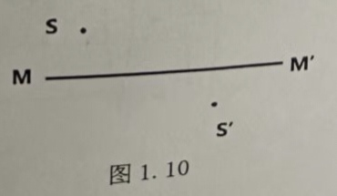

答案、思路与方法

**1. 标准符号与条件。** $MM'$ 是主轴，$S$ 是物点，$S'$ 是其像点；薄透镜两侧均为空气，光心为 $O$，物方、像方焦点为 $F,F'$。

**2. 原型作图规律。**

1. 过薄透镜光心的近轴光线方向不变。
2. 入射线平行主轴，出射线通过像方焦点 $F'$。
3. 空气中薄透镜有 $OF=-OF'$。

**3. 作图。**

1. 连接 $S,S'$，与主轴 $MM'$ 的交点即为光心 $O$。
2. 过 $O$ 作主轴的垂线，得到透镜平面。
3. 过 $S$ 作主轴平行线，交透镜平面于 $A$；连接 $A,S'$，其与主轴的交点就是 $F'$。
4. 在主轴另一侧取与 $F'$ 关于 $O$ 对称的点，得到 $F$。

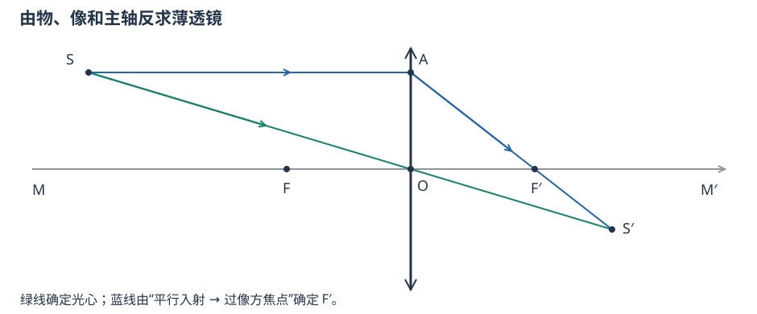

**4. 结果与检查。** $SS'$ 必须直通过 $O$；从 $S$ 发出的平行主轴线折射后必须经过 $F'$ 并到达 $S'$。原图主轴是斜线，“透镜平面垂直主轴”不等于纸面竖直。

## 二（10分）

一光源与屏间距离为0.9米，用焦距为20厘米的凸透镜插在两者之间，透镜应放在什么位置，才能使光源成像于屏上？

答案、思路与方法

**1. 标准符号与条件。** 取透镜光心为原点、向右为正。设透镜距左侧光源的正长度为 $u$，距右侧屏的正长度为 $v$，则
$$s=-u,qquad s'=v,qquad u+v=L=90\ \mathrm{cm},$$
且凸透镜 $f'=+20\ \mathrm{cm}$。

**2. 原型公式。**
$$\frac1{s'}-\frac1s=\frac1{f'}.$$
代入 $s=-u,s'=v$ 后，才可写成实物—实像的正长度形式
$$\frac1u+\frac1v=\frac1{f'}.$$

**3. 代入求解。**
$$\frac1u+\frac1v=\frac1{20},\qquad u+v=90.$$
由第一式得 $uv=20(u+v)=1800\ \mathrm{cm^2}$，于是
$$u(90-u)=1800,$$
$$u^2-90u+1800=0,$$
$$u=30\ \mathrm{cm}\quad\text{或}\quad60\ \mathrm{cm}.$$
相应地 $v=60\ \mathrm{cm}$ 或 $30\ \mathrm{cm}$。

**4. 结果与检查。** 透镜应放在距光源
$$\boxed{30\ \mathrm{cm}\ \text{或}\ 60\ \mathrm{cm}}$$
处。检查：固定物屏距离存在两位置的条件为 $L\ge4f'$；本题 $90>80$，故有两个位置。两次横向放大率分别为 $-2$ 和 $-1/2$。

## 三（10分）

物体位于凹面镜轴线上焦点之外，在焦点与凹面镜之间放一个与轴线垂直的两表面相互平行的玻璃板，其厚度为d，折射率为n。试证明：放入这玻璃板后使物移动的距离与把凹面镜向物体移动d(n−1)/n的一段距离的效果相同。

答案、思路与方法

**原题校对。** 照片印刷为“使物移动”，但“效果相同”及教材同型题应为：**放板后的最终像位置，等于去板后把凹面镜向物体移动 $d(n-1)/n$ 所得的像位置。** 以下证明这个命题；若坚持“把物体移动”，则不是同一结论。

**1. 标准符号与条件。** 固定纸面向右为正。原凹面镜顶点 $O$ 取 $x=0$；物点坐标为 $s<0$；凹面镜曲率半径为 $r<0$。玻璃板厚度 $d$、折射率 $n>1$，两面垂直主轴。定义
$$\Delta=d\left(1-\frac1n\right)>0.$$

**2. 原型公式。** 近轴光从空气斜入玻璃，$\theta_g\simeq\theta/n$。因此厚度 $d$ 的玻璃内横向传播量等于空气中传播 $d/n$，比同厚空气少
$$d-\frac dn=\Delta.$$
凹面镜成像原型为
$$\frac1{s_m} +\frac1{s'_m}=\frac2r.$$

**3. 代入证明。**

放入玻璃板后，去程的等效物距从 $s$ 变为
$$s_m=s+\Delta.$$
先按凹面镜原型求“等效坐标”中的像距
$$q=\left(\frac2r-\frac1{s+\Delta}\right)^{-1}.$$
回程再次穿板，等效传播仍比空气少 $\Delta$，故实际最终像的全局坐标为
$$X_{\text{板}}=q-\Delta.$$

现在去掉玻璃板，并把凹面镜向物体（向左）移动 $\Delta$。新镜顶点为
$$x_O=-\Delta,$$
物点相对新镜的坐标仍为
$$s_m=s-x_O=s+\Delta,$$
所以相对新镜求出的像距仍是同一个 $q$。换回全局坐标：
$$X_{\text{移镜}}=x_O+q=-\Delta+q.$$

于是
$$X_{\text{板}}=X_{\text{移镜}}.$$

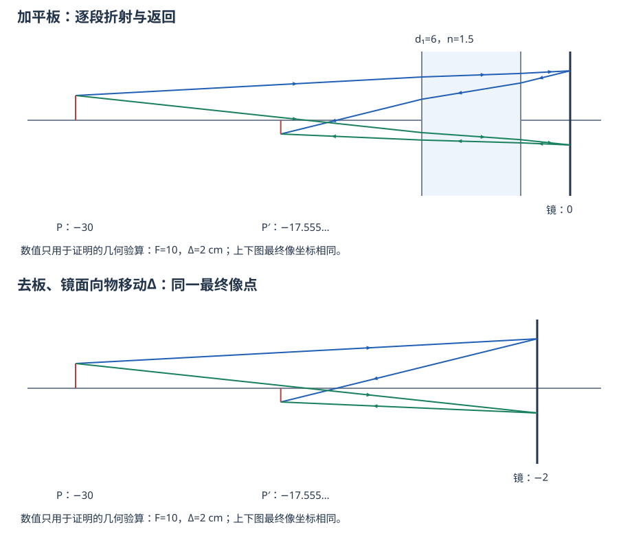

**4. 结果与检查。**
$$\boxed{\text{放入玻璃板}\ \Longleftrightarrow\ \text{凹面镜向物体移动 }d\frac{n-1}{n}}.$$
这是**最终像位等效**，不是说像必定只移动同样距离。若 $s+\Delta$ 恰为焦点，$q$ 为无穷远，应单独按平行束处理。

## 四（10分）

如图是安置在游泳池底部的照相机拍摄的一张照片的示意图，照相机的镜头竖直向上。照片中，游泳馆顶部及其它水面上的景象全呈现在半径为11 cm的圆内，水面上的运动员长度为10 cm。若已知水的折射率为1.33，假设运动员身高1.8m，请估算该游泳池的水深（结果保留两位有效数字）。

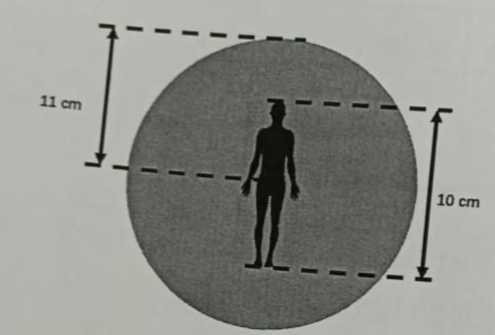

答案、思路与方法

**1. 标准符号与条件。** 照片中圆形水面像的半径为 $r_i=11\ \mathrm{cm}$，运动员像高为 $l_i=10\ \mathrm{cm}$；运动员实际身高 $L=1.8\ \mathrm m$。水的折射率 $n_w=1.33$，空气折射率近似为 1。设相机所见水面圆在实际水面上的半径为 $\rho$，水深为 $h$。

**2. 原型公式。** 同一照片上的长度按同一比例缩放：
$$\frac{\rho}{r_i}=\frac{L}{l_i}.$$
水—空气界面的临界角满足
$$\sin i_c=\frac{1}{n_w},$$
池底相机到临界出射圆边缘的几何关系为
$$\rho=h\tan i_c.$$

**3. 代入求解。**
$$\rho=11\ \mathrm{cm}\times\frac{180\ \mathrm{cm}}{10\ \mathrm{cm}}=198\ \mathrm{cm}=1.98\ \mathrm m.$$
$$i_c=\arcsin\frac1{1.33}\simeq48.8^\circ,$$
$$h=\frac{\rho}{\tan i_c}=\frac{1.98}{\tan48.8^\circ}\ \mathrm m\simeq1.73\ \mathrm m.$$

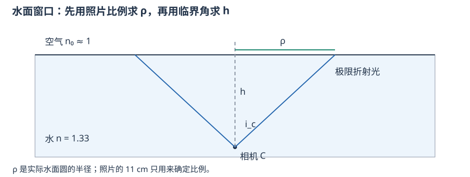

**4. 结果与检查。** 保留两位有效数字：
$$\boxed{h\simeq1.7\ \mathrm m}.$$
11 cm 是照片中圆的**半径**，不能当直径；本题临界角较大，不能用 $\tan i_c\simeq i_c$ 的近轴近似。

## 五（15分）

一束平行光垂直入射到薄平凸透镜的平表面上（图5），会聚于透镜后48cm处；如果此透镜的凸表面镀反射膜，则平行光会聚于镜前8cm处，试求透镜的折射率和凸表面的半径。

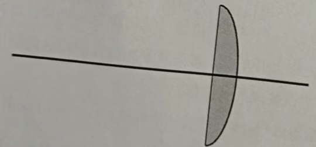

答案、思路与方法

**1. 标准符号与条件。** 薄平凸透镜置于空气中，平面在左、凸面在右；凸面的曲率半径大小为 $R>0$，折射率为 $n$，镜厚忽略。未镀膜时，平行光从平面入射，在透镜右侧 $f'=48\ \mathrm{cm}$ 会聚；凸面镀反射膜后，返回光在透镜左侧 8 cm 会聚。

**2. 原型公式。** 未镀膜时用空气中薄透镜制造者公式
$$\frac1{f'}=(n-1)\left(\frac1{r_1}-\frac1{r_2}\right).$$
本题 $r_1=\infty,r_2=-R$，故
$$f'=\frac{R}{n-1}.$$
镀膜后，平行光在玻璃中被球面反射，球面镜的近轴焦距大小为 $R/2$；会聚光再由玻璃经平面射入空气，平面折射使轴向会聚距离按折射率比变为
$$L_{\mathrm{air}}=\frac{n_{\mathrm{air}}}{n_{\mathrm{glass}}}L_{\mathrm{glass}}=\frac1n\frac R2.$$

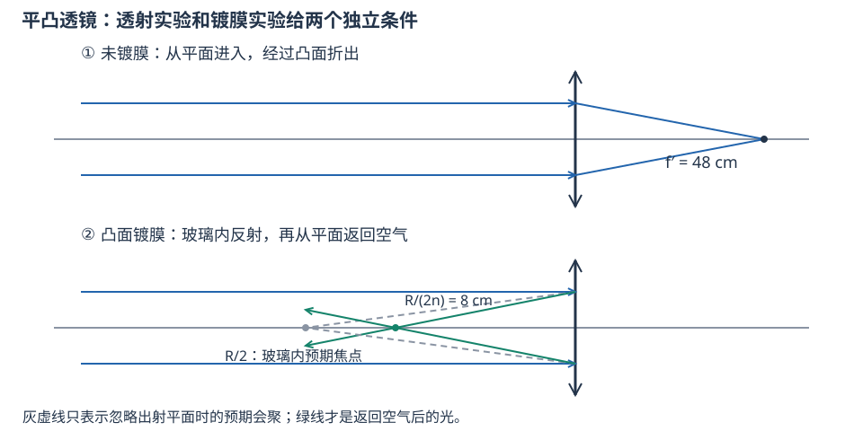

**3. 代入求解。** 两个独立实验分别给出
$$\frac{R}{n-1}=48,$$
$$\frac{R}{2n}=8.$$
第二式给 $R=16n$。代入第一式：
$$\frac{16n}{n-1}=48,$$
$$16n=48n-48,$$
$$n=1.5,$$
继而
$$R=16n=24\ \mathrm{cm}.$$

**4. 结果与检查。**
$$\boxed{n=1.5,\qquad R=24\ \mathrm{cm}}.$$
第一条约束是**透射薄透镜焦距**，第二条是**球面反射后再经平面折射**；不能把镀膜后的系统仍直接当成原薄透镜。回代得 $24/(1.5-1)=48$、$24/(2\times1.5)=8$，均符合题设。

## 六（15分）

把曲率半径为9cm的会聚透镜的中央部分C切去，C的宽度为0.8cm，把余下的两部分粘起来。如在其对称轴上距透镜5cm处置一点光源，试求像的位置。

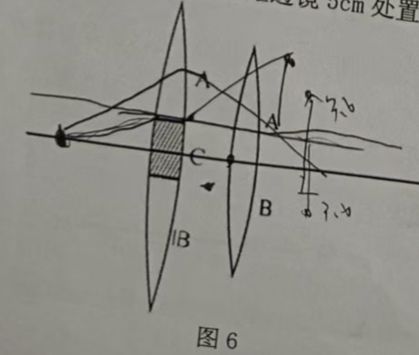

答案、思路与方法

**原题条件审查。** 印刷题只给曲率半径大小 9 cm 和切去宽度 0.8 cm，未给折射率、两面的曲率符号及薄透镜假设，因而不能唯一得到数值像位。以下先给通式，再列出照片手写所暗示的补充条件 $n=1.5$、空气中对称双凸薄透镜。

**1. 标准符号与条件。** 原完整透镜光心为坐标原点，主轴向右、竖直向上为正；点光源坐标为
$$s=-5\ \mathrm{cm},\qquad y=0.$$
切去中央宽 $w=0.8\ \mathrm{cm}$ 后，上、下两片的光轴高度分别为
$$c_+=+\frac w2,qquad c_-=-\frac w2.$$
设完整透镜像方焦距为 $f'$。

**2. 原型公式。**
$$\frac1{f'}=(n-1)\left(\frac1{r_1}-\frac1{r_2}\right),$$
$$\frac1{s'}-\frac1s=\frac1{f'},\qquad \beta=\frac{s'}s.$$
对光轴平移到高度 $c$ 的子透镜，物点相对该子轴的高度为 $-c$，所以全局像高为
$$y'=c+\beta(-c)=(1-\beta)c.$$

**3. 代入求解。** 通式先保留为
$$s'=\left(\frac1{f'}+\frac1s\right)^{-1},\qquad y'_{\pm}=(1-\beta)c_{\pm}.$$

若补充 $n=1.5,r_1=+9\ \mathrm{cm},r_2=-9\ \mathrm{cm}$，则
$$\frac1{f'}=(1.5-1)\left(\frac19-\frac1{-9}\right)=\frac19,$$
$$f'=9\ \mathrm{cm}.$$
成像式给
$$\frac1{s'}-\frac1{-5}=\frac19,$$
$$s'=-\frac{45}{4}=-11.25\ \mathrm{cm},\qquad \beta=\frac{-11.25}{-5}=2.25.$$
又因 $c_{\pm}=\pm0.4\ \mathrm{cm}$，
$$y'_{pm}=(1-2.25)(\pm0.4)=\mp0.50\ \mathrm{cm}.$$

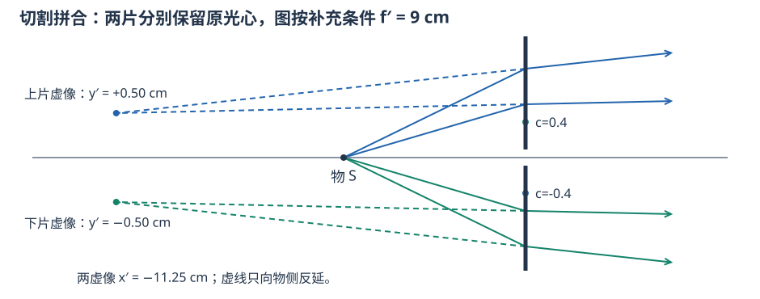

**4. 结果与检查。** 原印刷题只能得到上述通式；在补充条件下，两像均在透镜左侧 11.25 cm，为虚像，像高分别为 $+0.50$ cm 和 $-0.50$ cm，间距 1.00 cm。切片只平移子透镜光轴，不改变其焦距和纵向像距。

## 七（20分）

如图7所示，凸透镜的焦距为4a，凹透镜的焦距为−3a，两透镜间距为2a。

（1）若在凸透镜左侧8a处放置一个物体，求像的位置，并画成像光路的示意图。

（2）如图7所示，若将折射率为1.5的等腰直角棱镜放置在凸透镜左侧，棱镜的直角边长为1.5a，在棱镜上方a处放置物体。棱镜边缘与凸透镜的距离为2a。求物体经棱镜和两个透镜所成像的位置、横向放大率，说明像的性质。

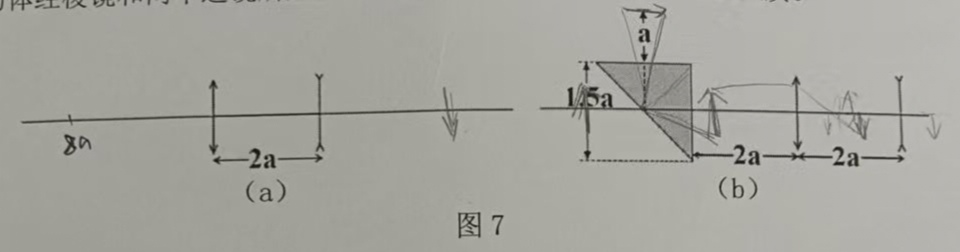

答案、思路与方法

### （1）两薄透镜逐次成像

**1. 标准符号与条件。** 令凸透镜 $L_1$ 位于 $x=0$，凹透镜 $L_2$ 位于 $x=2a$，向右为正：
$$f'_1=+4a,qquad f'_2=-3a.$$
物体在 $x=-8a$，故第一次物距 $s_1=-8a$。

**2. 原型公式。** 每片透镜分别使用
$$\frac1{s'_j}-\frac1{s_j}=\frac1{f'_j},\qquad \beta_j=\frac{s'_j}{s_j}.$$
第一片像作为第二片物，须从第二片重新量：
$$s_2=s'_1-2a.$$

**3. 代入求解。** 第一片：
$$\frac1{s'_1}-\frac1{-8a}=\frac1{4a}\quad\Rightarrow\quad s'_1=+8a.$$
该会聚点位于第二片右侧，因此对第二片是虚物：
$$s_2=8a-2a=+6a.$$
第二片：
$$\frac1{s'_2}-\frac1{6a}=\frac1{-3a}\quad\Rightarrow\quad s'_2=-6a.$$
最终像的全局坐标
$$x'=2a+s'_2=-4a.$$
总横向放大率
$$\beta=\beta_1\beta_2=\frac{8a}{-8a}\cdot\frac{-6a}{6a}=+1.$$

**4. 结果与检查。** 最终像在凸透镜左侧 $4a$（或凹透镜左侧 $6a$），为正立、等大的虚像：
$$\boxed{x'=-4a,\qquad \beta=+1}.$$
第二片收到的是正在会聚的光束，故其物点虽是第一片的像点，却是第二片的**虚物**。

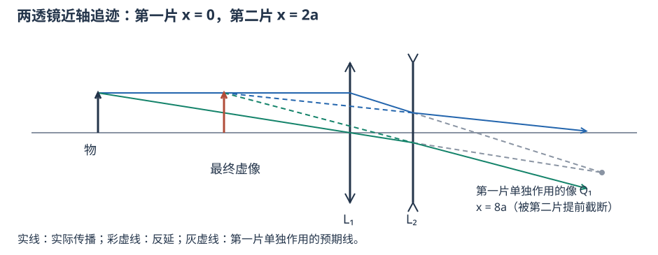

### （2）棱镜折转后进入两透镜

**1. 标准符号与条件。** 棱镜折射率 $n=1.5$，等腰直角棱镜直角边长 $1.5a$；物体在棱镜上方 $a$，棱镜出射边到凸透镜距离为 $2a$。凸、凹透镜参数仍为 $f'_1=4a,f'_2=-3a$。

**2. 原型关系。** 斜边入射角为 $45^\circ$，全反射临界角满足
$$\sin i_c=\frac1n.$$
近轴光在均匀玻璃中的传播，用约化长度 $\ell/n$ 计入等效物距；物处在正透镜前焦面时，出射为平行光。物高与出射倾角满足
$$\theta=-\frac{y}{f'_1},$$
平行光经第二片后的像高可由
$$y'=f'_2\theta$$
求得。

**3. 代入求解。**
$$i_c=\arcsin\frac1{1.5}\simeq41.8^\circ<45^\circ,$$
故斜边发生全反射，光路折转 $90^\circ$。从物到凸透镜的等效距离为
$$a+\frac{1.5a}{1.5}+2a=4a=f'_1.$$
因此凸透镜后为平行光；凹透镜对平行光成像于
$$s'_2=f'_2=-3a.$$
即最终像在凹透镜左侧 $3a$，也就是凸透镜左侧 $a$。沿展开后的共同横轴计算横向倍率：
$$\beta=\frac{y'}y=\frac{f'_2(-y/f'_1)}y=-\frac{f'_2}{f'_1}=\frac34.$$

**4. 结果与检查。**
$$\boxed{x'=-a,\qquad |\beta|=\frac34}.$$
像为缩小虚像。在把棱镜反射光路“展开”为一直线的坐标中，倍率为 $+3/4$；若始终使用纸面固定的上下方向，一次反射会额外改变图像手性，须在图旁声明坐标约定，不能只看一个负号下结论。

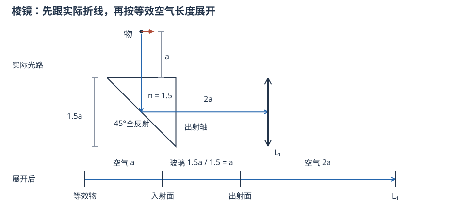

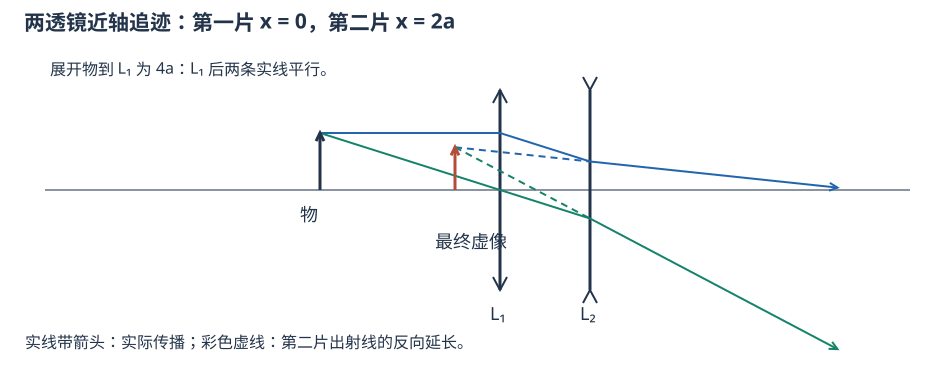

## 附加题（1）（5分）

估算人眼在明视距离处的分辨率。

答案、思路与方法

**1. 标准符号与条件。** 明视距离取 $D_0=25\ \mathrm{cm}=0.25\ \mathrm m$，正常眼最小分辨角取 $\theta_{min}=1'$；小角度须换成弧度。

**2. 原型公式。** 明视距离处的最小线间距
$$\Delta y=D_0\tan\theta_{min}\simeq D_0\theta_{min}.$$

**3. 代入求解。**
$$1'=\frac{\pi}{180\times60}\ \mathrm{rad}=2.91\times10^{-4}\ \mathrm{rad},$$
$$\Delta y\simeq0.25\times2.91\times10^{-4}\ \mathrm m
=7.27\times10^{-5}\ \mathrm m
=0.0727\ \mathrm{mm}.$$

**4. 结果与检查。**
$$\boxed{\Delta y\simeq0.073\ \mathrm{mm}\approx0.1\ \mathrm{mm}}.$$
若教材采用略不同的正常眼分辨角，常给约 $0.1$ mm；答案应同时写明所采用的角分辨率。

## 附加题（2）（5分）

眼睛的构造可简化为一折射球面模型，其曲率半径为5.55 mm，内部为折射率等于4/3的液体，外部是空气，其折射率近似地等于1。试计算眼球的两个焦距。用肉眼观察月球时，月球对眼的张角为1°，试问视网膜上月球的像有多大？

答案、思路与方法

**1. 标准符号与条件。** 把眼球简化为单个球面折射系统：空气 $n=1$，眼内液体 $n'=4/3$，曲率半径 $r=+5.55\ \mathrm{mm}$。月球对眼的张角为 $\alpha=1^\circ$，物在无穷远。

**2. 原型公式。** 单球面折射的物方、像方焦距为
$$f=-\frac{nr}{n'-n},\qquad f'=\frac{n'r}{n'-n}.$$
通过曲率中心的光线不偏折。球面顶点到曲率中心的距离为 $r$，所以无穷远物体的近轴像高可写为
$$y'=(f'-r)\tan\alpha.$$
等价地，节点关系给 $\alpha'=(n/n')\alpha$，再用 $y'=f'\tan\alpha'$。

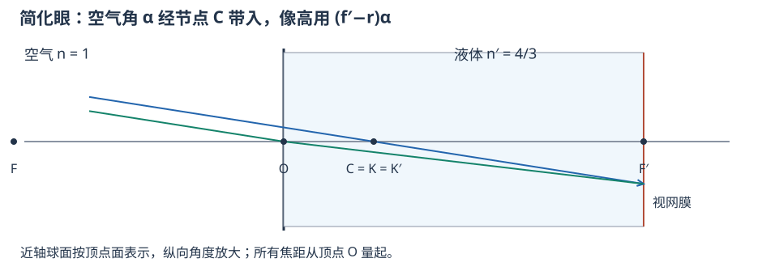

**3. 代入求解。**
$$f=-\frac{1\times5.55}{4/3-1}=-16.65\ \mathrm{mm},$$
$$f'=\frac{(4/3)\times5.55}{4/3-1}=22.20\ \mathrm{mm}.$$
因此
$$y'=(22.20-5.55)\tan1^\circ
=16.65\tan1^\circ
\simeq0.291\ \mathrm{mm}.$$

**4. 结果与检查。**
$$\boxed{f=-16.65\ \mathrm{mm},\quad f'=+22.20\ \mathrm{mm},\quad y'\simeq0.291\ \mathrm{mm}}.$$
两侧折射率不同，所以 $|f|\ne f'$；不能直接用 $f'\alpha$，那会把物方张角误当成像方张角。

## 附加题（3）（5分）

照相机镜头的光圈数F表示焦距与光圈直径的比值。请问在曝光量一定的前提下，曝光时间与光圈数有何关系？

答案、思路与方法

**1. 标准符号与条件。** 设镜头像方焦距为 $f'$，光圈直径为 $D$，光圈数为
$$N=\frac{f'}D.$$
固定场景亮度、焦距、透过率和感光度，只改变光圈与曝光时间 $t$。

**2. 原型公式。** 入瞳面积 $A\propto D^2$，像面照度
$$E'\propto D^2\propto\frac1{N^2}.$$
曝光量为
$$H=E't.$$

**3. 代入推导。** 在曝光量 $H$ 不变时
$$\frac{t}{N^2}=\text{常量},$$
所以两组设置满足
$$\boxed{\frac{t_2}{t_1}=\left(\frac{N_2}{N_1}\right)^2}.$$

**4. 结果与检查。**
$$\boxed{t\propto N^2}.$$
例如光圈数增大一档（乘 $\sqrt2$），曝光时间应加倍。光圈数越大，实际孔径越小，不能把方向记反。

## 附加题（4）（5分）

光学的应用在我们现代生活中无处不在。最新的全画幅相机，CCD尺寸与传统的135胶卷一样，即36×24mm）如果配上50/1.4的标准镜头（即相机焦距为50mm，光圈（数）为1.4），要使CCD的分辨率能与该镜头的光学性能相匹配，CCD至少要做到多少像素以上？

答案、思路与方法

**原题条件审查。** 题目给出 36 mm × 24 mm 传感器和 50/1.4 镜头，却没有给工作波长，也没有说明“匹配”采用瑞利斑、艾里斑直径还是奈奎斯特采样，因此不存在唯一数值答案。下面取常用绿光 $\lambda=550\ \mathrm{nm}=5.50\times10^{-4}\ \mathrm{mm}$，并分别列出三种标准。

**1. 标准符号与条件。** 光圈数 $N=1.4$，传感器面积
$$A_s=36\times24=864\ \mathrm{mm^2}.$$
设方形像素边长为 $p$，总像素数 $P=A_s/p^2$。

**2. 原型公式。**

1. 瑞利半径：$d_R=1.22\lambda N$；若取 $p=d_R$，则 $P=A_s/d_R^2$。
2. 艾里斑直径：$d_A=2.44\lambda N$；若取 $p=d_A$，则 $P=A_s/d_A^2$。
3. 非相干成像截止频率：$\nu_c=1/(\lambda N)$；奈奎斯特要求 $1/(2p)\ge\nu_c$，即 $p\le\lambda N/2$。

**3. 代入求解。**

瑞利半径标准：
$$d_R=1.22(5.50\times10^{-4})(1.4)=9.39\times10^{-4}\ \mathrm{mm},$$
$$P_R=\frac{864}{(9.39\times10^{-4})^2}\simeq9.8\times10^8.$$

艾里斑直径标准：
$$d_A=1.88\times10^{-3}\ \mathrm{mm},$$
$$P_A=\frac{864}{(1.88\times10^{-3})^2}\simeq2.45\times10^8.$$

奈奎斯特截止频率标准：
$$p\le\frac{(5.50\times10^{-4})(1.4)}2=3.85\times10^{-4}\ \mathrm{mm},$$
$$P_N\ge\frac{864}{(3.85\times10^{-4})^2}\simeq5.8\times10^9.$$

**4. 结果与检查。** 采用不同“匹配”定义会得到约 2.45 亿、9.8 亿或至少 58 亿像素，差异并非算错，而是采样准则不同。考试作答应先声明 $\lambda$ 和判据，再给数值；若命题人期待唯一答案，原题必须补充这两项。

---

## 这份往年题说明了什么

本卷确实出现了棱镜最小偏向角、近轴与薄镜近似、球差、热路面蜃景、仪器倒正像、分辨率、等光程、逆向作图、物屏定位、穿板与移镜、全反射视窗、镀银往返、切割透镜和棱镜—透镜组合。**“棱镜没有题”“只背成像公式就够”均与这份卷面不符。** 这只能证明本卷考过这些内容，不能推出今年只考这些或各题一定重复。

|题目|分值|主要考点|看到题干后的第一步|
|---|---:|---|---|
|一1—4|8|定律、球差、最小偏向、近似|先说成立条件，再给关系式|
|一5—6|4|共轭互换、分层折射|固定镜焦距；判断折射率梯度|
|一7—9|6|仪器、分辨、等光程|区分正倒像、倍率与分辨、共轭与非共轭|
|一10|2|已知主轴与物像反求透镜|先连SS′找O，再作平行线找F′|
|二|10|物屏固定、两位置法|几何$u+v=L$与成像约束联立|
|三|10|平行板、镜面反射、往返|去程和回程分别画出，比较最终全局像位|
|四|10|临界角、照片比例与几何|照片长度先换实际长度，再用临界角|
|五|15|薄镜、镀银、再出射|两个实验给n、R两条独立约束|
|六|15|偏心子孔径、光心平移|先审缺条件，再各算一片并平移回坐标|
|七|20|逐次成像、虚物、棱镜折转、倍率|画元件坐标；玻璃等效传播用长度/n|
|附加1—4|每题5|眼分辨、不同介质焦距、曝光、像素估算|写模型与估算参数，检查角度属于哪一侧|

## 解题路径：先减少未知量，再选公式

**第一步，分结构与状态。** $n,r,d,f'$属于系统结构；$s,s',y,y',\theta$描述本次物光束和像。题五有两个结构未知n、R，题给两次实验；题二只有一个透镜位置未知，物屏距离先把两个距离关联起来。别把同一成像式的两个变形当成两条独立约束。

**第二步，逐个“事件”分段。** 穿过界面、遇到透镜、被镜面反射各列一次。每次先填四件事：本元件原点、入射方向、入射束是否会聚、将求哪一个像。第二片的物距必须重新从第二片量起：$s_2=s_1'-d$。像在下一片后方，下一片收到会聚束，就是虚物，不能只凭“左实右虚”死记。

**第三步，选量的用途。** 相位／等光程用$n\ell$；平行板对近轴高度传播的等效空气长度用$\ell/n$；光焦度用$(n'-n)/r$；横向放大率用像高/物高；角放大率用出射/入射小倾角。眼与液体模型两侧折射率不同，$|f|$与$f'$不相等。

**第四步，遇到零或无穷先看光束。** 分母为零通常对应平行束；改用倾角传递，别在第七题中硬算“∞×0”。光束重新进入下一面前，可以根本没有真实中间像。

**第五步，检查一个式子以外的事实。** 回代题干两次实验；检查实像是否在实际出射方向、虚像是否由反延得到；检查n无单位、半径为长度、角度换成弧度；问像位置时同时报“距哪个元件、哪一侧”。

## 作图的得分步骤

1. 先画主轴、每个元件及其光心／顶点，标出真实距离和正方向。棱镜先画实际折线，再另画展开图。
2. 对同一物点选两条独立的近轴光线：平行主轴线、过光心线或经过物方焦点的线；第二元件必须接上第一元件送来的实际线。
3. 实际传播画实线并加箭头；预期像、反向延长和辅助构造用不同的虚线并写明用途。虚物是入射束的预期会聚点，虚像是出射线的反向延长交点。
4. 凹透镜不必把所有光都“射开”：它改变会聚程度；先看入射束。反射后传播方向改变，不能不声明就偷换坐标正向。
5. 最后用所求坐标对照图：两条对应线应交于同一像点；若题设为近轴，只画一级模型，不用大角草图去否定小角公式。

## 按此顺序复习与自测

先闭卷做抄题版，再看解析。优先补能够连带解决多题的步骤：**虚实物像与符号 → 球面／薄镜 → 逐次成像与倍率 → 穿板和棱镜 → 仪器与分辨 → 逆向作图**。下面是自编回测，和原题分开；每题答案在后面。

1. 第五题若把凸面反射后的8 cm改成12 cm，透射仍为48 cm，求n和R。
2. 第七（1）若把物体改放在凸镜左4a，像在哪里、倍率多大？
3. 第六题的补充条件取对称双凸、n=1.5，若切宽由0.8 cm改成0.4 cm，哪些像坐标不变？
4. 眼球模型中，若外界张角减半，像方焦距会改变吗？像高会怎样？

**回测答案。** 1：$R/(n-1)=48$、$R/(2n)=12$，解得$n=2,R=48\ \mathrm{cm}$。2：先出平行束，最终在凹镜左3a、凸镜左a，随轴横向倍率$+3/4$，正立缩小虚像。3：纵向仍$-11.25\ \mathrm{cm}$，像高改为$\pm0.25\ \mathrm{cm}$，间距0.50 cm。4：焦距由结构决定不变，像高近轴减半。

## 把缺条件的地方记在题旁

- 第三题：印刷“使物移动”疑为“使像移动”；解析证明两系统最终像位相同，像移量一般不是镜移量。
- 第六题：n=1.5是照片手写，不是印刷题干；两面半径、薄镜假设也须明确。答案给通式及补充条件下的数值。
- 第一大题9：依教材理想／近轴成像语境选ACD；若要求任意宽束严格等光程，题干需补条件。
- 附加4：波长与采样准则未给，无法从原文确定唯一像素数。

来源：本次3张试卷照片；姚启钧《光学教程》第五版第三章、第四章相关节及附录3.3；本班3-2、3-4、3-5、3-6、3-7、3-9、4-1、4-9课件。同型题交叉参照已有题册B09、B19、B21、B23、B28和薄镜镀银例；数值全部按本卷重新计算。原卷年份、命题单位与标准答案未提供。
