# 光学自学讲义

> 第1.9.1版 · 2026-10-20
> 姚启钧《光学教程》 × 老师 PPT × 作业意图分析  
> 本文件是 GitHub 直接预览版。更舒适的阅读、折叠答案和打印功能请打开同目录的 `光学自学讲义.html`。

## 一、如何使用

**期中（10月15日更新）**：十月最后一周课内考试，第三、四章为主；已讲内容均可能考，物理学史除外。按课表推算为10月27日或29日，具体课次待定，先按27日准备。现有八课以第三章为主，第四章待补；第四章约讲至第9节，待核对。

这套讲义同时保留两层：

- **逻辑层**：现象 → 对象 → 关系 → 条件 → 公式，负责建立完整理解。
- **考试层**：题型识别 → 解题方法 → 检查 → 复盘，负责限时调用。

指定作业保留原题、方法入口和检查点；独立练习附折叠答案。

[原理、定律与定理索引](原理与定理索引.md)：按来源和正文位置查找。

## 二、完整课程地图

贯穿几何光学的问题是：**光学界面或系统怎样把某个物点发出的入射光束，变成指向某个像点的出射光束？**

`光程与费马原理 → 反射/折射 → 近轴近似 → 单球面成像 → 薄透镜 → 共轴系统 → 逐次成像与实验反演`

| 课次 | 核心问题 | 考试产出 | 对应材料 |
|---|---|---|---|
| 01 基础原理与统一语言 | 光路由什么决定，怎样描述物像？ | 光程、费马、基本定律、实虚与符号 | 教材3.1、3.6；3-3 PPT |
| 02 全反射与棱镜 | 界面怎样改变光线方向？ | 临界角、最小偏向角、色散 | 3-2 PPT；教材 3.1–3.5 |
| 03 球面折射 | 近轴条件怎样产生物像公式？ | 球面、平面、视深、多界面、亥姆霍兹—拉格朗日定理 | 3-4 PPT；作业 3、10、12*、13、14 |
| 04 球面反射 | 反射能否纳入同一体系？ | 球面镜、平面镜、镜像法 | 3-5 PPT；作业 6–9* |
| 05 薄透镜 | 怎样合并两个折射面？ | 焦距、放大率、作图、反求 | 3-6 PPT；作业 15、17–19、25* |
| 06 共轴系统 | 怎样压缩复杂系统？ | 厚透镜、等效焦距、主平面 | 3-7 PPT |
| 07 基点与镜像法 | 怎样保持方向、压缩折射反射系统？ | 节点推导、复合系统、镀银半球三种解法 | 完整3-7第19–27页；教材148–153页 |
| 08 一般光具组作图 | 不同介质时怎样画图、选公式？ | 三条特殊线、一般高斯与牛顿公式、3.26和3.29*入口 | 3-9全6页；教材150、164页 |
| 09 综合与实验（待编） | 前一级的像怎样成为后一级的物？ | 21*–23*、28* 类题和实验反演 | 作业与习题课 |
| 第四章（待补） | 哪些已讲概念与方法需纳入？ | 根据课堂材料逐节补齐考点与方法 | 教材已有，第四章PPT尚缺；约第9节待核对 |
| 10 期中冲刺（待编） | 怎样在限时条件下稳定调用？ | 三四章为主，检查其他已讲内容，排除物理学史 | 已有大致范围；题型、分值和时长待补 |

## 三、作业布置逻辑

从题号的安排来看，老师在把难度一层层往上推：

1. **会描述**：3、10、12*、13、14，把真实装置翻译为界面、传播方向、物距、像距和曲率半径。
2. **会转换**：6–9*、15、17–19、25*，在反射镜、平行结构和薄透镜间切换，并让公式与作图互证。
3. **会反推**：21*–23*、28*，处理多次成像、反射—折射耦合、未知参数和实验可测量量。

两道思考题还透露了老师重视：

- 把成像公式改写成函数，确定定义域并求极值；
- 区分实物与虚物，理解“负透镜只成虚像”等口诀的适用边界。

因此更合理的复习顺序是：

`实虚和符号 → 单界面公式 → 作图与公式互证 → 逐次成像 → 极值和实验反演`

---

# 第 01 课：几何光学的基础原理与统一语言

## 0. 先掌握几何光学的基础原理

先问“光为什么沿这条路走”，再问“这些光线在哪里成像”。本节建立 [[光程与费马原理]]，并把反射、折射和成像公式放回同一条推理链。

来源：教材第三章§3.1，书页114—116（PDF第132—134页）；成像的等光程条件见§3.6，书页142—144。下文数值例题与检查题为讲义补充。

### 0.1 光线模型与四项基本规律

光线表示传播方向，不是能无限缩窄的实体细光束。只有装置和光束的特征尺度远大于波长、衍射影响可忽略时，才能主要用光线描述传播。在各向同性介质中，光线方向与当地波面的法线方向一致；波面是同一时刻相位相同的点组成的面。

| 规律 | 准确表述 | 先检查的条件与常见误读 |
| --- | --- | --- |
| 直线传播 | 光在均匀介质中沿直线传播 | 均匀性不可删去；折射率随位置变化时，光线可以弯曲 |
| 反射定律 | 入射线、反射线和法线共面；入射线与反射线分居法线两侧，反射角等于入射角 | 角从法线量；曲面用入射点的局部法线 |
| 折射定律（斯涅耳定律） | 入射线、折射线和法线共面，$n_1\sin i=n_2\sin r$ | 本节的$i,r$是相对法线的非负夹角；后文有向角须按符号约定处理。全反射时没有相应的传播折射光线 |
| 独立传播与光路可逆 | 在线性介质中，光束相遇后各自的传播路径不因另一束光而改变；本章普通互易系统中的光路可反向走回 | 独立传播不等于没有干涉；可逆不等于反向计算时照抄原物像距符号 |

独立传播说的是各光束的传播行为。重叠区的电场仍应先叠加，再计算强度：

$$
\mathbf{E}=\mathbf{E}_1+\mathbf{E}_2,\qquad
I\propto\left\langle\left|\mathbf{E}_1+\mathbf{E}_2\right|^2\right\rangle.
$$

因此，相干条件满足时可以出现干涉；只有干涉交叉项平均为零等条件成立时，才能把强度直接相加。不要把几何光学的独立传播规律误读成“任何情况下都是$I=I_1+I_2$”。

### 0.2 光程：把不同介质中的路段放到同一尺度

几何路程只计长度，光程还计入折射率：

$$
\boxed{L=\int_A^B n(\mathbf{r})\,\mathrm ds}.
$$

这里$\mathrm ds$是沿候选路径的微小几何长度；分段均匀时，$L=\sum_j n_j\ell_j$。折射率无量纲，所以光程仍以米、厘米等长度单位表示，不能把光程直接当时间。

在本章无色散近似下，$v=c/n$，传播时间为

$$
t=\int_A^B\frac{\mathrm ds}{v}=\frac{L}{c}.
$$

也就是说，光程是对应同样传播时间的真空路程。若用单色波的相位描述，则沿路积累的相位为$2\pi L/\lambda_0$，其中$\lambda_0$是真空波长。明显色散介质中脉冲的传播时间还涉及群速度，不把本节的时间说法无条件推广过去。

**小例子**：空气中走$3\,\mathrm{cm}$、折射率$1.5$的玻璃中走$2\,\mathrm{cm}$，几何路程为$5\,\mathrm{cm}$，光程却为$3+1.5\times2=6\,\mathrm{cm}$。

### 0.3 费马原理：固定端点，比较邻近路径的光程

在本章静止、透明、各向同性介质的几何光学模型中，固定起点$A$和终点$B$，真实光路相对于邻近允许路径的光程取驻值：

$$
\boxed{\delta L=\delta\int_A^B n\,\mathrm ds=0}.
$$

“驻值”指一阶变化为零，不是光程本身为零。若路径由一个参数$q$描述，则真实路径$q_0$附近满足

$$
L(q_0+\varepsilon)-L(q_0)
=L'(q_0)\varepsilon+O(\varepsilon^2),\qquad L'(q_0)=0.
$$

**不要省掉三个限定**：两端点固定；比较的是光程而非几何长度；比较邻近、满足指定界面和反射次数等约束的路径，而非在任意路线中寻找全局最短路。候选路径不必预先满足反射或折射定律，驻值条件正用来选出真实路径。

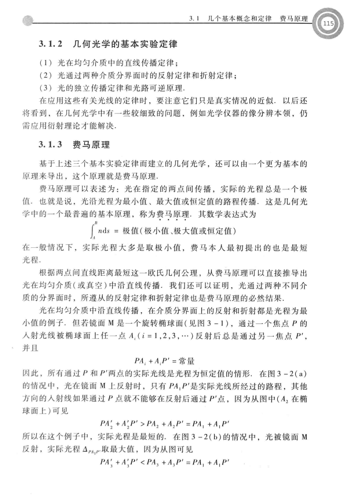

*教材书页115，PDF第133页。上部列基本实验定律，中部给出费马原理和光程积分，下部比较不同反射路径。教材把极小、极大和恒定光程统称为“极值”；用一阶驻值来理解，能避免把它缩成“总是最短”。积分中的n为折射率，ds为路程元，A、B为固定端点。*

教材最常见的例子是极小光程，但不是只有这一种：

- **均匀介质中的直线、平面镜反射**：在相应约束下为光程极小的情形。
- **旋转椭球面反射镜**：从一个焦点$P$发出、经镜面到另一焦点$P'$的光线，满足$PA+AP'=2a$，其中$a$是椭圆长半轴。同一介质中，这一连续光路族的光程相同。
- **教材图3-2的曲面镜**：在图示反射点变化的约束路径族中，可分别出现极小和极大；因此不能用“增加任何一点光程都一定变长”概括所有真实光路。

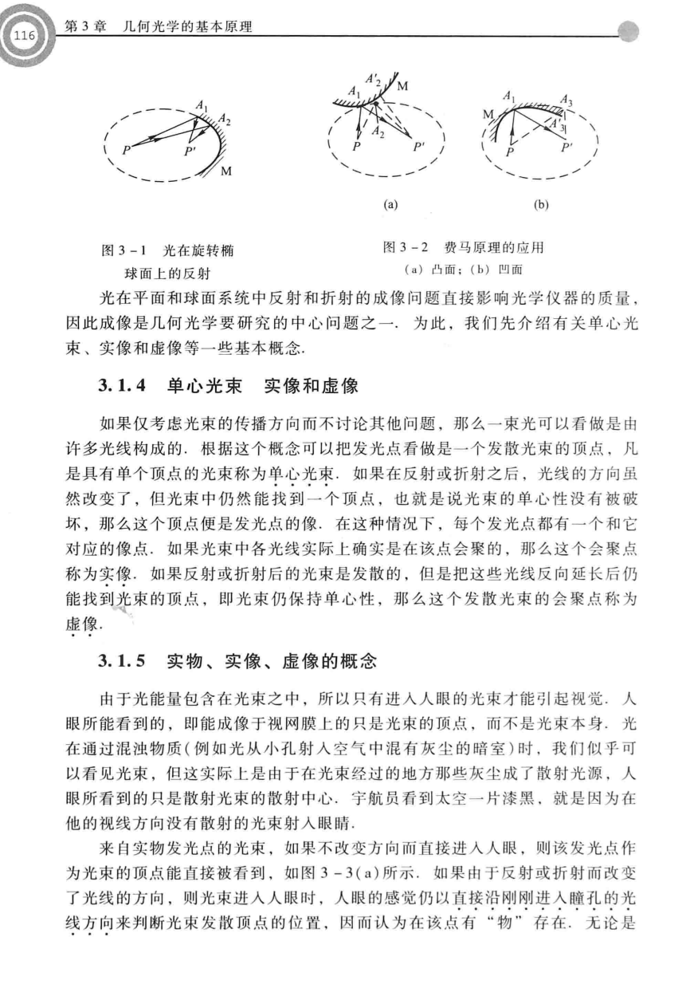

*教材书页116，PDF第134页，上半部图3-1与图3-2。P、P′为固定物像点，M为镜面，A₁、A₂等为镜面比较点。图3-1用两焦点展示恒定光程；图3-2比较实际反射点A₁附近的候选折线路径。图下半部转入单心光束与实虚像概念，正好连接本课后文。*

**概念辨析**：“不考物理学史”只排除历史叙述，不能据此删掉名字中有人名的物理原理。费马原理是教材第三章的正式内容。

### 0.4 从费马原理得到反射与折射

均匀介质中$n$为常数，光程驻值问题化为几何路程驻值问题；在无其他障碍的两点之间，实际光路为直线。

展开短推导：怎样由驻值条件得到反射、折射定律

图为依据教材§3.1.3的教学重绘。实线连接固定端点A、B，P可沿界面移动；虚线是两点直接连线。图中每个角从P处法线量，两个直角三角形分别给出推导中的两段路长。

对平面界面，设上方点$A=(0,a)$、界面点$P=(x,0)$，其中$a>0$。下方点$B=(d,-b)$、$b>0$。分段均匀时

$$
L(x)=n_1\sqrt{x^2+a^2}+n_2\sqrt{(d-x)^2+b^2}.
$$

真实折射点使$L'(x)=0$，因此

$$
\frac{n_1x}{\sqrt{x^2+a^2}}
-\frac{n_2(d-x)}{\sqrt{(d-x)^2+b^2}}=0
\quad\Longrightarrow\quad n_1\sin i=n_2\sin r.
$$

这里两个分数正是两段光线相对法线夹角的正弦。若改成两个端点都在镜面同侧，并令两段处于同一介质，同样求导就得到$\sin i=\sin r$，即反射角等于入射角。这段短推导的作用是看清“光程驻值→界面定律”，不是要求把反射、折射另背成两套互不相关的规则。

### 0.5 贯穿例题：几何距离更长，为什么反而是实际光路？

取上式$a=3\,\mathrm{cm},b=4\,\mathrm{cm},d=7\,\mathrm{cm}$，上方空气$n_1=1$，下方水$n_2=4/3$。

先把题目转成“求界面交点”：A、B与折射率给定，未知的是P的横坐标x。将a、b、d代入上节的驻值方程，可先在0到7 cm之间求根；本例用两段3—4—5直角三角形检查x=4 cm恰好满足方程。两项光程的二阶导数均为正，保证这个根唯一；一般数值不整齐时照同一个方程求数值根，无须猜三角形。

**先试直线**：直线$AB$与界面交于$x=3\,\mathrm{cm}$，两边角度都是$45^\circ$；但两侧折射率不同，$n_1\sin45^\circ\ne n_2\sin45^\circ$，它不是真实折射光路。

**再求实际点**：当$x=4\,\mathrm{cm}$时，两段各长$5\,\mathrm{cm}$，

$$
\sin i=\frac45,\qquad \sin r=\frac35,\qquad
n_1\sin i=\frac45=n_2\sin r.
$$

从$n$小的空气进入$n$大的水，折射角小于入射角，光线向法线偏折。比较两条路：

| 候选路线 | 几何路程 | 光程 |
| --- | --- | --- |
| 直接连线，经$x=3$ | $7\sqrt2\approx9.90\,\mathrm{cm}$ | $25\sqrt2/3\approx11.79\,\mathrm{cm}$ |
| 实际折射，经$x=4$ | $10\,\mathrm{cm}$ | $35/3\approx11.67\,\mathrm{cm}$ |

真实路线的几何长度稍长，却少走了传播较慢的水中路段。这里平面折射的$L''(x)>0$，所以驻值确为极小；这是本例算出的性质，不能反过来把所有费马问题都定义成求最小值。

### 0.6 费马原理与成像的等光程条件

单条实际光路的驻值，并不表示所有任意路径都等光程。对连接同一实际物点和理想实像点的连续成像光束，光程不应随所选光线的入射高度改变；教材§3.6正利用这一条件得到近轴成像公式。

用$h$标记光线在球面的入射高度，若展开后

$$
L(h)=L_0+Ah+Bh^2+\cdots,
$$

则在保留的近轴近似阶次内，消除选线高度的影响要求相应系数$A=0,B=0$；由此分别得到横向成像关系和轴上物像公式。后面的“5.1教材为什么能从光程推出成像公式”会具体展示。这个近轴等光程条件有物点、孔径和近似阶次的限制，不是说真实镜头中任意大角度光线都严格等光程。

### 0.7 最小记忆包与快速检查

| 中文学术名称 | 必须能准确说出的内容 |
| --- | --- |
| 光程 | $L=\int n\,\mathrm ds$，分段均匀为$\sum n_j\ell_j$，单位是长度 |
| 费马原理（Fermat's principle） | 固定端点，真实光路的光程对邻近允许路径取驻值，$\delta L=0$ |
| 反射与斯涅耳折射定律 | 共面条件、相对法线量角、$i=r$或$n_1\sin i=n_2\sin r$ |
| 独立传播与可逆性 | 不排斥干涉；反向解题仍需重判符号 |
| 理想成像等光程条件 | 同一物像点对的连续成像光束，在所用近似内不依赖选线高度 |

1. “费马原理说光总走几何距离最短的路线。”哪里错？

> [!question] 第1题
> 我的回答：
> 我不确定的地方：

参考答案

比较量应是光程，而不是单纯几何长度；一般要求驻值，不能无条件限定为最小。上面空气—水的例子已说明真实路线可以比两点直线更长。

2. “两条实际光路连接相同端点，费马原理就保证两者光程相等。”对吗？

> [!question] 第2题
> 我的回答：
> 我不确定的地方：

参考答案

不能只由驻值推出不同独立光路的光程相等。每条路径都取驻值，不意味着驻值的数值相同。理想成像中连续光路族的等光程，还要结合成像条件与连续性。

3. 两束光相遇出现明暗条纹，是否推翻光的独立传播规律？

> [!question] 第3题
> 我的回答：
> 我不确定的地方：

参考答案

没有。在线性介质中各光束仍按各自规律传播；条纹来自叠加电场后的强度交叉项。独立传播与相干叠加描述不同层面。

4. 空气中走$4\,\mathrm{cm}$、折射率$1.5$的玻璃中走$6\,\mathrm{cm}$，光程是多少？若两种介质中的长度相等，光程是否也相等？

> [!question] 第4题
> 我的回答：
> 我不确定的地方：

参考答案

$L=4+1.5\times6=13\,\mathrm{cm}$。长度相等但折射率不同，单段光程仍不同；总传播时间在本节近似下为$L/c$。

## 1. 从镜中的虚像开始

照镜子时，你看到脸“在镜后”。镜后没有光线真实会聚；眼睛接收的是镜面反射后发散的光线，把这些光线反向延长，它们似乎来自镜后一点。

判断时先别背“左实右虚”之类的口诀。先沿箭头看实际光线；实际光线不相交时，再看它们的延长线。

## 2. 课件所说的“成像”究竟是什么

【课件】许多光线如果交于同一点，就组成单心光束。交点可以是光线真正通过的点，也可以是光线延长后得到的点。成像系统做的事，就是把和物点 $P$ 对应的一束入射光，变成和像点 $P'$ 对应的一束出射光：

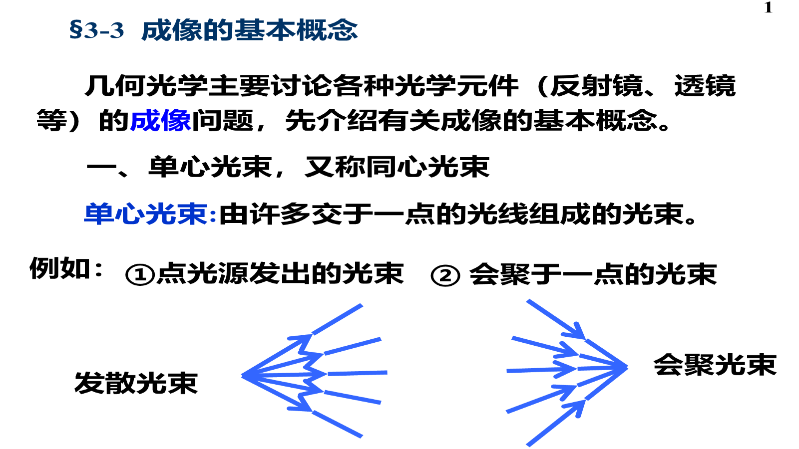

*课件《3-3 成像的基本概念》第 1 页。*

`物点 P —入射光束→ 光学系统 —出射光束→ 像点 P′`

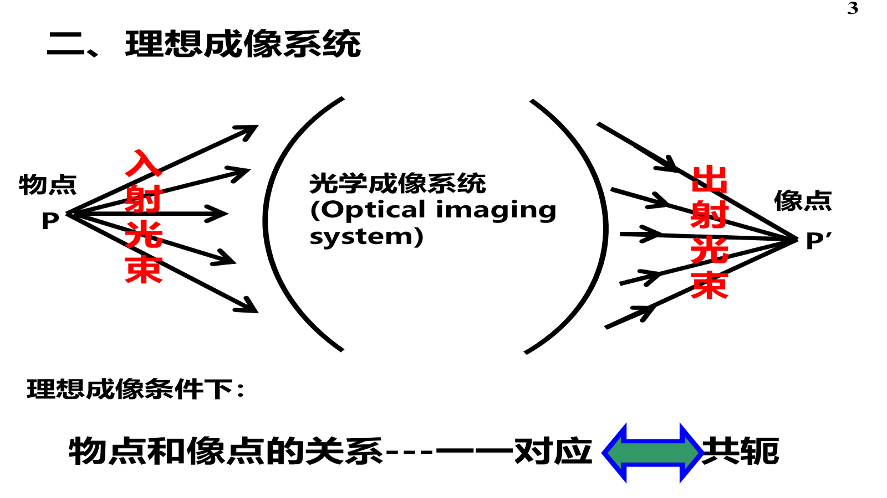

*课件第 3 页：物点与像点一一对应、彼此共轭。*

【教材】再往下追一层：要成一个清楚的点像，从同一物点发出的不同光线，经过系统后应当给出同一个像点。如果不同光线算出的交点不同，屏上看到的就不是一个点，而是一小团光斑，这就是像差的来源之一。

### 2.1 “共轭”不是一个额外公式

物点 $P$ 经过某个光学系统成像于 $P'$，就称 $P$ 和 $P'$ 是一对共轭点。它表达的是同一条物像关系。根据光路可逆性，如果把传播方向完全反过来，原来的像点可以作为物点，原来的物点成为像点。

这在题里很有用：有些题正着看很麻烦，反过来恰好变成熟悉的平行光或焦点关系。但传播方向改变以后，坐标和各量符号必须重新判断，不能照抄原式的正负号。

## 3. 四个概念用两束光判断

| 概念 | 看哪束光 | 操作性定义 |
|---|---|---|
| 实物 | 入射光 | 入射光确实从该点发出或发散 |
| 虚物 | 入射光 | 入射光正朝该点会聚，但到达前先遇到当前系统 |
| 实像 | 出射光 | 出射光真实会聚于该点 |
| 虚像 | 出射光 | 出射光发散，其反向延长线交于该点 |

例如，第一块透镜本来会在右侧 $Q$ 点形成实像。若在光到达 $Q$ 前放入第二块透镜，那么 $Q$ 对第二块透镜是虚物。

这里已经出现多次成像的关键：**同一个几何点，对不同界面可以扮演不同角色。**

实际判断时，先画当前元件附近的光线箭头。元件之前是入射光，元件之后是出射光；入射光决定物的实虚，出射光决定像的实虚。

### 3.1 四种情况放在一起比较

| 光线在当前元件附近的样子 | 结论 | 理由 |
|---|---|---|
| 入射光从某点向外发散 | 实物 | 光确实从该点来到元件 |
| 入射光正向某点会聚，但途中先碰到元件 | 虚物 | 该点只是入射光原本要到达的位置 |
| 出射光在某点真正相交 | 实像 | 该点有实际光线通过，可以用屏承接 |
| 出射光发散，但反向延长线相交 | 虚像 | 该点只有延长线，没有实际出射光通过 |

## 4. 物空间与像空间

【课件】名称是按光线分的，不是看物点和像点画在哪一边：

- 物空间：入射光线所在的空间。
- 像空间：出射光线所在的空间。

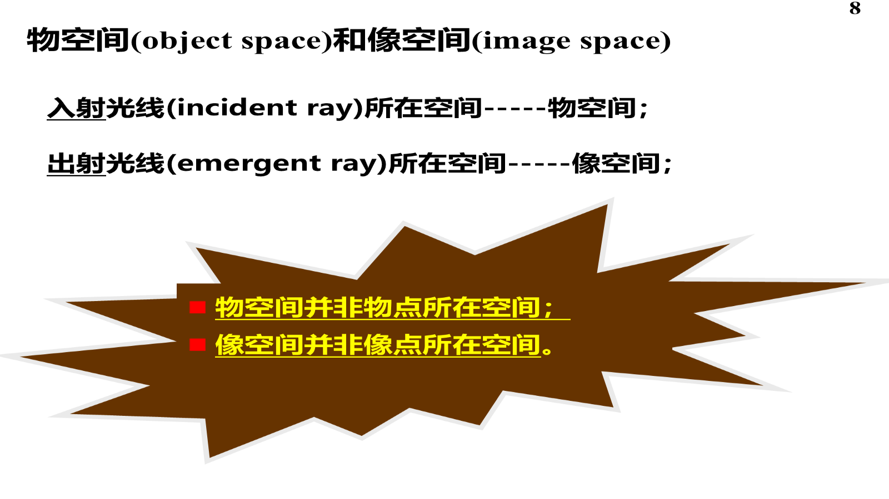

*课件第 8 页。*

它们不是由物点和像点的位置定义。虚物点可以位于像空间一侧，虚像点也可以位于物空间一侧。

折射时，入射光和出射光通常分居界面两侧；反射时，两者可能处于同一几何区域，但传播方向相反。因此“左边是物方、右边是像方”不能作为通用规则。

## 5. 为什么必须引入近轴条件

如果让离轴很远、倾角很大的光线都参加成像，它们一般不会刚好交在同一点。教材先限制到靠近光轴、倾角很小的光线，也就是近轴光线。这时可以用：

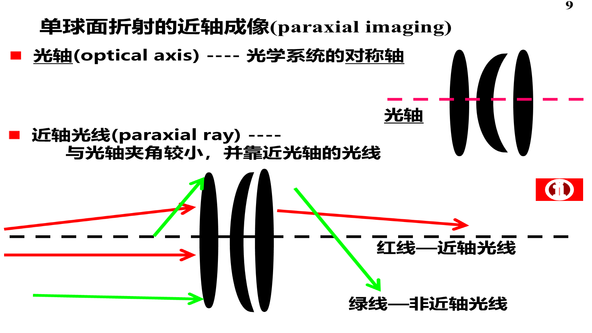

*课件第 9 页：红线用于说明近轴，绿线用于说明非近轴。*

$$
\sin\theta\approx\tan\theta\approx\theta.
$$

【教材】作了小角度近似以后，推导中的高次项可以略去，所得像距在一级近似下不再随光线入射高度改变。孔径变大或物点离轴较远时，这些被略去的项不能再忽略，于是会出现球差、彗差等像差。

注意：与光轴平行不等于近轴。平行光可能离光轴很远；近轴同时要求靠轴和小角。

### 5.1 教材为什么能从光程推出成像公式

教材第 142 页以球面反射为例：在轴上物点 $P$ 附近取一个离轴小物点 $Q$，在像点附近取 $Q'$。光线经过球面上不同高度 $h$ 的点 $A$ 反射。把光程 $QA+AQ'$ 按小量展开，如果希望所有近轴光线都到达同一个 $Q'$，展开式中随 $h$ 改变的项必须消失，由此得到

$$
\frac{1}{s'}+\frac{1}{s}-\frac{2}{r}=0,
$$

以及

$$
\frac{y}{s}+\frac{y'}{s'}=0.
$$

第一式决定轴上物点和像点的位置关系，第二式决定物高与像高的关系。它们不是互不相干的经验式，而是来自同一个要求：物体上邻近各点发出的近轴光线，反射后仍应分别成像于确定的点。

| 教材推导 | 近轴与小物体条件 |
|---|---|
| [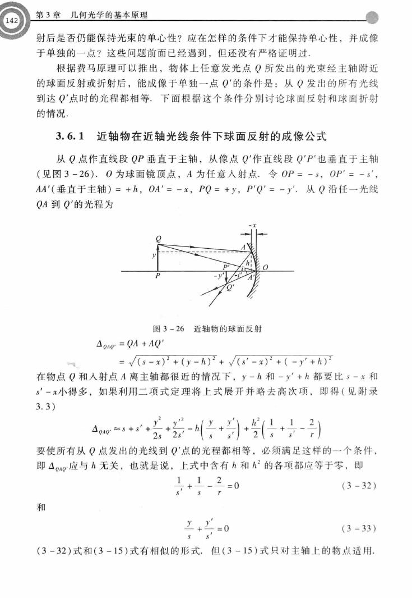](assets/第01课/08-教材近轴反射推导-p142.jpg) | [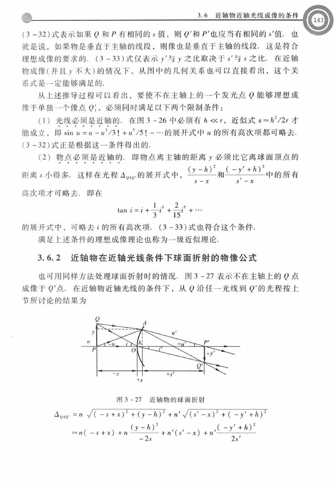](assets/第01课/09-教材近轴条件-p143.jpg) |

下一节给出保留到二次项的关键展开，并把两项条件与成像公式对应起来。

### 5.2 为什么近轴光线能会聚：把同一个物点的不同光路算出来

依据：教材§3.6及附录3.3，书页142—144、158；3-4 PPT第7、14页。

这一段只回答一个问题：**同一个物点发出的光，打在镜面不同位置，为什么仍能近似会聚到同一个像点？**先讨论凹面镜，物和实像都在镜面左侧。

#### ① 先读完整光路图：哪些点固定，哪个点在变？

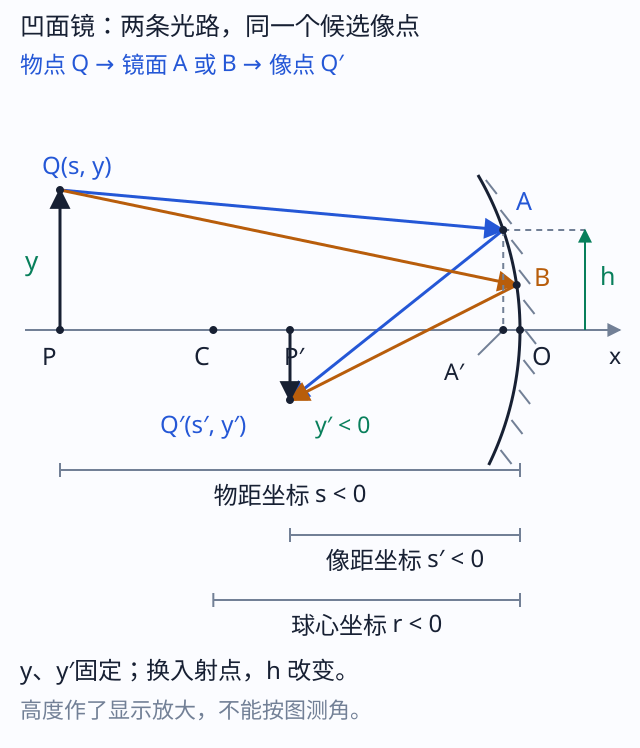

蓝线和橙线都从物点 $Q$ 出发，在镜面不同位置反射，再到达同一个候选像点 $Q'$。实线箭头表示实际传播方向，灰色虚线只是投影辅助线。图中高度为便于辨认而放大，不能按图测量倾角；镜面投影点 $A'$ 与顶点 $O$ 的小间隔在下一幅图放大说明。

坐标原点是镜面顶点 $O$，向右、向上为正。各符号的含义是：

| 符号 | 在图中的位置 | 比较不同光路时 |
|---|---|---|
| $Q=(s,y)$ | 物点；$s<0$ 是物距，$y$ 是物高 | 固定 |
| $Q'=(s',y')$ | 候选像点；图示 $s'<0,y'<0$，是左侧倒立实像 | 选定后先固定，再检查各条光线能否共同到达 |
| $A=(x_A,h)$ | 一条光线打在镜面上的点 | 沿镜面改变，$h$ 和 $x_A$ 随之改变 |
| $B$ | 另一条光线的入射点 | 用来提醒：不能只检验一条光线 |
| $C=(r,0)$ | 球心；本图 $r<0$，半径的正值为 $R=-r$ | 镜面固定，$r$ 固定 |

$P,P'$ 是物、像点在主轴上的垂足，$A'$ 是入射点在主轴上的垂足。**$y$ 是物有多高，$y'$ 是像有多高，$h$ 是光打在镜面的多高处。**改变 $h$ 是换一条光路，不是把物体上下移动。

#### ② “近轴”究竟允许近似什么？

先分清两类限制：

- **光线靠轴、倾角小**：入射高度相对镜面半径很小，$|h|/R\ll1$；两段光线的斜率 $|(h-y)/s|$、$|(h-y')/s'|$ 也要远小于1。
- **物点靠轴**：物高、像高相对各自轴向距离很小，即 $|y/s|\ll1$、$|y'/s'|\ll1$。只缩小光阑，不能保证很远离轴的物点也满足这一条件。

符号 $\ll1$ 表示“远小于1”。这些比值都是无量纲的；计算距离必须统一单位。这里的“保留到二次项”，是把 $h,y,y'$ 当作小量，保留它们的平方和乘积，舍去更高次的小量。**这仍是近似成像，不是说真实凹面镜的任意光线都严格交于一点。**

#### ③ 为什么镜面点的横坐标也要计算？

镜面是弯的，点 $A$ 不在过顶点的竖直平面上。$A'$ 到 $O$ 的那一小段叫球面的**矢高**；在本图中 $A'$ 在 $O$ 左侧，所以坐标 $x_A<0$。

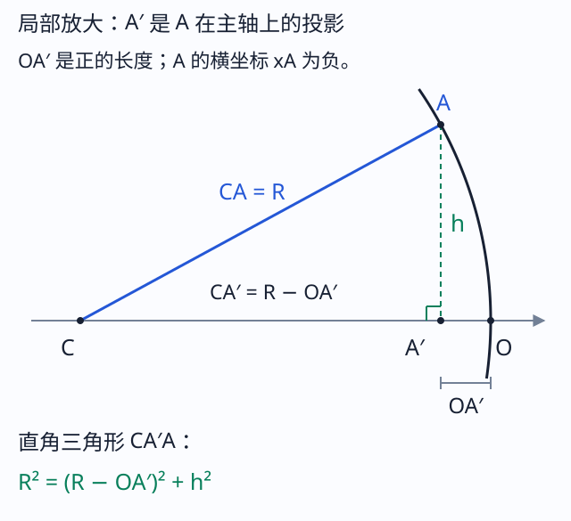

这是上一幅镜面的局部放大图；为看清小间隔，所画比例不代表近轴程度。$CA=CO=R$，$AA'=h$，直角三角形 $CA'A$ 给出

$$OA'=R-\sqrt{R^2-h^2}
=\frac{h^2}{R+\sqrt{R^2-h^2}}
\approx\frac{h^2}{2R}.$$

最后一步使用 $|h|\ll R$，把分母近似为 $2R$。$OA'$ 是正的长度，而 $x_A$ 是负的坐标，因此

$$x_A=-OA'\approx-\frac{h^2}{2R}=\frac{h^2}{2r}.$$

#### ④ 先写两段真实长度，再谈“展开”

按两点距离公式，图中的入射段与反射段分别是

$$QA=\sqrt{(x_A-s)^2+(h-y)^2},$$

$$AQ'=\sqrt{(x_A-s')^2+(h-y')^2}.$$

两条根号都是正的几何长度，不能把负物距 $s$ 直接叫作路长。两段在同一均匀介质中，光程等于几何路程乘以固定折射率；判断是否随 $h$ 改变，两者条件相同。下面记总几何路程为 $S(h)=QA+AQ'$。

利用前述小量条件，把根号逐步近似，结果可按 $h$ 的次数整理为

$$\begin{aligned}
S(h)\approx S_0
&+h\left(\frac ys+\frac{y'}{s'}\right)\\
&-\frac{h^2}{2}\left(\frac1s+\frac1{s'}-\frac2r\right).
\end{aligned}$$

$S_0$ 是与入射高度 $h$ 无关的部分。这里要看的是：换一条入射高度不同的光线，会改变后面的一次项和二次项。

展开的中间步骤：根号怎样变成上式？

用到的数学近似只有这一条：$\sqrt{a^2+b^2}\approx a+b^2/(2a)$，其中 $a>0$、$|b/a|\ll1$。它来自 $\sqrt{1+\varepsilon}\approx1+\varepsilon/2$。例如 $a=10,b=1$ 时，精确值 $\sqrt{101}\approx10.04988$，近似值是 $10.05$。

对第一段，$a=x_A-s>0$、$b=h-y$，故

$$QA\approx(x_A-s)+\frac{(h-y)^2}{2(x_A-s)}
\approx-s+x_A-\frac{(h-y)^2}{2s}.$$

第二次近似只在分母里忽略了 $x_A$。因为 $x_A$ 本身已经是二次小量，再乘上分子中的二次小量，只会造成四次及更高次修正；单独的 $+x_A$ 则必须保留。

第二段同理：

$$AQ'\approx-s'+x_A-\frac{(h-y')^2}{2s'}.$$

两段相加，代入 $2x_A\approx h^2/r$：

$$S(h)\approx-s-s'+\frac{h^2}{r}
-\frac{(h-y)^2}{2s}-\frac{(h-y')^2}{2s'}.$$

再用 $(h-y)^2=h^2-2hy+y^2$ 及对应的像高展开，把同次项放到一起。与 $h$ 无关的部分为

$$S_0=-s-s'-\frac{y^2}{2s}-\frac{y'^2}{2s'},$$

一次项和二次项正好就是正文所列的两项。至此每一步都有对应的几何长度或代数操作，不需要另记一个没有来由的长公式。

#### ⑤ 要一整束光共同成像，为什么要让两个系数为零？

我们希望换成另一条近轴光路时，光程仍近似相同。在保留的阶次内，如果一次项或二次项系数不为零，$S(h)$ 就会随 $h$ 改变。因此必须同时满足

$$\boxed{\frac1s+\frac1{s'}=\frac2r},$$

$$\boxed{\frac ys+\frac{y'}{s'}=0}.$$

第一式确定**像在轴向哪里**；第二式确定**像有多高、是否倒立**。第二式给出横向放大率

$$\beta=\frac{y'}y=-\frac{s'}s\qquad(y\ne0).$$

费马原理对某一条光线给出驻值条件；这里要求整个近轴光束都连接同一对物像点，所以要检查不同 $h$，不能只检查一个入射点。

**带练**：凹面镜 $r=-20\,\mathrm{cm}$，小物点在 $s=-30\,\mathrm{cm}$、$y=0.30\,\mathrm{cm}$ 处。先由轴向式求像距：

$$\frac1{s'}=\frac2{-20}-\frac1{-30}=-\frac1{15},
\qquad s'=-15\,\mathrm{cm}.$$

再由高度式求 $\beta=-(-15)/(-30)=-1/2$，所以 $y'=-0.15\,\mathrm{cm}$。结果表示：像在镜面左侧、倒立、高度为原来的一半。像距和像高分别由两个条件确定，不能只求像距就说离轴物点已经成像。

对照教材的球面折射：配另一张图，改哪两处？

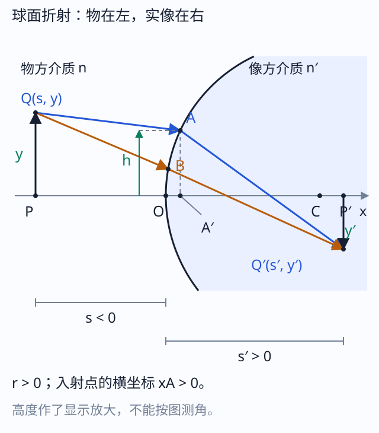

依据教材书页143—144图3-27重绘。光线从左侧介质 $n$ 进入右侧介质 $n'$；物点 $Q=(s,y)$ 在左，候选实像点 $Q'=(s',y')$ 在右。入射点仍为 $A=(x_A,h)$；图示球心在右，故 $r>0$、$x_A\approx h^2/(2r)>0$。灰色虚线是投影辅助线，高度同样作了显示放大。

**第一处变化是实际长度的横向间隔。**入射段仍为 $x_A-s>0$，出射段改为 $s'-x_A>0$，因为光继续向右走：

$$QA=\sqrt{(x_A-s)^2+(h-y)^2},$$

$$AQ'=\sqrt{(s'-x_A)^2+(y'-h)^2}.$$

**第二处变化是必须按各段介质加权。**折射率不同，不能只加几何长度；光程为 $L(h)=n\,QA+n'\,AQ'$。使用同一根号近似，得到

$$\begin{aligned}
L(h)\approx{}&-ns+n's'+(n-n')x_A\\
&-\frac{n(h-y)^2}{2s}+\frac{n'(h-y')^2}{2s'}.
\end{aligned}$$

代入矢高、展开两个平方，再按 $h$ 的次数整理：

$$\begin{aligned}
L(h)\approx L_0
&+h\left(\frac{ny}{s}-\frac{n'y'}{s'}\right)\\
&+\frac{h^2}{2}\left(\frac{n'}{s'}-\frac ns-\frac{n'-n}{r}\right),
\end{aligned}$$

其中 $L_0=-ns+n's'-ny^2/(2s)+n'y'^2/(2s')$ 不随 $h$ 改变。要求一次、二次项系数同时为零，分别得到

$$\frac{ny}{s}=\frac{n'y'}{s'},\qquad
\frac{n'}{s'}-\frac ns=\frac{n'-n}{r}.$$

第一式给 $\beta=ns'/(n's)$；第二式是球面折射成像式。它们与凹面镜公式的符号差别，来自实际传播方向、两段长度及介质加权的差别。这里先用明确的实物、实像构型理解推导；虚物、虚像用有向距离推广，不能把负坐标直接当成负的几何路长。

## 6. 老师采用的笛卡尔符号法则

【课件】本课程默认光线从左侧进入当前光学系统：

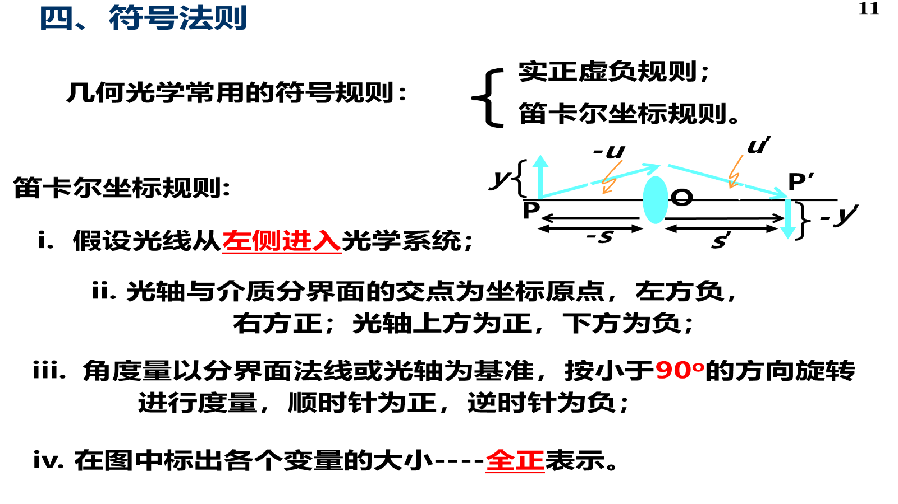

*课件第 11 页。*

1. 原点取当前界面的顶点或薄元件中心。
2. 向右为正、向左为负；主轴上方为正、下方为负。
3. 角度从法线或光轴转过小于 $90^\circ$ 的角；顺时针为正，逆时针为负。
4. 公式使用代数量；图中标出的长度常是几何正值，代入前必须附号。

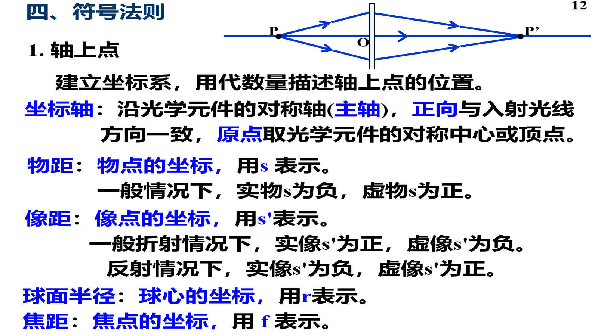

*课件第 12 页：物距、像距、曲率半径和焦距都按对应点的坐标定义。*

| 符号 | 含义 | 代数定义 |
|---|---|---|
| $s$ | 物距 | 物点坐标 |
| $s'$ | 像距 | 像点坐标 |
| $r$ | 球面半径 | 球心坐标 |
| $f,f'$ | 物方、像方焦距 | 相应焦点坐标 |
| $y,y'$ | 物高、像高 | 相对主轴的纵坐标 |

在常见的左入射折射图中，实物常在左侧，所以 $s<0$；实像常在右侧，所以 $s'>0$。但这只是坐标结果，不能反过来把正负号当作实虚的定义。

反射后，出射光回到左侧。若它在镜前真实会聚，像点坐标位于原点左侧，故 $s'<0$，但它仍然是实像。

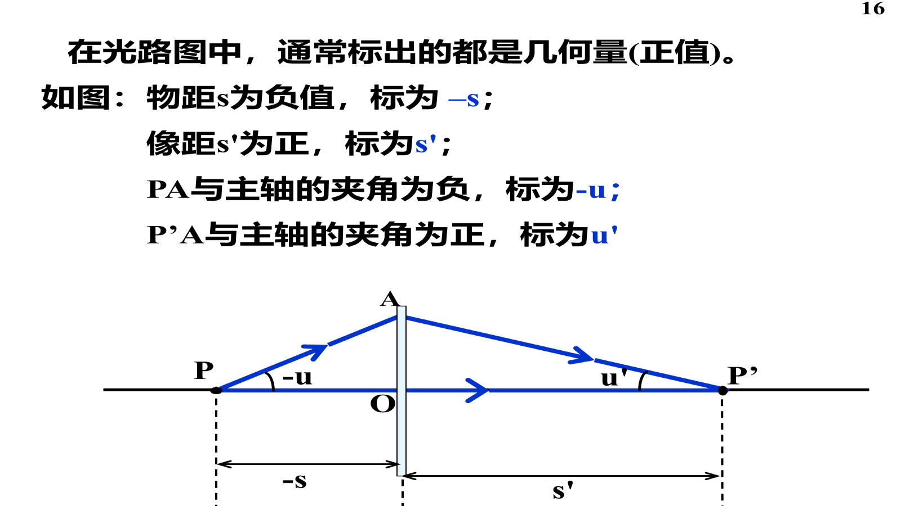

*课件第 16 页：图上通常标几何量正值，代入公式时再写成带符号的代数量。*

必须永久拆开：

- **实/虚**：光线关系；
- **正/负**：坐标关系。

### 6.1 为什么角度也要规定正负

只做轴上成像时，好像只管距离符号就够了；推导横向放大率、亥姆霍兹—拉格朗日定理或多面系统时，还会出现光线倾角 $u$、$u'$。如果角度没有统一正负，同一条光线在不同公式里会得到矛盾结果。

课件规定顺时针转角为正、逆时针为负。应先选定主轴或法线作为基准，再看从基准转到光线需要顺时针还是逆时针，不能只凭光线“向上”或“向下”判断。

## 7. 这些定义后面怎么用

以后每学一个界面，都会得到一个物像公式。计算本身通常不难；真正容易错的是：这一面的物是谁、光往哪边走、距离应带什么符号。球面折射会得到

$$
\frac{n'}{s'}-\frac{n}{s}=\frac{n'-n}{r},
$$

薄透镜会得到

$$
\frac{1}{s'}-\frac{1}{s}=\frac{1}{f'}.
$$

遇到多个元件时，就一面一面算：前一面得到的像，拿到下一面重新判断它是实物还是虚物，再继续计算。

### 7.1 这一课与作业的关系

作业 3、10、12*、13、14 虽然装置不同，第一步都一样：确定当前界面的入射方向，再标出物点、像点和球心坐标。第二组反射镜题更容易暴露符号问题，因为反射后的实像可能落在坐标负侧。如果仍用“实像为正”的口诀，第一行公式就可能写错。

本课真正的达标要求是：给出一张光路图，即使暂时不会算，也能把每个界面的实物/虚物、实像/虚像以及 $s$、$s'$、$r$ 的符号标对。

## 8. 做题时就按这五步检查

1. **先看光往哪边走**：在图上补出入射光和出射光的箭头。
2. **再看现在算哪一个面**：把这个面的顶点或薄透镜中心当作原点。
3. **给各段距离带上正负号**：不要把图上的几何长度直接抄进公式。
4. **选这个界面对应的公式**：折射面、反射面和薄透镜不要混用。
5. **算完回到图上解释**：像在什么位置，是实像还是虚像，结果是否符合光线方向。

最省事的记法：**看方向 → 定原点 → 标正负 → 列公式 → 回图检查。**

### 只判断符号的示例

界面顶点取 $x=0$，光从左向右；物点在 $x=-20\,\text{cm}$，球心在 $x=+8\,\text{cm}$。若算得像点在 $x=+30\,\text{cm}$，则

$$
s=-20\,\text{cm},\qquad r=+8\,\text{cm},\qquad s'=+30\,\text{cm}.
$$

如果出射光真实在该处会聚，它就是实像。若反射光在 $x=-15\,\text{cm}$ 处真实会聚，则 $s'=-15\,\text{cm}$，但仍是实像。

## 9. 常见误区

- **实像一定在右侧**：错。反射系统的实像常在左侧。
- **物空间就是物点所在空间**：错。物空间由入射光定义。
- **平行于光轴就是近轴**：错。还要求离轴距离和夹角满足近轴条件。
- **图上的长度可直接代公式**：错。公式需要代数量。
- **多次成像只设一次坐标**：错。每遇到一个新界面，都要重新判断方向、原点和距离正负。

## 10. 最低记忆表

| 必须掌握 | 最短表述 |
|---|---|
| 成像本质 | 入射光束经系统变为指向共轭像点的出射光束 |
| 实物/虚物 | 看入射光是真发散，还是正要会聚 |
| 实像/虚像 | 看出射光是真会聚，还是反向延长后相交 |
| 物/像空间 | 分别由入射光、出射光所在空间定义 |
| 近轴条件 | 靠轴、小角，可作一阶近似 |
| 正负号 | 坐标决定，不能由实虚直接决定 |
| 做题顺序 | 传播方向 → 原点 → 符号 → 方程 → 检查 |

## 11. 快速自测

1. 入射光正向界面右侧 $Q$ 点会聚，但在到达 $Q$ 前经过一个透镜。$Q$ 对该透镜是什么物？
2. 出射光发散，但反向延长线交于一点，该点是什么像？
3. “像在元件左侧，所以一定是虚像。”为什么错？
4. 物空间由物点位置定义，对还是错？
5. 近轴条件为什么能简化成像关系？
6. 写出做题时的五步检查。
7. 球面镜顶点取 $x=0$，入射光从左向右；物点、反射光的真实会聚点、球心分别在 $x=-12,-18,-6\,\text{cm}$。写出 $s,s',r$ 并判断像的实虚。
8. 光程展开时，为什么要让含入射高度 $h$ 的项不再影响像点位置？
9. 把共轭点间的传播方向完全反过来，物像怎样变化？符号能否照抄？
10. 一条光线与光轴平行但离轴很远，能否只凭“平行”认定它满足近轴条件？

展开答案

1. 虚物；入射光正朝 $Q$ 会聚。
2. 虚像；出射光没有在那里真实会聚。
3. 左右只表示坐标位置，反射系统的实像也可能在左侧。
4. 错；物空间由入射光线所在空间定义。
5. 小角和小孔径使三角关系线性化，高阶项可忽略，一阶像点位置不再依赖具体光线高度。
6. 看传播方向、定当前原点、标距离正负、选公式、回到光路图检查。
7. $s=-12\,\text{cm},s'=-18\,\text{cm},r=-6\,\text{cm}$；像是实像。负号只说明点在坐标原点左侧。
8. 不同近轴光线对应不同 $h$；若像点随 $h$ 改变，它们就不能共同成像于一个点。
9. 原物点和像点交换角色；传播方向改变后必须重新确定坐标与符号。
10. 不能。近轴还要求光线靠近光轴，入射高度相对曲率尺度足够小。

# 第 02 课：全反射和棱镜

这节课有三条线：折射角增大到极限时为什么出现全反射；三棱镜怎样改变光的方向；折射率随波长变化后为什么会分光。

## 1. 全反射条件

光从折射率 $n_1$ 的介质射向 $n_2$，折射定律为

$$
n_1\sin i=n_2\sin r.
$$

当 $n_1>n_2$，增大入射角时，折射角增大得更快。折射光恰好沿界面传播，即 $r=90^\circ$ 时，对应临界角

$$
\sin i_c=\frac{n_2}{n_1}.
$$

再增大入射角，折射定律将要求 $\sin r>1$，不再存在传播到第二种介质中的折射光，于是发生全反射。

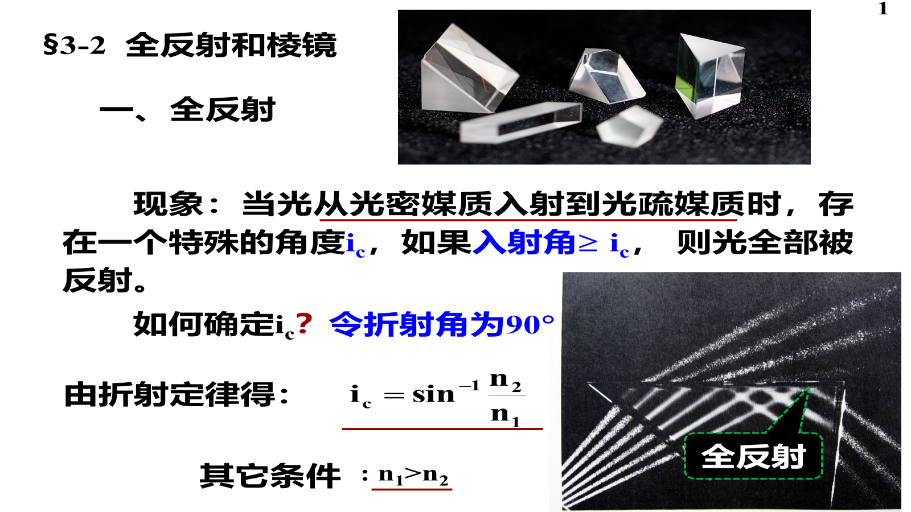

必须同时满足：

1. 从光密介质射向光疏介质，即 $n_1>n_2$；
2. $i\ge i_c$。

在 $i=i_c$ 时，几何光学给出折射光沿界面传播。课件把它作为全反射开始的临界状态。

### 1.2 全反射时，第二介质中仍有倏逝场

依据：教材书页122例3.2。   **这一节要解决的问题是：没有射向第二介质远处的折射光，是否意味着第二介质中处处没有光的电磁场？**   几何光线只能说明传播方向；要判断界面附近的场，必须把光看成波。倏逝场就是离开界面后迅速衰减的振荡电磁场。“倏逝”说的是随距离衰减，不是光在时间上突然消失。

#### 先读图：沿界面走，沿法线衰减

图为教学重绘，依据教材例3.2；上半部为第二介质，$z$垂直界面向上，$x$沿界面向右。入射角$i$从法线量。下图横轴是进入第二介质的深度$z$，纵轴是电场振幅与界面振幅之比；它不是光线轨迹。教材原图的坐标字母与本图不同，这里始终用$z$表示穿透方向。

#### 从波长到波数：为什么题目给波长，计算却用波数？

对沿某方向传播的正弦波，电场可写成$E=E_0\cos(ks-\omega t+\phi_0)$。$s$是沿传播方向的距离，$t$是时间，$E_0$是振幅，余弦中的量叫   **相位**   ，表示振动进行到周期中的哪一步。走过一个波长$\lambda$，相位增加$2\pi$，所以

$$k\lambda=2\pi,\qquad k=\frac{2\pi}{\lambda}.$$

$k$叫   **角波数**   ，简称波数，是单位距离上的相位变化量，单位为$\mathrm{rad/m}$（弧度视为无量纲时写$\mathrm{m^{-1}}$）；不要与另一些教材中的光谱波数$1/\lambda$混淆。角频率$\omega=2\pi\nu$表示单位时间的相位变化，$\nu$是频率。介质界面两边频率相同，介质中波长为$\lambda=\lambda_0/n$，因此真空波数$k_0=2\pi/\lambda_0$、介质波数$k=nk_0$。   **波长并没有变成一个额外未知量；改用波数，是为了把波的方向分解成沿界面与垂直界面的两部分。**

普通传播平面波在本图内的相位写成$k_xx+k_zz-\omega t$，其中$k_x,k_z$分别是沿$x,z$方向每单位距离的相位变化量。入射波的波矢长为$n_1k_0$，投影到界面得$k_x=n_1k_0\sin i$；这里出现正弦，是因为$i$从竖直法线量，而不是从界面量。

#### 三步推导：界面匹配 → 法向分量 → 衰减

1.    **沿界面的相位必须匹配。**   静止、平整界面上的边界条件要在每个位置$x$、每个时刻$t$同时成立，因此入射、反射和第二介质中的波必须有相同的$k_x$和$\omega$。第二介质中仍有$k_x=n_1k_0\sin i$。
2.    **用第二介质的波动关系求法向分量。**   均匀、无吸收、各向同性介质的平面波满足$k_x^2+k_z^2=(n_2k_0)^2$，所以

$$k_z^2=k_0^2(n_2^2-n_1^2\sin^2i).$$

若$i<i_c$，右端为正，$k_z$为实数，表示正常传播的折射波。若$n_1>n_2$且$i>i_c$，则$n_1\sin i>n_2$，右端为负：已经不能用一个实数折射角描述法向传播。

3.    **负的平方对应空间衰减。**   记正数$\kappa=k_0\sqrt{n_1^2\sin^2i-n_2^2}$，$\kappa$叫衰减系数，单位是长度的倒数。为避免入射角$i$与虚数单位混淆，本节用$\mathrm j^2=-1$。取$k_z=\mathrm j\kappa$，在复指数表达中有$e^{\mathrm j k_zz}=e^{-\kappa z}$。另一符号会使场随$z$无限增大，不符合第二介质半无限且远处没有光源的条件。用实数直接写物理电场更清楚：

$$E(x,z,t)=E_s e^{-\kappa z}\cos(k_xx-\omega t+\phi_s).$$

$E_s$和$\phi_s$分别是所讨论电场分量在界面的振幅与初相位；此处关注空间变化，不要求先求出它们。余弦表示沿界面变化、随时间振荡；$e^{-\kappa z}$表示越深入第二介质，振幅越小。理想半无限、无吸收介质中，没有向远处输送能量的时间平均法向能流，但界面外的场并不为零。

#### 带着题目计算：振幅降到多少，才算“穿透深度”？

   **例题（自编数值，方法对应教材例3.2）**   ：玻璃$n_1=1.5$向空气$n_2=1$入射，$i=45^\circ$，真空波长$\lambda_0=600\,\mathrm{nm}$。求第二介质中电场振幅降到界面振幅$1/e$时的深度。

   **先分析条件和目标。**   折射率与入射角决定能否全反射及衰减的几何因子；波长决定长度尺度；“振幅变成$1/e$”要求解$e^{-\kappa d_E}=e^{-1}$，因此$d_E=1/\kappa$，不是先去求一个不存在的实数折射角。

| 步骤 | 代入与结果 | 这一步解决什么 |
|---|---|---|
| 判断情形 | $i_c=\arcsin(1/1.5)=41.81^\circ<45^\circ$ | 可以使用倏逝衰减式 |
| 波长换成波数 | $k_0=2\pi/(600\,\mathrm{nm})=0.010472\,\mathrm{nm^{-1}}$ | 保留纳米作为长度单位，不另做米制转换 |
| 求衰减因子 | $n_1^2\sin^2i-n_2^2=2.25\times0.5-1=0.125$ | 检查根号为正 |
| 求衰减系数 | $\kappa=0.010472\sqrt{0.125}=0.003702\,\mathrm{nm^{-1}}$ | 每深入单位距离，振幅衰减的快慢 |
| 回答长度 | $d_E=1/\kappa=270.1\,\mathrm{nm}$ | 振幅剩$e^{-1}\approx0.368$的位置 |

检查：$\kappa$为长度的倒数，倒数才是深度；波长增大时，其他条件不变，$d_E$也增大。若题目问的是   **振幅平方**   降至$1/e$，因为$|E|^2/|E_s|^2=e^{-2\kappa z}$，相应长度为$1/(2\kappa)=135.0\,\mathrm{nm}$。倏逝场不具有普通法向传播波的强度关系，读到“强度穿透深度”时先核对题目定义。

将另一高折射率介质放到这一尺度内，场可与它耦合并传输能量，原来的半无限模型随之改变。严格$i>i_c$才有$\kappa>0$；当$i\to i_c^+$，此理想模型的衰减长度趋大，不能在临界角把它说成某个有限值。

## 2. 全反射棱镜

普通玻璃折射率约为 1.5，玻璃到空气的临界角约为

$$
i_c=\arcsin(1/1.5)\approx41.8^\circ.
$$

光从等腰直角棱镜的直角面垂直入射，到斜面时的入射角为 $45^\circ$，大于临界角，因此在斜面全反射。根据入射方式，可以使光偏转 $90^\circ$ 或折回 $180^\circ$。

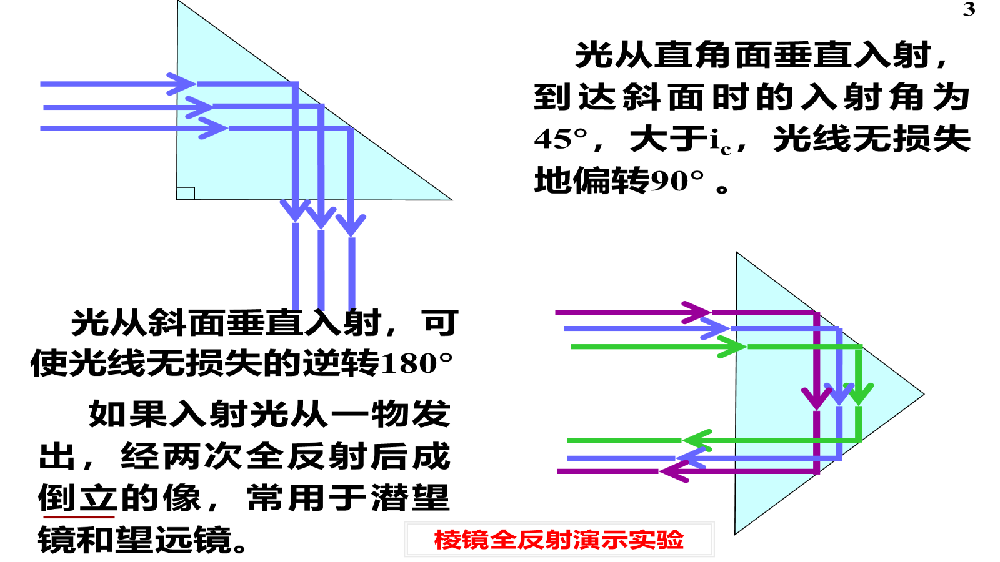

## 3. 光纤中的全反射

阶跃型光纤的芯层折射率 $n_1$ 高于包层 $n_2$。只有在芯层—包层界面满足全反射条件的光线，才能被限制在芯层中传播。

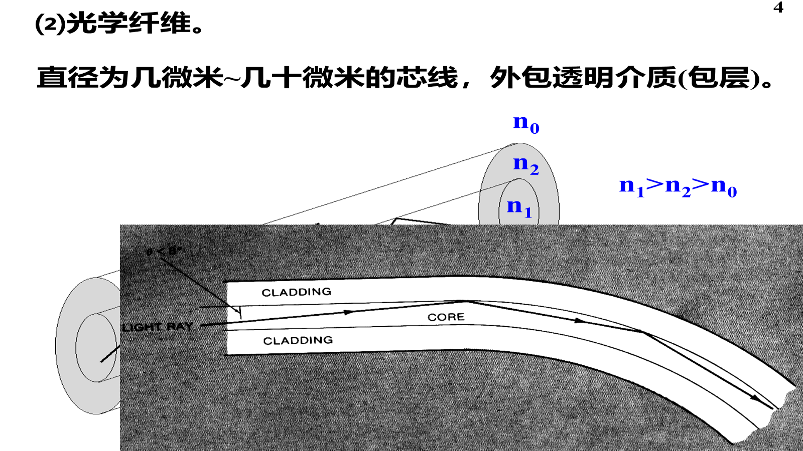

光纤并不是任何方向的入射光都能接收。对外界折射率为 $n_0$ 的子午光线，最大入射半角满足

$$
n_0\sin\alpha_{\max}=\sqrt{n_1^2-n_2^2}.
$$

右边称为数值孔径。光纤弯曲过急会改变光在芯层—包层界面的局部入射角，使部分光线低于临界角而泄漏。

### 3.1 接收角与数值孔径的来源

图为依据PPT第4—6页的教学重绘。先顺着光线经过的两个位置读：端面法线是水平轴，侧壁法线是竖直方向，所以同一条芯内光线对两种法线的角互余。题目求“从外面能接收多大的角”，但限制来自芯层侧壁；解题要先在侧壁列全反射条件，再通过端面折射把它换回外部角$\alpha$。

依据：3-2 PPT第4—6页；教材书页122—124。取直的阶跃型光纤、与轴垂直的端面及经过轴的子午光线。设芯内光线与轴夹角为$\theta$，侧壁入射角为$i=90^\circ-\theta$，端面外入射角为$\alpha$。端面折射给$n_0\sin\alpha=n_1\sin\theta$，侧壁约束给$\sin i\ge n_2/n_1$，所以

$$n_0\sin\alpha\le n_1\sqrt{1-(n_2/n_1)^2}=\sqrt{n_1^2-n_2^2}\equiv\mathrm{NA}.$$

根号这一步不是新增定律：$\sin i=\cos\theta\ge n_2/n_1$，两边平方后用$\sin^2\theta=1-\cos^2\theta$，得$\sin\theta\le\sqrt{1-(n_2/n_1)^2}$；再用端面式$n_0\sin\alpha=n_1\sin\theta$消去$\theta$。NA即“数值孔径”的缩写，是无量纲量。

数值孔径NA量化可接收光锥的大小，不是芯层折射率本身。若NA$/n_0\le1$，$\alpha_{\max}=\arcsin(\mathrm{NA}/n_0)$；若计算值超过1，外部几何接收半角至多$90^\circ$。例：$n_1=1.50,n_2=1.48,n_0=1$，NA$\approx0.244$，$\alpha_{\max}\approx14.1^\circ$。

条件$n_1>n_2$负责芯层约束；PPT示例的$n_2>n_0$不是所有光纤的必要条件。弯曲、端面倾斜、斜光线或波导模分析不能无条件套这条子午光线推导。教材还区分阶跃型与渐变型：前者芯内$n$近似恒定、在芯包界面突变；后者芯内$n$随半径变化，光路连续弯曲。内窥镜传像还要求纤维束保持端点的空间对应，单根纤维导光本身不保证传出完整图像。

## 4. 渐变介质中的弯曲光路

把折射率连续变化的介质看成许多很薄的平行层，每经过一层，光线都轻微折射；当层厚趋于零，折线路径变成平滑曲线。光线向折射率较大的一侧弯曲。

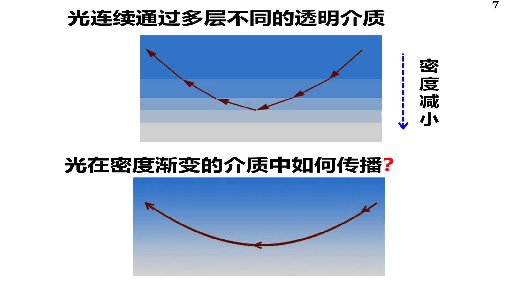

海市蜃楼来自大气折射率随高度变化造成的弯曲光路。眼睛按直线反向追踪光线，于是看到移位或倒置的虚像。

### 4.1 分层不变量、弯曲方向与上下蜃景

依据：3-2 PPT第7—10页；教材书页123—124。   **先把连续弯曲拆成已经会用的平面折射：相邻薄层之间都满足斯涅耳定律。**   取水平$x$轴、竖直$z$轴，折射率只随高度变化，即$n=n(z)$；光线与竖直法线的夹角为$\theta$。

图为依据上述材料的教学重绘，折射率变化与弯曲幅度为突出关系而放大。第一幅各层交界处的虚线是法线；下两幅的实线为真实光路，虚线为眼睛按入眼切线反向延长的视线，虚像的位置必须沿这条虚线判断。

#### 从两个界面推到任意高度

第一、二层之间有$n_1\sin\theta_1=n_2\sin\theta_2$，第二、三层之间有$n_2\sin\theta_2=n_3\sin\theta_3$。   **同一层中两处法线平行，光线与法线的角相同**   ，所以可以把等式首尾连接：

$$n_1\sin\theta_1=n_2\sin\theta_2=n_3\sin\theta_3=\cdots=C.$$

层厚趋于零，便得到$n(z)\sin\theta(z)=C$。常量$C$由这条光线的初始条件确定；不同光线不一定具有相同的$C$。已知初始折射率与角度，先算$C=n(z_0)\sin\theta_0$，再在目标高度求$\sin\theta=C/n(z)$。

   **如何看出转向？**   光线进入$n$较小的区域时，$C/n$增大，锐角支上的$\theta$增大，光线趋向水平。若到达$n=C$，则$\theta=90^\circ$，光路与层面相切；再往$n<C$处延伸会要求$\sin\theta>1$，不可能有实光路。通常在光滑且梯度非零的情况下，光线在此转回$n$较大的区域；它不是撞到了一面镜子。若折射率只渐近趋于$C$等特殊情形，是否在有限位置转回还要检查具体分布。

   **带练**   ：某光线在$n_a=1.50$处与竖直夹$60^\circ$，求到$n_b=1.40$处的角度，并判断能否到达$n=1.20$处。先有$C=1.50\sin60^\circ=1.2990$；目标角$\theta_b=\arcsin(1.2990/1.40)=68.1^\circ$，比原来更靠近水平。若分布沿前进方向连续下降，则到$n=1.2990$已达到转向条件，不会继续进入$n=1.20<C$的区域。这是便于计算的模型数值，不是实际大气折射率。

#### 更一般的光线方程：每个符号在图中代表什么？

当$n$不只随高度变化，使用位置向量$\mathbf r(\ell)$表示光路；$\ell$是沿曲线量出的弧长，$\mathbf t=\mathrm d\mathbf r/\mathrm d\ell$是指向前进方向、长度为1的切向量。梯度$\nabla n$指向$n$增长最快的方向，大小表示单位距离的增长率。对$n=n(z)$，它就是竖直方向的$(\mathrm dn/\mathrm dz)\mathbf e_z$。

费马原理给出的光线方程是

$$\frac{\mathrm d}{\mathrm d\ell}(n\mathbf t)=\nabla n.$$

把左边用乘积求导拆开，并用$\mathrm dn/\mathrm d\ell=\nabla n\cdot\mathbf t$（梯度沿前进方向的分量），得到

$$n\frac{\mathrm d\mathbf t}{\mathrm d\ell}=\nabla n-(\nabla n\cdot\mathbf t)\mathbf t.$$

右边正是梯度中   **垂直于光线**   的部分；左边是方向随路程的变化。因此光线向横向$n$增大的那一侧弯。均匀介质$\nabla n=0$时不弯；若梯度恰沿光线，横向分量也为零，方向仍可不变。对分层介质，原方程的$x$分量为$\mathrm d(n t_x)/\mathrm d\ell=0$，而$t_x=\sin\theta$，又回到$n\sin\theta=C$，两种写法相互核对。

费马原理怎样给出这条方程？

固定两端点，给光路一个任意小位移$\delta\mathbf r$，端点处位移为零。光程$L=\int n\,\mathrm d\ell$的变化由折射率变化及路程变化两部分组成：

$$\delta L=\int[\nabla n\cdot\delta\mathbf r+n\mathbf t\cdot\mathrm d(\delta\mathbf r)/\mathrm d\ell]\,\mathrm d\ell.$$

第二项分部积分，端点项因$\delta\mathbf r=0$消失，得到$\delta L=\int[\nabla n-\mathrm d(n\mathbf t)/\mathrm d\ell]\cdot\delta\mathbf r\,\mathrm d\ell$。由于任意内部小位移都应使一阶变化为零，方括号中的系数必须为零，便得上式。这里$\delta$表示路径的微小变化，和棱镜偏向角不是同一个量。

#### 把“弯向哪里”转成“像在哪里”

| 情形 | 先判折射率与弯曲 | 再沿入眼切线反向延长 |
|---|---|---|
| 热路面、沙漠的下蜃景 | 近地空气热、密度小、$n$小，光路向上弯 | 远景似在下方；常见的“路面积水”景象可以来自天空光，不是地面真有水 |
| 冷海面上方的上蜃景 | 近海面较冷、$n$较大，光路向下弯 | 远景似被抬高，可看到几何直线视野以外的物体 |

做题顺序：先画$n$随高度的趋势 → 标角度从法线还是水平量 → 求$C$与可达范围 → 画入眼切线判视位置。若角$\alpha$改从水平量，因为$\theta=90^\circ-\alpha$，不变量应为$n\cos\alpha=C$。蜃景的正倒、重像取决于整束光的完整路径，单凭一条光线“向上弯”不能确定所有像的倒正。

## 5. 棱镜偏向角

设棱镜顶角为 $A$，第一面入射角为 $i$、折射角为 $r_1$；第二面的内部入射角为 $r_2$、出射角为 $e$。几何关系为

$$
r_1+r_2=A,
$$

$$
\delta=(i-r_1)+(e-r_2)=i+e-A.
$$

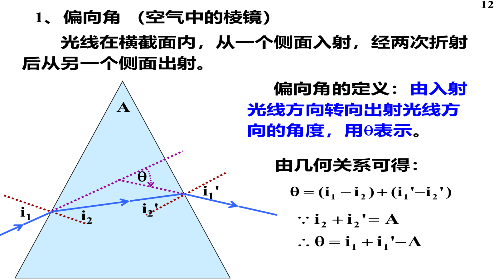

一般计算顺序是：第一面折射 → 用 $r_1+r_2=A$ 转到第二面 → 检查第二面是否全反射 → 第二面折射 → 用 $\delta=i+e-A$ 求偏向角。

## 6. 最小偏向角

偏向角随入射角先减小后增大，因此存在最小值。

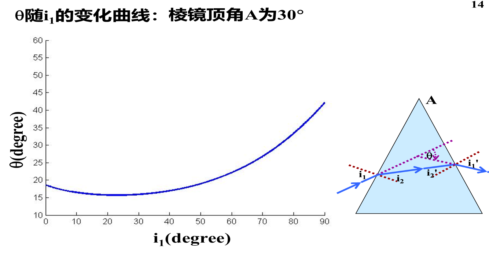

最小偏向时光路对称：

$$
i=e,\qquad r_1=r_2=\frac A2.
$$

若棱镜折射率为 $n$，外界折射率为 $n_0$，则

$$
\frac n{n_0}=\frac{\sin[(A+\delta_{\min})/2]}{\sin(A/2)}.
$$

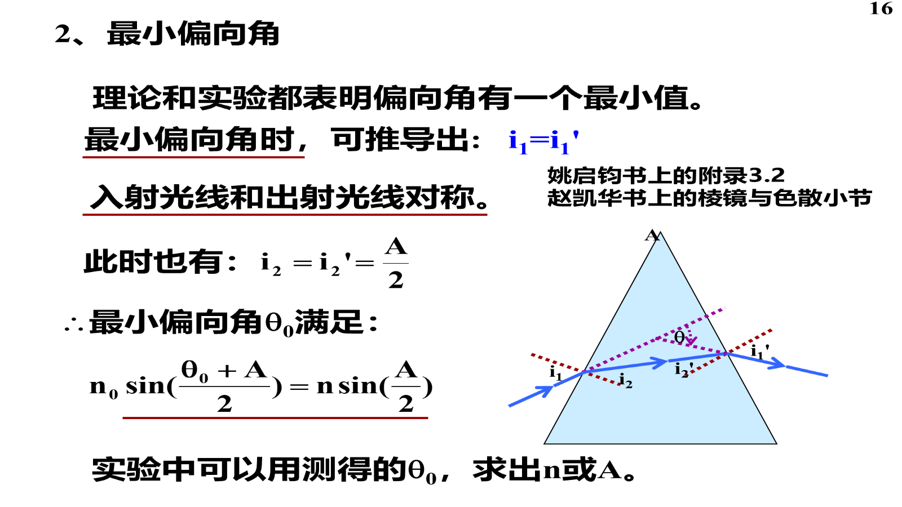

实验中测出 $A$ 和 $\delta_{\min}$，就能求棱镜折射率。使用公式前还必须检查第二表面能否出射；若 $r_2$ 超过临界角，第二面发生全反射，出射角没有实数解。

### 教材习题 3.4、3.5

这两题没有出现在你发来的两次作业清单中，这里作为本节配套练习，不标记为已布置作业。

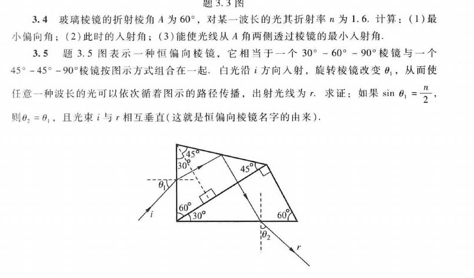

- **3.4 入手提示**：前两问使用最小偏向的对称关系；第三问令第二面的出射角达到 $90^\circ$，从临界状态反推第一面的最小入射角。
- **3.5 入手提示**：沿图逐面标法线和角度，利用两个直角三角形的几何关系。先证明 $\theta_2=\theta_1$，再处理出射光与入射光垂直的条件。

### 6.2 为什么对称光路给最小偏向角

   **先确定谁固定、谁变化。**   对照上方棱镜角度图，把顶角$A$与材料相对折射率$m=n/n_0$固定，缓慢改变入射角$i$；内部$r_1$随之变，$r_2=A-r_1$反向变，最后改变出射角$e$和偏向角$\delta=i+e-A$。求最小偏向就是求这条函数曲线的极小值，不是把光程拿来再求一次极小。

链式求导逐步为$\mathrm dr_1/\mathrm di=\cos i/(m\cos r_1)$、$\mathrm dr_2/\mathrm di=-\mathrm dr_1/\mathrm di$、$\mathrm de/\mathrm dr_2=m\cos r_2/\cos e$。把三步相乘，再对$\delta=i+e-A$求导，才得到下式。

依据：3-2 PPT第12—18、32页；教材书页125、附录3.2书页157—158。令相对折射率$m=n/n_0>1$，考虑主截面内从一个面进入、另一个面直接出射的光路。$\sin i=m\sin r_1$，$\sin e=m\sin r_2$，$r_1+r_2=A$。固定$A,m$对$i$求导：

$$\frac{\mathrm d\delta}{\mathrm di}=1-\frac{\cos i\cos r_2}{\cos e\cos r_1}.$$

在驻值处，两余弦乘积相等；结合两次折射关系得$(m^2-1)(\sin^2r_1-\sin^2r_2)=0$。在通常$0\le r_1,r_2<90^\circ$分支，故$r_1=r_2=A/2$、$i=e$。还需判极小：写$g(r)=\arcsin(m\sin r)$，则$\delta=g(r_1)+g(A-r_1)-A$，而

$$g''(r)=\frac{m(m^2-1)\sin r}{(1-m^2\sin^2r)^{3/2}}>0$$

（可直接出射的内部区间），所以对称驻值确为最小值。可逆性说明交换入射与出射得到另一条相同偏向光路，却不能单靠可逆性证明它是极小值。

   **出射边界先于求角度**   ：临界角$r_c=\arcsin(1/m)$，第二面需$r_2\le r_c$。在$r_1,r_2\ge0$的通常构型中，若$A>r_c$，则

$$i\ge i_{\min}=\arcsin\!\left[m\sin(A-r_c)\right].$$

根号或反正弦的定义域必须成立；有非掠射的对称透射光路还要求$A<2r_c$。例：$A=60^\circ,m=1.5$，$r_c=41.81^\circ$，$i_{\min}\approx27.92^\circ$；最小偏向时$i=e\approx48.59^\circ$，$\delta_{\min}\approx37.18^\circ$。小于出射阈值的曲线段应留空，不能把第二面全反射仍画成一条透射曲线。

最小偏向测液体时，可用平行薄玻璃壁组成空心棱镜。每面玻璃壁两表面平行，串联折射可消去壁的折射率，保留空气到液体的角度关系；忽略薄壁造成的横向位移后，仍用液体与外界的相对折射率。玻璃壁不平行或厚度引起路径改变明显时，须逐界面追迹。

## 7. 薄棱镜

当顶角及有关入射、折射角都很小时，使用 $\sin\theta\approx\theta$ 得

$$
\delta\approx\left(\frac n{n_0}-1\right)A.
$$

空气中 $n_0\approx1$，于是

$$
\delta\approx(n-1)A.
$$

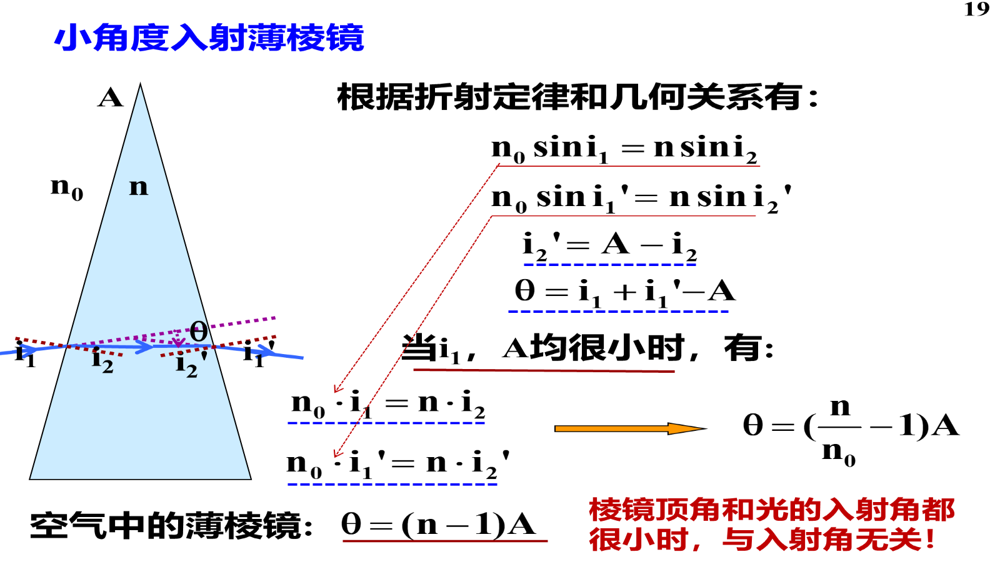

“与入射角无关”只在一级小量近似下成立；精确偏向角仍随入射角变化。

## 8. 棱镜色散和分光系统

折射率是波长的函数 $n(\lambda)$。普通玻璃在可见光区通常满足 $dn/d\lambda<0$，短波长的折射率较大，因此紫光的偏向通常大于红光。

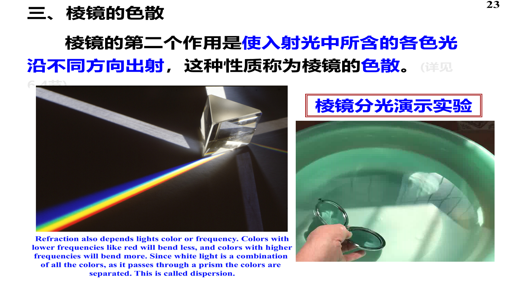

课件图中英文的意思是：折射程度取决于光的颜色或频率；红光偏折较小，频率较高的光偏折较大；白光包含各种颜色，通过棱镜后被分开，这叫色散。

分光系统先由 $L_1$ 把狭缝光变成平行光，棱镜使不同波长获得不同偏向角，再由 $L_2$ 把不同方向的平行光会聚到焦平面的不同位置。

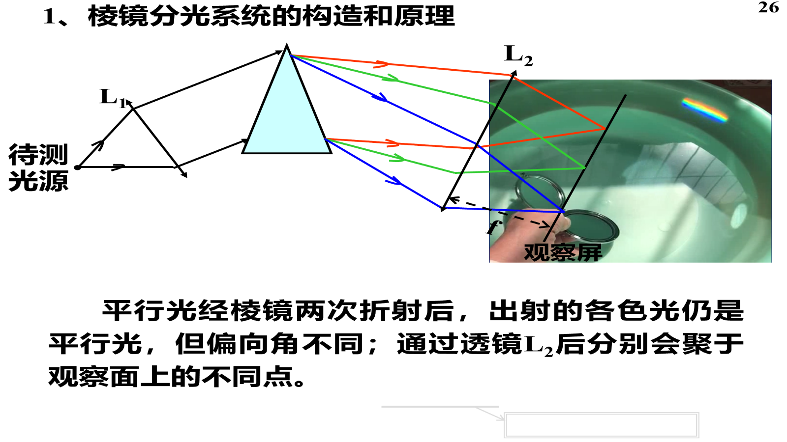

角色散定义为

$$
D_\delta=\frac{d\delta_{\min}}{d\lambda}.
$$

薄棱镜条件下

$$
D_\delta\approx A\frac{dn}{d\lambda}.
$$

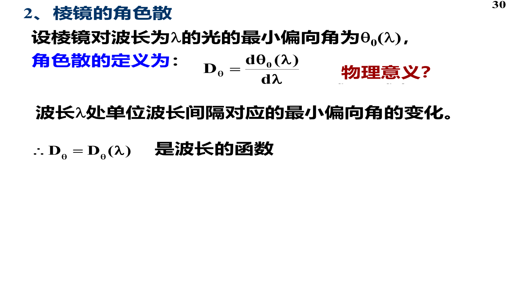

### 8.2 柯西公式、反常色散与精确角色散

依据：3-2 PPT第24—25、30—31页。$\lambda$取真空波长；介质色散$\mathrm dn/\mathrm d\lambda$描述材料性质，角色散$\mathrm d\delta/\mathrm d\lambda$还包括棱镜几何。透明波段常用经验性的柯西公式

$$n(\lambda)\approx a+\frac b{\lambda^2}+\frac c{\lambda^4},\qquad\frac{\mathrm dn}{\mathrm d\lambda}=-\frac{2b}{\lambda^3}-\frac{4c}{\lambda^5}.$$

$a$无量纲，$b,c$的单位分别与$\lambda^2,\lambda^4$相同，数值随选用的波长单位变化。PPT取正系数，得到正常色散$\mathrm dn/\mathrm d\lambda<0$；在某些吸收带附近可出现反常色散$\mathrm dn/\mathrm d\lambda>0$，上述正系数柯西式不再适用。因此“紫光折射率永远比红光大”不是无条件定律。

  **从题目数据选公式。**  题目给$a,b,c$和波长时，先用柯西式求$n$及$\mathrm dn/\mathrm d\lambda$；题目直接给$n$和变化率时，不必再反求经验系数。接着看棱镜是否薄、是否处最小偏向，选择几何因子，最后把“材料每改变单位波长时折射率变多少”换成“出射方向变多少”。求导前统一波长单位，求导中的角用弧度。

PPT定义的是  **各波长最小偏向角的变化率**  。外界折射率$n_0$在所讨论波段视为常量，对$\sin[(A+\delta_{\min})/2]=(n/n_0)\sin(A/2)$求导，有

$$D_{\min}=\frac{\mathrm d\delta_{\min}}{\mathrm d\lambda}=\frac{2\sin(A/2)}{n_0\sqrt{1-(n/n_0)^2\sin^2(A/2)}}\frac{\mathrm dn}{\mathrm d\lambda}.$$

角用弧度；空气中$n_0=1$。$A$及所有相关角很小时，才退化为$D_{\min}\approx(A/n_0)\,\mathrm dn/\mathrm d\lambda$。同理，将两次小角折射$i\approx mr_1,e\approx mr_2$相加，得薄棱镜偏向$\delta\approx(m-1)A$。PPT的$A=5^\circ,n=1.5$给$\delta\approx2.5^\circ$；只知顶角小，却以很大的入射角照射，不能保证这一近似。

例：空气中$A=60^\circ,n=1.5$，精确几何因子为$1/\sqrt{1-0.75^2}\approx1.512$，若$\mathrm dn/\mathrm d\lambda=-0.04\,\mu\mathrm m^{-1}$，则$D_{\min}\approx-0.0605\,\mathrm{rad}/\mu\mathrm m$。负号说明波长增加时最小偏向角减小；比较分色能力通常比较$|D|$。

上例中几何因子无量纲，所以结果的单位来自$\mathrm dn/\mathrm d\lambda$，并约定角度为弧度。若两条邻近谱线相差$\Delta\lambda=0.010\,\mu\mathrm m$，可估$\Delta\delta\approx D_{\min}\Delta\lambda=-6.05\times10^{-4}\,\mathrm{rad}$；这是小波长间隔的线性估计，较宽波段应分别算各自角度。

  **不能混同两种求导条件**  ：固定棱镜和入射方向时，$i$固定，精确追迹给

$$\left.\frac{\partial\delta}{\partial n}\right|_i=\frac{\sin A}{n_0\cos r_1\cos e}.$$

它在中心波长恰处最小偏向时，与上式的一阶结果相同；并不表示宽谱每个波长都同时处于最小偏向。外界也有色散时，应对$m(\lambda)=n/n_0$整体求导。角色散大也不等于一定分辨出相邻谱线，还要看狭缝像宽和仪器分辨能力。

### 8.3 角反射器：为什么能反向返回

依据：3-2 PPT第49—52页；教材书页126。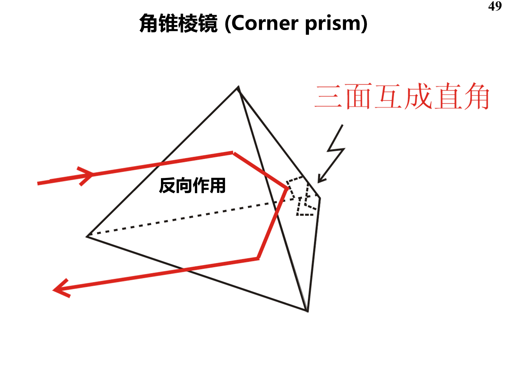

出处：3-2 PPT第49页。Corner prism意为角锥棱镜；图中三反射面两两垂直。

三块两两垂直的平面反射面组成角反射器。  **当光线依次在三个面各反射一次**  时，最终方向与原方向相反，通常沿平行但有横向位移的直线返回。

取三个面的法线分别沿$x,y,z$，方向向量为$\mathbf v=(v_x,v_y,v_z)$。平面反射只翻转法向分量、保留切向分量：

$$(v_x,v_y,v_z)\longrightarrow(-v_x,v_y,v_z)\longrightarrow(-v_x,-v_y,v_z)\longrightarrow(-v_x,-v_y,-v_z)=-\mathbf v.$$

这条推理依赖三面正交和三次反射；两块垂直镜只改变两个分量，通常不足以在三维空间把任意方向反向。单块平面镜仅在法向入射时原路返回。角锥棱镜还要检查每面全反射或反射膜，以及入射位置是否使光线确实打到三个面；不是任意位置、任意方向都能进入有效光路。

应用是回归反射标志、测距和光路折返。PPT第52页另布置赵凯华教材第一章第3题：证明角反射器出射方向与入射相反并思考用途。方法入口是分解三个正交方向分量；检查三次反射及方向反向与原线重合的区别。

直角棱镜在主截面内经两个垂直面反射，可使传播方向转$180^\circ$；这一二维结论不能直接代替三面角反射器的三维结论。PPT第3页的光束上下次序也被反转，须区分光束转向与图像取向。

### 8.4 课件中的其他棱镜作用

依据：3-2 PPT第33—48页。下列机制按课件展开层级讲解；第44—45页的论文延伸明确标注“非考试内容”，不能据此把其他页也一并排除。

#### 菲涅耳双棱镜：虚光源间距怎样从偏折角得到（第37—38页）

图为依据PPT第37页重绘的主截面示意，角度放大以方便辨认。两块小顶角薄棱镜底边相合；上半部把光向下偏，下半部把光向上偏。先看实线箭头，再把出射线反向延长，得到两个虚光源$S_1,S_2$。它们是同一光源$S$的两个虚像，不是另外放了两盏灯。

设源到薄棱镜距离为$l$，每半的顶角为$A$，外界为空气。薄棱镜给小偏折角$\delta\approx(n-1)A$；把出射方向向源平面回推距离$l$，每个虚源相对原源横移约$l\tan\delta\approx l\delta$。两侧位移相反，所以虚源间距约为$2l(n-1)A$。角要用弧度；题目给角度制时先乘$\pi/180$，再代入。近轴、薄棱镜及忽略厚度是这个位移估计的条件。

两束来自同一源的光在重叠区可干涉，这是分波前；不是任意两个独立灯泡经棱镜后就相干。PPT的超短脉冲装置还让两束光斜着交会，使不同横向位置对应不同的相对到达延迟，再用非线性介质及光谱记录重建脉冲信息。该装置的作用是脉冲测量，不能只按普通成像透镜解释。

#### 布儒斯特角棱镜：先理解偏振，再看两个界面的角（第39—40页）

  **入射面**  是入射光线与界面法线共同确定的平面，在下面的光路剖面图中就是纸面。电场在这个平面内振动叫$p$偏振；电场垂直于这个平面振动叫$s$偏振。偏振说的是电场振动方向，不是光线另向一个方向传播。

图为依据PPT第40页的教学重绘。第一幅为单界面，所有入射、反射、折射角都从法线量；红色虚线只标示可能的反射方向，在布儒斯特角且纯$p$偏振时，该反射分量振幅为零。第二幅为对称棱镜，虚线法线垂直于各自表面；内部两角$r_B$相加等于顶角$A$。

在无吸收、非磁、各向同性、折射率不同的两介质界面，$p$偏振的反射电场振幅系数可写成

$$r_p=\frac{n\cos i-n_0\cos r}{n\cos i+n_0\cos r}.$$

$r_p$是反射电场与入射电场振幅之比（正负随电场基矢约定，零点不变），不要把下标$p$的系数$r_p$与折射角$r$混淆。这是电磁场边界条件给出的菲涅耳关系；此处使用它来理解“为什么能没有$p$反射”。要求$r_p=0$，就是令分子$n\cos i_B=n_0\cos r_B$。再联立折射定律$n_0\sin i_B=n\sin r_B$，消去折射率得到$\sin i_B\cos i_B=\sin r_B\cos r_B$。在不同折射率的非掠射分支，取$i_B+r_B=90^\circ$，于是

$$\tan i_B=\frac n{n_0},\qquad r_B=90^\circ-i_B.$$

图上反射线与折射线垂直，是这个角度关系的几何表现。它只使$p$反射为零；$s$偏振仍有反射，非偏振光也仍有反射。两侧折射率完全相同则原本没有这个折射率界面的反射，不能把它当成有唯一特殊角的普通布儒斯特问题。

  **为什么棱镜顶角要选$A=180^\circ-2i_B$？**  第一面在$i_B$入射，内部折射角为$r_B$；若中心波长走对称光路，第二面的内部入射角也等于$r_B$。由上一节棱镜几何$r_1+r_2=A$，立刻得到$A=2r_B$。第二面从$n$到$n_0$的布儒斯特角恰为$r_B$，因此两个面都可降低$p$反射损耗，同时中心光路满足最小偏向。

  **带练：空气中$n=1.50$，怎样设计顶角？**  先由折射率求$i_B=\arctan1.5=56.31^\circ$，再求内部角$r_B=33.69^\circ$，最后取$A=67.38^\circ$。检查两内部角之和确为$A$，外部入射与出射角相等。若题目只给顶角，反过来先求$r_B=A/2$，再求$i_B=90^\circ-r_B$和$n/n_0=\tan i_B$。

真实材料的$n$随波长变，同一固定顶角通常只对选定中心波长精确满足上述设计。几何上的偏向最小也不是“色散有普遍最大值”的定理；分色程度仍应按角色散公式与材料数据计算。

#### 色散补偿：先区分“不同颜色走向不同”与“到达时刻不同”（第41—43页）

一个短光脉冲由一段频率范围内的光叠加而成。各频率分量的相对相位决定它们何时相长叠加，因而决定脉冲在时间上的形状。  **把颜色在空间重新合到同一路径，只解决了方向问题；要把脉冲压短，还要消除不合适的相对到达延迟。**

图为机制示意：上图以两个频率分量的延迟举例，数值自编；下图是啁啾脉冲放大（CPA）的三个阶段，框宽表示持续时间的相对变化，不是光路长度。

记频率分量通过系统后增加的相位为$\phi(\omega)$，称谱相位；$\omega=2\pi\nu$是角频率，单位$\mathrm{rad/s}$。群延迟$\tau$表示一小段邻近频率组成的包络通过系统后的时间延迟。为什么它等于相位的一阶导数？取相近的两频率，出射场分别含有$\cos[\phi(\omega)-\omega t]$和$\cos[\phi(\omega+\Delta\omega)-(\omega+\Delta\omega)t]$。用和差化积，慢变包络的相位含有$(\Delta\phi-\Delta\omega t)/2$；包络的对应极大满足$t=\Delta\phi/\Delta\omega$。令频率间隔趋于零，得到

$$\tau(\omega)=\frac{\mathrm d\phi}{\mathrm d\omega},\qquad G=\frac{\mathrm d\tau}{\mathrm d\omega}=\frac{\mathrm d^2\phi}{\mathrm d\omega^2}.$$

$G$叫  **群延迟色散**  ，常缩写GDD，单位$\mathrm{s^2}$或$\mathrm{fs^2}$；$1\,\mathrm{fs}=10^{-15}\,\mathrm s$。$G>0$表示频率更高的邻近分量群延迟更大。$\tau$是“延后多久”，$G$是“延后多少会随频率改变”。常数谱相位只改变整体相位，线性谱相位只使整个脉冲平移；二次及更高次谱相位一般会改变脉冲形状。

在中心频率$\omega_0$附近展开，$\phi\approx\phi_0+\tau_0(\omega-\omega_0)+\tfrac12G(\omega-\omega_0)^2$，故$\tau\approx\tau_0+G(\omega-\omega_0)$。  **数值入口**  ：两分量相差$\Delta\omega=0.02\,\mathrm{rad/fs}$，若$G=100\,\mathrm{fs^2}$，延迟差约为$\Delta\tau=G\Delta\omega=2\,\mathrm{fs}$。若只考虑二阶项，补偿器需提供$G=-100\,\mathrm{fs^2}$，让总$G$为零；这不是让总传播时间为零。

材料与路径共同决定谱相位。例如均匀材料长度$L$固定时，$\phi=n(\omega)\omega L/c$，$c$是真空光速。棱镜对先让不同颜色走不同方向，使它们经历不同的材料路程与空气路程；改变棱镜间距、插入量，就能调节几何部分的谱相位，补偿已有的频率延迟差。实际符号和补偿量必须由整个光路决定，不能认定任意棱镜摆法都自动压缩脉冲。

“正常色散$\mathrm dn/\mathrm d\lambda<0$”描述折射率随波长的一阶变化；“正GDD”描述系统相位随角频率的二阶变化，两者不能只比较正负号。  **CPA（啁啾脉冲放大）**  中，“啁啾”指脉冲内瞬时频率随时间变化：先展宽脉冲以降低峰值功率，再放大，最后补偿相位将脉冲压缩。仅令二阶项抵消也不保证任意宽谱脉冲完全恢复，更高阶项还可能残留。

#### 锥透镜与贝塞尔光束：先看锥面叠加，再解释函数（第46、48页）

图为过轴截面的教学示意，旋转一周才是三维锥面光；绿色区域表示有限口径光束的重叠范围。锥形折射面使不同半径、不同方位的准直入射光偏向轴线。各方位的波在轴附近相干叠加，形成明亮中心和同心环，不是普通透镜只在单个焦平面聚焦的光路。

以$z$为轴向，$\rho$为到轴的距离；每束波与轴夹角为$\gamma$，介质波数$k=2\pi/\lambda$分解为$k_z=k\cos\gamma$和$k_\perp=k\sin\gamma$。所有方位具有相同的轴向分量$k_z$；横向分量方向不同，合成后的轴对称振幅写成$J_0(k_\perp\rho)$。$J_0$叫  **零阶第一类贝塞尔函数**  ，不是电流或新的待求物理量；它描述振幅由中心向外振荡、出现零点的形状，$J_0(0)=1$。

理想单色场可写为$E\propto J_0(k_\perp\rho)\cos(k_zz-\omega t)$，时间平均强度正比于$J_0^2(k_\perp\rho)$。该横向分布不含$z$，因此称理想无衍射光束。第一个零点在$k_\perp\rho\approx2.405$：如题目给$\lambda$和锥角$\gamma$，先算$k_\perp=(2\pi/\lambda)\sin\gamma$，再求中心亮斑半径$\rho_0\approx2.405/k_\perp$；锥角越大，中心斑越窄。

为什么各方位相加会得到这个函数？

让方位角$\psi$从0变化到$2\pi$，在距轴$\rho$处，各方位波的额外横向相位为$k_\perp\rho\cos\psi$。把等权重的各方位贡献平均，就是$J_0(u)=\frac1{2\pi}\int_0^{2\pi}\cos(u\cos\psi)\,\mathrm d\psi$，其中$u=k_\perp\rho$。此式直接给出$J_0(0)=1$；离轴后各方位相位不再相同，便出现相长、相消形成的圆环。

理想模型的无限横向范围需要无限能量，真实有限口径只在有限距离内近似保持轮廓。局部遮挡后，未遮挡的锥面光可在后方重新叠加出中心部分，称自恢复；被挡住的能量并未凭空回来，遮挡过大也不能恢复原轮廓。

  **其余器件图示（第33—36、39、46—47页）**  ：五角棱镜用固定几何关系作约$90^\circ$转向；道威棱镜用于图像翻转与旋转；楔形棱镜偏转光束，旋转后扫出圆锥；变形棱镜对借两个方向放大率不同改变光斑长短轴；高折射率耦合棱镜借倏逝场和切向波数匹配把光耦入薄膜导模；偏振棱镜利用各向异性或偏振选择性分束；阿贝、佩林—布洛卡棱镜组合折射和反射来分光、转向。判断题先说明它控制方向、空间形状、偏振还是频谱，再逐面用相应规律；不能用一条$\delta=(n-1)A$包办所有结构。

**辨析练习：全反射辨析**

玻璃向空气全反射时，空气一侧是否完全没有电磁场？说明“没有传播折射光”的含义。

> [!question] 全反射辨析作答
> 我的判断与条件：

参考判断

存在倏逝场，振幅沿法线指数衰减；理想半无限无吸收条件下，没有向空气远处输送能量的法向传播折射波。

**辨析练习：角色散条件**

为什么不能把宽谱光每个波长都当成同时处于最小偏向？

> [!question] 角色散条件作答
> 我的判断与条件：

参考判断

固定入射角时，折射率变化使各色内部路径不同；通常只有中心波长处于对称光路。最小偏向角的导数与固定入射角的导数只在该中心状态一阶相同。

**辨析练习：角反射器反例**

两面垂直反射镜能否把任意三维入射方向反向？用未反射方向的分量解释。

> [!question] 角反射器反例作答
> 我的判断与条件：

参考判断

一般不能；如只翻转x、y分量，z分量保持，只有z分量为零的特定二维构型才得到完全反向。

## 9. 第 02 课自测

1. 为什么光从空气射入玻璃不能全反射？
2. 折射率为 1.5 的玻璃到空气的临界角约为多少？
3. 直角棱镜中的 $45^\circ$ 入射为何常能全反射？
4. 光纤弯得过急为什么漏光？
5. 写出棱镜内部角和偏向角关系。
6. 最小偏向时有哪些对称关系？
7. 最小偏向角法为何可以测折射率？
8. $\delta\approx(n-1)A$ 的条件是什么？
9. 正常色散中红光和紫光谁偏折更大？
10. 为什么求第二面出射角前必须检查全反射？

展开答案

1. 不满足从高折射率介质射向低折射率介质的条件。
2. $\arcsin(1/1.5)\approx41.8^\circ$。
3. $45^\circ$ 大于普通玻璃到空气约 $42^\circ$ 的临界角。
4. 局部入射角可能降到临界角以下。
5. $r_1+r_2=A$，$\delta=i+e-A$。
6. $i=e$，$r_1=r_2=A/2$。
7. $A$、$\delta_{\min}$ 可测，对称关系使折射定律只剩折射率未知。
8. 空气中薄棱镜，顶角和相关角度都足够小，只保留一级小量。
9. 紫光。
10. 若第二面已经全反射，就不存在向外传播的折射光，出射角没有实数解。

# 第 03 课：球面折射成像

这一课研究一个折射球面怎样把入射光束变成另一束光。逻辑顺序是：精确折射关系仍依赖具体光线 → 施加近轴条件 → 得到与光线高度无关的共同像点 → 再推广到焦点、放大率、平面折射和多面系统。

## 1. 装置、坐标与符号

球面顶点为 $O$，球心为 $C$，曲率半径 $r=OC$。物方、像方介质折射率分别为 $n$、$n'$；物点、像点相对顶点的位置为 $s$、$s'$。

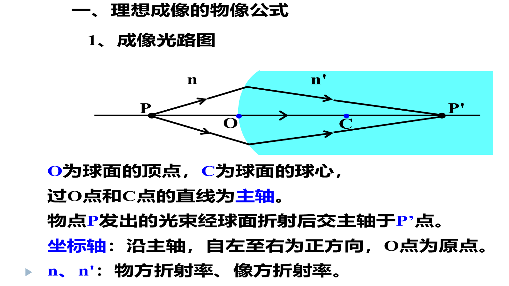

本讲义沿用课件的笛卡尔约定：光轴向右为正。点在顶点右侧，坐标为正；在左侧，坐标为负。因此实物在左侧通常有 $s<0$，球心在右侧有 $r>0$。实像或虚像必须看出射光束是否真实会聚，不能由 $s'$ 的正负直接判断。

## 2. 近轴条件为何不可少

从轴上物点发出一条光线，在球面上高度为 $h$ 的点折射；该点的法线经过球心。精确的正弦、正切关系会使算出的像点依赖 $h$，不同高度的光线不能严格聚在同一点，这正是球差的来源。

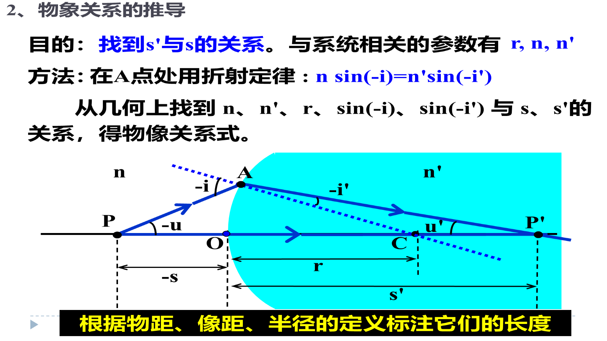

近轴光线靠近光轴且倾角很小，可以使用

$$\sin\theta\approx\tan\theta\approx\theta.$$

于是各角可写成“光线高度÷轴向距离”，共同的 $h$ 被约去，一阶像点不再依赖选取哪条近轴光线。

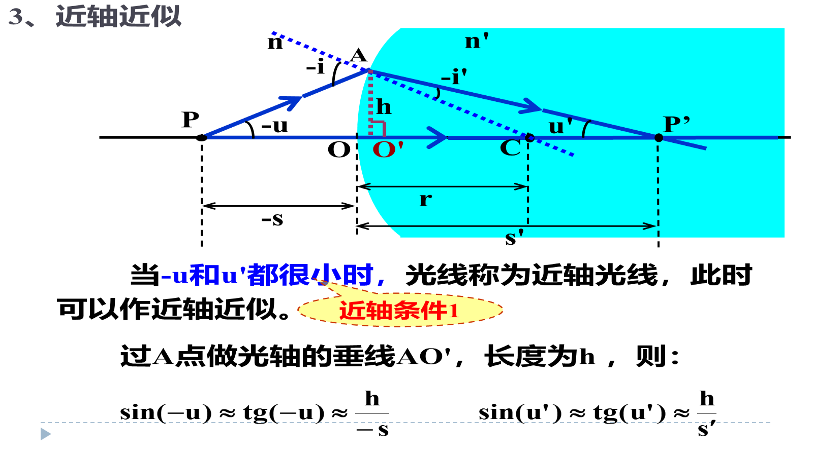

注意：与光轴平行不等于近轴。离轴很高的平行光仍可能进入非近轴区。

### 2.1 精确关系怎样退化成近轴公式

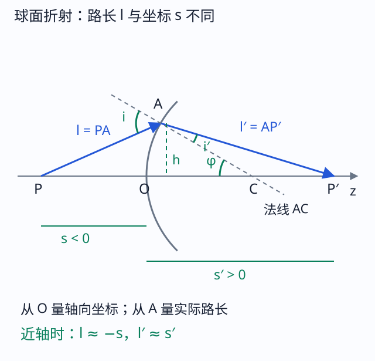

先标$P\to A\to P'$，其中$AC$是法线。图中的$l,l'$为斜线长度，$s,s'$从顶点$O$沿轴量；所以近轴替换$l\approx-s$有几何依据，并非人为给长度加负号。检查“是否近轴”就是检查这些斜线长度能否用轴向距离近似。

依据：3-4 PPT第4—8页；教材§3.3.2—3.3.5，书页127—131。以左侧实物、右凸折射面、右侧实像的构型为例，令入射点为$A$、顶点$O$、球心$C$，$l=PA>0,l'=AP'>0$；$s,s',r$仍为带符号的轴向坐标。两三角形的正弦定理与$n\sin i=n'\sin i'$联合给

$$\frac{n'}{l'}+\frac n l=\frac1r\left(\frac{n's'}{l'}+\frac{ns}{l}\right).$$

这一步的几何消元可展开来看：令$\varphi$为半径$CA$与向左主轴的锐夹角，图示构型$P$在$O$左侧、$P'$在$C$右侧。两三角形给$\sin i=(r-s)\sin\varphi/l$、$\sin i'=(s'-r)\sin\varphi/l'$。代入$n\sin i=n'\sin i'$，约去非轴向光线共有的$\sin\varphi$，得$n(r-s)/l=n'(s'-r)/l'$；展开并把含$r$的项移到一边，就是上面的精确式。轴向光线用连续极限理解。

从$A$沿球面移动时，$l,l'$随入射高度改变，一般求出的$s'$也随之改变，出射束失去单心性。近轴时$l\approx-s,l'\approx s'$，上式变为$n'/s'-n/s=(n'-n)/r$，入射高度消失。

球面反射的对应精确关系（左实物、左实像、凹面镜构型）是

$$\frac1l+\frac1{l'}=\frac1r\left(\frac s l+\frac{s'}{l'}\right).$$

这里$l,l'>0$而$s,s',r<0$。近轴时$l\approx-s,l'\approx-s'$，才得到$1/s+1/s'=2/r$。所以“球面光束一般不单心”与“近轴球面镜可成理想像”并不矛盾，二者近似层次不同。精确式中的几何路长$l$和代数坐标$s$不可随意互换。例：轴向平行光经凹球面镜反射，若入射点半径与轴夹角为$\varphi$，光线轴交点距球心为$R/(2\cos\varphi)$；仅$\varphi\to0$才得到顶点前$R/2$焦点，离轴高度增加会产生球差。

## 3. 球面折射公式与光焦度

近轴条件下：

$$\frac{n'}{s'}-\frac{n}{s}=\frac{n'-n}{r}=\Phi.$$

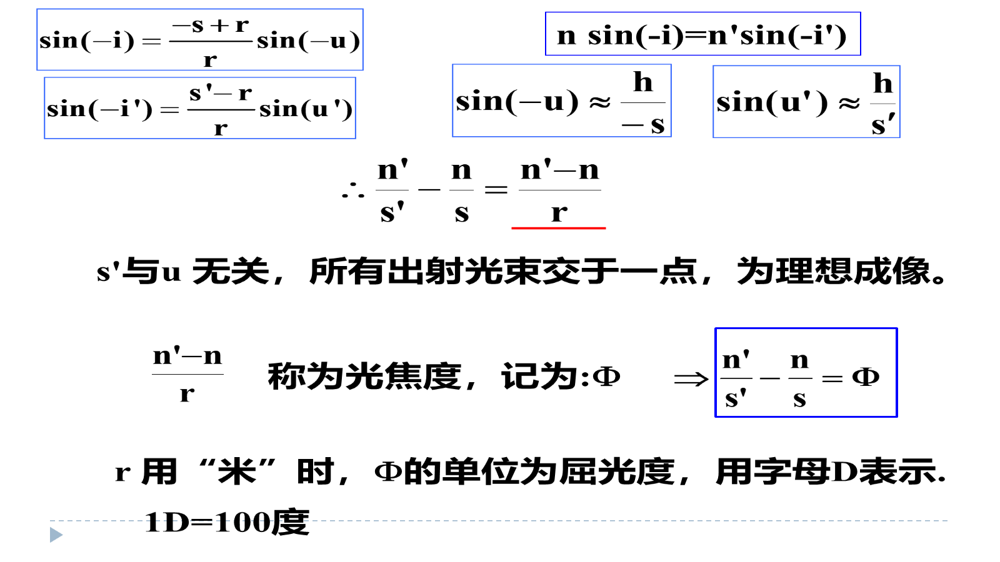

$\Phi=(n'-n)/r$ 是折射面的光焦度，SI 单位为 $\mathrm{m^{-1}}$，也称屈光度 D。公式可以读成：

> 出射光束的会聚程度 − 入射光束的会聚程度 = 折射面提供的光焦度。

两个极限可随时用来检查：

- $n'=n$：界面不改变光束，公式给出 $s'=s$；
- $r\to\infty$：球面变为平面，得到 $n'/s'=n/s$。

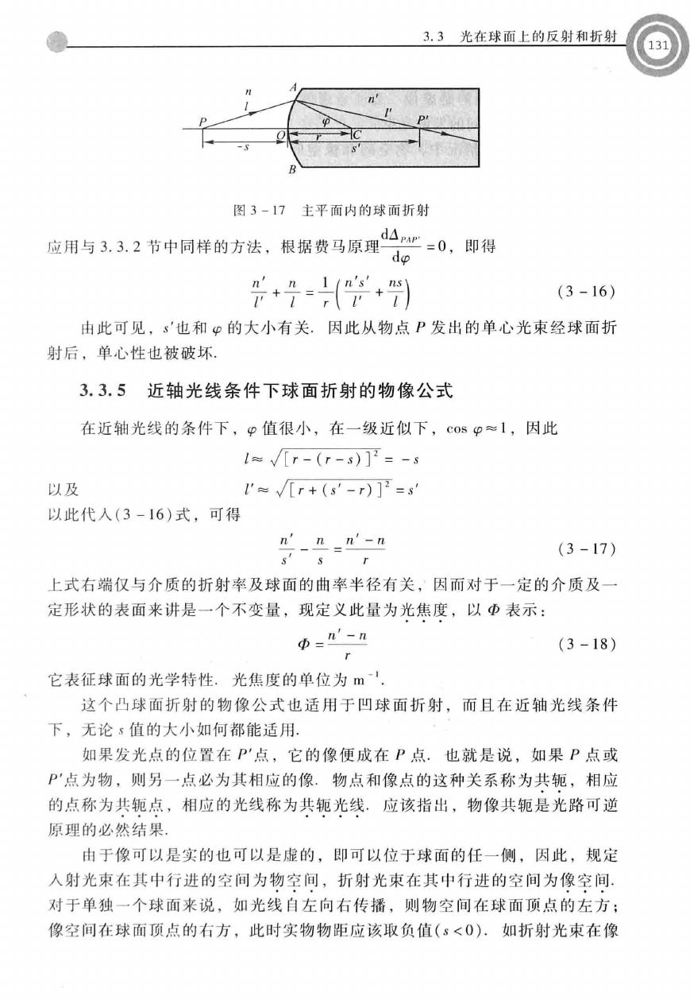

## 4. 焦点、焦距、高斯公式和牛顿公式

物在无穷远时，像在像方焦点 $F'$：

$$f'=\frac{n'r}{n'-n}=\frac{n'}{\Phi}.$$

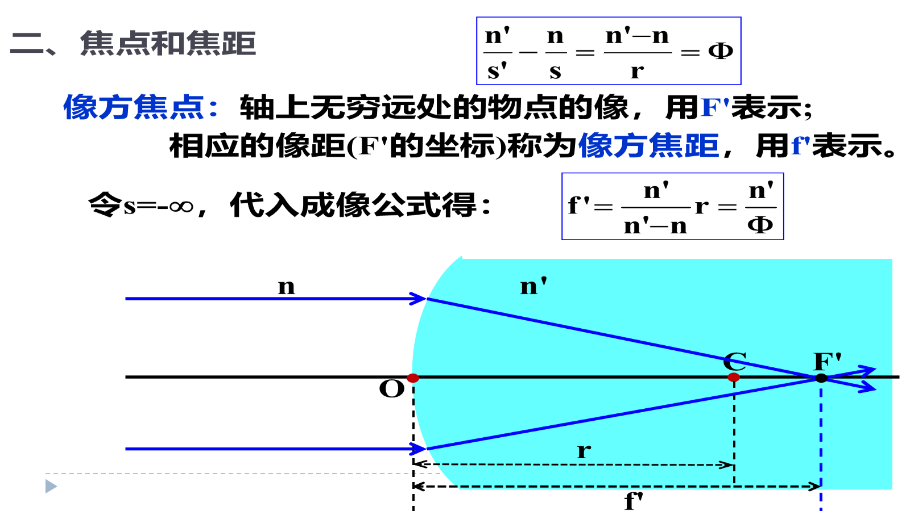

物在物方焦点 $F$ 时，像在无穷远：

$$f=-\frac{nr}{n'-n}=-\frac{n}{\Phi}.$$

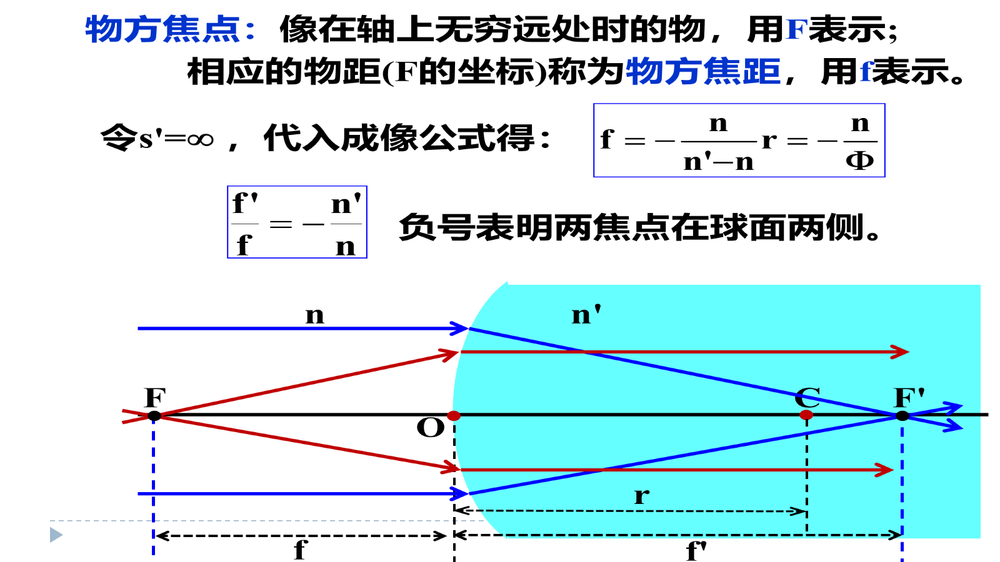

所以单折射球面的两个焦距一般不等长：

$$\frac{f'}{f}=-\frac{n'}{n}.$$

从顶点量距离，使用高斯公式：

$$\frac{f'}{s'}+\frac{f}{s}=1.$$

从焦点量距离，令 $x=s-f$、$x'=s'-f'$，使用牛顿公式：

$$xx'=ff'.$$

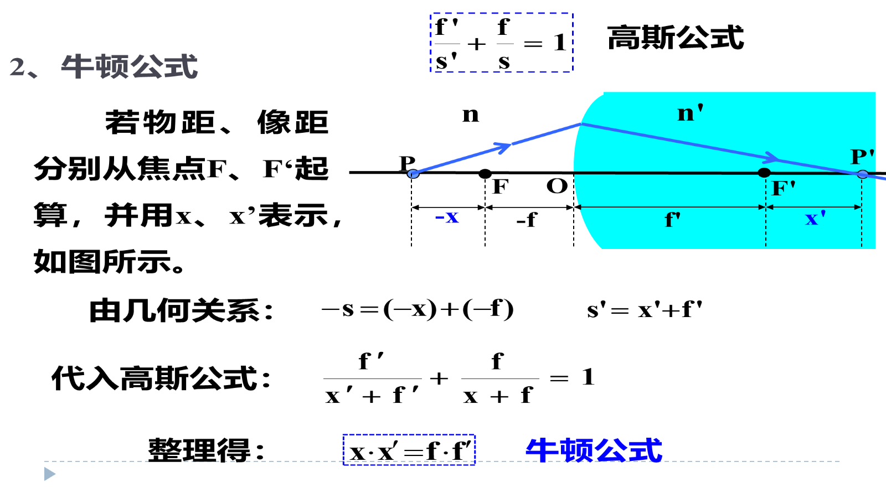

题目给物距、半径和折射率时，基本公式最直接；围绕焦点给距离时，牛顿公式通常更短。不要把从顶点量的 $s$ 与从焦点量的 $x$ 混用。

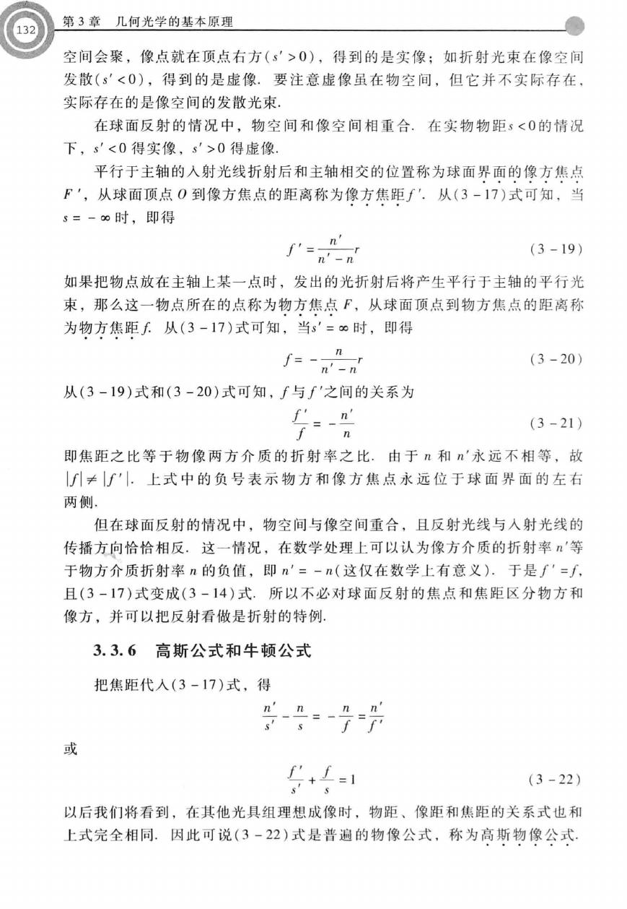

### 4.1 高斯、牛顿公式与放大率的连锁推理

本节只做两件事：把物像公式的量距原点从顶点换到焦点，再把像高与物高的比写成可计算的形式。对照上方“高斯与牛顿公式”图，先写$x=s-f$、$x'=s'-f'$，而不要凭图把$x$误当作正的线段长。$\beta=y'/y$是带符号的横向放大率；负值表示倒立，不是“像高小于零”这个长度概念。

依据：3-4 PPT第11—12、16页；教材书页132—133、138。球面折射式除以$\Phi$，用$f'=n'/\Phi,f=-n/\Phi$，立即得$f'/s'+f/s=1$。令$s=x+f,s'=x'+f'$，交叉相乘：

$$f'(x+f)+f(x'+f')=(x+f)(x'+f'),$$

同项消去便是$xx'=ff'$。两者描述同一对共轭点，只是量距原点不同。计算中有零分母时须用无穷远共轭的极限解释，不能机械约去。

经过球心的光线不偏折，相似三角形给$\beta=(r-s')/(r-s)$；结合物像公式，化为$\beta=ns'/(n's)$。再利用$f/f'=-n/n'$与牛顿式，得

$$\boxed{\beta=-\frac{fs'}{f's}=-\frac f x=-\frac{x'}{f'}.}$$

这里使用近轴、小物条件。若改为空气薄透镜，$f=-f'$，于是$\beta=s'/s$；若为球面镜，$f=f'$，于是$\beta=-s'/s$。同一个一般式解释两种负号差别。第06—08课中，$s,s'$需改从各自主点量，不能继续从外表面顶点量。

### 已布置习题 3.10

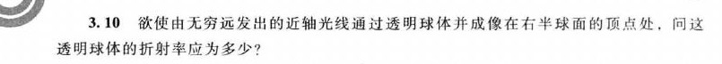

只看入手提示

目标像点恰好是第二个表面的顶点。若第一面已经使平行光在距第一面一个直径的位置会聚，光到第二面时光束高度正好缩为零，第二面不再构成普通的有限孔径成像。因此先求第一面的像方焦距，再令它等于球的直径 $2R$。不要把 $s_2'=0$ 硬代入含 $1/s_2'$ 的公式。

## 5. 横向放大率和角放大率

对垂直于光轴的小物：

$$\beta=\frac{y'}{y}=\frac{ns'}{n's}.$$

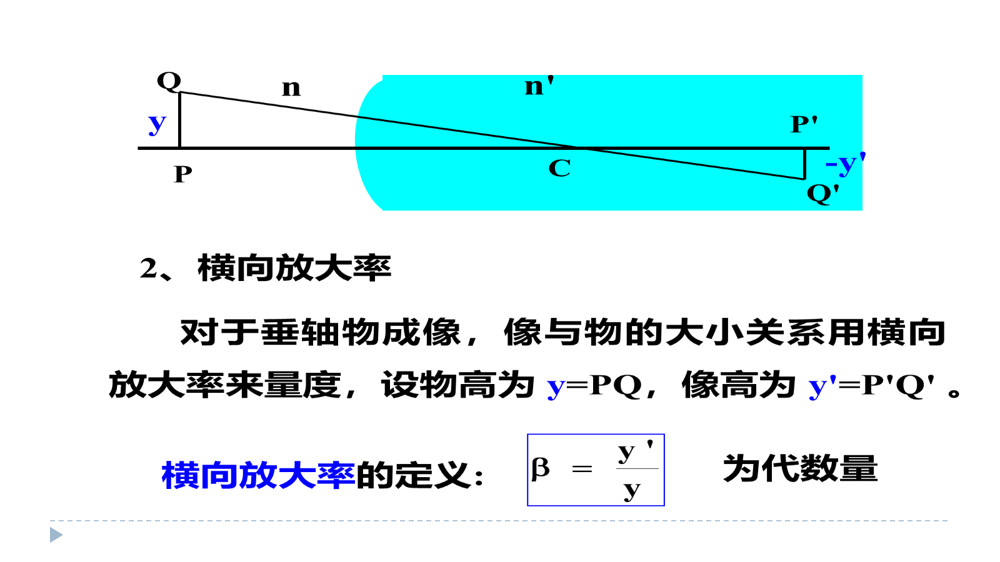

$|\beta|$ 表示大小比例；$\beta>0$ 为正立，$\beta<0$ 为倒立。角放大率满足

$$\gamma=\frac{u'}{u}=\frac{s}{s'},\qquad \beta\gamma=\frac{n}{n'}.$$

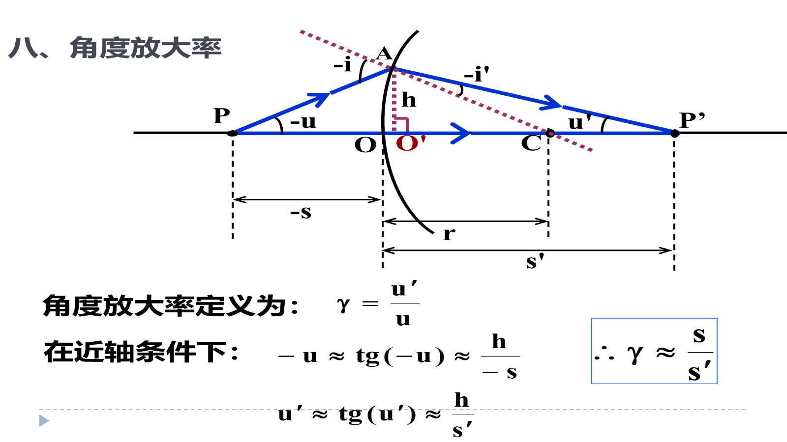

### 5.1 亥姆霍兹—拉格朗日定理：尺寸与光束角度的约束

教材§3.6.3（书页144，PDF第162页）把这条关系单独列为定理。在近轴物、近轴光线的一阶理想共轴成像中，物像高与对应光线的有向倾角满足

$$
\boxed{nyu=n'y'u'}.
$$

其中$n,n'$是系统外侧物像介质的折射率；$y,y'$是小物$PQ$及像$P'Q'$相对轴上共轭点$P,P'$的有向高度。$u,u'$取自连接轴上$P,P'$的同一条对应孔径光线，是它在物像两侧与主轴的有向夹角，不能任取一条从离轴$Q$出发的光线替代。本节先按普通折射系统讨论；有反向传播时必须保持统一的角度与折射率记账约定。

它就是前面两个放大率关系的物理约束：

$$
\beta=\frac{y'}y,\qquad\gamma=\frac{u'}u,
\qquad\beta\gamma=\frac n{n'}.
$$

因此横向放大与光束角度变化不能任意指定；两侧介质相同时，$\beta\gamma=1$，并不表示$\beta=\gamma$。例如$n=1,n'=1.5,\beta=-2$，则$\gamma=-1/3$；若错用同介质公式，就会算成$-1/2$。

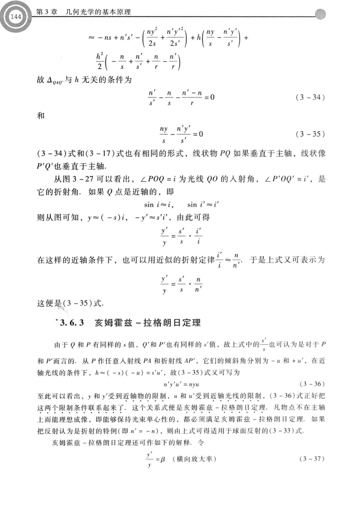

*教材书页144，PDF第162页。上半部由等光程条件得到成像与放大率关系，下半部§3.6.3给出式(3-36)。教材n′y′u′=nyu中的撇号表示像方量；两侧倾角均是有向角，不能只因图上一个向上、一个向下就漏掉负号。*

**适用边界**：不能把本式直接改为$ny\sin u=n'y'\sin u'$就宣称任意大孔径系统都成立；这里用的是近轴一阶定理。这里的光束角放大率，也不能不经定义换算就当作第四章仪器的视角放大率。

**考试入口**：问“为什么像放大与光锥角度不能同时任意增大”，或给$n,n',\beta$求$\gamma$，先用本定理；第07课节点的$\gamma=1$也由此得到$\beta=n/n'$，所以节点不一定具有横向等大性质。

**快速检查**：空气中的同一共轭物像，若$\beta=-4$，是否可能同时有$\gamma=-4$？

> [!question] 定理应用
> 我的回答：
> 我不确定的地方：

参考答案

不可能。两侧同介质要求$\beta\gamma=1$，所以$\gamma=-1/4$。原判断的乘积为16，违反一阶成像约束。

## 6. 连续折射与中间像

多面系统逐面计算。若两顶点相距 $d$，第一面的像距为 $s_1'$，换到第二面顶点作原点后：

$$s_2=s_1'-d.$$

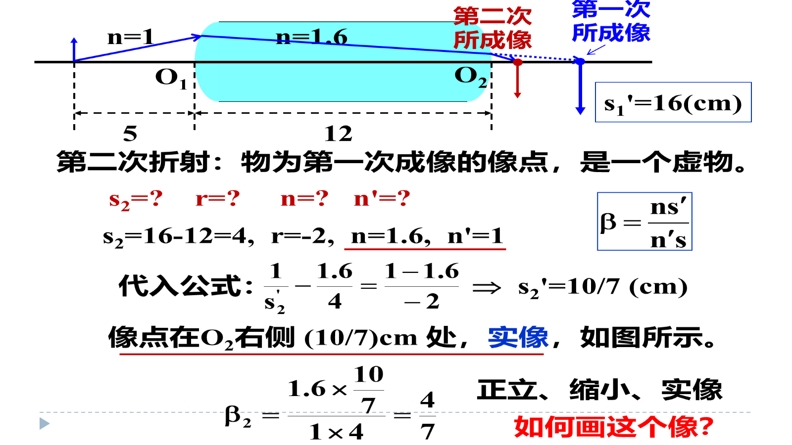

若中间像在第二面后方，入射到第二面的光正向该点会聚，所以它是第二面的虚物。总横向放大率逐面相乘：

$$\beta_{\text{总}}=\beta_1\beta_2\cdots.$$

最常见的错误是把 $s_1'$ 原样抄成 $s_2$，或忘记第二面的曲率半径也要按新顶点和球心位置重新判号。

### 6.1 课件例题：中间实像成为第二面的虚物

   **读题先画两个顶点。**   以第一面顶点为0，第二面顶点在右方12 cm；第一次像点先用第一面的公式求，第二次物距再减去12 cm换原点。若第一次会聚点落在第二面右侧，第二面收到的是还没会聚的光束，故它面对虚物。下面数字中的16 cm是“第一次像到第一顶点”，4 cm才是“该点到第二顶点”。这个换原点步骤决定第二次代入的正负。

依据：3-4 PPT第18—21页。玻璃棒$n=1.6$，两顶点间距$12\,\mathrm{cm}$，两端球面半径大小均为$2\,\mathrm{cm}$，物在首面前$5\,\mathrm{cm}$，外界为空气。全程取向右为正。

第一面$s_1=-5,r_1=2$：$1.6/s_1'-1/(-5)=0.6/2$，得$s_1'=16\,\mathrm{cm}$，$\beta_1=16/[1.6(-5)]=-2$。这表示若没有第二面，光会在首面右方16 cm会聚。

实际第二面在右方12 cm，光还没会聚就先到达它；所以$s_2=16-12=4\,\mathrm{cm}>0$为虚物。第二面$r_2=-2,n=1.6,n'=1$：

$$\frac1{s_2'}-\frac{1.6}{4}=\frac{1-1.6}{-2},\qquad s_2'=\frac{10}{7}\,\mathrm{cm},\qquad\beta_2=\frac{1.6(10/7)}4=\frac47.$$

最终像在第二面右方$10/7$ cm，总放大率$\beta=(-2)(4/7)=-8/7$，故为倒立、略放大的实像。“第二次正立缩小”是相对中间物而言，不是相对最初物体。PPT第21页把判实像处写成$s_2>0$；这里应看最终像距$s_2'>0$，$s_2>0$只判定第二面的虚物。教材例3.4使用20 cm间距，结果不同，不能把两组数据混用。

### 已布置习题 3.12、3.13、3.14

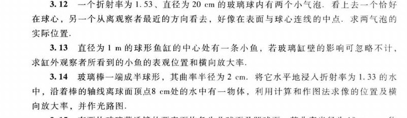

3.12* 入手提示

观察者只通过离自己最近的球面看两个气泡。分别计算两个气泡经同一球面形成的表观像，利用两像位置相同反求实际物距。

3.13 入手提示

先利用“鱼在球心”判断光线与法线的关系，再用公式核对表观位置。横向放大率应由 $\beta=ns'/(n's)$ 检查，不能只凭直觉。

3.14 入手提示

光从水进入玻璃：物方折射率为 1.33，像方为玻璃折射率。先画球心，按光行方向建坐标并判 $r$，再分别用公式与三条特殊光线作图。

## 7. 平面折射、视深和玻璃平板

令 $r\to\infty$：

$$\frac{n'}{s'}=\frac{n}{s},\qquad s'=\frac{n'}{n}s,\qquad \beta=1.$$

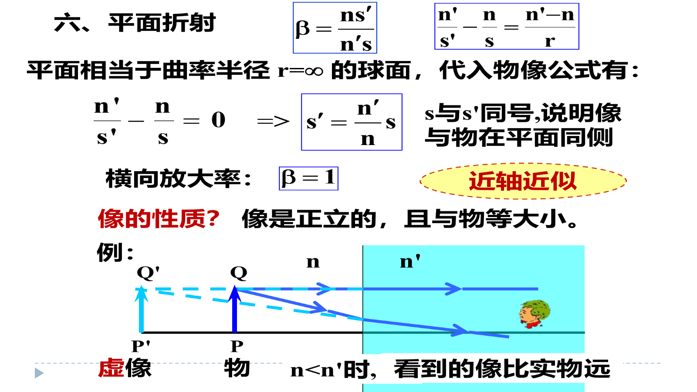

物在水中、观察者在空气中时，光从水射向空气，$|s'|=(n_{\rm air}/n_{\rm water})|s|$，所以看起来变浅。必须先按实际光行方向分清 $n$ 与 $n'$，不能无条件套“实际深度除以折射率”。

平板有两个平行界面。逐面计算后，若外界折射率为 $n_0$、平板折射率为 $n$、厚度为 $d$，近轴表观位移为

$$\Delta=d\left(1-\frac{n_0}{n}\right).$$

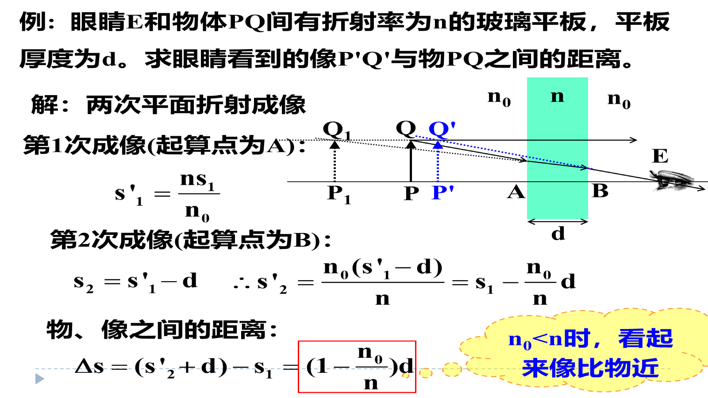

### 已布置习题 3.3

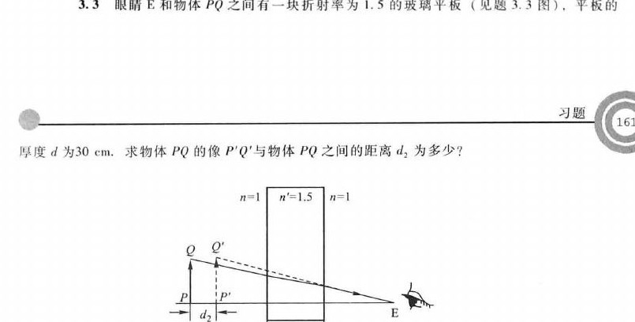

只看入手提示

沿物体到眼睛的光行方向，依次处理空气→玻璃、玻璃→空气。先求中间像，再相对第二面重新量物距，最后比较物点与最终虚像的坐标。平板位移式可用于复核。

### 7.4 平面折射为何通常不能严格成点像

依据：教材§3.2.2、附录3.1书页119—121、155—157；3-4 PPT第22—30页。平面反射严格保持单心性，   **平面折射通常不保持**   ；视深公式仅在近法线观察的近轴范围使用。

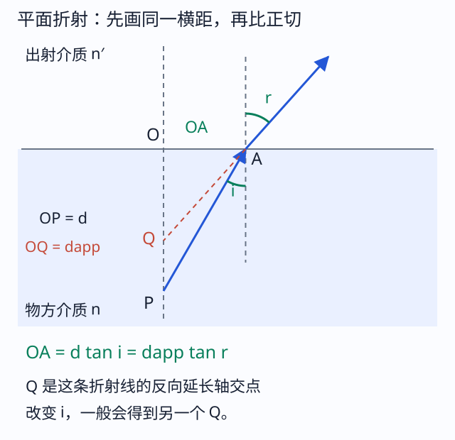

教学重绘依据教材§3.2.2。先找真实物点$P$、入射点$A$、物点正上方的$O$；把出射光反向延长，与$OP$交于$Q$。两个直角三角形共享横边$OA$，于是$OA=d\tan i=d_{\rm app}\tan r$。这里$Q$只是这一条光线的轴交点，要检验“成点像”，还必须换另一条光线看是否交在同处。

设水下轴上点距平面法向深度为$d$，物方折射率$n$、出射方$n'$，某条光线入射、折射角为$i,r$。入射点到轴的横距为$d\tan i$，出射线反向延长到轴的表观深度为

$$d_{\rm app}(i)=d\frac{\tan i}{\tan r}=d\frac{n'\cos r}{n\cos i},\qquad n\sin i=n'\sin r.$$

一般随$i$变化，故不同光线没有同一虚像点。$i,r\to0$才得到$d_{\rm app}\approx(n'/n)d$与$\beta=1$。例：$n=4/3,n'=1$，近法线深度为$0.75d$；$i=30^\circ$时$r\approx41.81^\circ$，该光线的轴交深度约$0.645d$。不能把$0.75d$用于任意斜视角。教材的斜细光束结果还可具体表示：临时取界面为$X$轴、从界面指向物方为$Y$正向，物点$P=(0,d)$，令$\eta=n'/n$、$i$为中心光线入射角。子午面内两条邻近折射线的反向延长交点为

$$X_t=d(\eta^{-2}-1)\tan^3i,\qquad Y_t=d\eta\left[1-(\eta^{-2}-1)\tan^2i\right]^{3/2}.$$

   **子午与弧矢是什么意思？**   中心光线和界面法线张成的平面叫子午面；以中心光线为轴，在与子午面垂直的方向再取一小束邻光，得到弧矢方向。斜细光束在这两个方向一般不能同时收缩到一点，形成两条焦线。上式$(X_t,Y_t)$表示子午截面内相邻反向延长线交点的位置；$Y_s$对应另一组的轴交位置。它们不应直接当作所有光线共有的“水下物体像深”。

斜视焦线坐标如何从邻近两条光线得到？

把中心入射角暂记为变量$i$。入射点横坐标为$a(i)=d\tan i$，其折射线及反向延长线满足$X+Y\tan r(i)=a(i)$。两条角度只差很小的邻光交于同一点，故固定交点$X,Y$，对$i$求导：$Y\sec^2r\,\mathrm dr/\mathrm di=d\sec^2i$。折射定律给$\mathrm dr/\mathrm di=\cos i/(\eta\cos r)$，所以$Y_t=d\eta\cos^3r/\cos^3i$。用$\sin r=\sin i/\eta$改写余弦比，即得上面的$Y_t$；再代回$X_t=d\tan i-Y_t\tan r$便得$X_t$。这一步解释了为什么要使用邻近两条线，而不能只延长一条线就认定完整点像。

式中根号需在可传播折射的范围内。反向延长线与法线轴的交点高度则是$Y_s=d\eta\cos r/\cos i$。$i\to0$时$X_t\to0,Y_t,Y_s\to\eta d$；斜视时一般不重合。教材进一步指出，斜入射的细光束有子午、弧矢两条互相垂直的焦线，通常不汇成一个点，属于几何像散，区别于孔径很小造成的衍射。

平行平板两侧介质相同为$n_0$时，   **单根光线出射方向与入射方向平行**   ：两面折射关系相乘即可消去平板$n$。设板内角$r$、入射角$i$、厚度$d$，该光线的横向偏移为

$$b=d\frac{\sin(i-r)}{\cos r}.$$

沿界面法线衡量的表观像移则为$\Delta=d[1-\tan r/\tan i]$，近法线时才成为$d(1-n_0/n)$。二者方向和定义不同，不可混用；出射平行不保证原先会聚的整束光仍严格单心。

### 7.5 斯涅耳窗口：180°外景压缩在约97°光锥内

依据：3-4 PPT第27—29页。取平静水平水面，观察者在水下。空气中方向角$i_a$从天顶$0^\circ$变化到地平线$90^\circ$，水内角$i_w$满足$n_a\sin i_a=n_w\sin i_w$。因此

$$0\le i_w\le\theta_c=\arcsin(n_a/n_w).$$

取$n_w=4/3,n_a=1$，半角$\theta_c=48.59^\circ$，顶角$2\theta_c=97.18^\circ$；若取$n_w=1.33$则顶角约$97.5^\circ$。它表示整个外部上半空间映入这一内部光锥，不是水下只看到了外部上半空间中的97°。深度为$h$的观察者，其窗口在水面上的圆盘半径为$h\tan\theta_c$；如$h=1$ m，半径约1.13 m。

窗口外的反向观察光路超过水到空气的临界角，于是主要看到水下环境的全反射像，而不是必然一片黑。波浪会改变局部法线，使窗口边缘变形；不能把平面近轴视深式延伸到窗口边缘。

**辨析练习：平面折射辨析**

“平面折射后像与物等大”能否用于任意斜视角？

> [!question] 平面折射辨析作答
> 我的判断与条件：

参考判断

不能。β=1属于近法线、小物的近轴结果。斜视时平面折射通常破坏单心性，出现不同的轴交点与两条焦线。

## 8. 三条特殊光线与固定解题流程

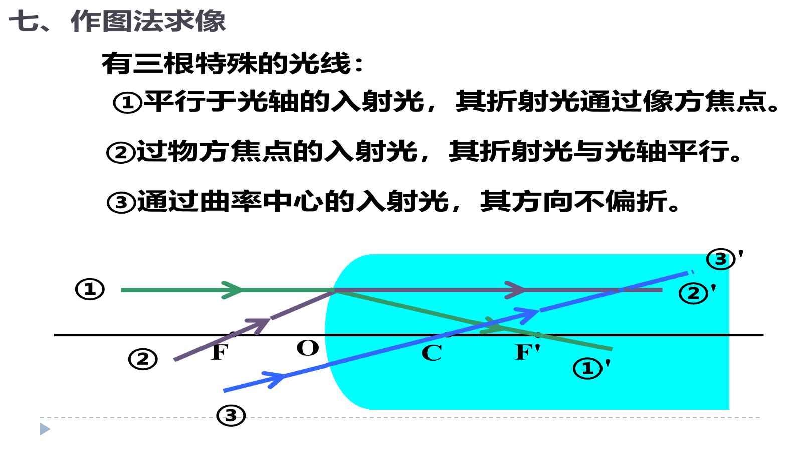

近轴条件下：平行轴线的光折射后过 $F'$；过 $F$ 的光折射后平行轴线；过球心 $C$ 的光沿法线传播、不改变方向。任选两条定像，第三条检查。

固定流程：

1. 画光行方向箭头；
2. 圈定当前界面，以其顶点为原点；
3. 写出带符号的 $n,n',s,r$；
4. 用球面公式求 $s'$，必要时求 $\beta$；
5. 把结果放回图上解释实像或虚像；
6. 有下一面就平移原点，重新开始。

## 9. 第 03 课自测

1. 为什么球面折射公式需要近轴条件？
2. 写出球面折射公式与光焦度。
3. $n'=n$ 时公式给出什么？
4. 为什么 $f$ 与 $f'$ 通常不等长？
5. 高斯公式与牛顿公式的距离分别从哪里量？
6. 第一面 $s_1'=16\rm\,cm$，第二面在其右侧 $12\rm\,cm$，求 $s_2$ 并判断中间像对第二面的角色。
7. 水中物体从空气看为何变浅？
8. 平面折射 $\beta=1$，为何仍会改变表观位置？
9. 多面系统总横向放大率怎样求？
10. 球面折射作图的三条特殊光线是什么？

展开答案

1. 精确关系中像点随光线高度改变；近轴小角近似使一阶像点与所选近轴光线无关。
2. $n'/s'-n/s=(n'-n)/r=\Phi$。
3. $s'=s$，表示没有折射率突变时界面不改变光束。
4. $f=-n/\Phi$、$f'=n'/\Phi$，两侧介质折射率通常不同。
5. 高斯公式从顶点量 $s,s'$；牛顿公式从焦点量 $x,x'$。
6. $s_2=16-12=+4\rm\,cm$；入射光在第二面后方会聚，因此是虚物。
7. $s'=(n'/n)s$，水到空气有 $n'<n$，所以像距绝对值减小。
8. $\beta$ 只描述横向尺寸；轴向位置仍按折射率比改变。
9. $\beta_{\rm 总}=\beta_1\beta_2\cdots$。
10. 平行轴线后过 $F'$；过 $F$ 后平行轴线；过 $C$ 不偏折。

# 第 04 课：球面反射成像

反射并不是另起一套互不相干的公式。老师课件的核心处理是：把反射看成球面折射在 $n'=-n$ 时的形式。这样，上一课的符号、焦点、放大率和作图法可以直接迁移；真正要适应的是反射光回到了入射一侧。

## 1. 球面反射与统一坐标

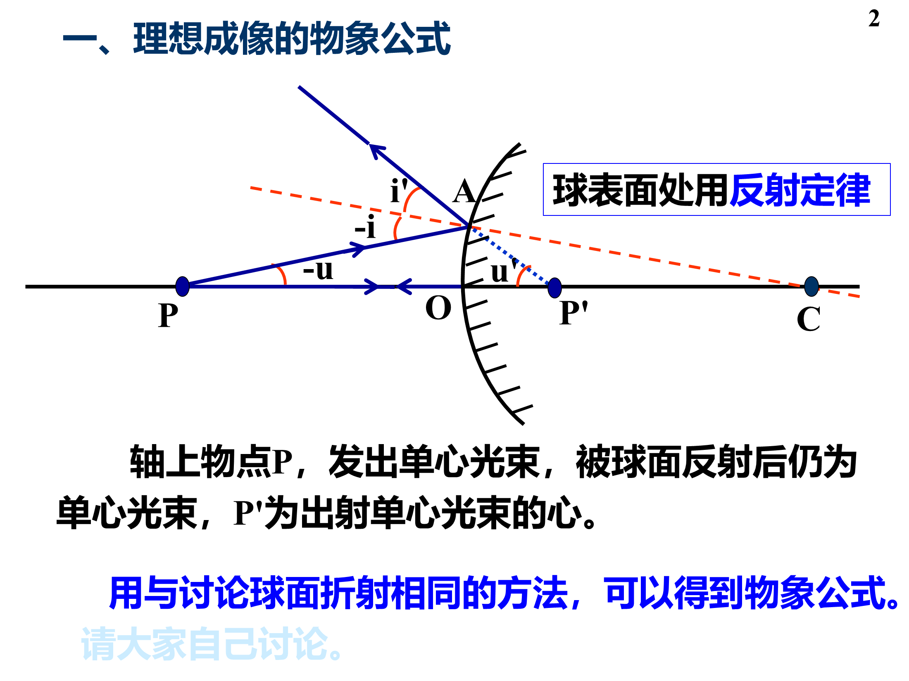

仍以镜面顶点 $O$ 为原点，向右为正。课件图中光从左向右入射，反射后向左返回。反射光若在镜前左侧真实会聚，虽然 $s'<0$，仍然是实像；负号只表示坐标位置。

## 2. 从球面折射公式得到球面反射公式

折射定律为

$$n\sin i=n'\sin i'.$$

令 $n'=-n$，便有 $i'=-i$，形式上得到反射定律。把同一代换放入球面折射公式：

$$\frac{n'}{s'}-\frac{n}{s}=\frac{n'-n}{r},$$

得到

$$\boxed{\frac{1}{s'}+\frac{1}{s}=\frac{2}{r}}.$$

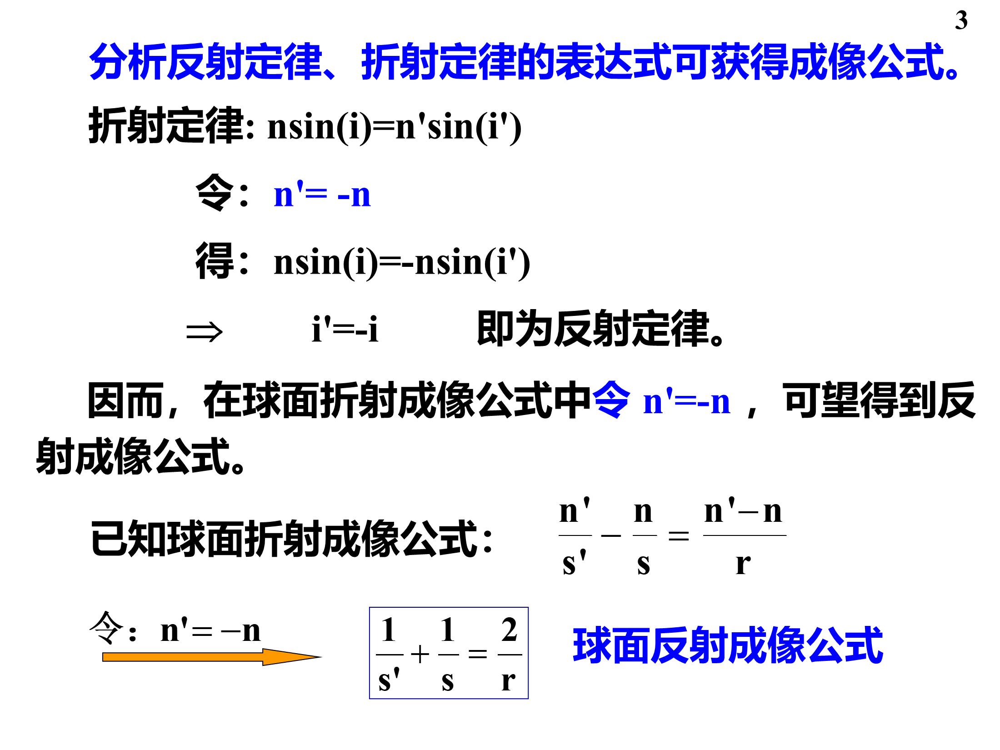

$n'=-n$ 是记录出射光反向传播的数学代换，不表示镜后存在真实的负折射率介质。

在本讲义的向右为正坐标中，镜面朝向左侧入射光时：

| 镜面 | 球心位置 | 半径与焦距 | 对平行近轴光的作用 |
|---|---|---|---|
| 凹面镜 | 镜前左侧 | $r<0, f'=r/2<0$ | 镜前真实会聚 |
| 凸面镜 | 镜后右侧 | $r>0, f'=r/2>0$ | 发散，反向延长线交于镜后 |

这与某些高中教材规定“凹面镜焦距为正”的正长度法不同。两套方法都能给出正确物理结果，但符号不能混用。

## 3. 焦点与焦距

令 $1/s\to0$：

$$s'=\frac{r}{2}.$$

由光路可逆性，物方焦点和像方焦点在物理空间重合：

$$F=F',\qquad f=f'=\frac{r}{2}.$$

## 4. 高斯公式、牛顿公式与放大率

高斯公式为

$$\boxed{\frac{1}{s'}+\frac{1}{s}=\frac{1}{f'}}.$$

从焦点量距离，令 $x=s-f$、$x'=s'-f'$，牛顿公式为

$$xx'=ff'=f'^2.$$

由球面折射放大率代入 $n'=-n$：

$$\boxed{\beta=\frac{y'}{y}=-\frac{s'}{s}}.$$

$\beta$ 的符号判断正倒，$|\beta|$ 判断放缩。若 $s$ 与 $s'$ 同号，则 $\beta<0$，像倒立；若二者异号，则 $\beta>0$，像正立。

## 5. 凹、凸面镜的成像性质由公式推出

把高斯公式解成

$$s'=\frac{f's}{s-f'}.$$

对凹面镜，$s<0$、$f'<0$：

| 物的位置 | 像的位置与性质 | 放大率 |
|---|---|---|
| $|s|>|r|$ | 镜前 $F$ 与 $C$ 之间的实像，倒立 | $|\beta|<1$ |
| $|s|=|r|$ | 像也在球心，实像，倒立 | $|\beta|=1$ |
| $|f'|<|s|<|r|$ | 镜前球心外的实像，倒立 | $|\beta|>1$ |
| $|s|=|f'|$ | 反射光平行，像在无穷远 | 无有限值 |
| $|s|<|f'|$ | 镜后虚像，正立 | $|\beta|>1$ |

对凸面镜，$s<0$、$f'>0$，公式必给出 $s'>0$ 且 $0<\beta<1$，因此镜前实物总形成镜后的正立、缩小虚像。

作图仍使用三条特殊光线：平行主轴后过焦点；过焦点后平行主轴；过球心后沿原路返回。虚像用反射光的反向延长线定位。

## 6. 近轴公式与大口径聚光的边界

球面镜对非近轴光会产生球差：不同离轴高度的光线不在同一点会聚。口径越大，收集的太阳功率大致按 $D^2$ 增长，但实际焦斑还受太阳有限角直径、反射率、像差和加工误差影响。

因此，只给镜面口径通常不足以唯一确定“焦点温度”；把所有能量压到数学点上也不符合实际。

### 6.1 衍射分辨本领：大口径为何能分开更近的两点

   **为什么几何成像后还会有“分不开”？**   真实光是波，通过有限孔径后会衍射；一个点源的像也会铺成有宽度的亮斑。两点方向很近时，两斑重叠。瑞利判据约定怎样的重叠程度算刚好分开，因此本题输入应是波长与口径，输出是最小方向角差。

计算前把波长与口径化为同一长度单位：$550\,\mathrm{nm}=5.50\times10^{-7}\,\mathrm m$。计算后的弧度换角秒用$1\,\mathrm{rad}=(180/\pi)\times3600$角秒。下面的1.22来自圆孔衍射亮斑第一暗环的位置，不能直接移用到任意形状孔径。

依据：3-5 PPT第9页。均匀照明的理想圆形孔径，在单色光、远场或焦平面的衍射条件下，点像有中央亮斑和圆环。瑞利判据取一个点的中央极大落在另一个点的第一暗环，得到最小角间隔

$$\theta_R\approx1.22\frac\lambda D\quad\text{（弧度）}.$$

$\lambda$为传播介质中的波长，$D$为有效圆孔直径；两点须满足通常的非相干点源成像条件。例：$\lambda=550$ nm、$D=0.10$ m，$\theta_R\approx6.71\times10^{-6}$ rad，约1.38角秒。此判据讨论分辨两个方向，不是几何焦距或收光功率。射电干涉阵列的最高角分辨尺度约由$\lambda/B$决定，$B$为最大有效基线；稀疏阵列不能直接当成同直径的填满圆孔套1.22，也不拥有同等收光面积。

### 6.2 虹与霓：反射次数、偏向极值与色序

依据：3-5 PPT第22—33页，尤其第32页。

出处：3-5 PPT第32页。图中文字：Primary Rainbow、Primary为主虹；Secondary Rainbow、Secondary为副虹（霓）；Raindrops为雨滴；Measured from anti-solar point意为角度从反太阳点方向量起。42°和51°是角半径的近似值。

近似球形水滴受太阳平行光照射，入射、出射各折射一次，内部反射$p$次。主虹$p=1$，副虹（霓）$p=2$；内部反射通常是部分反射，不是全反射。以光线在空气中的入射角$i$、滴内折射角$r$表示，$\sin i=n\sin r$，$n$为水相对空气折射率。沿光路累计的偏向为

$$D_p=p\pi+2i-2(p+1)r.$$

每次折射贡献$i-r$，每次内部反射贡献$\pi-2r$，相加即得。由于水滴截面各入射位置都有光，方向分布在$D_p$驻值附近集中：

$$\frac{\mathrm dD_p}{\mathrm di}=2-2(p+1)\frac{\cos i}{n\cos r}=0,\qquad\cos^2i=\frac{n^2-1}{p(p+2)}.$$

这里固定的是入射光方向，变化的是水滴上的入射位置；与费马原理固定端点、改变候选路径的变分不是同一个极值问题。几何光线在驻值附近聚集解释亮带位置，实际亮度不能靠无限大的几何密度计算，还受波动与滴大小限制。

   **数值为什么按这个顺序算？**   题目要找亮虹角半径，先用反射次数$p$选主虹或副虹，再由驻值条件求$i$；用$r=\arcsin(\sin i/n)$求滴内角，代入$D_p$，最后把累计偏向换成观察者从反太阳方向量的角半径。导数中每个角都按弧度处理；显示最后数值时可换成度。

取$n=4/3$，主虹$i\approx59.39^\circ,r\approx40.20^\circ$，$D_1\approx137.97^\circ$，相对反太阳点的角半径为$\rho_1=180^\circ-D_1\approx42.03^\circ$。副虹$i\approx71.83^\circ,r\approx45.45^\circ$，累计$D_2\approx230.98^\circ$，角半径$\rho_2=D_2-180^\circ\approx50.98^\circ$。PPT标出的42°、51°均从   **反太阳方向**   量，不是从地平线或太阳本身量。

正常色散下紫光$n$较大：主虹角半径变小，故外红内紫；副虹角半径变大，故内红外紫。副虹经历额外一次部分反射，通常较弱。主虹以内与副虹以外的对应光线较丰富，二者之间相对暗的区域称亚历山大暗带。

相同角半径的水滴围绕反太阳轴构成圆锥，眼睛看到其截面为圆；地面遮挡常只留下圆弧，高处可见近完整圆环。不同观察者、同一观察者所见不同颜色通常对应不同水滴，不能把彩虹当作固定在某个空间位置的物体。PPT中的细密副条纹还涉及干涉，不能用“多反射一次”解释全部条纹。

**辨析练习：彩虹辨析**

主虹42°从哪里量？主虹的滴内反射是不是全反射？

> [!question] 彩虹辨析作答
> 我的判断与条件：

参考判断

从反太阳方向量角半径；通常是部分反射。若把42°当成入射角或把虹霓解释为全反射，会得到错误光路。

## 7. 平面镜与镜像法

令 $r\to\infty$：

$$\frac{1}{s'}+\frac{1}{s}=0
\quad\Longrightarrow\quad
s'=-s,$$

并且

$$\beta=-\frac{s'}{s}=1.$$

平面镜像与物关于镜面对称、等大、正立。镜像法把物点关于镜面对称到镜后，再连接观察点与镜像点；这条直线与镜面的交点就是反射点。它可以处理反射点、最短光程和可见范围问题。

倾斜玻璃板投影的“悬浮像”本质上仍是平面反射形成的虚像。

课件第12—15页的双曲面镜装置则利用连续两次反射：物在一面镜的焦区附近，使光束反射后近似平行；另一面镜再把它会聚到开口附近，形成可从外部观察的实像。像的大小、倒正由两次成像共同决定。它与第18—20页倾斜玻璃板形成的虚像不同；“悬浮显示”不保证同一种成像机制，也不能仅凭商品名称就认定采用了记录、重建光波的全息术。

## 8. 已布置习题 3.6–3.9*

### 习题 3.6、3.7

3.6 入手提示

先按统一坐标写 $s$ 与 $f'$ 的符号，用高斯公式求 $s'$，再由 $\beta=-s'/s$ 求像高。作图用两条特殊光线，检查计算所得像区和正倒关系。

3.7 信息充分性检查

物高和像高只能给出 $|\beta|=1/5$，题目没有说明正倒。分别取 $\beta=+1/5$ 与 $\beta=-1/5$，求出两种 $s'$ 和 $r$。若分别对应凸、凹面镜，就应指出缺少像的正倒或实虚信息，不能强行保留一个答案。

### 习题 3.8

入手提示

先求眼睛经凸面镜形成的虚像坐标。玻璃板反射像关于玻璃板与眼睛对称。把两幅像放在同一坐标轴上并令坐标相等，再用“玻璃板位于眼睛与凸面镜之间”筛选根。

### 习题 3.9*

证明路线

这是双程问题：入射光穿过玻璃板一次，反射光返回时还要穿过一次。分别按实际光行方向使用平面折射或平板位移关系，把插板前后的坐标相减，再与改变球面镜物距的结果比较。只计算一次单程位移会漏项。

## 9. 固定解题流程

1. 画入射箭头，明确反射后光行方向反转；
2. 以镜面顶点为原点，写带符号的 $s,r,f'=r/2$；
3. 使用 $1/s'+1/s=2/r=1/f'$；
4. 用 $\beta=-s'/s$ 判断正倒和放缩；
5. 回到光路图，判断出射光是否真正经过像点；
6. 若有玻璃板或第二镜面，按传播顺序分段并重新建坐标。

## 10. 第 04 课自测

1. 为什么形式上可令 $n'=-n$ 得到反射公式？
2. 写出统一坐标下的球面反射公式。
3. 光从左向右入射时，凹面镜的 $r$ 为什么为负？
4. 镜前实像有 $s'<0$，为何仍是实像？
5. 球面镜的物方、像方焦点为何重合？
6. 凸面镜为何总成正立缩小虚像？
7. 平面镜公式怎样由球面镜公式取极限得到？
8. 镜像法为什么能把折线路径拉直？
9. 只知道物高、像高和物距，为何可能不能唯一判断镜面种类？
10. 镜前玻璃板题为何必须考虑双程？

展开答案

1. $n'=-n$ 使折射定律形式变为 $i'=-i$，用代数记录出射光反向传播。
2. $1/s'+1/s=2/r=1/f'$，且 $f'=r/2$。
3. 球心在顶点左侧，向右为正，所以 $r<0$。
4. 负号只表示位置在左侧；反射光确实在那里会聚，所以是实像。
5. 反射发生在同一介质中，由光路可逆性，两个焦点是同一物理点。
6. 对实物 $s<0$、凸面镜 $f'>0$，公式给出 $s'>0$、$0<\beta<1$。
7. 令 $r\to\infty$，得 $s'=-s$、$\beta=1$。
8. 物点关于镜面的对称点使等角反射关系等价于一条直线。
9. 只能得到 $|\beta|$，而 $\beta$ 的正、负可能对应凸、凹两种解。
10. 光到镜面前穿过一次，反射回来又穿过一次，两程方向相反。

# 第 05 课：薄透镜

薄透镜是两个折射球面靠得足够近时的近似。逐面写两次球面折射，再利用两个顶点近似重合消去中间像，就能得到薄透镜公式。

## 1. 定义与两种分类

若两顶点间厚度 $d$ 远小于曲率半径和题目中的物像距离，可把两个顶点看成同一个光心平面。

- 按形状：凸透镜中间厚，凹透镜中间薄；
- 按功能：正透镜 $\Phi>0$，负透镜 $\Phi<0$。

形状与功能不是同一分类。普通玻璃在空气中时凸透镜通常会聚；若外界介质折射率高于透镜材料，功能可能反转。

## 2. 两次球面折射合成

设透镜材料折射率为 $n$，左右外界为 $n_1,n_2$，曲率半径为 $r_1,r_2$：

$$\frac{n}{s_1'}-\frac{n_1}{s}=\frac{n-n_1}{r_1},$$

$$\frac{n_2}{s'}-\frac{n}{s_2}=\frac{n_2-n}{r_2}.$$

薄透镜近似给出 $s_2\approx s_1'$，相加后中间像项消去：

$$\boxed{\frac{n_2}{s'}-\frac{n_1}{s}
=\frac{n-n_1}{r_1}+\frac{n_2-n}{r_2}=\Phi}.$$

厚度不可忽略时，$s_2=s_1'-d$ 不能替换为 $s_1'$，必须逐面成像或使用主平面。

## 3. 焦点、焦距与制镜者公式

一般介质中：

$$f'=\frac{n_2}{\Phi},\qquad f=-\frac{n_1}{\Phi},\qquad
\frac{f'}{f}=-\frac{n_2}{n_1}.$$

$$\Phi>0\Longleftrightarrow f'>0\quad\text{正透镜},$$

$$\Phi<0\Longleftrightarrow f'<0\quad\text{负透镜}.$$

空气中 $n_1=n_2=1$：

$$\boxed{\frac{1}{s'}-\frac{1}{s}=\frac{1}{f'}
=(n-1)\left(\frac{1}{r_1}-\frac{1}{r_2}\right)}.$$

若浸在折射率为 $n_0$ 的同种介质中：

$$\frac{1}{f'}=\left(\frac{n}{n_0}-1\right)
\left(\frac{1}{r_1}-\frac{1}{r_2}\right).$$

曲率半径必须带符号。先画两球心，再写 $r_1,r_2$；半径绝对值相同不表示代入时同号。

## 4. 高斯、牛顿公式与放大率

$$\frac{f'}{s'}+\frac{f}{s}=1,\qquad xx'=ff'.$$

一般介质：

$$\beta=\frac{y'}{y}=\frac{n_1s'}{n_2s}.$$

空气中：

$$\boxed{\beta=\frac{s'}{s}}.$$

球面镜为 $\beta=-s'/s$，空气薄透镜为 $\beta=s'/s$，不要混用。

## 5. 正、负透镜的成像范围

空气正透镜对实物，令 $u=-s>0$、$v=s'$：

$$\frac{1}{u}+\frac{1}{v}=\frac{1}{f'}.$$

| 物距 | 像的位置和性质 | 放大率 |
|---|---|---|
| $u>2f'$ | $f'$ 与 $2f'$ 间，实像、倒立 | $|\beta|<1$ |
| $u=2f'$ | $2f'$ 处，实像、倒立、等大 | $\beta=-1$ |
| $f'<u<2f'$ | $2f'$ 外，实像、倒立 | $|\beta|>1$ |
| $u=f'$ | 像在无穷远 | 无有限值 |
| $0<u<f'$ | 物侧虚像、正立、放大 | $\beta>1$ |

如果入射光正在向透镜右侧会聚，透镜面对的是虚物 $s>0$。正透镜会进一步增强会聚，可形成右侧正立、缩小的实像。

负透镜对实物有 $s<0,f'<0$：

$$\frac{1}{s'}=\frac{1}{f'}+\frac{1}{s}<0,$$

所以形成物侧正立、缩小虚像。

但负透镜面对虚物 $s>0$ 时可能成实像。令 $F=|f'|$：

$$\frac{1}{s'}=-\frac{1}{F}+\frac{1}{s}.$$

当 $0<s<F$ 时 $s'>0$，可形成实像。因此“负透镜只能成虚像”只对实物成立。

## 6. 特殊光线、焦平面与任意光线

外界介质相同时：

1. 平行主轴入射，出射后通过像方焦点 $F'$；
2. 通过物方焦点 $F$ 入射，出射后平行主轴；
3. 通过光心 $O$ 的近轴光线方向不变。

两侧介质不同时，过光心的光线不再保持直线。

某一方向的平行光会聚于像方焦平面上的一个点；物方焦平面上一点发出的光，经透镜后成为某一方向的平行光。

任意入射线的构造：过光心作与它平行的辅助线，辅助线与像方焦平面的交点确定该方向的焦面点，再把实际入射点与该点连接。

### 6.1 光心性质的条件与两种焦面作图

依据：3-6 PPT第13—16页；教材书页137、140—141。在薄透镜近轴模型中，两顶点重合为轴上参考点$O$。两侧介质相同时，过$O$的光线出射方向不变，此时$O$为光心。它不是任意厚透镜的几何中心；两侧介质不同时，轴上参考点仍可用来量距离，但不具有一般的“不偏折”性质。

   **斜率为什么能代表方向？**   设$z$沿主轴向右、$y$向上，光线前进一小段$\Delta z$时高度改变$\Delta y$，比值$q=\Delta y/\Delta z$就是斜率；直线写作$y=h+qz$。近轴下它近似等于从向右轴逆时针量的角（弧度），因此与本讲义顺时针有向角$u$的符号相反。$q'$是出射斜率，$h$是透镜处光线高度，$\Phi$为透镜光焦度，$n_1,n_2$分别为两侧折射率。方向问题用$q$比只代物像距离更直接。

用普通几何斜率$q=\mathrm dy/\mathrm dz$（区别于本讲义顺时针为正的有向角$u$）及透镜面高度$h$写一阶折射关系：

$$n_2q'=n_1q-\Phi h.$$

过$O$时$h=0$，故$q'=(n_1/n_2)q$；只有$n_1=n_2$或轴向$q=0$才保持方向。例：$n_1=1,n_2=1.5$，入射斜率0.03，出射0.02，并非不偏折。这与第07课节点保持方向、主点保持单位横向放大率的区别相一致。

在两侧同介质的薄透镜中，$q'=q-h/f'$。同一方向平行入射时，传播到像方焦面$z=f'$的高度为$y_F=h+f'q'=f'q$，与入射高度无关，说明整束同向光对应同一焦面点。焦面点可以是虚的，负透镜需用出射线反向延长定位。

因此任意入射线可用两种方法：

1.    **像方焦面法**   ：过$O$作平行于给定入射线的辅助线，与像方焦面交于$C'$；连接实际入射点$B$与$C'$确定出射线。
2.    **物方焦面法**   ：把给定入射线延长至物方焦面，得$C$；连接$C,O$，过实际入射点$B$作与$CO$平行的出射线。因为$C$是物方焦面点，它发出的所有近轴光出射后同向。

交点在虚延长线上时仍按实际传播方向加箭头。透镜两侧介质不同、主点分离时，不能继续用这套单一光心画法，应改用第08课的主面等高与节点法。

### 6.2 课件例题：移动物体反求焦距

读题先把语言变成有符号的量：“倒立、一半高”给$\beta_1=-1/2$，“等大实像”在此实物会聚情形给$\beta_2=-1$；“向透镜移近10 cm”给负物距增加10 cm。两个状态共用同一个$f'$。先由放大率消去每一状态的像距，就能只用物距与焦距解联立关系。

依据：3-6 PPT第21页。空气薄凸透镜对实物先成倒立、像高为物高一半的实像，物体向透镜移近10 cm后成等大实像。第一状态$\beta_1=-1/2$，故$s_1'=-s_1/2$；代入$1/s_1'-1/s_1=1/f'$得$s_1=-3f'$。第二状态$\beta_2=-1$给$s_2=-2f'$。又$s_2=s_1+10$ cm，所以$f'=10$ cm，物距依次为$-30,-20$ cm，像距为$15,20$ cm。检查移近后像移远且放大，符号与图景相符。

### 6.3 课件例题：平凸透镜镀银后不是原透镜焦距的一半

本题给了两种装置的焦距，要求两个未知量$n,R$；需要各建立一个关系。未镀银时使用两次透射，镀银后改为“平面折射进入 → 曲面反射折返 → 平面折射出去”。先在纸上按这三次实际相遇顺序画箭头，特别标出最后一次出射的正向已向左，再列式。

依据：3-6 PPT第22—23页。平行光从平面一侧入射薄平凸玻璃透镜，未镀银时在后方48 cm聚焦；凸面镀反射膜后，在前方8 cm聚焦，求$n,R$。$R>0$表示半径大小，入射向右时$r_1=\infty,r_2=-R$。

未镀银用制镜者公式：$f'=R/(n-1)=48$ cm。镀银后有三次作用：平面入射折射仍为平行光；凸曲面从玻璃内部看是凹面镜，反射后在其前方$R/2$会聚；返程再经玻璃到空气的平面折射。

返程改用向左为正，薄透镜忽略两顶点间厚度。原会聚点在返程出射侧，是平面折射的虚物$s=R/2>0$，所以$s'=(1/n)s=R/(2n)=8$ cm。联立$R/(n-1)=48$、$R/(2n)=8$，得$n=1.5,R=24$ cm。全程若固定原坐标，则最后像点坐标为$-8$ cm，两种坐标结果一致。

关键是按“折射—反射—折射”处理；不能把镀银后的装置仍当成同一块透射薄透镜，或忽略返程平面折射。厚度不可忽略时，返回平面前还必须平移距离原点。

**辨析练习：光心条件**

薄透镜过轴上参考点的近轴线，在n₁≠n₂时为什么通常改变方向？

> [!question] 光心条件作答
> 我的判断与条件：

参考判断

h=0仅使光焦度项消失，仍有n₂q′=n₁q；两侧折射率不同且q≠0时，q′不等于q。厚透镜还需区分主点与节点。

## 7. 已布置习题 3.15、3.17–3.19、3.25

### 习题 3.15

入手提示

先画两球心，确定 $r_1,r_2$。空气中使用 $n-1$；水中必须改用 $n/n_0-1$。求出焦距后再代物像公式，并用作图检查像区、正倒和实虚。

### 习题 3.17、3.18

3.17 入手提示

空气双凹透镜浸在水中，有 $n/n_0-1<0$，而双凹的曲率组合也为负，乘积为正，因此功能会反转。先判光焦度符号，再求焦距。

3.18 入手提示

斜平行光会聚于像方焦平面而非轴上焦点。物方焦平面上的离轴点发光后，出射为具有确定倾角的平行光束。

### 习题 3.19

作图入口

连接 $S,S'$，与主轴的交点为光心 $O$；过 $O$ 作透镜平面。从 $S$ 作平行主轴的光线，连接入射点与 $S'$，它与主轴的交点给出 $F'$。再用光路可逆性求 $F$。

### 习题 3.25

作图入口

先由已知光线 $ABC$ 建出像方焦平面：过 $O$ 作与 $AB$ 平行的辅助线，与 $BC$ 相交；过交点作垂直主轴的焦平面。再过 $O$ 作与 $DE$ 平行的辅助线，它与焦平面的交点就是 $DE$ 对应的焦面点；将该点与 $E$ 连接。

## 8. 思考题：最小物像间距

正透镜实物成实像时，$u=-s>f'$、$v=s'>0$：

$$\frac{1}{u}+\frac{1}{v}=\frac{1}{f'}
\Longleftrightarrow uv=f'(u+v).$$

令 $L=u+v$，由 $(u+v)^2\ge4uv$：

$$L^2\ge4f'L
\Longrightarrow
\boxed{L_{\min}=4f'}.$$

等号在 $u=v=2f'$ 时成立。令 $q=u/f'>1$：

$$\frac{L}{f'}=q+\frac{q}{q-1}.$$

当 $u\to f'^+$ 或 $u\to\infty$ 时，$L\to\infty$；曲线在 $u=2f'$ 处取得最小值 $4f'$。

## 9. 固定解题流程

1. 判断厚度能否忽略；
2. 标传播方向、介质和两面球心；
3. 求光焦度或焦距，浸液时使用相对折射率；
4. 按入射光束判断实物或虚物，写带符号的 $s$；
5. 求 $s'$ 和 $\beta$，分别解释位置、实虚、正倒和放缩；
6. 用特殊光线或焦平面复核。

## 10. 第 05 课自测

1. 薄透镜近似怎样消去中间像？
2. 写出一般介质中的薄透镜公式。
3. 为什么凸透镜不一定会聚？
4. 空气薄透镜的物像公式与放大率是什么？
5. 为什么镜面与透镜的放大率相差一个负号？
6. 正透镜实物位于焦内时成什么像？
7. 负透镜为何不能把实物成实像？
8. 负透镜什么时候可以成实像？
9. 斜平行光为什么不聚在轴上焦点？
10. 正透镜实物成实像时最小物像间距是多少？

展开答案

1. 令 $s_2\approx s_1'$，两面公式相加后中间项消去。
2. $n_2/s'-n_1/s=(n-n_1)/r_1+(n_2-n)/r_2=\Phi$。
3. 功能由折射率差和曲率共同决定；透镜折射率低于外界时符号可反转。
4. $1/s'-1/s=1/f'$，$\beta=s'/s$。
5. 反射用 $n'=-n$ 表示出射光反向，折射透镜两侧同为空气。
6. 物侧正立、放大虚像。
7. $s<0,f'<0$ 使 $s'<0$，像在物侧。
8. 虚物满足 $0<s<|f'|$ 时可得实像。
9. 不同方向的平行光对应像方焦平面上的不同点。
10. $L_{\min}=4f'$，在 $u=v=2f'$ 时取得。

# 第 06 课：共轴球面组成像——把厚透镜压缩成一个“等效薄透镜”

上一课把两个几乎重合的折射面合成薄透镜；这一课取消“厚度可以忽略”的条件。真正的新问题不是公式更长，而是：物距和像距不再从透镜表面量，而要从系统自己的主平面量。

> 本课主线：逐面成像是底层算法；主点、主平面和焦点是压缩后的接口。找到这组接口以后，复杂系统在外部近轴光线看来仍满足熟悉的高斯公式。

## 1. 为什么需要理想光具组

共轴球面组由多个球心位于同一直线上的折射面或反射面组成。照相机镜头内部通常包含多片透镜和空气间隔。逐面计算可以完成成像，但每增加一个面，就多一个中间像和一次坐标换算。

【课件】理想光具组保持近轴光束的单心性，并保持物与像的几何相似；物点、像点以及物方和像方的线、面互相共轭。这里的“理想”不是说元件没有厚度，而是说只研究一阶近轴成像，暂时忽略像差。

| 方法 | 保留的信息 | 适用问题 |
| --- | --- | --- |
| 逐次成像法 | 每个界面的物距、像距和中间像 | 已知各面参数，或题目要求内部像、内部光路 |
| 理想光具组法 | 主点、焦点、焦距等基点 | 只关心系统外部物像关系，或题目已经给出主平面 |

教材第 146 页说明：基点理论用一个等效光具组代替实际系统来确定像的位置和大小，并明确限定在近轴区域。

主平面的位置本身来自逐面成像；如果不知道系统的基点，仍要回到底层计算。两种方法不是互相排斥的两套理论。

## 2. 厚透镜是最小的完整复合系统

设空气中的厚透镜折射率为 $n$，两球面顶点为 $O_1,O_2$，轴上厚度为 $\delta$，曲率半径为 $r_1,r_2$。物点为 $P$，最终像点为 $P'$。把从 $O_1$ 量起的物距记作 $\bar s$，从 $O_2$ 量起的最终像距记作 $\bar s'$。

第一面为空气到玻璃的球面折射：

$$
\frac{n}{s_1'}-\frac{1}{\bar s}
=\frac{n-1}{r_1}
=\frac{n}{f_1'}.
$$

第一面形成的中间像 $P_1'$ 对第二面成为物。由于两个顶点相距 $\delta$，第二面的物距为

$$
s_2=s_1'-\delta.
$$

第二面为玻璃到空气的球面折射：

$$
\frac{1}{\bar s'}-\frac{n}{s_1'-\delta}
=\frac{1-n}{r_2}
=-\frac{n}{f_2}.
$$

其中

$$
f_1'=\frac{nr_1}{n-1},
\qquad
f_2=\frac{nr_2}{n-1}.
$$

这组式子的逻辑是

$$
P\xrightarrow{\text{第一面折射}}P_1'
\xrightarrow{\text{作为第二面的物}}P'.
$$

## 3. 消去中间像：厚透镜的等效焦距

联立两面公式并消去 $s_1'$，整个厚透镜可写成

$$
\frac{1}{\bar s'-p'}-\frac{1}{\bar s-p}=\frac{1}{f'}.
$$

其中

$$
f'=\frac{-f_1'f_2}{n\left(f_1'-f_2-\delta\right)},
\qquad
p=-\frac{\delta f'}{f_2},
\qquad
p'=-\frac{\delta f'}{f_1'}.
$$

$f'$ 描述系统的等效会聚能力；$p,p'$ 描述物距和像距的起算点需要移动多少。

直接用厚度和曲率表示，空气中厚透镜的制镜者公式为

$$
\boxed{
\frac{1}{f'}
=(n-1)\left(
\frac{1}{r_1}-\frac{1}{r_2}
+\frac{\delta(n-1)}{nr_1r_2}
\right)
}.
$$

当 $\delta\to0$ 时，厚度项消失，公式退化为薄透镜公式

$$
\frac{1}{f'}=(n-1)\left(\frac{1}{r_1}-\frac{1}{r_2}\right).
$$

### 3.1 等效焦距与主点位移为何同时出现

对照本课上方厚透镜图，第一顶点$O_1$、第二顶点$O_2$相隔$\delta$。$\bar s$、$\bar s'$分别从这两个顶点量，$s_1'$是第一次像到$O_1$的坐标；因此它成为第二面的物时，物距为$s_1'-\delta$。下面引入$A,B$只是把两个面的光焦度写短，   **不是棱镜顶角或图中的点名**   。$p=O_1H$、$p'=O_2H'$是带符号的主点位移；$\bar s-p$才是从$H$量的物距。

若题目给两面曲率、折射率与厚度，先求$A,B$，再求系统$\Phi,p,p'$；若题目只求一个物点的像，也可保留中间像逐面算。消元的目的，是让任意物点都能复用同一组系统参数，而不是增添一套新的物理规律。

依据：3-7 PPT第6—8页；教材附录3.4书页158—160。记$A=(n-1)/r_1$、$B=(1-n)/r_2$为两面的光焦度，厚度为$\delta$。第一面给$n/s_1'=A+1/\bar s$；第二面给$1/\bar s'=B+n/(s_1'-\delta)$。代入并整理：

$$\frac1{\bar s'}=B+\frac{n(A+1/\bar s)}{n-\delta(A+1/\bar s)}.$$

这不是简单的两面光焦度相加，原因正是中间传播使第二面光束高度和会聚程度发生变化。定义

$$\Phi=A+B-\frac\delta n AB,\qquad f'=\frac1\Phi,\qquad p=\frac{\delta B}{n\Phi},\qquad p'=-\frac{\delta A}{n\Phi},$$

原式便能化为$1/(\bar s'-p')-1/(\bar s-p)=\Phi$。代入$A,B$即恢复本课的厚透镜制镜者式与$p,p'$式。$\delta\to0$时，传播项消失，$p,p'\to0$，才回到薄透镜两面光焦度相加。单位检查：$A,B,\Phi$为长度的倒数，$p,p',f'$为长度。

若$\Phi=0$，系统为无焦系统，有限焦距和上述有限主点参数的写法退化；不能把除以零得到的量继续当作普通主面距离。逐面追迹仍可使用。两薄透镜在空气中相隔$d$的公式$1/f'=1/f_1'+1/f_2'-d/(f_1'f_2')$同样含传播项；只有间隔$d=0$才可直接相加光焦度。

## 4. 主点和主平面是新的距离原点

定义

$$
s=\bar s-p,
\qquad
s'=\bar s'-p'.
$$

厚透镜的物像公式便恢复为熟悉的形式：

$$
\boxed{\frac{1}{s'}-\frac{1}{s}=\frac{1}{f'}}.
$$

新的两个原点分别叫物方主点 $H$ 和像方主点 $H'$；过它们并垂直于主轴的平面叫物方主平面和像方主平面。

| 量 | 起算点 | 进入公式前的含义 |
| --- | --- | --- |
| $\bar s$ | $O_1$ | 物点相对前表面顶点的坐标 |
| $p$ | $O_1$ | $H$ 相对 $O_1$ 的坐标 |
| $s=\bar s-p$ | $H$ | 等效高斯公式中的物距 |
| $\bar s'$ | $O_2$ | 像点相对后表面顶点的坐标 |
| $p'$ | $O_2$ | $H'$ 相对 $O_2$ 的坐标 |
| $s'=\bar s'-p'$ | $H'$ | 等效高斯公式中的像距 |

主平面不是透镜表面，而是等效系统的坐标基准。它可以位于玻璃内部，也可以落在系统外部。$p,p'$ 的正负只说明主点在对应表面顶点的哪一侧。

## 5. 主平面为什么是一对单位放大率共轭面

厚透镜的总横向放大率是两次折射放大率的乘积：

$$
\beta=\beta_1\beta_2=\frac{s'}{s}.
$$

当物逐渐靠近物方主平面时，$s\to0$；由高斯公式，$s'\to0$，而且

$$
\beta=\frac{s'}{s}
=\frac{f'}{s+f'}
\longrightarrow1.
$$

所以物方主平面与像方主平面互相共轭，横向放大率为 $1$。作图时，一条光线在物方主平面上的高度可以等高转移到像方主平面，再按系统外部的出射方向继续画。

“等高转移”不表示光线在玻璃内部水平传播。它只是理想光具组的外部作图规则。若题目要求内部真实路径，必须逐面折射。

## 6. 焦点、焦面和牛顿公式

像方焦点 $F'$ 是轴向平行光通过系统后所成的像；物方焦点 $F$ 是出射光平行于主轴时所对应的物点。过 $F,F'$ 且垂直于主轴的平面分别是物方焦平面和像方焦平面。

当物在无穷远时，$s=-\infty$，故 $s'=f'$；当像在无穷远时，$s'=+\infty$，故 $s=f$。如果系统两侧折射率相同，

$$
f=-f'.
$$

定义牛顿坐标 $x$ 为物点相对物方焦点的有向距离，$x'$ 为像点相对像方焦点的有向距离，则

$$
xx'=ff'.
$$

空气两侧 $f=-f'$ 时，横向放大率还可写成

$$
\beta=\frac{s'}{s}=\frac{f'}{x}=-\frac{x'}{f'}.
$$

## 7. 课件例题：先求系统参数，再求具体物像

双凸厚透镜满足

$$
r_1=4\,\mathrm{cm},
\quad r_2=-6\,\mathrm{cm},
\quad \delta=2.0\,\mathrm{cm},
\quad n=1.5.
$$

先求两个单球面的焦距：

$$
f_1'=\frac{nr_1}{n-1}=12\,\mathrm{cm},
\qquad
f_2=\frac{nr_2}{n-1}=-18\,\mathrm{cm}.
$$

再求系统参数：

$$
f'=5.14\,\mathrm{cm},
\qquad
p=0.57\,\mathrm{cm},
\qquad
p'=-0.86\,\mathrm{cm}.
$$

若物点在 $O_1$ 左侧 $8\,\mathrm{cm}$，则表面坐标 $\bar s=-8\,\mathrm{cm}$。进入高斯公式前先改为主点坐标：

$$
s=\bar s-p=-8-0.57=-8.57\,\mathrm{cm}.
$$

于是

$$
\frac{1}{s'}-\frac{1}{-8.57}=\frac{1}{5.14}
\quad\Longrightarrow\quad
s'=12.80\,\mathrm{cm}.
$$

$s'$ 从 $H'$ 起算。题目问像相对后表面 $O_2$ 的位置，还要换回表面坐标：

$$
\bar s'=s'+p'=12.80-0.86=11.94\,\mathrm{cm}.
$$

最终像在 $O_2$ 右侧 $11.94\,\mathrm{cm}$。本课最常见的错误，是把从 $H'$ 量起的 $12.80\,\mathrm{cm}$ 直接当作距后表面的像距。

## 8. 用主平面作图

当系统两侧介质相同，且主点、焦点已知时，可以把薄透镜的特殊光线规则改写为：

1. 入射光平行主轴：在物方主平面取交点，等高移到像方主平面，出射线通过 $F'$；
2. 入射线指向 $F$：等高移过两个主平面以后，出射光平行主轴；
3. 普通光线：先利用前两条确定像点，或利用焦平面确定出射方向。

薄透镜只是 $H,H'$ 重合的特殊情况。厚透镜作图时，入射点和出射点分别落在两个主平面上，但高度相同。

教材第 148 页后半开始介绍节点。本课保留原“部分”课件边界；节点与复合光具组在第 07 课依据新完整课件与教材续讲。

## 9. 教材习题在知识链中的位置

### 9.1 对位练习 3.26

只看作图入口

先由已知共轭点 $S_1,S_1'$ 恢复系统对光线的映射。选一条从 $S_1$ 发出的入射线，使它在物方主平面上取一点；把这一高度等高转移到像方主平面，再连接 $S_1'$，得到对应的出射方向。随后从 $S_2$ 发出与刚才入射线平行的辅助线；同方向入射光共享同一个像方焦面点，由此确定它通过系统后的方向。两条出射线的交点就是 $S_2'$。

### 9.2 已布置习题 3.28：两次成像与实验反演

只看方法入口，不展开作业答案

物与屏固定，相距 $l$。透镜有两个位置能在屏上形成清晰实像，对应物距、像距交换。若两个透镜位置相距 $d$，可写

$$
u+v=l,
\qquad
|v-u|=d,
$$

再与

$$
\frac{1}{u}+\frac{1}{v}=\frac{1}{f'}
$$

联立。两次放大率互为倒数；实验可行条件来自 $l\ge4f'$。先画“物—透镜位置 1—透镜位置 2—屏”的同一坐标轴，避免把 $d$ 错当物距或像距。

这道题虽然使用薄透镜公式，却训练“把不可直接测的焦距换成可测位置差”的系统观念，因此是从单透镜走向系统与实验反演的桥梁。

## 10. 题型识别与固定流程

| 题目给法 | 首选方法 | 首要检查 |
| --- | --- | --- |
| 给每个面的 $r,n,\delta$ | 逐面成像，或先求 $f',p,p'$ | 中间像到下一面的有向距离 |
| 给 $H,H',F,F'$ | 直接用基点作图或高斯公式 | $s,s'$ 是否从主点量起 |
| 给表面到物、像的距离 | 先换成主点坐标，再列公式 | 最后是否换回指定参考面 |
| 问内部光路或中间像 | 逐面成像 | 不能用等效系统伪造内部路径 |
| 透镜与屏有两个清晰位置 | 使用 $u+v$、$|u-v|$ 和薄透镜公式 | 是否满足 $l\ge4f'$ |

固定流程：

1. 判系统：薄透镜、厚透镜，还是多个分离元件；
2. 判资料：题目给表面参数，还是已经给基点；
3. 定参考点：在图上标出 $O_1,O_2,H,H'$；
4. 选算法：要内部信息就逐面算，只求外部物像就用等效系统；
5. 做坐标换算：表面距离先换成主点距离，求完按题意换回；
6. 解释结果：说明像相对哪个点、位于哪侧、实虚、正倒和放缩。

## 11. 易错点

| 错误 | 原因 | 修正 |
| --- | --- | --- |
| 厚透镜仍从表面顶点量 $s,s'$ | 等效高斯公式的原点已经改为 $H,H'$ | 先写 $s=\bar s-p$、$s'=\bar s'-p'$ |
| 把 $p,p'$ 当正长度 | 它们是有向坐标 | 按主点相对表面顶点的位置保留符号 |
| 把主平面当实体界面 | 主平面是等效几何结构 | 外部可等高转移，内部仍需逐面折射 |
| 公式同形便认为厚度没有影响 | 厚度已经进入 $f',p,p'$ | 公式形式相同不等于系统参数相同 |
| 直接报告 $s'$ 为距后表面的像距 | $s'$ 从 $H'$ 起算 | 需要时用 $\bar s'=s'+p'$ 换回 |

## 12. 第 06 课自测

1. 理想光具组为什么能代替复杂共轴系统？
2. 逐次成像法和基点法各适合什么问题？
3. 厚透镜第二面的物距为什么是 $s_1'-\delta$？
4. 厚透镜的高斯公式是什么？其中距离从哪里量？
5. 主平面的单位放大率共轭是什么意思？
6. 主平面是否一定在玻璃内部？
7. 为什么薄透镜的两个主平面近似重合？
8. 课件例题中为什么不能把 $s'=12.80\,\mathrm{cm}$ 直接报告为距后表面的像距？
9. 什么时候不能只使用等效厚透镜作图？
10. 两次清晰成像实验为什么要求物屏距离不小于 $4f'$？

展开答案

1. 在近轴一阶范围内，外部物像关系可由少数基点和基面决定，不必知道每一段内部光路。
2. 逐次成像适合求内部像和已知各面的系统；基点法适合系统外部物像、焦距和放大率。
3. 中间像坐标以 $O_1$ 为原点，第二面的物距以 $O_2$ 为原点，两原点相距 $\delta$。
4. $1/s'-1/s=1/f'$；$s$ 从 $H$ 量，$s'$ 从 $H'$ 量。
5. 两主平面上同高度的点互相共轭，横向放大率为 $1$。
6. 不一定；主平面可以在元件内部或外部。
7. $\delta\to0$ 时，$p,p'\to0$，两个主点与透镜位置近似重合。
8. $12.80\,\mathrm{cm}$ 从 $H'$ 起算；要用 $\bar s'=s'+p'$ 换到 $O_2$，得到 $11.94\,\mathrm{cm}$。
9. 题目要求内部真实光路、中间像或某一表面上的信息时。
10. 固定物屏距离就是固定 $u+v$；正透镜成实像时 $u+v\ge4f'$。

# 第 07 课：理想光具组的基点与镜像法

课程地图：[[课程脉络]]。前置：第 03 课球面折射、第 04 课反射与镜像、第 06 课厚透镜与主平面。

本课解决两个问题：复杂系统除焦点、主点外为什么还需要节点；有折射又有反射时，怎样用镜像展开把返回光路转成已经会算的系统。学完应能推导节点位置、区别横向与角放大率，并用逐次成像、镜像展开和复合光具组三种方法核对同一课件例题。

## 来源依据与本课知识点

| 内容 | 来源 | 位置与用途 |
| --- | --- | --- |
| 主点、节点、节点位置 | 《3-7 共轴球面组成像》完整 PPT | 第 19–22 页；正式定义、推导及光路图 |
| 镀银玻璃半球例题 | 同上 | 第 23–27 页；完整题设与镜像法 |
| 节点、复合系统和三种解法 | 姚启钧《光学教程》第五版 | 书页 148–153，对应本项目 PDF 第 166–171 页；补齐课件省略的步骤 |
| 比较方法、极限检查、独立练习 | 讲义补充 | 基于上述公式组织，不作为教师新增要求 |

核心知识点：[[主点与主平面]]、[[节点与角放大率]]、[[复合光具组]]、[[镜像展开法]]。这些概念共同服务于“用系统外部性质压缩多界面光路”。前置/辅助知识：球面折射公式、近轴条件、平面镜对称、坐标换算。

## 1. 从“光线方向保持”这个问题进入

照相机镜头有厚度。你希望把某条斜光线穿过镜头前后的方向联系起来，不能随便把一条线画穿透镜几何中心，再称它“方向不变”。第 06 课的主平面告诉我们怎样转移**高度**；现在要寻找能转移**方向**的另一对参考点。

这里沿用左入射、光轴向右为正的有向坐标。以下节点和一般成像公式先讨论没有返回段的理想共轴折射系统，两侧介质折射率为 $n,n'>0$；镀银半球的实际反射另按传播顺序处理。所有公式限于近轴一阶、小物体范围。

## 2. 三对基点分别控制什么

*完整 3-7 PPT 第 19 页。图中的 next 是“下一页”；H、H′为物方、像方主点，M、M′为主面上的同高点，P、P′为共轭物像点，u、u′为光线倾角。*

从左读图：入射线延长到物方主面，交于 $M$；对应出射线延长到像方主面，交于同高度的 $M'$。中间虚线是等效作图的高度对应，不能据此认定真实光线在元件内水平传播。主点是轴上横向放大率 $+1$ 的一对共轭点；主面是过主点垂直主轴的平面。

| 基点 | 中文学术含义 | 控制的关系 | 距离的起点 |
| --- | --- | --- | --- |
| $H,H'$ | 物方、像方主点 | 主面共轭，横向放大率 $\beta=+1$ | 高斯公式中的 $s,s'$ 从此量起 |
| $F,F'$ | 物方、像方焦点 | 物在 $F$ 时出射平行；轴向平行入射时像在 $F'$ | 牛顿公式中的 $x,x'$ 从此量起 |
| $K,K'$ | 物方、像方节点 | 节点共轭，角放大率 $\gamma=+1$ | 连接节点的入、出射光线方向相同 |

*完整 3-7 PPT 第 20 页。K、K′分别表示物方、像方节点。*

“通过节点”包括光线本身或其延长线通过该点。它不要求节点是玻璃中的实体位置，也不要求两段光线处于同一直线上。节点分开时，入、出射线方向相同而有横向位移；只有 $K,K'$ 重合时，这条特殊线才可画成连续的一条直线。

## 3. 从放大率推导节点位置

### 3.1 先分清大小比例与方向比例

横向放大率和角放大率分别定义为

$$
\beta=\frac{y'}{y},\qquad \gamma=\frac{u'}{u}.
$$

对于轴上共轭物像点，取在两主面上同高的近轴光线。主面等高使角度与距离给出

$$
\gamma=\frac{s}{s'},\qquad
\beta=\frac{ns'}{n's},\qquad
\boxed{\beta\gamma=\frac{n}{n'}}.
$$

第二式可由各折射面的放大率与角放大率关系逐面相乘得到：中间介质的折射率因子依次约去，只留下最外侧的 $n/n'$。因此 $\gamma=1$ 只说明方向保持；节点处的横向放大率是 $n/n'$，未必为 $1$。两侧介质不同，主点和节点就不应混为一谈。

一般系统的高斯公式、焦距比和牛顿公式为

$$
\frac{f'}{s'}+\frac{f}{s}=1,\qquad
\frac{f'}{f}=-\frac{n'}{n},\qquad
x=s-f,\quad x'=s'-f',\quad xx'=ff'.
$$

第 08 课会由三条特殊光线的几何关系逐步推出这些一般式。先把高斯式两边乘 $ss'$，得 $ss'=f's+fs'$；用 $x=s-f,x'=s'-f'$ 展开，即得 $xx'=ff'$。

由一般放大率式再得

$$
\beta=-\frac{f}{x}=-\frac{x'}{f'},\qquad
\gamma=\frac{x}{f'}=\frac{f}{x'}.
$$

这些式子里的减号来自有向距离，不能因想套熟悉的正长度公式而删去。

### 3.2 令方向比例等于一

*完整 3-7 PPT 第 21 页。γ 表示角放大率，β 表示横向放大率；图中先用 s/s′建立角度比，再改写为焦点坐标 x/f′。*

节点满足 $\gamma=1$，所以

$$
\boxed{\overline{FK}=x_K=f',\qquad
\overline{F'K'}=x_{K'}'=f}.
$$

课件中“在焦点右侧”的表述对应它画出的 $f'>0,f<0$ 会聚情形。普遍写法应保留有向距离：$f'$ 若为负，$K$ 就在 $F$ 左侧；$f$ 若为正，$K'$ 就在 $F'$ 右侧。

换成主点坐标后

$$
\boxed{\overline{HK}=f+f',\qquad
\overline{H'K'}=f+f'}.
$$

这里两个位移相等，**不是**说两个节点的全局坐标相等。若要在同一坐标轴定位，还需分别加上 $H,H'$ 的全局坐标。

*完整 3-7 PPT 第 22 页。蓝线分别展示轴向平行线和节点线；标注 f′、−f 为焦点到节点的几何距离。*

当 $n=n'$ 时，$f=-f'$，两个位移都为零，故 $K=H,K'=H'$。空气薄透镜进一步有两个主点近似重合于光心，才得到高中熟悉的“过光心不偏折”。空气厚透镜虽然各节点与对应主点重合，两个主点通常仍不重合，不能画成一条贯穿中心的直线。

**数值检查（讲义补充）**：若 $f=-5\,\mathrm{cm},f'=6\,\mathrm{cm}$，则 $n'/n=6/5$，$K$ 在 $H$ 右侧 $1\,\mathrm{cm}$，$K'$ 在 $H'$ 右侧 $1\,\mathrm{cm}$。节点处 $\gamma=1$，但 $\beta=5/6$；两种“放大率为一”不能互换。

## 4. 教材的进一步深度：两个光具组如何复合

两个空气中的理想共轴光具组组成系统时，系统 I 的像是系统 II 的物。设

$$
d=\overline{H_1'H_2},\qquad
s_2=s_1'-d.
$$

$d$ 是第一组像方主点到第二组物方主点的有向间隔，通常不是两外表面间距。空气中 $f_i=-f_i'$；$f_1',f_2'$ 可以正也可以负。

*教材书页 149，PDF 第 167 页。上图标出两组主面、焦点及光学间隔；先认清 d、Δ的起点，再看公式。*

为推导等效焦距，让光轴方向平行光进入系统 I。出射线在 $H_1'$ 高度为 $h$，将会在第一组像焦点聚焦，所以其普通几何斜率为 $m_1=-h/f_1'$。到 $H_2$ 的高度变为

$$
h_2=h+d m_1=h\left(1-\frac{d}{f_1'}\right).
$$

系统 II 再使斜率改变 $-h_2/f_2'$，故

$$
m_2=m_1-\frac{h_2}{f_2'}
=-h\left(\frac1{f_1'}+\frac1{f_2'}-\frac{d}{f_1'f_2'}\right).
$$

此处 $m=dy/dz$ 只是直线几何斜率；老师的角度约定是顺时针为正，二者符号相反。整个推导只在同一斜率约定内进行。通过选取一对等高主面定义总系统的焦距，得到

$$
\boxed{\frac1{f'}=\frac1{f_1'}+\frac1{f_2'}-\frac{d}{f_1'f_2'}}.
$$

若记 $\Delta=\overline{F_1'F_2}=d-f_1'-f_2'$，还可写

$$
f'=-\frac{f_1'f_2'}{\Delta},\qquad
p=\overline{H_1H}=\frac{df'}{f_2'},\qquad
p'=\overline{H_2'H'}=-\frac{df'}{f_1'}.
$$

这两个 $p,p'$ 的起点是子系统的主点，而第 06 课厚透镜公式的起点是表面顶点，不能只因名字相同就混用。主点位移也可以直接由同高条件推出：

1. 对刚才的平行入射线，总像方主面上的高度仍为 h。从 $H_2'$ 移到总主面 $H'$，有 $h=h_2+p'm_2$。代入 $h_2=h(1-d/f_1')$、$m_2=-h/f'$，即得 $p'=-df'/f_1'$。
2. 再选一条最终出射平行的光线，在 $H_2'$ 高度为 h。逆向追踪第二组前的斜率为 $m_1=h/f_2'$，在 $H_1'$ 的高度为 $h_1=h-dh/f_2'$；第一组前的斜率为 $m_0=m_1+h_1/f_1'=h/f'$。总物方主面高度也须为 h，故 $h=h_1+pm_0$，得 $p=df'/f_2'$。

这解释了为什么总系统焦距求出后，仍要移动物像距离的起点：总主面一般不等于子系统主面。

**三个检查**：$d=0$ 时焦度相加且 $p=p'=0$；若 $d=f_1'+f_2'$，总焦度为零，系统为无焦系统，不能硬套有限焦距及有限主点公式；若中间介质不是空气，本节推导的传输与焦度因子要重写，不能照抄。

**独立例子**：$f_1'=10\,\mathrm{cm},f_2'=20\,\mathrm{cm},d=5\,\mathrm{cm}$，得 $f'=8\,\mathrm{cm}$，$p=+2\,\mathrm{cm},p'=-4\,\mathrm{cm}$。第一组物方主点左侧 $18\,\mathrm{cm}$ 的物，变为总系统 $s=-20\,\mathrm{cm}$，得 $s'=40/3\,\mathrm{cm}$；换回第二组像方主点则为 $s'+p'=28/3\,\mathrm{cm}$。逐次算得 $s_1'=22.5\,\mathrm{cm},s_2=17.5\,\mathrm{cm},s_2'=28/3\,\mathrm{cm}$，两法一致。

## 5. 贯穿例题：镀银玻璃半球为什么能把像送回物面

课件题设：半径 $R$ 的玻璃半球，$n=1.5$，平面镀银。物体 $PQ$ 在凸球面顶点前 $2R$，求最终像的位置和性质。这是课件例题，不是登记为指定作业的题目，下面完整展开。

取凸面顶点 $O$ 的全局坐标 $z=0$，球心及镀银平面在 $z=R$，物点在 $z=-2R$。实际传播次序为

$$
\text{空气}\longrightarrow\text{球面折射}\longrightarrow
\text{玻璃中平面反射}\longrightarrow\text{同一球面反向折射}\longrightarrow\text{空气}.
$$

### 5.1 方法一：按实际光行方向逐次成像

第一次为空气到玻璃，$s_1=-2R,r_1=R,n_1=1,n_1'=3/2$：

$$
\frac{3/2}{s_1'}-\frac1{-2R}=\frac{3/2-1}{R}
\quad\Rightarrow\quad\frac1{s_1'}=0.
$$

第一面出射成平行光。平面镜把平行光反向送回，仍为平行光。对于返回球面，明确沿用全局向右为正的坐标，$s_2=+\infty$，玻璃到空气的折射率为 $3/2\to1$，球心仍在原顶点右侧，故 $r_2=+R$。于是

$$
\frac1{s_2'}-\frac{3/2}{+\infty}=\frac{1-3/2}{R}
\quad\Rightarrow\quad s_2'=-2R.
$$

返回光真实会聚于 $z=-2R$，所以最终像在物平面，是实像。实像的像距为负，与第 01 课“正负不等于实虚”完全一致。

轴上无穷远中间像使逐段放大率出现一段趋于无穷、另一段趋于零，不能直接把 $\infty\times0$ 当作答案。可先把初始物距改为一般有限 $a$，再取极限：

$$
a_1=\frac{3Ra}{a+2R},\qquad
b=2R-a_1,\qquad
c=\frac{2Rb}{3R-b}.
$$

$a_1$ 是第一面像的全局坐标，$b$ 是它关于镀银平面 $z=R$ 的镜像坐标，$c$ 是最终像坐标。三段横向放大率为 $2a_1/(3a)$、$1$、$3c/(2b)$，乘积在有定义时化简成

$$
c=\frac{R(4R-a)}{2a+R},\qquad
\beta=\frac{a_1c}{ab}=\frac{3R}{2a+R}.
$$

取 $a\to-2R$ 得 $c\to-2R$、$\beta\to-1$。因此像倒立、等大。

*完整 3-7 PPT 第 24 页。黑色箭头是首次进入玻璃的光线；右侧蓝色线是展开系统中的透射线，左侧蓝色返回线才对应实际反射系统。*

### 5.2 方法二：先展开成玻璃球，再折回实际空间

把右侧反射空间关于 $z=R$ 镜像展开：原半球与其镜像组成半径为 $R$ 的整球。实际同一球面上的两次折射，变成整球前、后表面的两次折射。展开图的后半球是计算辅助体，不是实际增加的一块玻璃。

对展开球体，$r_1=R,r_2=-R,\delta=2R,n=3/2$。代第 06 课厚透镜公式：

$$
\frac1{f'}=(n-1)\left[\frac1R-\frac1{-R}+
\frac{2R(n-1)}{nR(-R)}\right]
=\frac{2(n-1)}{nR}.
$$

所以

$$
f'=\frac{nR}{2(n-1)}=\frac32R,\qquad
p=R,\quad p'=-R.
$$

两主点都在球心 $z=R$。物距从主点量为 $s=-2R-R=-3R$：

$$
\frac1{s'}-\frac1{-3R}=\frac1{(3/2)R}
\quad\Rightarrow\quad s'=3R,\qquad \beta=\frac{s'}s=-1.
$$

*完整 3-7 PPT 第 25 页。先由 r₁、r₂、δ计算 f′，再由 p、p′把两个主点定位到球心；不要把相对不同顶点的 p=R、p′=−R误读为两个不同位置。*

展开像的全局位置为 $z_{\rm 展开}=R+s'=4R$。镜像展开最后必须折回：

$$
\boxed{z_{\rm 实际}=2R-z_{\rm 展开}=-2R}.
$$

平面镜对横向高度不加额外的上下翻转，所以原玻璃半球最终仍有 $\beta=-1$。若只报告“球心右侧 $3R$”，那回答的是辅助整球，而不是题目中的反射装置。

*完整 3-7 PPT 第 27 页。上图先定位辅助整球的倒立像；下图把右侧展开路径关于镀银平面折回，显示实际像与物面重合。等效主面作图不是元件内部的实际路径，图中的两种层次要分别解释。*

### 5.3 方法三：用教材的复合光具组重算整球

教材把展开球拆成两个空气中的平凸半球子系统。对 $n=3/2$，两组各有 $f_1'=f_2'=2R$。前半球像方主面和后半球物方主面分别离公共平面 $2R/3$，故主点间隔

$$
d=2R-\frac R3-\frac R3=\frac{4R}{3}.
$$

代复合焦度式：

$$
\frac1{f'}=\frac1{2R}+\frac1{2R}-\frac{(4/3)R}{4R^2}
=\frac2{3R},\qquad f'=\frac32R.
$$

相对两组最外侧主点，$p=df'/f_2'=R$、$p'=-df'/f_1'=-R$，总主点再次位于球心。随后 $s=-3R,s'=3R$，再镜像折回，得到相同的实际像。

教材三种方法的原始推导页

*书页 151，PDF 第 169 页。依次看第一次折射变成平行光、平面反射、返回折射；纸面下部用始终向右为正的坐标。*

*书页 152，PDF 第 170 页。上半页对应整球 f′、p、p′和成像结果；下半页确定两个半球子系统的主面。*

*书页 153，PDF 第 171 页。上半页先求主面间隔 4R/3，再求总焦距与主点，核对前两种方法。下半页“集成光学简介”是教材拓展背景，不是本例额外条件。*

## 6. 考试题型识别与方法选择

| 题目触发信息 | 方法 | 必做检查 |
| --- | --- | --- |
| 要节点位置、出射方向或给出不同 f、f′ | 用 $\gamma=1$ 及节点有向距离 | 是否错误假定 $K=H$ |
| 给两子系统焦距与间距 | 逐次成像，或复合焦度与主点换算 | 间距从哪两个主点量；焦度是否为零 |
| 球面折射后遇平面镀银，再返回 | 实际逐段算，或镜像展开 | 反向传播的坐标约定；展开像是否折回 |
| 问实际内部光路 | 实际界面逐段追踪 | 不能把主面等高虚线当作实际路径 |

把光路返回问题拉直的做法与第 04 课平面镜镜像法相同；新难点是拉直以后仍有折射面，还要算展开系统的主点和焦距。实际成像位置最终必须落回原装置所在空间。

## 7. 最小记忆包

| 中文学术名称 | 关系 | 一句话调用 |
| --- | --- | --- |
| 节点与角放大率 | $\gamma=1$，$\beta\gamma=n/n'$ | 方向不变不等于像等大 |
| 节点位置 | $\overline{FK}=f',\overline{F'K'}=f$ | 先焦点坐标，再转主点坐标 |
| 节点与主点 | $HK=H'K'=f+f'$ | 两侧相同介质时分别重合 |
| 空气中的复合焦度 | $1/f'=1/f_1'+1/f_2'-d/(f_1'f_2')$ | d 从两组相邻主点量 |
| 镜像展开法 | $z_{\rm 实际}=2z_{\rm 镜}-z_{\rm 展开}$ | 求完展开像后折回 |

## 8. 快速检查与独立练习

先独立作答，答案折叠。下列练习为讲义补充，不重复指定作业完整答案。

### 第 1 题

$n=1,n'=1.5,f'=9\,\mathrm{cm}$。求 $f$、两个节点相对对应主点的位置，以及节点处的 $\beta$。

> [!question] 第 1 题作答
> 我的回答：
> 我不确定的地方：

### 第 2 题

两空气光具组 $f_1'=12\,\mathrm{cm},f_2'=-6\,\mathrm{cm},d=3\,\mathrm{cm}$。求总 $f'$、$p,p'$；若把 d 改为 $6\,\mathrm{cm}$，系统怎样变化？

> [!question] 第 2 题作答
> 我的回答：
> 我不确定的地方：

### 第 3 题

某镜像展开问题中，镜面全局坐标为 $z=4\,\mathrm{cm}$，展开像在 $z=14\,\mathrm{cm}$。实际像位置是什么？仅凭位置能判断实虚吗？

> [!question] 第 3 题作答
> 我的回答：
> 我不确定的地方：

### 第 4 题

课件半球例题第一次像在无穷远，为什么不能把两次横向放大率直接相乘为“无穷乘零”？如何检查最终正倒？

> [!question] 第 4 题作答
> 我的回答：
> 我不确定的地方：

展开参考答案与检查过程

1. $f=-6\,\mathrm{cm}$；$HK=H'K'=3\,\mathrm{cm}$，均在对应主点右侧；节点处 $\beta=n/n'=2/3$，不是 1。
2. $1/f'=1/12-1/6+3/72=-1/24$，故 $f'=-24\,\mathrm{cm}$；$p=df'/f_2'=12\,\mathrm{cm},p'=-df'/f_1'=6\,\mathrm{cm}$。当 $d=6\,\mathrm{cm}=f_1'+f_2'$ 时总焦度为零，变成无焦系统，有限主点公式不再可用。
3. $z=2\times4-14=-6\,\mathrm{cm}$。还必须看实际出射光是否真实会聚；坐标位置不能单独判断实虚。
4. 两式在该精确条件下分别失去普通有限像高意义，必须取相邻有限条件的总放大率极限，或用展开整球求 $\beta=-1$ 后折回；均得倒立等大。

> [!question] 学习反馈
> 我的回答：逐题写出判断或计算。  
> 我不确定的地方：标明题号、坐标起点或公式条件。  
> 最需要复讲的是：节点推导 / 复合主点 / 镜像折回 / 其他。

# 第 08 课：一般理想光具组的作图成像

课程地图：[[课程脉络]]。前置：第 05 课特殊光线与焦平面、第 06 课主面、第 07 课节点。

本课的任务是：已知六个基点，即使不了解系统内部形状、两侧介质又不同，也能确定像的位置与性质。作图、一般高斯式、牛顿式和放大率必须相互验证；不能只得到一个像距数字。

## 来源依据与本课知识点

| 内容 | 来源 | 位置与用途 |
| --- | --- | --- |
| 三条特殊光线、图上基点和例题 | 《3-9 一般理想光具组的作图成像法》PPT | 第 1–5 页；原始图形、已知量和公式条件 |
| 新课件作业记录 | 同上 | 第 6 页：第三章 3.26、3.29* |
| 一般高斯式、牛顿式与图解推导 | 《光学教程》第五版 | 书页 149–150，PDF 第 167–168 页 |
| 习题 3.29 原文 | 同上 | 书页 164，PDF 第 182 页；只保留题意与方法入口 |
| 补齐例题高斯法、放大率、独立练习 | 讲义补充 | 按教材一般关系推导，区分于课件略去的步骤 |

核心知识点：[[理想光具组作图]]、[[一般高斯与牛顿公式]]。辅助：[[节点与角放大率]]、主面共轭、实虚判断。几何作图与公式都是同一基点体系的表达，不是需要分开记忆的两套成像理论。

## 1. 把薄透镜的画法改成两个参考平面

你在第 05 课能用两条特殊线定像。现在把薄透镜的位置拆成 $H,H'$ 两个主面：入射线延长到 $H$，对应出射线延长到 $H'$；两端等高，但中间没有要求真实光线水平前进。再把“过光心方向不变”改成“过 $K$ 的入射线对应过 $K'$ 的同方向出射线”。

这两处替换，就是从薄透镜作图迁移到一般系统作图的核心。外部实际光线画实线；延长线和等效连接画虚线，并为实际光线标箭头。

以下均取正折射率、近轴一阶共轴系统，入射从左向右。真实介质或传播方向改变时，先核对坐标约定，不凭图上左右猜实虚。

## 2. 三条特殊光线的操作步骤

*3-9 PPT 第 1 页。图中 P、Q为物体下端和上端，P′、Q′为其像，H、H′为主点，F、F′为焦点，k、k′为节点；M、M′等是光线构造的辅助标记。基点的角色以课件正文及本课表格为准。*

**平行主轴线**：从物体上端 $Q$ 作轴向平行入射线，与物方主面交于 $M$；在像方主面取同高度的 $M'$；出射线经过 $F'$。图中的绿色实线给出系统外部方向，$M\to M'$ 的虚线只是主面等高关系。若像方焦点是虚焦点，用出射线的反向延长线通过 $F'$，不能给不存在的真实会聚画错箭头。

*3-9 PPT 第 2 页。蓝线使用物方焦点，红线使用物方节点；绿线使用像方焦点。各条线必须从同一物点发出并得到同一像点。*

**通过物方焦点的线**：从 $Q$ 指向 $F$，延长至物方主面，得到交点 $N$；在像方主面取同高 $N'$；从 $N'$ 向前画平行主轴的出射线。对虚物或虚焦点，先把“通过”理解为直线及其延长线的共线关系，再补实际传播箭头。

**节点线**：作入射直线 $QK$；过 $K'$ 作与 $QK$ 平行的出射直线。不要要求它同时经过像方主面上与入射点同高的位置：等高规则要在正确的两主面上应用，不是把任意位置的两个线段任意连接。节点线既同方向，又符合整个系统的主面映射。

任选两条不重合、能有效定交点的出射线确定 $Q'$，第三条检验。出射线实交得实像；出射线发散而反向延长相交得虚像；出射线互相平行则像在无穷远。由 $Q'$ 向主轴作垂线定位轴上像点 $P'$。

### 退化情况怎样处理

物点恰在焦平面时，两条出射线可能平行，不要强行画一个远处的有限交点。物点在主轴上时，三条轴上特殊线可能重合，应选有非零近轴高度的辅助线确定交点；物在 $F$ 时直接用出射平行这一特征。若某条线恰与主面平行而没有普通有限交点，换另一条辅助线或用公式。

## 3. 从图形推出一般成像公式

### 3.1 先统一距离起点

| 量 | 有向定义 | 本课用途 |
| --- | --- | --- |
| $s$ | $\overline{HP}$ | 从物方主点量的物距 |
| $s'$ | $\overline{H'P'}$ | 从像方主点量的像距 |
| $f$ | $\overline{HF}$ | 物方焦距 |
| $f'$ | $\overline{H'F'}$ | 像方焦距 |
| $x=s-f$ | $\overline{FP}$ | 从物方焦点量的物距 |
| $x'=s'-f'$ | $\overline{F'P'}$ | 从像方焦点量的像距 |

例如主点左侧的物有 $s<0$；会聚系统的物焦点在主点左侧有 $f<0$。这两个量分别确定，不能把课件图上“20 cm”和“5 cm”直接当作正代数量。

### 3.2 用一条焦点线、一条平行线建立相似三角形

从 $Q$ 通过 $F$ 的线在 $H$ 主面的高度记为 $h$。点 $(s,y)$、$(f,0)$ 和 $(0,h)$ 共线，所以

$$
h=-\frac{fy}{s-f}=-\frac{fy}{x}.
$$

该线出射后平行主轴、主面等高，故像高 $y'=h$。另一条入射平行线在两个主面上的高度均为 $y$；其出射线经过 $F'$，在 $s'$ 位置的高度为

$$
y'=y\left(1-\frac{s'}{f'}\right)=-y\frac{x'}{f'}.
$$

两条线给出的像高相同，因而

$$
\boxed{\beta=\frac{y'}y=-\frac f x=-\frac{x'}{f'},\qquad
xx'=ff'}.
$$

把 $x=s-f,x'=s'-f'$ 代回并展开，得到 $ss'-sf'-fs'=0$。在普通有限物像距情形除以 $ss'$，得

$$
\boxed{\frac{f}{s}+\frac{f'}{s'}=1}.
$$

这就是一般高斯公式，牛顿式与它相同来源。公式中两焦距不必等长；像在主面等特殊情形，应回到极限或直接作图，不硬把零距离代进含倒数的式子。

*教材书页 150，PDF 第 168 页。按图 3-32先认两主面等高，再看两对相似三角形；教材由此推出一般高斯式与牛顿式。页面底部开始的镀银半球例题已在第 07 课完整展开。*

### 3.3 空气简化式到底多用了哪个条件

各面近轴放大率关系相乘给出 $\beta\gamma=n/n'$；两主面等高又给 $\gamma=s/s'$，所以

$$
\beta=\frac{ns'}{n's}.
$$

将一般高斯式代入上述几何放大率关系，可得焦距比

$$
\frac{f'}f=-\frac{n'}n.
$$

也可以把 $f=-n/\Phi,f'=n'/\Phi$ 作为系统光焦度 $\Phi$ 的定义式。因此一般高斯式等价于

$$
\frac{n'}{s'}-\frac n s=\Phi.
$$

只有 $n=n'$，才有 $f=-f'$，高斯式才能化为

$$
\frac1{s'}-\frac1s=\frac1{f'},\qquad \beta=\frac{s'}s.
$$

**做题规则**：题目给两种焦距时，先用一般式；不确定介质时，牛顿式 $xx'=ff'$ 同样直接可用。$f\ne-f'$ 已经足以否定两侧同介质的假设。只有明确满足条件才用第 05、06 课的简化式。

## 4. 完整展开课件例题：作图、两种公式与性质四重核对

*3-9 PPT 第 3 页。20 cm 是物点到 H 的距离，5 cm 是 F 到 H 的距离，6 cm 是 H′到 F′的距离；不是把所有标注统一从光心或表面量。图中绿、蓝、红三条出射线在主轴下方相交。*

已知 $s=-20\,\mathrm{cm},f=-5\,\mathrm{cm},f'=+6\,\mathrm{cm}$。物体上端位于主轴上方。要求最终像的位置和性质。

### 4.1 图形解法

从物体上端分别画平行线、物焦点线和节点线。先把各线与物方主面的相交关系确定，再在像方侧使用等高或同方向规则。三条实际出射线在 $F'$ 右侧、主轴下方相交：说明是倒立实像。图形主要检验位置区域和正倒；精确距离由公式给出。

### 4.2 牛顿公式：从焦点量

$$
x=s-f=-20-(-5)=-15\,\mathrm{cm},
$$

$$
x'=\frac{ff'}x=\frac{(-5)\times6}{-15}=+2\,\mathrm{cm}.
$$

因此像在 $F'$ 右侧 $2\,\mathrm{cm}$。再转换起点：

$$
\boxed{s'=f'+x'=6+2=8\,\mathrm{cm}}.
$$

*3-9 PPT 第 4 页。课件给出牛顿法计算，标明一般高斯法“略”；下面补齐这一步。*

### 4.3 一般高斯公式：补齐 PPT 略去的步骤

$$
\frac{-5}{-20}+\frac6{s'}=1
\quad\Rightarrow\quad \frac6{s'}=\frac34
\quad\Rightarrow\quad s'=8\,\mathrm{cm}.
$$

两个公式得到同一个像点；“距 $F'$ 2 cm”和“距 $H'$ 8 cm”是两个起点下的同一位置。如果题目要求距系统后表面，应再知道后表面到 $H'$ 的距离，不能凭空把 8 cm 改称表面像距。

### 4.4 放大率、节点与实虚

$$
\beta=-\frac f x=-\frac{-5}{-15}=-\frac13.
$$

所以像倒立，像高绝对值为物高的三分之一。若物高为 $3\,\mathrm{cm}$，像高为 $-1\,\mathrm{cm}$。图中的出射光真实会聚，像为实像。

由焦距比得 $n'/n=6/5$，再核对

$$
\beta=\frac n{n'}\frac{s'}s
=\frac56\frac8{-20}=-\frac13.
$$

节点相对各自主点的位移为 $f+f'=+1\,\mathrm{cm}$；这解释了图中两个节点分别在对应主点右側。此物像对的角放大率 $\gamma=x/f'=-15/6=-5/2$，并不是 1：**只有以节点为共轭点的那个特殊物像对满足角放大率为一，不能把节点线的性质误套到所有物像点。**

### 4.5 错式会造成什么结果

*3-9 PPT 第 5 页。f≠−f′是不能使用空气简化式的证据，不是说所有成像公式都不能使用。*

若误用 $1/s'-1/s=1/6$，会得 $s'=60/7\,\mathrm{cm}$；若再误用 $\beta=s'/s$，会得 $\beta=-3/7$。即使有人用了正确 $s'=8$，再套空气放大率，仍会错得 $-2/5$。两种错误都来自忘记 $n'/n$，不是计算粗心。

最终标准表述：**像在像方主点 $H'$ 右侧 8 cm，即像方焦点 $F'$ 右侧 2 cm；为倒立、缩小的实像，横向放大率为 −1/3。**

## 5. 任意入射光线与焦平面的构造

若给出的不是物点而是一条任意入射线，过 $K$ 作与它平行的辅助入射直线。其对应出射线过 $K'$ 且保持方向；该出射线与像方焦平面的交点 $B'$，确定这一入射方向对应的焦面点。实际入射线在 $H$ 主面取交点 $A$，到 $H'$ 同高位置 $A'$ 后，出射直线通过 $B'$。

为什么能这样做？同一方向的近轴平行光束，相当于同一个无穷远物点，经过系统落在同一像方焦面点。节点辅助线负责确定这个点，主面等高负责确定实际光线的出射位置。第 05 课“过光心作平行辅助线”只是两侧相同且薄透镜主节点重合的特例。

虚焦面要用恰当的延长线；若要求内部实际路径，六个基点仍不足以恢复每个界面的折射过程，需要原系统结构。

## 6. 新作业 3.26、3.29* 的方法入口

*3-9 PPT第6页：作业3.26、3.29（星号题）。*

**3.26**：现有第 06 课已保留原图。题目给两主面及一对已知共轭点，用已知物像点恢复入、出射线的对应关系；平行入射方向共享同一焦面点，再由新物点的两条线确定新像点。题目并没有直接给出完整六基点，不能擅自画两个未知焦点当作已知条件。

*教材书页164，PDF第182页，顶部为3.29原题。*

**3.29***：题给厚透镜 $f'=60\,\mathrm{mm}$、两焦点间距 $125\,\mathrm{mm}$，分别讨论物在物方焦点左侧、右侧和虚物位于像方焦点右侧的情形。先在同一全局轴画 $F,H,H',F'$，明确采用教材本题通常的两侧空气条件，令 $f=-f'$；若另有介质条件，应先更换焦距关系。

方法步骤：

1. 用 $\overline{FF'}=\overline{HH'}+f'-f$ 恢复主点间隔，避免把 125 mm 当作厚度或直接当作主点间隔。
2. 前两种物的位置直接给 $x=\overline{FP}$ 的符号，用 $xx'=ff'$ 求像相对 $F'$ 的位置。
3. 第三种给的是相对像方焦点的虚物位置，必须先换到同一全局坐标，再算 $s=\overline{HP}$ 或 $x=\overline{FP}$；不能把这个给定距离直接写成物方牛顿坐标。
4. 用特殊光线复核实虚，再由 $\beta=-f/x$ 判断正倒和放缩。讲义保留原题与路线，完整指定作业解析在聊天中单独完成。

## 7. 题型识别与快速检查

| 给定信息 | 首选方法 | 最容易漏掉的检查 |
| --- | --- | --- |
| 给六基点或完整基点图 | 两条特殊线定像，第三条检查 | 等高用主面，平行方向用节点 |
| 给 $f,f'$ 与主点物距 | 一般高斯式 | 不擅自令 $f=-f'$ |
| 给距焦点的距离 | 牛顿式 | x、x′是否从各自焦点量 |
| 问大小和正倒 | $\beta=-f/x=-x'/f'$ | 不同介质不能用 $s'/s$ |
| 给任意入射光线 | 节点辅助线与焦平面 | 实线、延长线和实际箭头分清 |

真实应用是镜头系统的外部成像、不同介质之间的成像和光线方向构造。前置的薄透镜直觉可以迁移，迁移边界是主面分离、节点分离及两侧折射率不等。

## 8. 最小记忆包

| 中文学术名称 | 公式或规则 | 调用时先检查 |
| --- | --- | --- |
| 一般高斯公式 | $f/s+f'/s'=1$ | 物像距从两主点量 |
| 牛顿公式 | $xx'=ff'$ | 物像距从两焦点量 |
| 一般横向放大率 | $\beta=-f/x=-x'/f'=ns'/(n's)$ | 同介质才等于 $s'/s$ |
| 三条特殊线 | 平行到 F′；经 F后平行；经 K对应经 K′同方向 | 主面等高，节点不一定与主点重合 |
| 实虚判断 | 实际出射线交点 / 反向延长线交点 | 不能由坐标符号直接决定 |

## 9. 独立练习与参考解析

### 第 1 题

系统 $f=-4\,\mathrm{cm},f'=6\,\mathrm{cm}$，物在 $H$ 左侧 $12\,\mathrm{cm}$。求 $s',x',\beta$，并求节点相对主点的位移。

> [!question] 第 1 题作答
> 我的回答：
> 我不确定的地方：

### 第 2 题

同一系统的实物放在 $F$ 右侧 $1\,\mathrm{cm}$。用牛顿式确定像的主点坐标与放大率，并说明像的性质。

> [!question] 第 2 题作答
> 我的回答：
> 我不确定的地方：

### 第 3 题

对两侧介质不等的系统，有人把节点线直接画成穿过 $H,H'$ 的同一条直线。指出这一画法遗漏的两项条件。

> [!question] 第 3 题作答
> 我的回答：
> 我不确定的地方：

### 第 4 题

轴上物点在 $F$；用图和式说明成像结果。若物是焦平面上的离轴点，出射光为什么仍平行但不一定沿主轴？

> [!question] 第 4 题作答
> 我的回答：
> 我不确定的地方：

展开独立练习解析

1. $4/12+6/s'=1$，得 $s'=9\,\mathrm{cm}$；$x=-12-(-4)=-8\,\mathrm{cm},x'=3\,\mathrm{cm}$；$\beta=-(-4)/(-8)=-1/2$。节点位移 $f+f'=2\,\mathrm{cm}$，分别在对应主点右侧。对左入射、会聚成像，像为倒立实像。
2. $x=+1\,\mathrm{cm},s=f+x=-3\,\mathrm{cm}$，仍是实物。$x'=ff'/x=-24\,\mathrm{cm}$，$s'=f'+x'=-18\,\mathrm{cm}$；$\beta=-f/x=4$。出射光发散，反向延长交于物侧，像为正立放大虚像。这说明“距焦点为正”不等于物是虚物。
3. 两侧介质不同一般有 $K\ne H,K'\ne H'$；就算同介质、分别重合，厚系统的两个节点仍可能分离，入、出射线通常只平行而非一条连续直线。
4. $x=0$ 时有限 $x'$ 不可能满足 $xx'=ff'$，应取 $s'=\infty$ 的极限；轴上点出射沿轴平行。焦平面离轴点对应另一个无穷远方向，出射光彼此平行而倾斜，这与第 05 课焦平面性质相同。

> [!question] 学习反馈
> 我的回答：逐题写出起算点、公式、像的位置及性质。  
> 我不确定的地方：标明题号及哪条光线或哪一个符号。  
> 下一次希望优先处理：图形构造 / 公式条件 / 3.26 / 3.29* / 综合练习。

---

## 十四、学习记录

- [ ] 能不用原文解释实物、虚物、实像、虚像。
- [ ] 能区分实/虚与正/负。
- [ ] 能说明近轴条件为何必要。
- [ ] 能按五步检查处理一道成像题。
- [ ] 能按坐标判断 $s,s',r$ 的符号。
- [ ] 能在球面、平面、高斯和牛顿形式之间转换。
- [ ] 能把多面系统逐面计算并重判中间像的角色。
- [ ] 能由 $n'=-n$ 说明球面反射公式的来源。
- [ ] 能在统一坐标下判断凹、凸面镜的 $r,f',s'$。
- [ ] 能用镜像法并识别玻璃板双程问题。
- [ ] 能从两次球面折射说明薄透镜公式的来源。
- [ ] 能根据介质与曲率判断透镜光焦度，而不只看外形。
- [ ] 能处理实物、虚物经过正负透镜的成像。
- [ ] 能用焦平面构造任意光线。
- [ ] 能说明逐次成像与理想光具组法各自保留什么信息。
- [ ] 能区分表面坐标 $\bar s,\bar s'$ 与主点坐标 $s,s'$。
- [ ] 能由 $f',p,p'$ 求厚透镜的像，并把答案换回题目指定参考面。
- [ ] 能用主平面的等高共轭性质完成外部光路作图。

**最模糊的一点：**

**希望下一课怎样调整：**

- [ ] 能推导节点位置，并区别节点与主点。
- [ ] 能换算复合系统主点并处理无焦边界。
- [ ] 能用三种方法核对镀银半球例题。
- [ ] 能画一般光具组三条特殊线，正确使用不同介质的成像与放大率公式。

## 十五、材料来源与边界

- 【教材】姚启钧《光学教程》第五版，第 3 章相关内容。
- 【课件】3-2至3-7、3-9教师PPT。
- 【作业反推】两次作业、星号题及思考题的能力结构分析。
- 【讲义补充】五步检查、误区表、自测和课程组织方式。

原始教材与课件见 `../原始资料/`。图注同时标注书页与PDF页码（本版PDF页码＝书页＋18）。HTML版支持离线公式、折叠答案和笔记导出。
