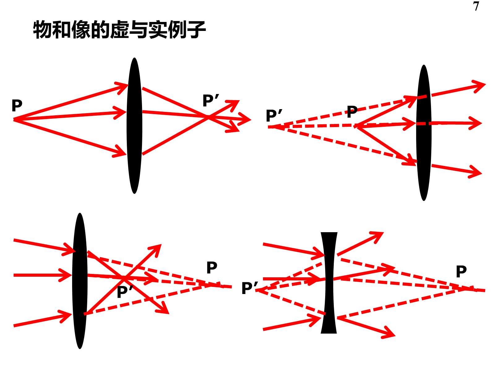

# 三、成像概念与球面折射

## G01 找物点、像点，判断四种实虚组合

来源：概念第5—7、17页。题意：图中物点/像点在哪？理解并熟记单心光束、理想成像、物像和实虚定义。

**分析与答案：** 先把光学系统圈定，只看进入它的光束找物点，只看离开它的光束找像点。单心光束的光线或其延长线交于同一点；理想成像要求由一物点入射的单心光束，出射仍为单心光束。物点与像点互为共轭。

| 看哪一束光 | 实际状态 | 点的性质 |
| --- | --- | --- |
| 入射光束 | 从一个真实交点发散而来 | 实物 |
| 入射光束 | 正朝前方某点会聚，先被系统截住 | 虚物；将入射线向前延长找点 |
| 出射光束 | 真实会聚相交 | 实像，可在该处用屏接收 |
| 出射光束 | 发散，反向延长相交 | 虚像，不能在该虚交点用屏接收 |

概念第7页四图按左上、右上、左下、右下依次为：实物实像、实物虚像、虚物实像、虚物虚像。虚物不表示空间中真的放着一件“虚的物体”，只是入射光束的会聚趋势。实像也不保证坐标为正，凹面镜的实像在入射侧。

## G02 笛卡尔符号与图中正长度

来源：概念第11—16、17页。题意：判高度、倾角、物像距、曲率半径正负；为什么图中写$-s,-u$？

取入射光从左向右，当前顶点为零。左实物$s<0$，右虚物$s>0$；右折射实像$s'>0$，左折射虚像$s'<0$；反射则左实像$s'<0$、右虚像$s'>0$。球心在右$r>0$、在左$r<0$。高度在轴上方正、下方负。PPT角度从光轴/法线按小于$90^\circ$方向转向光线，顺时针正、逆时针负。

图中箭线长度通常标正几何量，所以左实物到顶点的长度写$-s$，不是将物距改成了正数；从左下向右上走的入射线有$u<0$，旁边画出的正夹角写$-u$。物空间指入射线所在空间，像空间指出射线所在空间，不能按物点或像点在哪一侧命名；平面镜的物空间和像空间可以在同一侧重叠。

## G03 球面折射参数、精确关系与近轴公式

来源：折射第4—8页，含“系统参数有哪些”“还依赖$u,u'$说明什么”。

系统参数是$n,n',r$，物距$s$还须另给。光线在球面的高度不同，法线方向不同；精确折射后一般不交于共同像点，这就是球差的来源，不能先宣称任意宽光束严格单心。近轴要求孔径高度、光线倾角足够小；离轴小物还另需物高/视场足够小。

图中$O$为顶点，$C$为球心，$h$是入射点高度。用普通几何斜率$\vartheta$（与PPT顺时针角符号相反），法线倾角近似$\alpha=-h/r$。近轴折射$n(\vartheta-\alpha)=n'(\vartheta'-\alpha)$，且轴上物像给$\vartheta=-h/s,\vartheta'=-h/s'$。消去$h$：

$$\frac{n'}{s'}-\frac n s=\frac{n'-n}{r}=\Phi.$$

$\Phi$称光焦度；半径用米时单位D。公式不再含光线高度，表示一级近似下各近轴光线具有共同像点，而不是证明实际系统从此没有像差。角必须用弧度做小量近似。

## G04 焦距、高斯、牛顿、横向与角放大率

来源：折射第9—17、33页的推导与性质提问。

**推导：** 在G03令$s\to-\infty$得到$f'=n'/\Phi$，令$s'\to\infty$得到$f=-n/\Phi$，故$f'/f=-n'/n$。用$\Phi$除物像式即得$f/s+f'/s'=1$。再定义$x=s-f,x'=s'-f'$，代入并去分母得$xx'=ff'$。

过球心的光线沿法线不偏折，相似三角形给$\beta=(r-s')/(r-s)$；结合G03可化为

$$\beta=\frac{y'}y=\frac{ns'}{n's}=-\frac f x=-\frac{x'}{f'}.$$

因而$\beta>0$正立、$\beta<0$倒立，$|\beta|>1$放大、$<1$缩小；实虚由光束是否实际会聚决定，不能由$\beta$单独确定。对于同一轴上共轭点的孔径光线，近轴$\gamma=u'/u=s/s'=n/(n'\beta)$。这里比较的是同一条入射、出射对应光线的倾角，不是任意两条光线的角度比。

## G05 两次球面折射的玻璃棒例题

来源：折射第18—21页。题意：空气中玻璃棒$n=1.6$，两球面半径大小均2 cm，顶点间距12 cm，物在左顶点前5 cm，求最后像的位置与性质，并说明中间像。

两表面用同一向右坐标，$r_1=+2,r_2=-2$。表中距离单位cm：

| 次序 | $n\to n'$ | $s$ | $r$ | 由公式算得$s'$ | 放大率 |
| --- | --- | --- | --- | --- | --- |
| 左面 | $1\to1.6$ | $-5$ | $+2$ | $16$ | $-2$ |
| 右面 | $1.6\to1$ | $16-12=+4$ | $-2$ | $10/7$ | $4/7$ |

例如第一面$1.6/s_1'-1/(-5)=0.6/2$，得$s_1'=16$。中间像在第二面右4 cm，入射第二面时还未会聚，所以是第二面的虚物；$s_2$必须取$+4$。第二面$1/s_2'-1.6/4=(-0.6)/(-2)$，得$s_2'=10/7$。

最终在右顶点右$10/7$ cm，实像；$\beta=(-2)(4/7)=-8/7$，相对原物倒立、略放大。第二步本身的正立缩小是相对中间像说的，不能拿来描述最终像。图中灰虚线为若移去第二面才会到达的中间像方向，蓝线是真实折射后的光路。

## G06 平面折射中的折射率是谁的

来源：折射第22—26页。题意：平面像的性质？人在岸上看鱼、鱼看岸上物，$n,n'$分别指谁？

令$r\to\infty$，得$s'=(n'/n)s,\beta=1$。$n$始终是沿物到眼睛传播时的入射介质，$n'$是出射介质。岸上看鱼，$n=n_\mathrm水,n'=n_\mathrm气$，近竖直观察的视深为真深的$n'/n$，像变浅；水下看岸上物顺序相反，视高度增大。左实物$s<0$给$s'<0$，虚像、正立、横向等大。

上述等大与深度比例是近轴/近法线观察结果；大角度斜视会出现子午/弧矢像差，不能对整片大视场机械使用一个视深。

## G07 玻璃平板的像移

来源：折射第30页例题；指定作业B03为数值特例。题意：外界$n_0$，板$n$、厚$d$，求看到的像与物之间距离。

第一面$s_1'=(n/n_0)s_1$；换到第二面$s_2=s_1'-d$，第二面$s_2'=(n_0/n)s_2=s_1-(n_0/n)d$。把像坐标换回第一面原点，多加$d$，故

$$\Delta x=(s_2'+d)-s_1=d(1-n_0/n),\qquad\beta=1.$$

当$n>n_0$时像沿传播方向移向观察者，正立等大虚像。关键是先换起算点；不能把$s_1'$直接当$s_2$。$n=n_0$或$d=0$时像移为零，作为检查。

## G08 球面折射怎样作图，角放大率怎样读

来源：折射第31—33页，含“其他例子自己练习”。

从物点画平行轴的线，折射线通过$F'$；画通过$F$的入射线，折射后平行轴；再用过$C$的法线入射线核对。两条出射实线相交得实像，反向延长相交得虚像。图的蓝、紫、绿三线各自对应同一条入/出射光线，不能把不同颜色半条拼起来。过$C$不偏折与薄透镜“过光心”是不同的几何理由。

近轴曲线分类：对会聚球面$\Phi>0$且左实物，$s<f<0$（物在物方焦点以外）得右实像；$s=f$出射平行；$f<s<0$得左虚像。对发散球面$\Phi<0$、左实物，一般得左虚像。具体正倒和倍率仍按G04计算。第33页角放大率为$\gamma=s/s'$；两侧介质不同时不能误写成$1/\beta$。

## G09 斯涅耳窗口为何约97度（配套整理）

依据：折射第27—29页图。水下光线从法线量的最大折射角满足$\sin\theta_{\max}=n_\mathrm气/n_\mathrm水$；整个外界半球压缩进全顶角$2\theta_{\max}$的圆锥。取$n_\mathrm水=4/3$，全角$2\arcsin(3/4)=97.18^\circ$。这个角是水下光锥全角，不是空气一侧的入射角，也不是近轴视深公式。窗口以外主要对应水下景物的反射光，不是“空气那边没有电磁场”。
