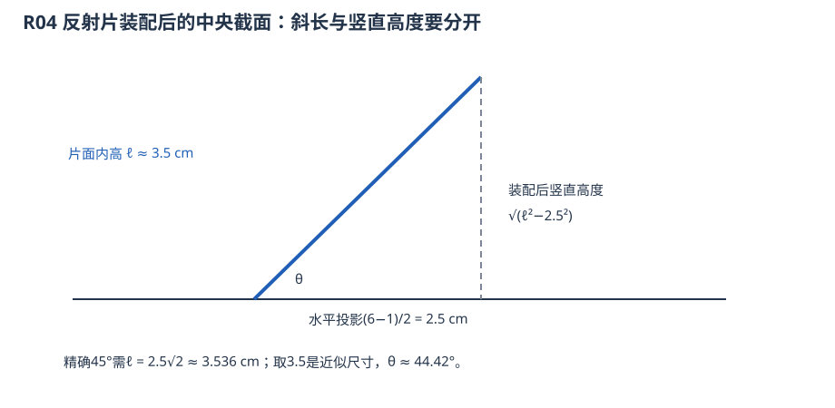
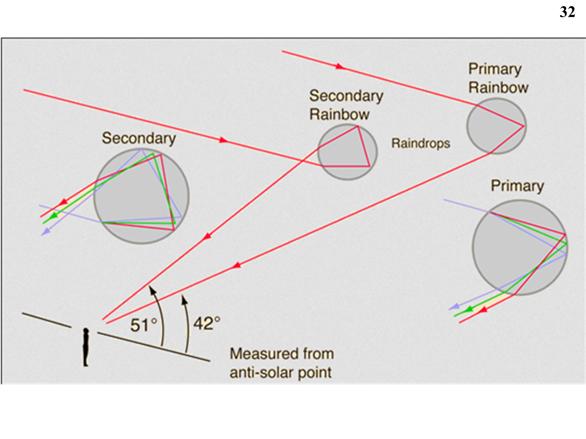

# 四、反射与光路应用

## R01 自行推导球面镜成像公式

来源：反射第2—4、10—11页。题意：仿照球面折射讨论反射成像、焦距、牛顿式与放大率。

以$n'=-n$作代数形式变换，折射关系$n\sin i=n'\sin i'$变成$i'=-i$，即反射定律。代入折射物像式得

$$\frac1s+\frac1{s'}=\frac2r,\qquad f=f'=r/2,\qquad\beta=-\frac{s'}s.$$

这里负折射率只是把反射统一进代数算法的技巧，不是宣称镜后真的有负折射率材料。以$s=f+x,s'=f+x'$代入，得$xx'=f^2$。同一左入射坐标下，凹面镜$r<0$，平行入射成左实焦点；凸面镜$r>0$，成右虚焦点。作图用平行轴线经焦点反射、过球心线沿原线返回，见B06实例。

## R02 1米反射镜聚多少太阳光，能否点燃木块

来源：反射第7页两道思考题，含扩大到数百米的提问。

**题意转量：** 直径$D$对应接收面积$A=\pi D^2/4$。题目未给太阳辐照度、反射率、吸收率、焦斑和材料热参数，不能求唯一能量或唯一点燃口径。设入射辐照度为$S_\odot$（W/m²），有效反射效率$\eta$，则焦区功率$P=\eta S_\odot\pi D^2/4$，时间$t$内能量$Q=Pt$。

若仅作题外估算，取$S_\odot=1000\,\mathrm{W/m^2},\eta=1,D=1$ m，得$P\approx785$ W；1秒能量785 J。瓦是功率，不能直接回答成“能量785瓦”。口径加至100 m时同条件接收功率增加$10^4$倍，但焦斑和焦距也决定功率密度，不能仅由口径判温度。

**点燃条件：** 木块吸收率$\alpha$、有效加热质量$m$、比热$c_p$及热损失$P_\mathrm{loss}$确定加热过程。简化预算$\alpha\eta S_\odot\pi D^2t/4\ge mc_p(T_\mathrm{ign}-T_0)+\int P_\mathrm{loss}\,dt$，还需达到足够局部温度和持续时间。若题给维持点燃所需净功率$P_*$，才可反求$D\ge\sqrt{4P_*/(\pi\alpha\eta S_\odot)}$。有限太阳视角、球差及散热都使“任意大镜把光聚成数学点”不成立。

## R03 平面镜、街边建筑与虚像

来源：反射第16—17页，含“街边的建筑？”提问。

令$r\to\infty$，$s'=-s$、$\beta=1$。每条反射线按反射定律走，反向延长都到镜后与原点对称的位置，故正立、等大虚像。对于街景平面反射装置，应找实际反射面，用入眼光反向延长定位；没有屏可以在镜后的虚像位置接到这些光线。“左右反了”是观察坐标/朝向的比较，不意味着$\beta=-1$；横向放大率在所取垂轴方向为$+1$。

## R04 手机悬浮显示的面倾角

来源：反射第18—20页，含第19页“角度为多大”。题意：水平屏幕经倾斜透明面反射，怎样得到近竖直的虚像？

**解析：** 平面反射把一个方向关于镜面作对称。要把水平物平面变成竖直虚像平面，反射面取两平面的角平分面，因此理想倾角$45^\circ$。图中的梯形片短边约1 cm、长边约6 cm，**片面内的高**约3.5 cm；装配后中央截面的水平投影为$(6-1)/2=2.5$ cm，斜长为3.5 cm，竖直高度才是$\sqrt{3.5^2-2.5^2}=\sqrt6$ cm。倾角$\arctan(\sqrt6/2.5)\approx44.42^\circ$；这些只是接近45度的制作尺寸，不能当成精确45度的尺寸组。

虚像来自反射线的反向延长，透明片允许同时看见背景，形成“悬浮”观感；这类装置不因标题写“全息”就自动成为记录并重建完整波前的全息术。题图未给精确装配朝向时应说明测的是片面与屏幕的夹角，不能报一个无基准的角。

## R05 彩虹为何弯曲，虹与霓的光路（配套整理）

来源：反射第22—33页，含第33页“彩虹为什么是弯的”链接标题所问的物理问题；这里给出解析，不要求另看链接。

图中Primary/Rainbow为主虹，Secondary为副虹/霓，Raindrops为雨滴，Measured from anti-solar point表示角从反太阳点方向量。主虹在滴内反射一次，副虹反射两次。若外部入射角$i$、内部折射角$r$，$\sin i=n\sin r$，内部反射$p$次的展开偏向角为$D_p=p\pi+2i-2(p+1)r$。主虹$p=1$，驻值要求$dr/di=1/2$，由折射定律求得其强光集中在反太阳方向附近约42度的圆锥上；副虹约51度。

雨滴沿这个圆锥方向都能将相应光送到眼睛，因此看到圆/圆弧，地平线遮去一部分；不是某一滴弯成了彩虹。不同波长的$n$使角度略异；主虹红外紫内，副虹色序相反。这里各角随波长变，42、51度是典型近似，不是所有材料和波长的固定精确值。
