# 光学PPT与指定作业题解

2026-10-25（保留原题版）。原题以已收到的13份PPT及姚启钧《光学教程》第五版为依据。收录课件例题、练习、作图、问号提问、明确要求自行完成的推导与记忆作业；相同题目合并解析并列全出处。历史课件的思考题另列附录，不作为已通知的期中范围。像差等没有独立计算题的内容，另用明确标为“整理题”的问答帮助复习。

原题区按教材／课件截图保留原措辞、条件、分问、符号和题图，默认展开；题意分析、方法和答案另行折叠。原件若有错误，原题不改，在解析旁勘误；补充整理题明确标注为非教师原题。来源缩写：电磁=1-1电磁理论（二）；相干=1-2/1-3独立叠加；棱镜=3-2；概念=3-3；折射=3-4；反射=3-5；薄透镜=3-6；共轴=3-7完整版；作图=3-9；仪器=4-1；像差=4-9；历史=引言2。页码指PPT幻灯片顺序，不是教材页码。3-7部分版18页与完整版前18页对应，重复出处同样登记。

学公式与定理时使用[公式与定理手册](../公式定理手册/光学公式与定理手册.html)：按含义、条件、关键推导、变式与用法系统学习，含波动、几何成像、仪器和像差。

## 先统一符号

每一段入射传播方向为当前坐标正向，当前界面顶点为原点。物距$s$、像距$s'$、半径$r$都是坐标：实物通常$s<0$；折射后实像通常$s'>0$；镜面反射后实像$s'<0$。高度向上为正，$\beta=y'/y$；负号表示倒立。反射后若重新把坐标正向取为新的传播方向，必须同时转换各点坐标与半径，不能只改一个符号。图中实线为真实传播段，虚线为延长线或辅助线。

| 遇到的结构 | 计算关系 | 先检查什么 |
| --- | --- | --- |
| 一个折射球面 | $n'/s'-n/s=(n'-n)/r$；$\beta=ns'/(n's)$ | 两侧介质、球心方向、近轴 |
| 球面镜 | $1/s+1/s'=2/r$；$\beta=-s'/s$ | 同一入射坐标下，凹面镜$r<0$ |
| 同介质中的薄透镜 | $1/s'-1/s=1/f'$；$\beta=s'/s$ | $f'>0$会聚，$f'<0$发散 |
| 一般理想光具组 | $f/s+f'/s'=1$；$xx'=ff'$ | $s,s'$从$H,H'$，$x,x'$从$F,F'$量；$f'/f=-n'/n$ |
| 串联两个界面 | $s_2=s_1'-d$；$\beta=\beta_1\beta_2$ | $d$是两界面在当前正向的间距；先把上一像转换为下一物 |
| 普通两面透射棱镜 | 逐面折射，$r_1+r_2=A$，$\delta=i+e-A$ | 第二面是否已全反射；是否允许小角近似 |

式中$n,n'$为入射和出射介质折射率，无量纲；距离统一用cm或m，同一式不能混用。光焦度$\Phi=(n'-n)/r$中若$r$用m，则单位为$\mathrm{m^{-1}}$（屈光度D）。视角放大率比较观察角度，与横向放大率$\beta$不同。求导、相位、角乘距离时，角用弧度。

波动部分统一采用$E=\operatorname{Re}[Ue^{-i\omega t}]$，$i^2=-1$。$\omega=2\pi\nu$是角频率（rad/s），$k=2\pi/\lambda=2\pi n/\lambda_0$是介质波数（rad/m），$\lambda_0$为真空波长，$\lambda$为介质波长。$U$为复振幅，模表示振幅、辐角表示空间相位；实际电场取实部。课件归一化光强$I=|U|^2$与真正的平均能流密度有介质因子之别，见W07。

## 怎样从题干选方法

先把每个数标到图上，再判断题目要的是方向、位置、大小、视角还是分辨率。方向题优先逐面折射/反射；成像题按真实传播次序列物像；给焦点、主面就优先基点法；复杂折返可镜像展开，但最后必须折回实际空间。每次算出像的位置后，用出射光实际会聚还是反向延长相交判实虚，用$\beta$判正倒与缩放。

计算完成至少做两项复核：代回原方程、检查量纲、检查极限、用两条特殊光线确认、或用逐面法与基点法相互比较。教材/PPT中的印刷结果也要经过这些检查；本册在对应题内标出发现的冲突。

---

# 一、波动与相干

## W01 传播滞后怎样进入波的表达式

来源：电磁第4—10、23页第1项。

<!-- ORIGINAL-BEGIN -->

**课件原题／原文与题图**

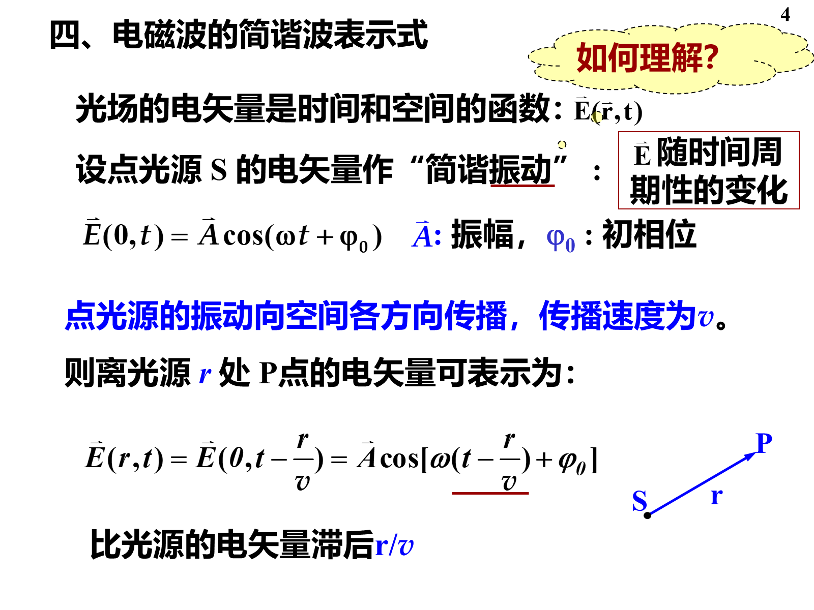

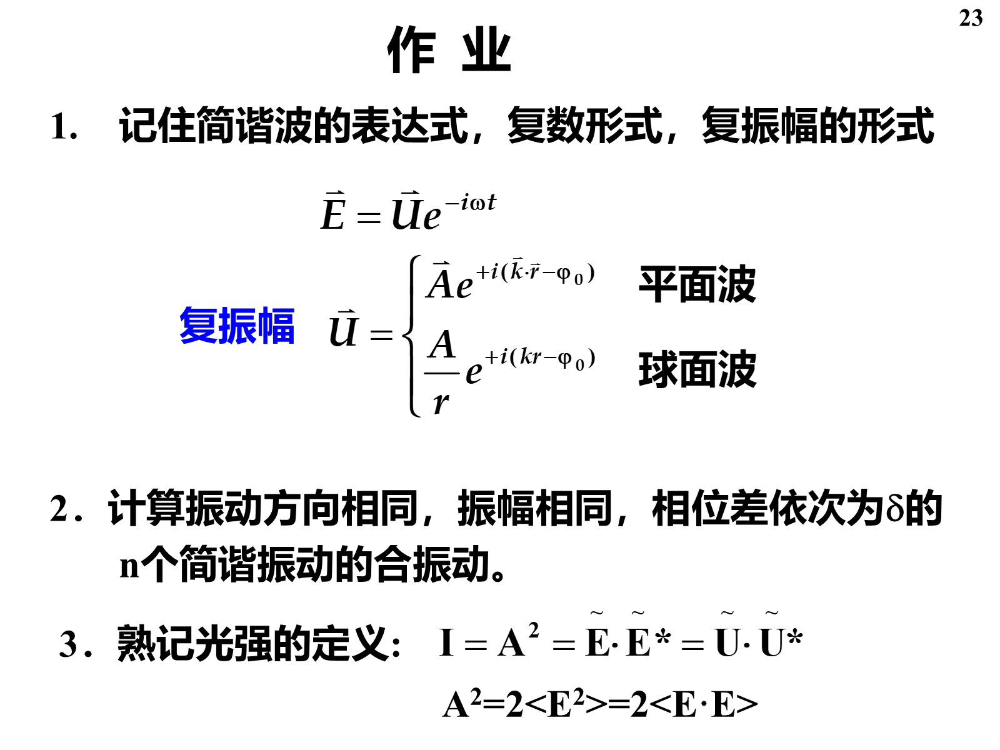

<!-- ORIGINAL-END -->

题意分析：理解距离$r$处相对光源的滞后，写平面波、球面波的实数式、复数式和复振幅。

**知识与选法：** 传播需要时间$r/v$，观察点此时收到的是光源在$t-r/v$时的状态。先替换时间，再把$\omega/v$记成$k$。

若光源参考振动为$A\cos(\omega t+\varphi_0)$，沿$+z$的平面波为

$$E(z,t)=A\cos(\omega t-kz+\varphi_0),\qquad U(z)=Ae^{i(kz-\varphi_0)},\qquad \widetilde E=Ue^{-i\omega t}.$$

固定相位要求$z$随$t$增加，故传播向$+z$。无吸收均匀介质中的发散球面波为

$$E(R,t)=\frac C R\cos(\omega t-kR+\varphi_0),\qquad U(R)=\frac C R e^{i(kR-\varphi_0)}.$$

$R$是到点光源的距离；$C$是常系数，不与局部振幅$C/R$混用。由于球面面积$4\pi R^2$增加，能量守恒要求强度按$R^{-2}$降低，电场振幅按$R^{-1}$降低。平面波理想模型无此几何扩散。检查：相位无量纲；频率跨静止界面不变，变的是$v,\lambda,k$。课件第8页用局部径向波矢表示球面波，不能据此把它误当作空间处处相同的常矢量。

## W02 离轴点光源在一个平面上的复振幅

来源：电磁第11—12页。

<!-- ORIGINAL-BEGIN -->

**课件原题／原文与题图**

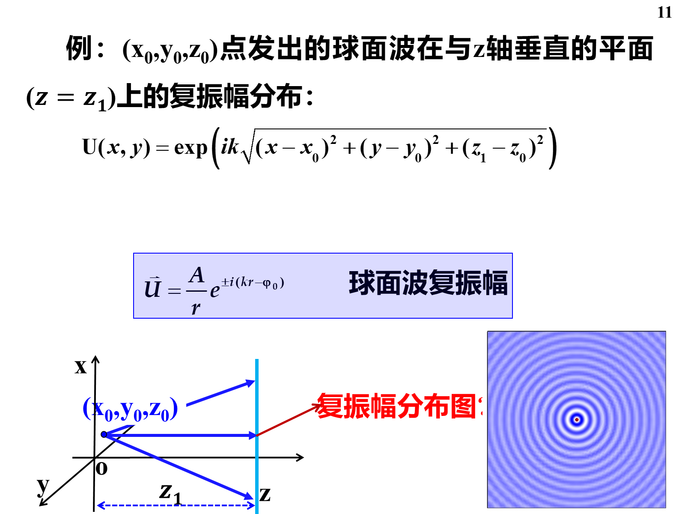

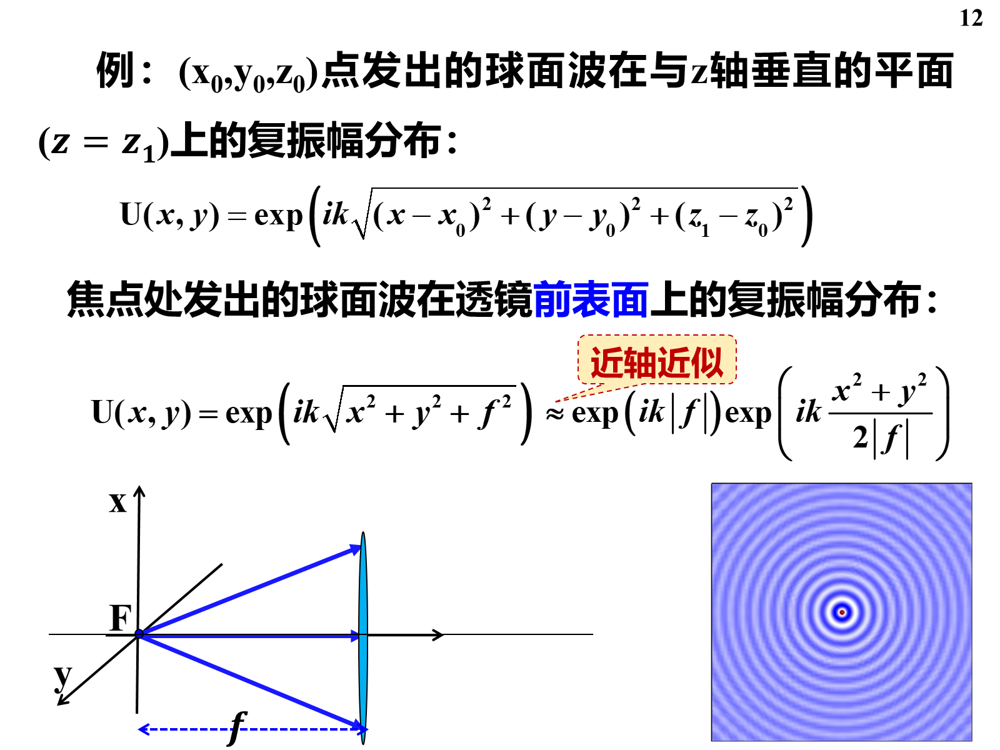

<!-- ORIGINAL-END -->

题意分析：源位于$(x_0,y_0,z_0)$，求$z=z_1$平面上的复振幅分布并解释图样。

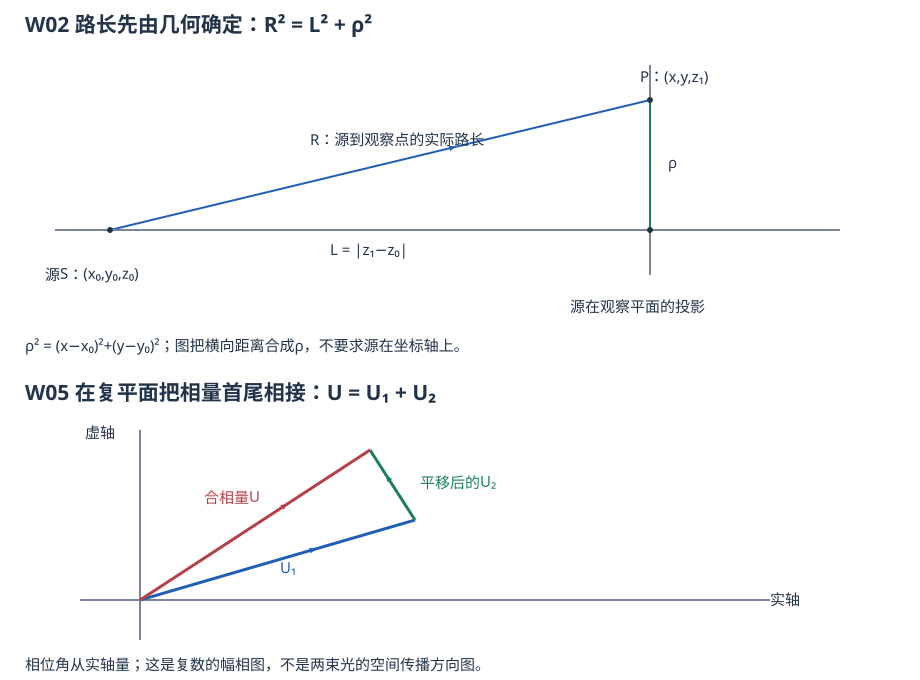

上图先把横向两个坐标差合成为$\rho$，再与轴向间距$L$组成直角三角形，斜边才是$R$；下图供W05对照，箭头在复平面内。

**思路：** 对平面上任一点$(x,y,z_1)$先求实际路长，而非把$z_1$直接当成路长：

$$R=\sqrt{(x-x_0)^2+(y-y_0)^2+(z_1-z_0)^2},\qquad U(x,y)=\frac C R e^{i(kR-\varphi_0)}.$$

若$L=|z_1-z_0|$且横向距离$\rho=\sqrt{(x-x_0)^2+(y-y_0)^2}\ll L$，用$\sqrt{1+\epsilon}\approx1+\epsilon/2$，得到$R\approx L+\rho^2/(2L)$。振幅近似$C/L$，相位保留二次项：

$$U\approx\frac C L e^{i(kL-\varphi_0)}e^{ik\rho^2/(2L)}.$$

等相位轮廓为以$(x_0,y_0)$为中心的圆；图中的同心色环通常编码相位或实部，不代表单独球面波的强度有明暗环。课件只写指数时省略了振幅因子；写完整复振幅应保留或明确这一近似。

若还要求截断后的**相位误差**远小于1 rad，需要更强的$k\rho^4/(8L^3)\ll1$；它来自根号展开下一项$-\rho^4/(8L^3)$乘以$k$。几何路长的相对误差小，不自动等于许多波长累积后的相位误差小。

## W03 焦点发散与会聚球面波的符号

来源：电磁第12—13页。

<!-- ORIGINAL-BEGIN -->

**课件原题／原文与题图**

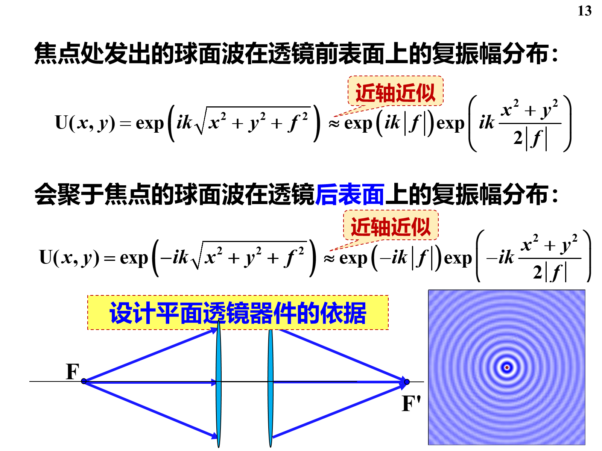

<!-- ORIGINAL-END -->

题意分析：写透镜前由焦点发出的波、透镜后会聚到焦点的波在横截面上的复振幅，说明近轴展开。

**条件与分析：** 取轴上焦点到参考平面的轴向距离$L>0$，$\rho^2=x^2+y^2$。令$R=\sqrt{L^2+\rho^2}\approx L+\rho^2/(2L)$。在本册$e^{-i\omega t}$约定下，发散波$U_\mathrm d\propto e^{+ikR}/R$，会聚波$U_\mathrm c\propto e^{-ikR}/R$：

$$U_\mathrm d\approx\frac C L e^{ikL}e^{+ik\rho^2/(2L)},\qquad U_\mathrm c\approx\frac {C'}L e^{-ikL}e^{-ik\rho^2/(2L)}.$$

相位梯度指向发散波的外传播方向，会聚波则相反。均匀平面入射波要在焦距$f'>0$处会聚，薄透镜需要提供的横向相位为$-k\rho^2/(2f')$（忽略整体常相位）。检查：不能在保留同一时间因子的同时，任意翻转空间相位符号；也不能将图中相位圆环当成强度分布。

## W04 斜平面波的“条纹”看得见吗

来源：电磁第14页。

<!-- ORIGINAL-BEGIN -->

**课件原题／原文与题图**

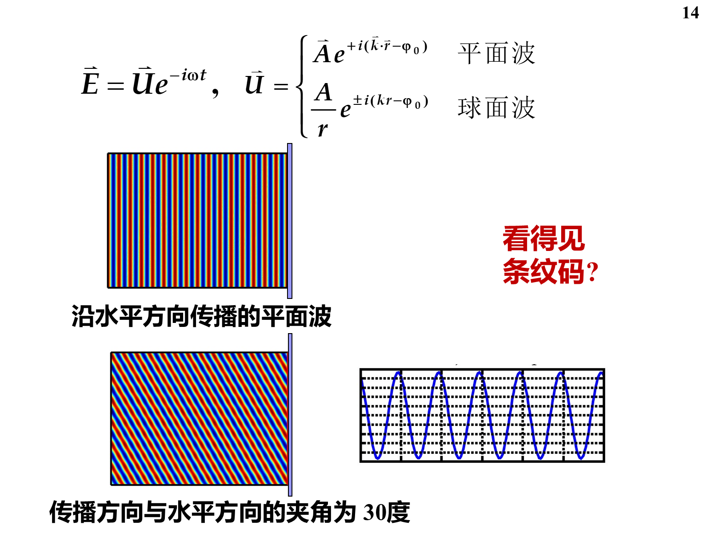

<!-- ORIGINAL-END -->

题意分析：比较水平传播和与水平成$30^\circ$传播的波面图，能否直接看见条纹？

**解析：** 在$x,z$平面内若传播方向相对$+z$向$+x$倾斜$30^\circ$，则$\mathbf k=k(\sin30^\circ,0,\cos30^\circ)$，$U=Ae^{i(k_xx+k_zz+\alpha)}$。等相位面满足$k_xx+k_zz=\text{常数}$，始终垂直于传播方向。单个理想均匀平面波的强度$|U|^2=A^2$处处相同；图中正负电场或相位色带不是可直接看到的稳定强度条纹。加入参考波产生干涉，才可把相位差转为强度变化。

## W05 两个同方向、同频振动如何合成

来源：电磁第15—16页。

<!-- ORIGINAL-BEGIN -->

**课件原题／原文与题图**

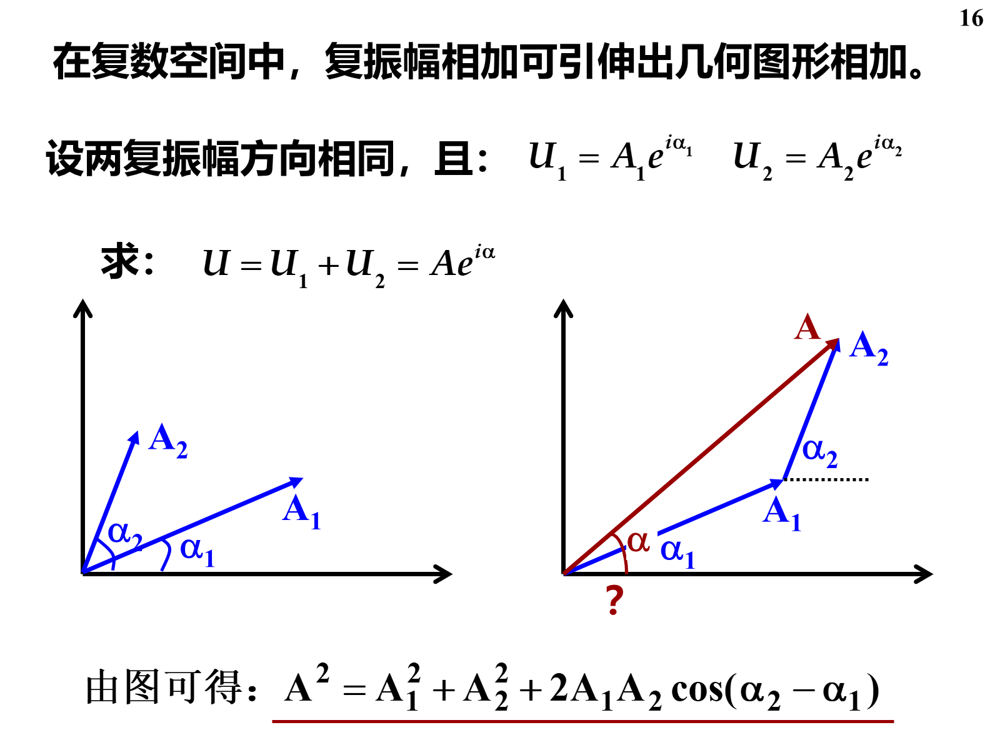

<!-- ORIGINAL-END -->

题意分析：由$U_1=A_1e^{i\alpha_1},U_2=A_2e^{i\alpha_2}$求合振幅和相位。

**选法：** 同频可提取同一时间因子，将复振幅相加；在复平面中就是首尾相接。实部和虚部分别为

$$X=A_1\cos\alpha_1+A_2\cos\alpha_2,\qquad Y=A_1\sin\alpha_1+A_2\sin\alpha_2.$$

$$U=X+iY=Ae^{i\alpha},\quad A=\sqrt{A_1^2+A_2^2+2A_1A_2\cos(\alpha_2-\alpha_1)},\quad \alpha=\operatorname{atan2}(Y,X).$$

$\operatorname{atan2}$按$X,Y$的符号确定正确象限，优于只写$\tan\alpha=Y/X$。实际振动为$A\cos(\omega t-\alpha)$。同相振幅相加，反相为$|A_1-A_2|$；完全相消时$A=0$，合相位没有定义。复平面的相量箭头不等于真实空间的电场偏振方向。

## W06 等振幅、等相位递增的N个振动

来源：电磁第17—19、23页第2项。

<!-- ORIGINAL-BEGIN -->

**课件原题／原文与题图**

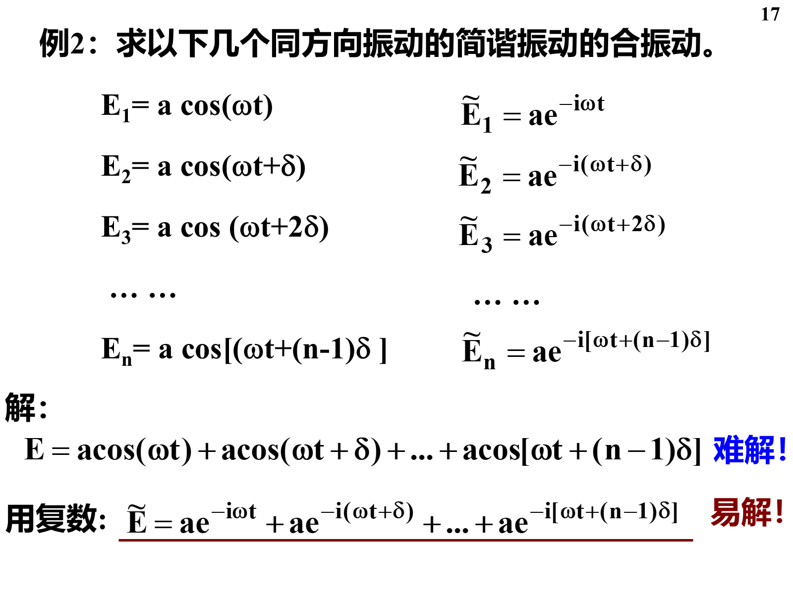

<!-- ORIGINAL-END -->

题意分析：$E_j=a\cos[\omega t+(j-1)\delta]$，$j=1,\ldots,N$，求合振动。

**知识与思路：** 等相差意味着复振幅构成公比$q=e^{-i\delta}$的等比数列。用$S_N=(1-q^N)/(1-q)$，再将分子分母各提出半相位。

$$U=a\sum_{j=0}^{N-1}e^{-ij\delta}=a\frac{\sin(N\delta/2)}{\sin(\delta/2)}e^{-i(N-1)\delta/2},$$

$$E=a\frac{\sin(N\delta/2)}{\sin(\delta/2)}\cos\left[\omega t+\frac{(N-1)\delta}{2}\right].$$

实际非负振幅是$a|\sin(N\delta/2)/\sin(\delta/2)|$。若前面的实系数为负，应把负号吸收到相位中加$\pi$。$\delta=2\ell\pi$时不能直接做$0/0$，回到原式可得$E=Na\cos\omega t$。当$\sin(N\delta/2)=0$且$\sin(\delta/2)\ne0$时完全相消。检查$N=2$应还原和差化积。课件第19页下方复振幅相位符号与前面的负时间指数约定不一致，本册统一以上述式子为准。

## W07 光强定义与“光强守恒吗”

来源：电磁第20—23页，含第23页第3项。

<!-- ORIGINAL-BEGIN -->

**课件原题／原文与题图**

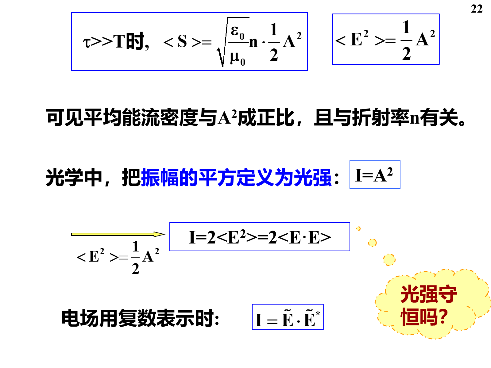

<!-- ORIGINAL-END -->

题意分析：由电场求光强，理解时间平均，判断是否守恒。

**解析：** 简谐电场$E=A\cos\omega t$满足$\langle E^2\rangle=A^2/2$（平均时间远大于周期）。课件定义归一化$I=A^2=2\langle\mathbf E\cdot\mathbf E\rangle=U\cdot U^*$，星号为复共轭，$I$不带光学相位。

真正的能流密度是坡印廷矢量$\mathbf S=\mathbf E\times\mathbf H$。在无吸收、非磁介质中的单个行波，

$$\langle S\rangle=\frac12 n\varepsilon_0cA^2\quad(\mathrm{W/m^2}).$$

所以跨不同折射率时，不能只用$A^2$直接比较实际能量通量；还须考虑$n$、光束面积、倾斜投影及反射透射。干涉可重新分配空间能流，并不要求每点光强不变。无吸收孤立系统守恒的是总能量；单独一点的$I$或一束反射光的强度不必守恒。球面波$I\propto R^{-2}$但穿过整个球面的功率恒定，就是直接反例。

## W08 独立传播与叠加是否矛盾

来源：相干第1—2页的两处提问。

<!-- ORIGINAL-BEGIN -->

**课件原题／原文与题图**

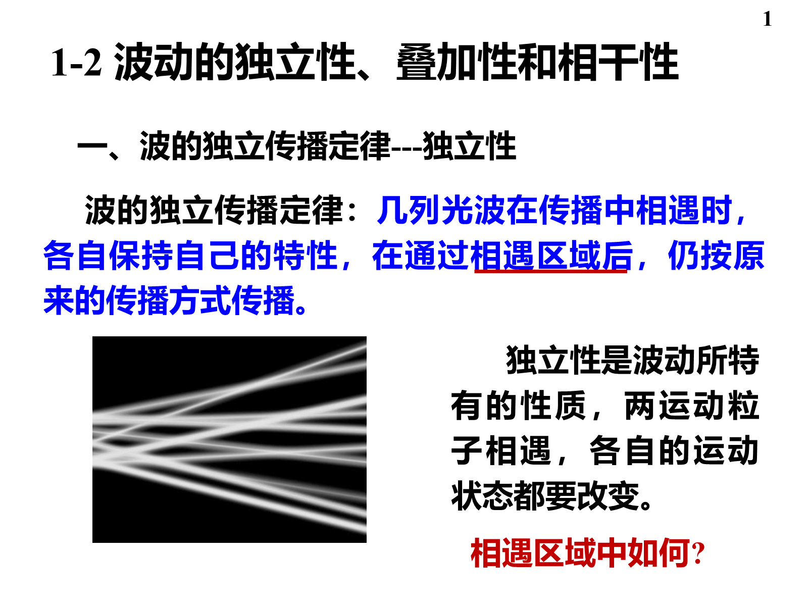

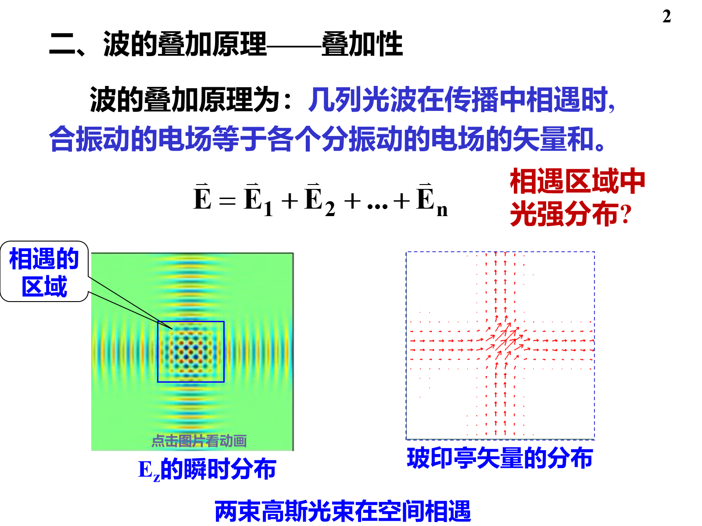

<!-- ORIGINAL-END -->

题意分析：光波相遇区域中发生什么，光强如何分布？

**解析：** 在线性介质中，各波离开交叠区后仍按原传播状态继续传播，这是独立性；在交叠处，瞬时总场为$\mathbf E=\mathbf E_1+\mathbf E_2$，这是叠加性。观测强度需先对总场平方再作时间平均，通常含交叉项；不能因“独立传播”就先把两个强度相加。两定律分别回答传播与局域场的不同问题。

## W09 从叠加原理推导干涉项及相干条件

来源：相干第3—7、13页第1、2项。

<!-- ORIGINAL-BEGIN -->

**课件原题／原文与题图**

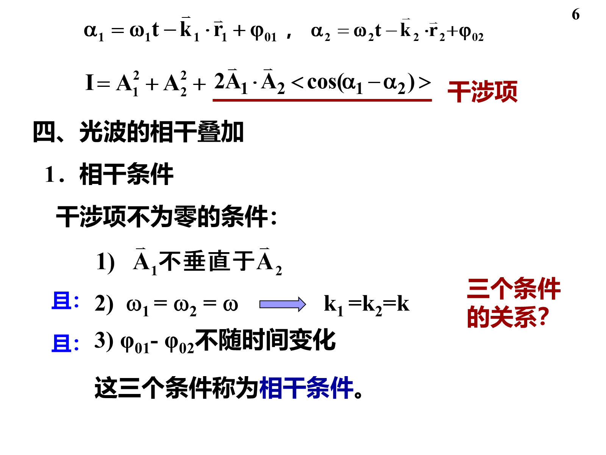

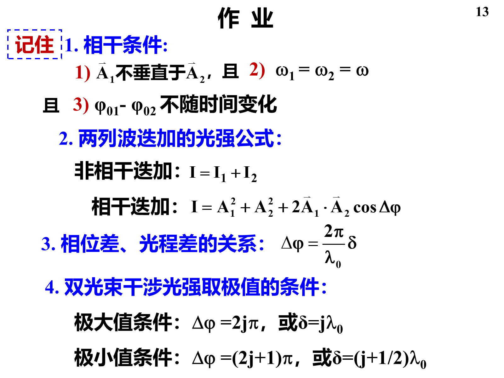

<!-- ORIGINAL-END -->

题意分析：写相干/非相干叠加式，解释三个条件之间的关系。

**推导：** 设$\mathbf E_j=A_j\mathbf e_j\cos\alpha_j$，$\mathbf e_j$为单位偏振矢量，$\mathbf e_1\cdot\mathbf e_2=\cos\theta$。展开$2\langle|\mathbf E_1+\mathbf E_2|^2\rangle$，用$2\cos\alpha_1\cos\alpha_2=\cos(\alpha_1-\alpha_2)+\cos(\alpha_1+\alpha_2)$，快振荡和频项平均后为零：

$$I=I_1+I_2+2\sqrt{I_1I_2}\cos\theta\,\langle\cos\Delta\varphi\rangle.$$

稳定同频、相对初相位稳定且偏振非正交时，可保留稳定交叉项，去掉最后的平均号；它们是需要同时检查的条件。若偏振正交，或相位差在观测时间内随机化，则交叉项平均为零，$I=I_1+I_2$。同频不保证初相位稳定；同频只在相同介质中才保证波数大小相同，不保证波矢方向相同。满足相干条件也可能在某些空间点恰有$\cos\Delta\varphi=0$。

**时间条件：** 不同频率的交叉项随差频振荡；普通慢探测器在$|\omega_1-\omega_2|\tau\gg1$时平均掉。足够快的探测可见拍频，不能无条件声称不同频率绝无干涉效应。

## W10 干涉极大、极小及是否全暗

来源：相干第8—9、13页第4项。

<!-- ORIGINAL-BEGIN -->

**课件原题／原文与题图**

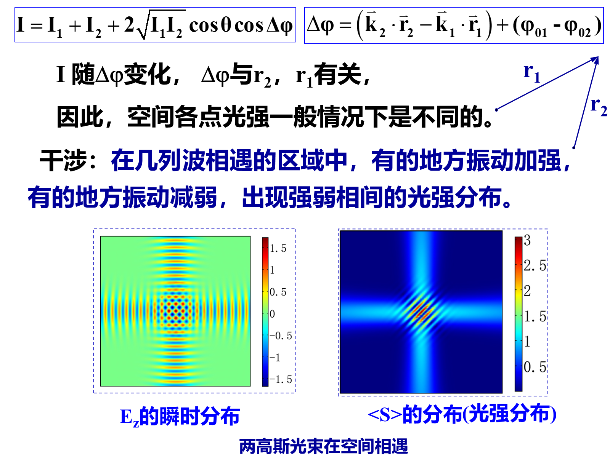

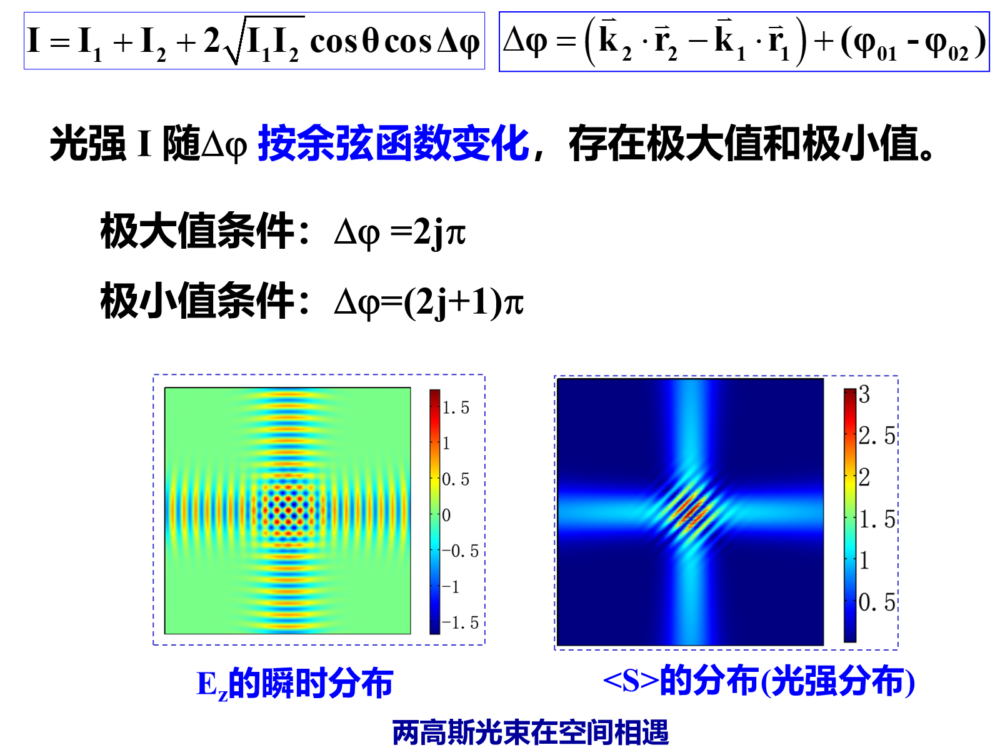

<!-- ORIGINAL-END -->

题意分析：求极值条件及强度。

同方向偏振时，$I=I_1+I_2+2\sqrt{I_1I_2}\cos\Delta\varphi$。余弦在$\pm1$取极值，故

$$\Delta\varphi=2j\pi:\ I_{\max}=(\sqrt{I_1}+\sqrt{I_2})^2,$$

$$\Delta\varphi=(2j+1)\pi:\ I_{\min}=(\sqrt{I_1}-\sqrt{I_2})^2.$$

只有$I_1=I_2$且可完全相消时最小值才为零。非平行线偏振的调制幅度还需乘$|\cos\theta|$；若保持一个使$\cos\theta<0$的基矢约定，极大极小相位应互换，或等价地把$\pi$吸入相对相位。可见度$V=(I_{\max}-I_{\min})/(I_{\max}+I_{\min})=2\sqrt{I_1I_2}|\cos\theta|/(I_1+I_2)$，这是便于检查对比度的整理结果。

## W11 两点源的明暗面为什么是双曲面

来源：相干第10—11页例题。

<!-- ORIGINAL-BEGIN -->

**课件原题／原文与题图**

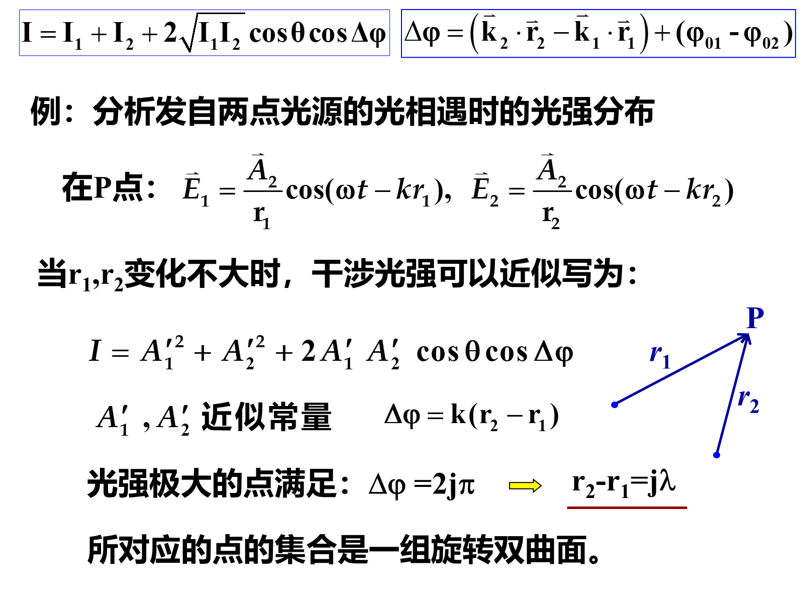

<!-- ORIGINAL-END -->

题意分析：分析两同频、同初相位、同偏振点源在空间相遇的光强分布。

设观察点到两源距离$r_1,r_2$，两波振幅$A_1=C_1/r_1,A_2=C_2/r_2$。相位差$\Delta\varphi=k(r_2-r_1)$，所以

$$I(P)=\frac{|C_1|^2}{r_1^2}+\frac{|C_2|^2}{r_2^2}+\frac{2|C_1C_2|}{r_1r_2}\cos[k(r_2-r_1)].$$

在振幅缓变区域，相长位置满足$r_2-r_1=j\lambda$，相消相位位置满足$r_2-r_1=(j+1/2)\lambda$。到两个定点的距离差恒定形成旋转双曲面；零距离差退化为垂直平分面。还须$|r_2-r_1|\le d$（两源间距），不是任意整数$j$都有对应面。若振幅在空间变化显著，“余弦最大”不等于整个$I(P)$沿任意扫描方向的严格局部最大；课件结论采用了缓变包络近似。

## W12 相位差与光程差的关系

来源：相干第11—13页第3、4项。

<!-- ORIGINAL-BEGIN -->

**课件原题／原文与题图**

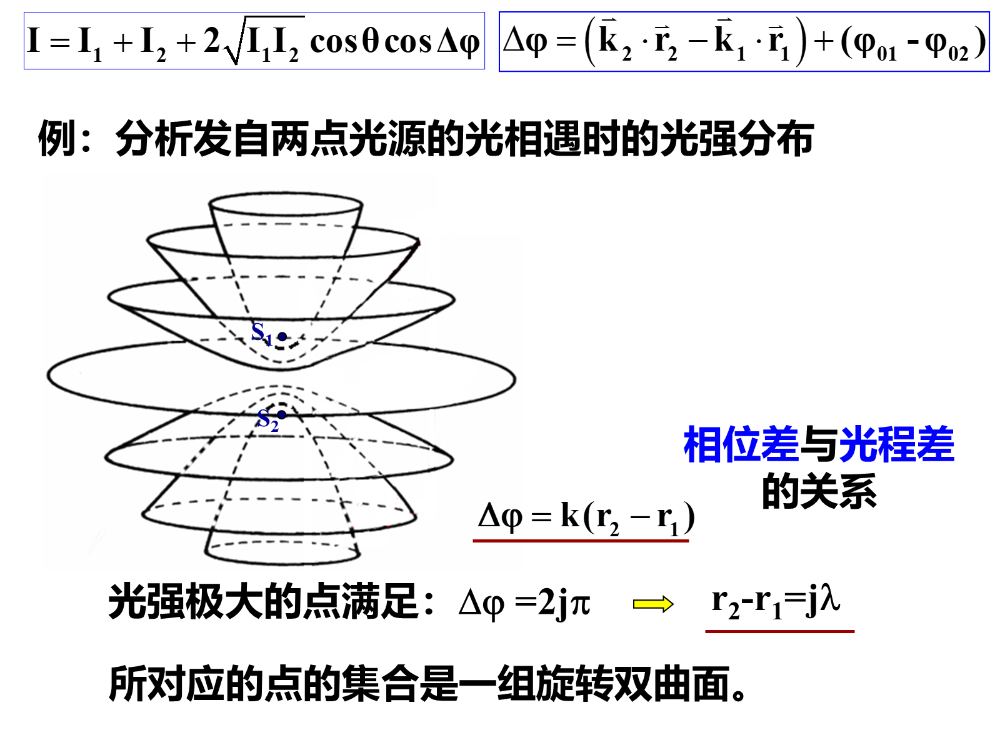

<!-- ORIGINAL-END -->

题意分析：由几何路长转成相位，并用光程写明暗条件。

光程$L=\int n\,\mathrm d\ell$的单位是长度；同一真空波长下，传播相位为$2\pi L/\lambda_0$。按$\Delta\varphi=\alpha_1-\alpha_2$及本册负时间指数约定，若定义$\delta=L_2-L_1$，则

$$\Delta\varphi=\frac{2\pi}{\lambda_0}\delta+(\varphi_{01}-\varphi_{02}).$$

这里$\alpha_j=\omega t-2\pi L_j/\lambda_0+\varphi_{0j}$是实数余弦中的相位。若改用复振幅的辐角相减，差值整体反号；余弦干涉强度不变，但不能在同一步计算里混用定义。

同初相位且无额外反射相位时，相长$\delta=j\lambda_0$，相消相位$\delta=(j+1/2)\lambda_0$；同一介质中可改用$r_2-r_1$与介质波长$\lambda$。检查：不能把光程差再乘一次$n$；若有初相差或反射附加相位，应先计入总相位，再判明暗。

---

# 二、全反射与棱镜

## P01 临界角、附加条件与直角棱镜

来源：棱镜第1—3、22页。

<!-- ORIGINAL-BEGIN -->

**课件原题／原文与题图**

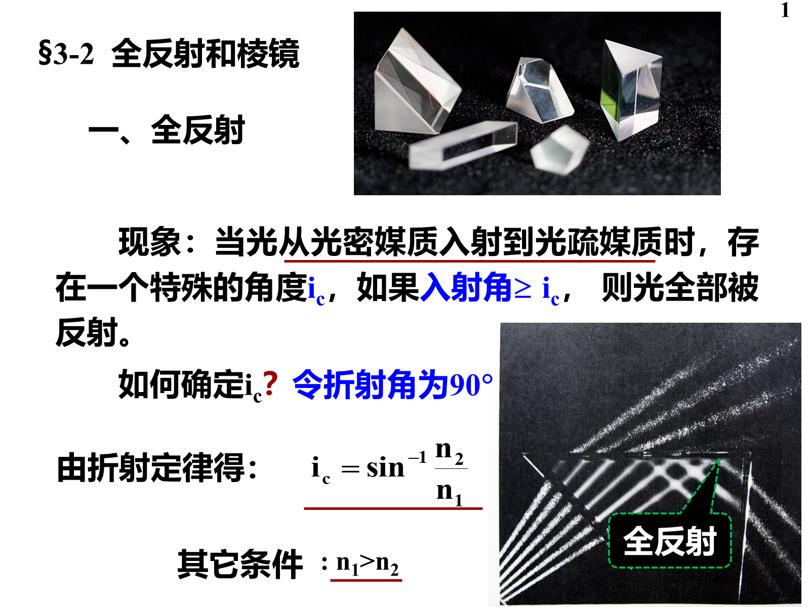

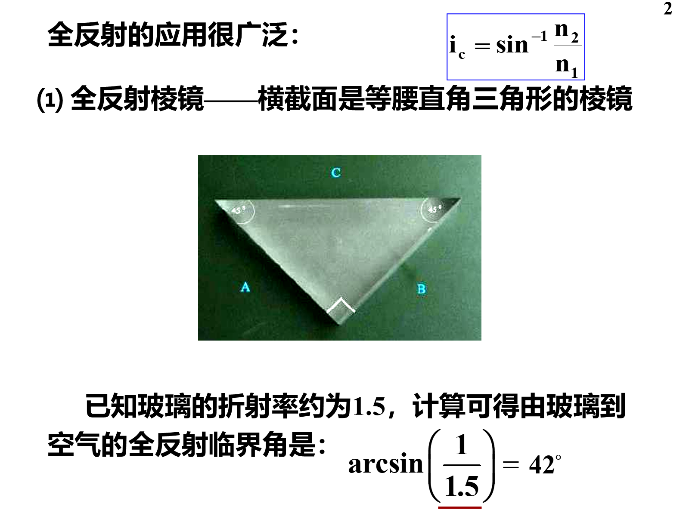

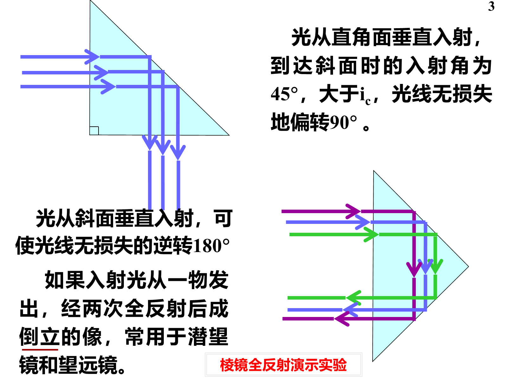

<!-- ORIGINAL-END -->

题意分析：怎样确定临界角？还需什么条件？$n=1.5$的玻璃到空气能否使$45^\circ$入射光全反射？

**选法：** 折射定律$n_1\sin i=n_2\sin r$中令$r\to90^\circ$，得$i_c=\arcsin(n_2/n_1)$。存在临界角需$n_1>n_2$；等号是临界掠射边界，严格超过时没有向第二介质深处传播的折射行波。这里取无吸收、第二介质半无限的理想界面。

全反射时第二介质的场并不为零：界面附近仍有随离开界面距离指数减弱的电磁场，称**倏逝场**。它与向深处传输能量的普通折射行波不同；本题求临界角不需要引入穿透深度计算。

玻璃到空气$i_c=\arcsin(1/1.5)=41.81^\circ$，所以$45^\circ>i_c$。从等腰直角棱镜直角面垂直进入时不偏折，在斜面全反射后转向$90^\circ$；从斜面垂直进入、依次在两个直角面反射，方向反转$180^\circ$。两次反射还会反转主截面内光束上下次序。这里“无损”只指理想内部全反射，不包括进出表面的反射损耗及材料吸收。若把外界改成水，必须重新算临界角，不能沿用空气中的结论。

## P02 棱镜偏向角怎样随入射角变化

来源：棱镜第12—16页的几何与曲线提问。

<!-- ORIGINAL-BEGIN -->

**课件原题／原文与题图**

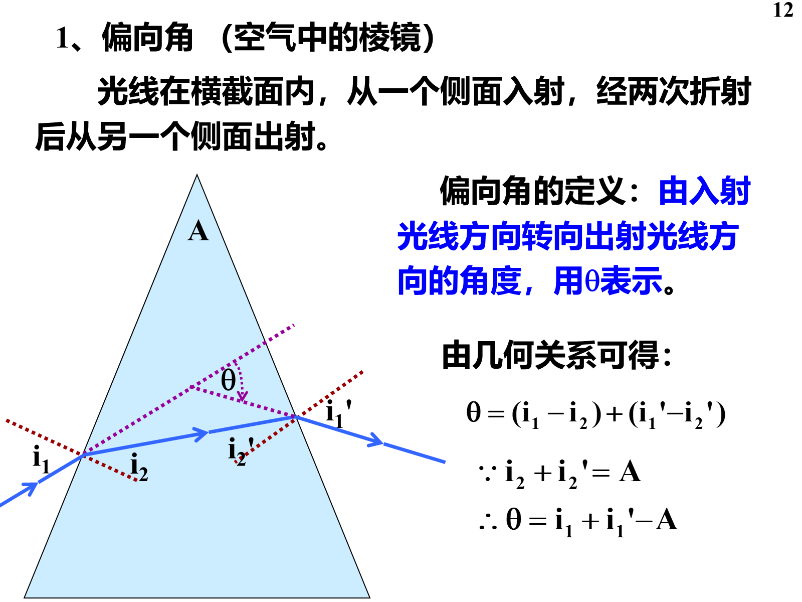

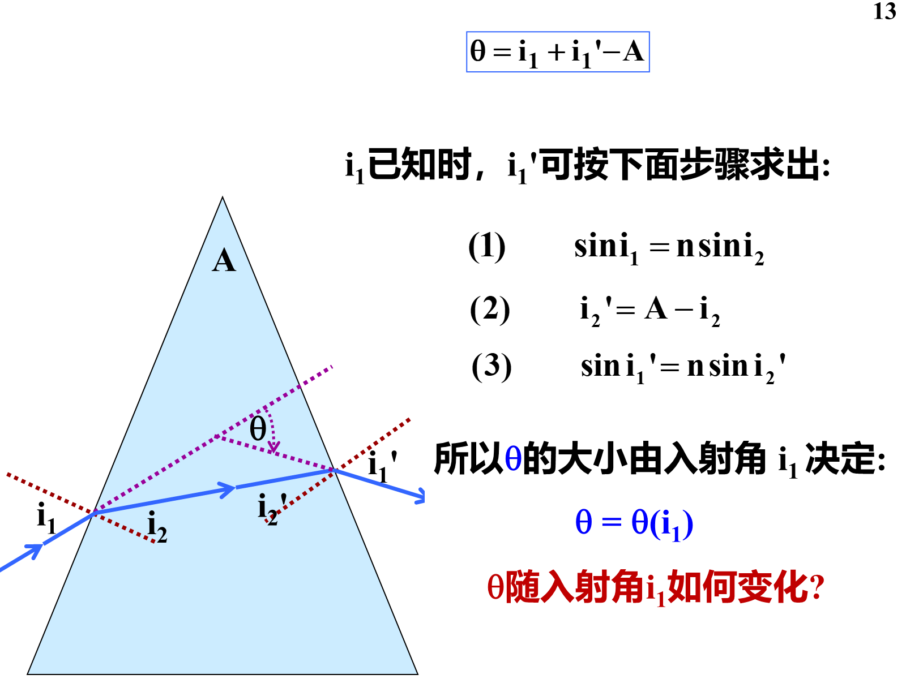

<!-- ORIGINAL-END -->

蓝实线按$P\to Q$传播，棕虚线为两面法线。$i,r_1$从第一面法线量，$r_2,e$从第二面法线量；课件的$i_1,i_2,i_2',i_1'$依次对应这四角。$A$为顶角，下方$\delta$比较入/出射方向。

取$m=n/n_0>1$。先用第一面折射得$r_1=\arcsin(\sin i/m)$；再由两面法线的几何关系得$r_2=A-r_1$；检查第二面后才算$e=\arcsin(m\sin r_2)$。两个面的方向改变相加：

$$\delta=(i-r_1)+(e-r_2)=i+e-A.$$

所以$i$改变会同时改变两次折射，不能将$e$当常数。普通可透射光路中的曲线先降后升，最小处$i=e,r_1=r_2=A/2$。在该内部角非负的分支，令$g(r)=\arcsin(m\sin r)$，则$\delta=g(r_1)+g(A-r_1)-A$，且

$$g''(r)=\frac{m(m^2-1)\sin r}{(1-m^2\sin^2r)^{3/2}}>0.$$

对称点是极小值。光路可逆性只说明交换$i,e$得到同一偏向，单靠可逆性不能证明极小。取$A=60^\circ,m=1.5$检查：最小处$i=e=48.59^\circ$，$\delta_{\min}=37.18^\circ$。非对称的$i=30^\circ$给$r_1=19.47^\circ,r_2=40.53^\circ,e=77.10^\circ,\delta=47.10^\circ$，确实更大。

## P03 最小偏向角如何测折射率，液体容器壁怎么办

来源：棱镜第16—18页。

<!-- ORIGINAL-BEGIN -->

**课件原文（讲授整理依据，无独立题干）**

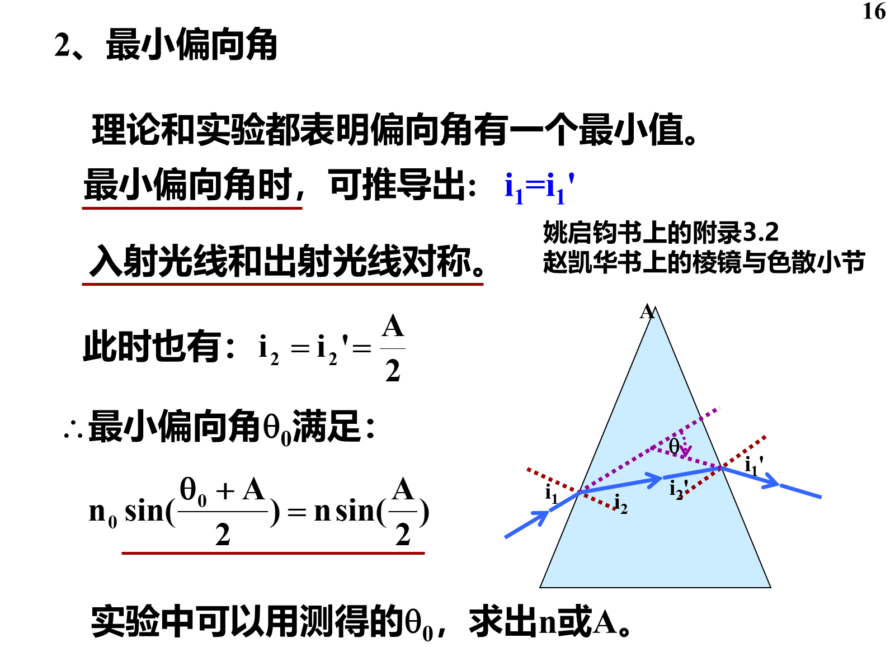

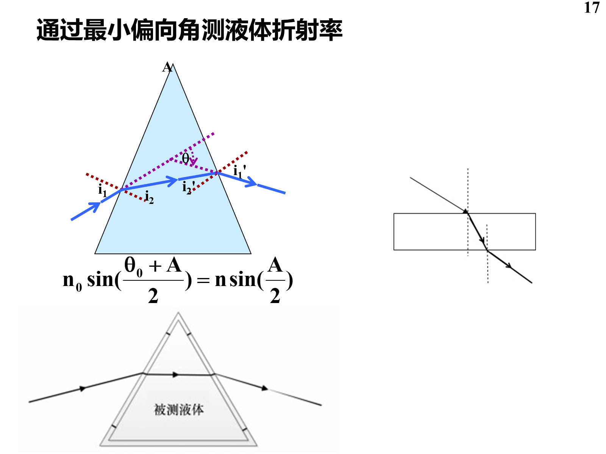

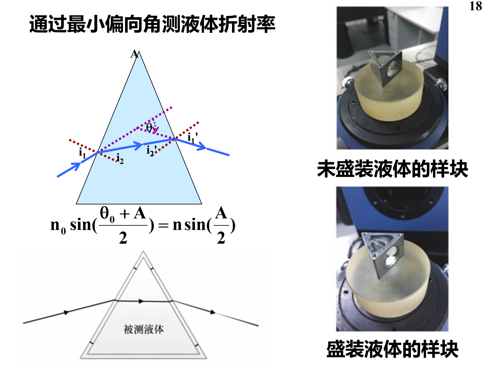

<!-- ORIGINAL-END -->

题意分析：由最小偏向角求$n$或$A$，理解液体实验。

**解析：** 最小偏向时内部两角为$A/2$，外部两角为$(A+\delta_{\min})/2$。将它们代入$n_0\sin i=n\sin r_1$：

$$\frac n{n_0}=\frac{\sin[(A+\delta_{\min})/2]}{\sin(A/2)}.$$

实验读到偏向曲线的转折最低位置，再结合已测顶角反算$n$；普通位置的偏向角不能代入。反求顶角时也可用$\tan(A/2)=\sin(\delta_{\min}/2)/[m-\cos(\delta_{\min}/2)]$，并检查几何分支。

空心棱镜每面若由两表面平行的薄玻璃壁构成，空气—玻璃—液体两次折射消去壁折射率，得到空气到液体的角度关系；忽略薄壁横向位移后使用同一式子。不平行或厚度影响路径时应逐界面追踪。存在非掠射对称光路还须$A<2\arcsin(1/m)$。

## P04 薄棱镜的5度例题与近似条件

来源：棱镜第19—20页。

<!-- ORIGINAL-BEGIN -->

**课件原题／原文与题图**

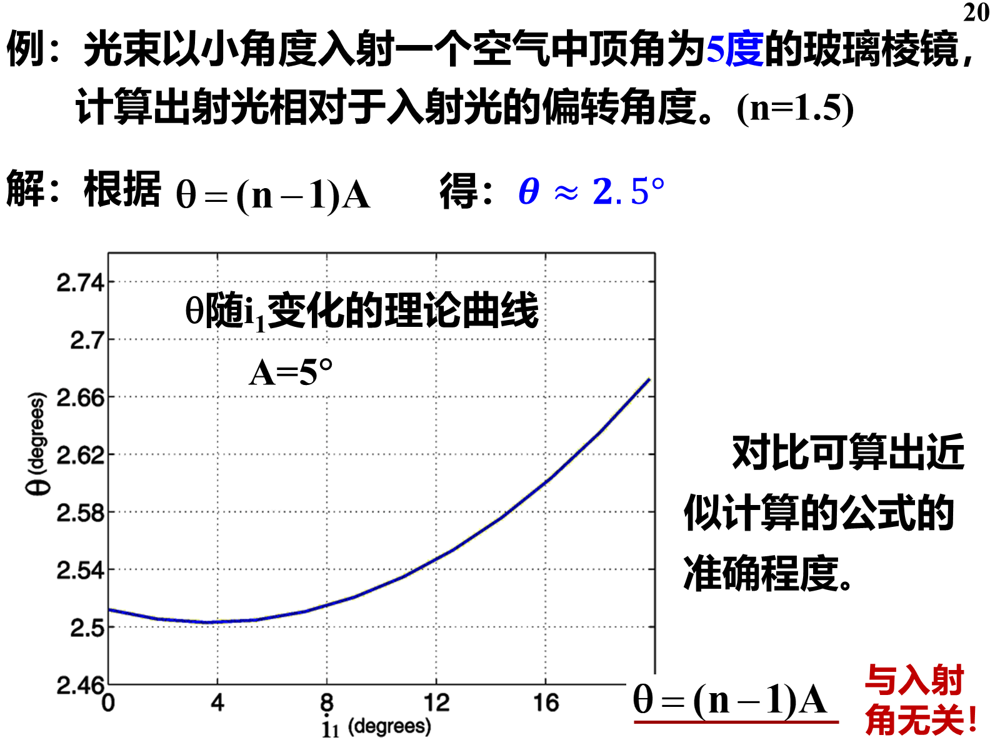

<!-- ORIGINAL-END -->

题意分析：空气中$n=1.5,A=5^\circ$，小角入射，求偏转角；比较近似准确性。

**推导与代入：** 当$i,r_1,r_2,e,A$均小时，正弦可用角的弧度值代替。由$i\approx mr_1,e\approx mr_2,r_1+r_2=A$，得

$$\delta\approx(m-1)A=(1.5-1)\times5^\circ=2.5^\circ.$$

最后这个线性比例可同用度表示；若将角再乘距离或求导，先换弧度。精确最小偏向为$2\arcsin[1.5\sin(2.5^\circ)]-5^\circ\approx2.503^\circ$，与$2.5^\circ$接近。由于原题没指定确切$i$，不能给出唯一的精确偏向角；“与入射角无关”只属于一级近似，不是精确结论。准确性应对给定$i$用P02逐面计算后比较。

## P05 编程画偏向曲线，怎样处理不能出射的区间

来源：棱镜第21、32页练习与作业。

<!-- ORIGINAL-BEGIN -->

**课件原题／原文与题图**

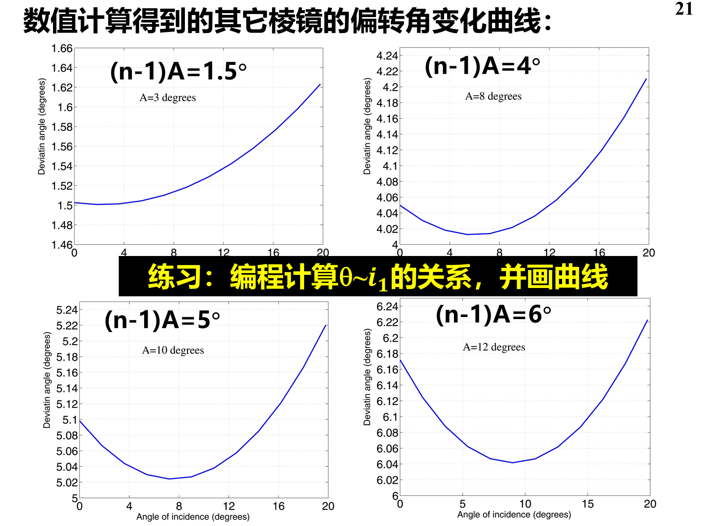

degrees：度；图中横轴为入射角、纵轴为偏向角。

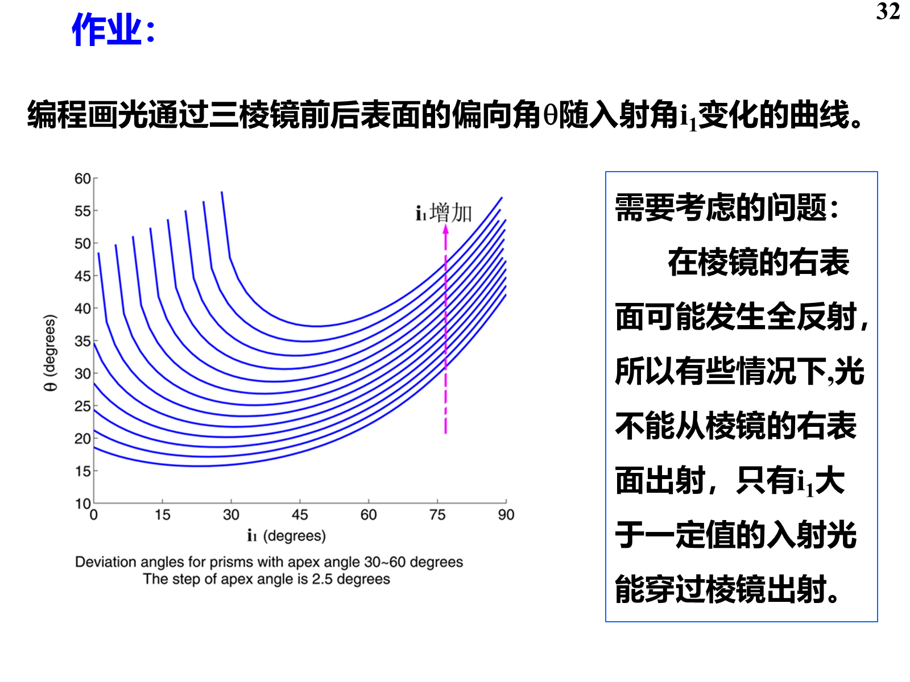

degrees：度；Deviation angles for prisms with apex angle 30~60 degrees：顶角30°至60°的棱镜的偏向角；The step of apex angle is 2.5 degrees：顶角步长为2.5°。

<!-- ORIGINAL-END -->

题意分析：画$\delta(i)$；第21页含$A=3^\circ,8^\circ,10^\circ,12^\circ$，第32页含$30^\circ$至$60^\circ$、步长$2.5^\circ$的曲线族，考虑第二面全反射。

**算法：** 固定$n/n_0$，扫描$i$，执行P02四步。若$|m\sin r_2|>1$，反正弦无实数解，该点留空；等于1只标为临界边界。采用带符号的折射角时$r_2$允许为负，不能把所有负角都误删。第32页通常正内部角分支的下界，在$A>r_c=\arcsin(1/m)$时为

$$i_{\mathrm{lim}}=\arcsin[m\sin(A-r_c)].$$

若$A\le r_c$，从$i=0$就可能出射；若$A>2r_c$，无普通非掠射的两面透射光路。取$m=1.5$，$A=60^\circ$应得到$i_{\mathrm{lim}}=27.92^\circ$，最低点为P02数值，这是程序验算点。

本题没有给每条曲线的独立材料数据，配图按同一普通玻璃$m=1.5$复现；换材料应改输入。[可运行的完整程序](棱镜曲线.py)用标准Python直接生成[曲线图](assets/棱镜曲线.svg)及CSV，正文图为程序实际输出。程序角度接口用度，内部三角计算转成弧度。

横轴入射角、纵轴偏向角；左图比较薄棱镜精确值与近似水平线，右图为大顶角曲线族，空白区对应不能从第二面透出。各最低点随顶角增大而升高，不是每条曲线都能从零入射画起。

## P06 分光系统怎样把颜色分开

来源：棱镜第23—27页，含第26页“在纸面内如何”提问。

<!-- ORIGINAL-BEGIN -->

**课件原题／原文与题图**

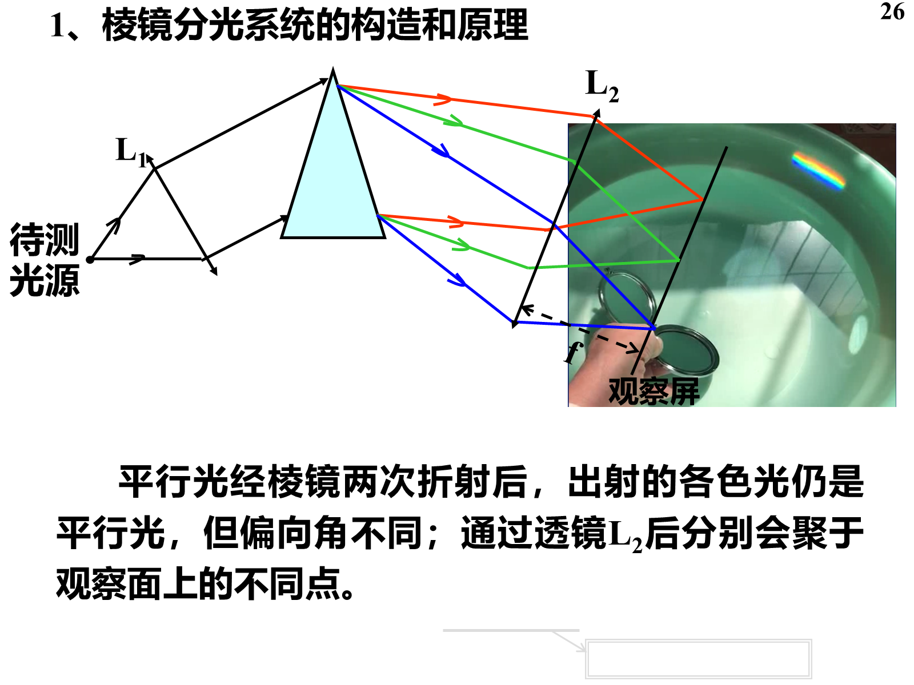

<!-- ORIGINAL-END -->

题意分析：解释材料色散、柯西公式及狭缝成谱线的过程。

**解析：** 透明波段可用经验式$n(\lambda_0)=a+b/\lambda_0^2+c/\lambda_0^4$拟合。若$b,c>0$，则$dn/d\lambda_0=-2b/\lambda_0^3-4c/\lambda_0^5<0$，称正常色散；短波折射率较大，通常偏折更多。吸收带附近可能反常色散，不能将“紫光总比红光偏得多”视为无条件规律。

狭缝放在准直透镜$L_1$的物方焦平面，出射为平行光；棱镜给不同波长不同出射方向；会聚透镜$L_2$使每一方向的平行光聚在像方焦平面不同位置。纸面内每种颜色对应一个点，垂直纸面的狭缝长度形成相应谱线。以中心方向作局部轴，邻近谱线间距$\Delta x\approx f_2'\Delta\delta$，角用弧度。聚焦透镜负责把方向差转成位置差，不是它产生材料色散。

按左侧狭缝→$L_1$→棱镜→$L_2$→屏带读；同一颜色各平行线属于一个方向，不能把颜色间不同方向说成不再平行的同色束。

## P07 角色散的意义、推导及顶角影响

来源：棱镜第30—31页的两处提问。

<!-- ORIGINAL-BEGIN -->

**课件原题／原文与题图**

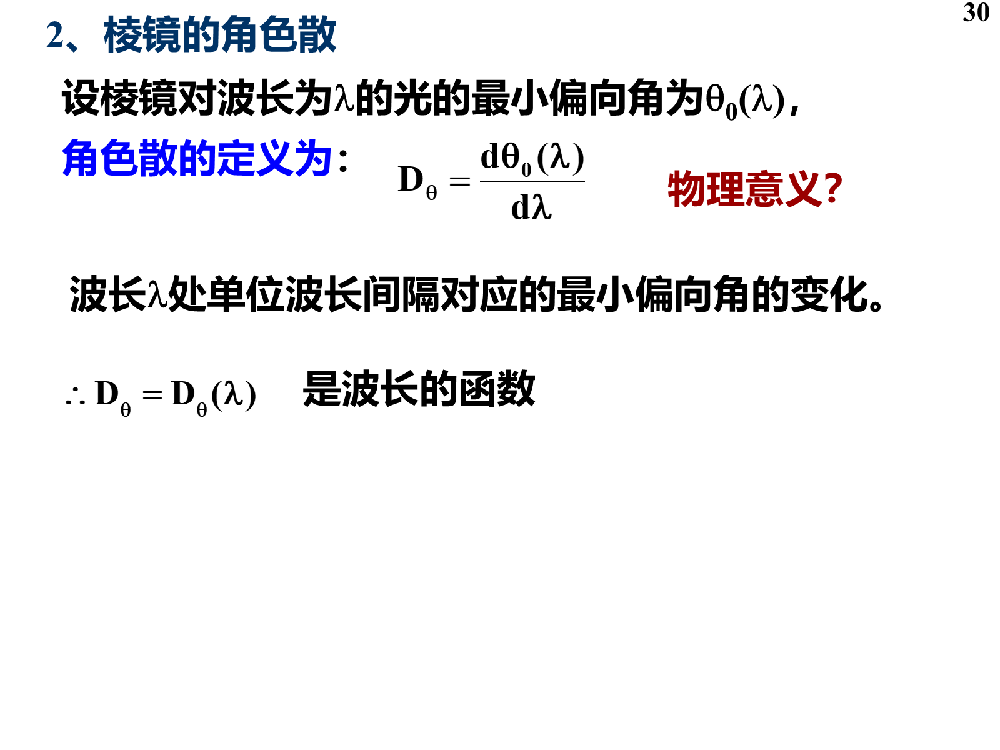

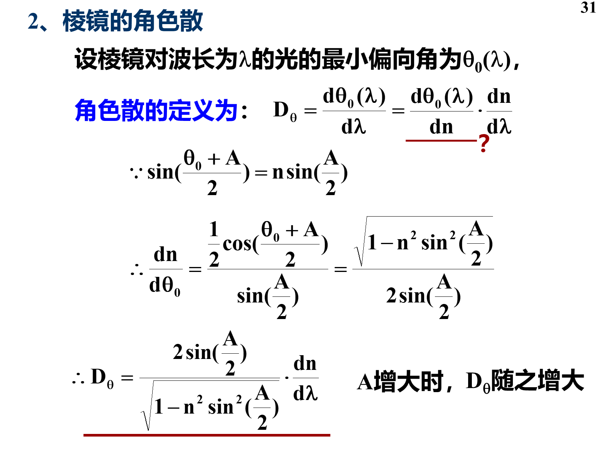

<!-- ORIGINAL-END -->

题意分析：解释$D_\delta=d\delta_{\min}/d\lambda_0$，求几何因子，判断$A$增大时怎样。

**推导：** 对$\sin[(A+\delta_{\min})/2]=m\sin(A/2)$求导，固定$A$且$n_0$不随波长变化：

$$D_\delta=\frac{2\sin(A/2)}{n_0\sqrt{1-m^2\sin^2(A/2)}}\frac{dn}{d\lambda_0}.$$

它表示单位波长变化对应的最小偏向变化，单位如rad/nm或rad/μm；不能把材料色散$dn/d\lambda_0$与角色散混为一量。正常色散下$D_\delta<0$，在可透射范围内增大$A$使几何因子增大，故一般是$|D_\delta|$增大，而不是负数$D_\delta$的代数值增大。邻近谱线$\Delta\delta\approx D_\delta\Delta\lambda_0$。

各波长的最小偏向角是各自调整入射角得到的。固定棱镜同时入射宽谱光时，通常只有中心波长恰对称；中心处的一阶导数相同，宽谱不能逐色都假定最小偏向。薄棱镜且各角均小时才有$D_\delta\approx(A/n_0)dn/d\lambda_0$。若$n_0$也有色散，应对$m=n/n_0$整体求导。

## P08 三面角反射器证明与用途

来源：棱镜第49—52页；第52页指定赵凯华教材第一章第3题。

<!-- ORIGINAL-BEGIN -->

**课件原题／原文与题图**

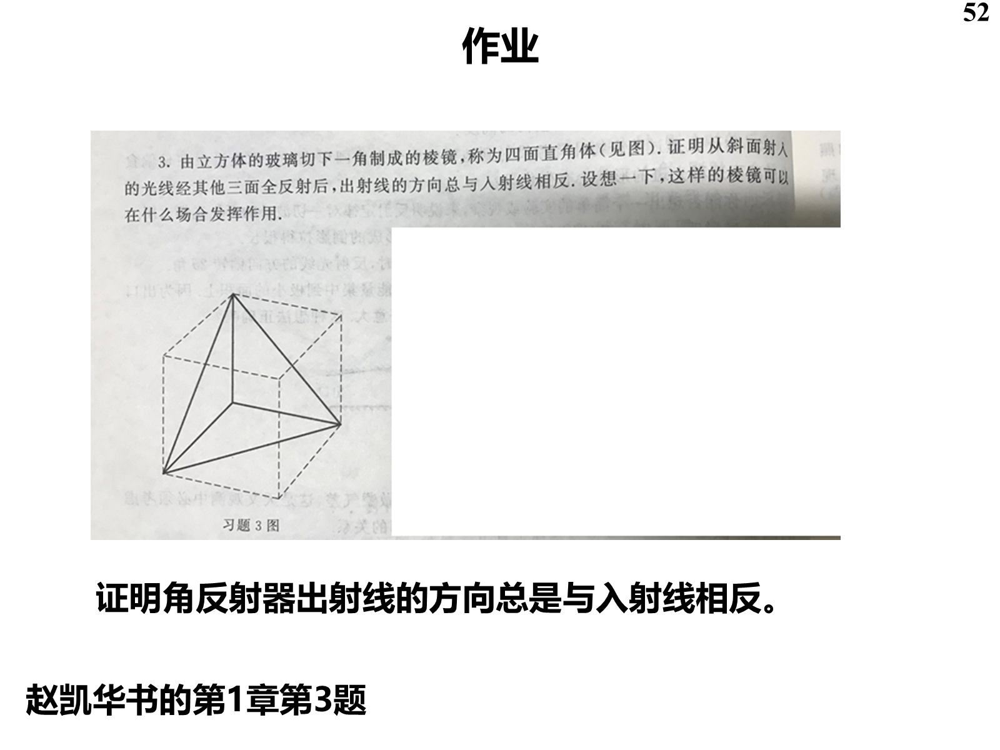

<!-- ORIGINAL-END -->

题意分析：由立方体切角制成的棱镜，光经三面反射后为何反向？用于何处？

Corner prism意为角锥棱镜。三反射面两两垂直；光实际依次打到三个面，出射线通常与原线平行但错开。

设三面法线分别沿$x,y,z$，入射方向$\mathbf v=(v_x,v_y,v_z)$。反射只翻转法向分量：

$$(v_x,v_y,v_z)\to(-v_x,v_y,v_z)\to(-v_x,-v_y,v_z)\to(-v_x,-v_y,-v_z)=-\mathbf v.$$

任意反射次序结果相同，前提是三面各反射一次。入出斜面时若同一均匀外界、同一平面界面，结合折射可逆性，外部入出方向同样相反。用途为测距回归目标、自行车回归反射标志等。两块垂直镜只翻转两个分量，不能把任意三维方向反向；“方向相反”也不保证“沿原直线”。玻璃面需满足全反射条件或镀反射膜，且光路确实覆盖三面。

## P09 分层介质中的传播与蜃景

来源：棱镜第7—10页，含“密度渐变时如何传播”的问题。

<!-- ORIGINAL-BEGIN -->

**课件原题／原文与题图**

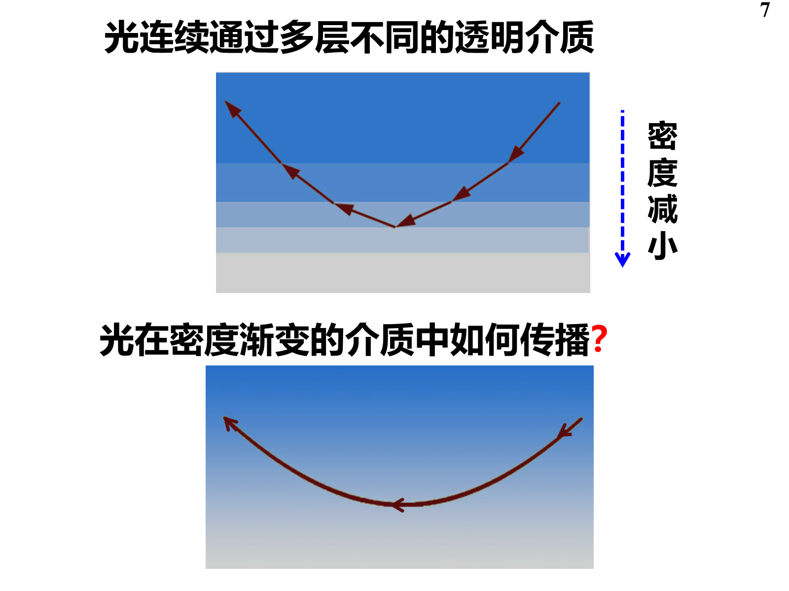

<!-- ORIGINAL-END -->

若$n=n(z)$、层面水平，角$\theta$从竖直法线量，各层折射定律给$n(z)\sin\theta(z)=C$。向$n$较小的一层传播时$\theta$增大，光线更接近水平；到$n=C$处可平滑转向，不必存在实体反射面。连续光线弯向折射率较大的一侧。

近地面热、$n$低时，光路向上弯，眼睛沿入眼切线反推可见地面以下的下蜃景；近海面冷、$n$大时光向下弯，远处物可显得被抬高。密度与折射率的对应需同组分等条件，不能把任意材料的密度高低直接当作折射率定律。看见像的位置需沿实际入眼方向反向延长，不能只凭“向上弯”判断像的全部倒正。

## P10 光纤为何导光，接收角怎样求（配套整理）

依据：棱镜第4—6页，接收角推导为方法整理。纤芯$n_1>n_2$包层，外界$n_0$。对过轴的子午光线，芯内与轴夹角$\theta$，侧面入射角$90^\circ-\theta$。全反射要求$\cos\theta>n_2/n_1$；端面折射$n_0\sin\alpha=n_1\sin\theta$，合得

<!-- ORIGINAL-BEGIN -->

**补充整理题（非教师原题）**：本题为帮助理解而整理的问答，来源见上方。

<!-- ORIGINAL-END -->

$$n_0\sin\alpha_{\max}=\sqrt{n_1^2-n_2^2}=NA.$$

$NA$无量纲，描述可接收的角度范围；若右侧大于$n_0$，外界实际接受半角上限仍为$90^\circ$。过急弯曲会让某些光线局部侧面入射角减小而漏光。此子午光线模型不能直接涵盖全部斜光线或波导模式。

## P11 布儒斯特棱镜的条件（应用整理）

依据：棱镜第40页。入射面是光线与法线张成的平面；$p$偏振的电场在入射面内，$s$偏振垂直入射面。无吸收、非磁、各向同性且折射率不同的界面，$p$反射为零时

<!-- ORIGINAL-BEGIN -->

**补充整理题（非教师原题）**：本题为帮助理解而整理的问答，来源见上方。

<!-- ORIGINAL-END -->

$$\tan i_B=n/n_0,\qquad i_B+r_B=90^\circ.$$

中心波长同时走对称光路时$A=2r_B=180^\circ-2i_B$。如$m=1.5$，得$i_B=56.31^\circ,r_B=33.69^\circ,A=67.38^\circ$。第二面反向介质的布儒斯特角恰为$r_B$。这只能消除理想$p$偏振的反射，不能消掉$s$反射。PPT“最大的色散”不作为普适定理：色散仍需按P07及完整光路判断，最小偏向本身并不保证所有设计中最大的分色能力。

## P12 其他棱镜装置各做什么（应用整理）

依据：棱镜第33—48页；第44—45页原文标注非考试延伸阅读，未当成计算作业。

<!-- ORIGINAL-BEGIN -->

**补充整理题（非教师原题）**：本题为帮助理解而整理的问答，来源见上方。

<!-- ORIGINAL-END -->

| 装置 | 机制与可用结论 | 不能误用之处 |
| --- | --- | --- |
| 菲涅耳双棱镜 | 两块薄棱镜底边相合，使同一源形成两个虚源；源距棱镜$l$时，虚源间距$2l(n-1)A$ | 由每侧回推位移$l\tan\delta\approx l\delta$得出，角用弧度；独立两灯不因此相干 |
| 色散补偿棱镜对 | 不同频率走不同材料/空气路程，调节频率相位差 | 将颜色空间合束不等于脉冲已压短 |
| CPA | 先展宽降低峰值功率、再放大、最后补偿频率相位以压缩 | 展宽与压缩是时间波形问题，非单纯成像 |
| 锥透镜 | 锥面使各方位的波在轴附近叠加，形成中心亮斑与同心环 | 理想贝塞尔无衍射模型需无限口径/能量，实际只有有限近似区间 |
| 变形棱镜对 | 对一个横向方向改变光束宽度，调节椭圆截面 | 不等于两个方向同倍率的普通放大 |
| 直角、屋脊、道威、五角等 | 依次依靠折射/反射实现转向或图像取向变换 | 必须数实际反射次数和方向，不能只看元件名称就判倒像 |

谱相位$\phi(\omega)$是每个频率通过系统后增加的相位；群延迟$\tau=d\phi/d\omega$是包络的延迟（s），群延迟色散$d^2\phi/d\omega^2$描述该延迟随频率的变化（s²）。这里的“正色散”不能仅凭$dn/d\lambda_0$的负号判断。上述整理回答装置作用，没有把课件未提出的任意新数值题冒充原题。

---

# 三、成像概念与球面折射

## G01 找物点、像点，判断四种实虚组合

来源：概念第5—7、17页。

<!-- ORIGINAL-BEGIN -->

**课件原题／原文与题图**

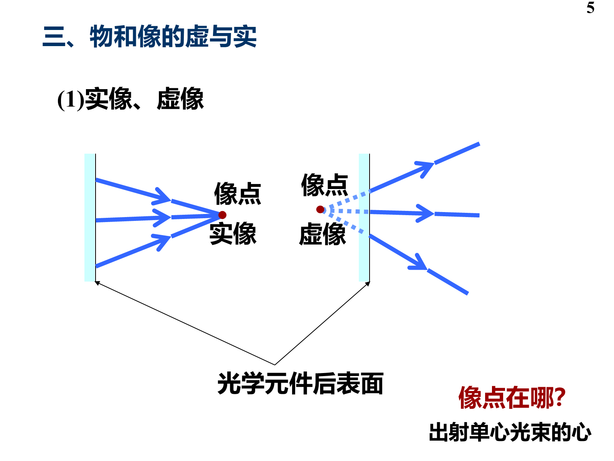

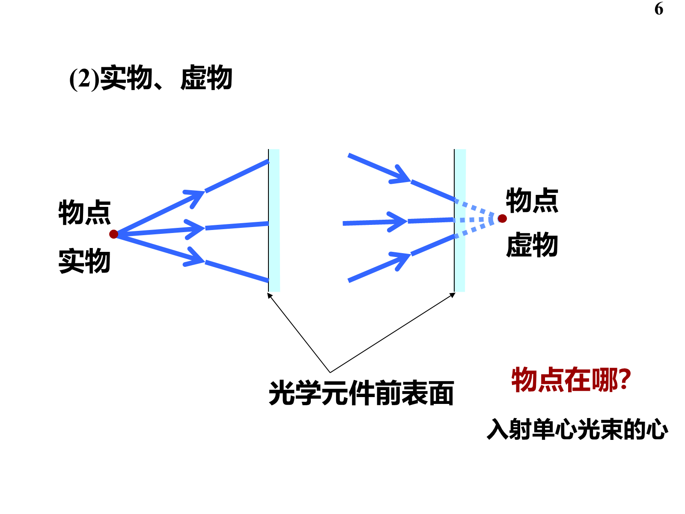

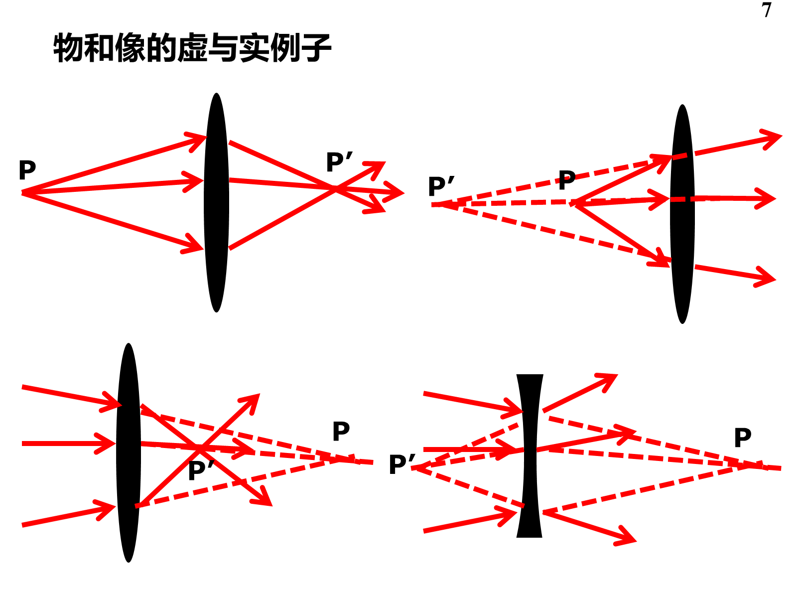

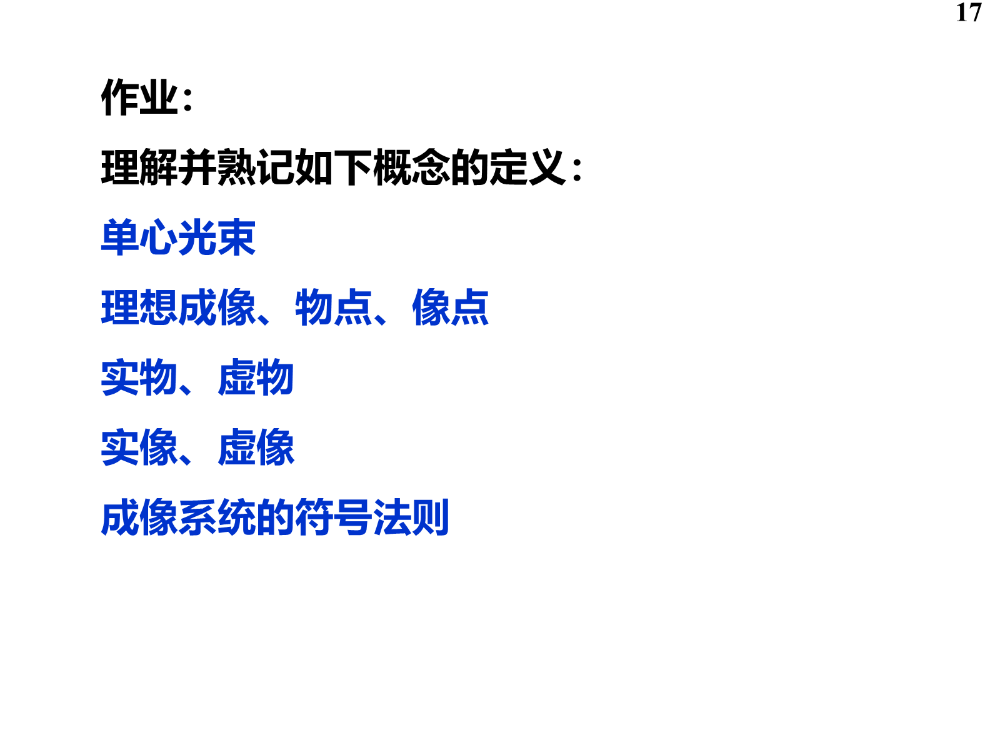

<!-- ORIGINAL-END -->

题意分析：图中物点/像点在哪？理解并熟记单心光束、理想成像、物像和实虚定义。

**分析与答案：** 先把光学系统圈定，只看进入它的光束找物点，只看离开它的光束找像点。单心光束的光线或其延长线交于同一点；理想成像要求由一物点入射的单心光束，出射仍为单心光束。物点与像点互为共轭。

| 看哪一束光 | 实际状态 | 点的性质 |
| --- | --- | --- |
| 入射光束 | 从一个真实交点发散而来 | 实物 |
| 入射光束 | 正朝前方某点会聚，先被系统截住 | 虚物；将入射线向前延长找点 |
| 出射光束 | 真实会聚相交 | 实像，可在该处用屏接收 |
| 出射光束 | 发散，反向延长相交 | 虚像，不能在该虚交点用屏接收 |

概念第7页四图按左上、右上、左下、右下依次为：实物实像、实物虚像、虚物实像、虚物虚像。虚物不表示空间中真的放着一件“虚的物体”，只是入射光束的会聚趋势。实像也不保证坐标为正，凹面镜的实像在入射侧。

## G02 笛卡尔符号与图中正长度

来源：概念第11—16、17页。

<!-- ORIGINAL-BEGIN -->

**课件原题／原文与题图**

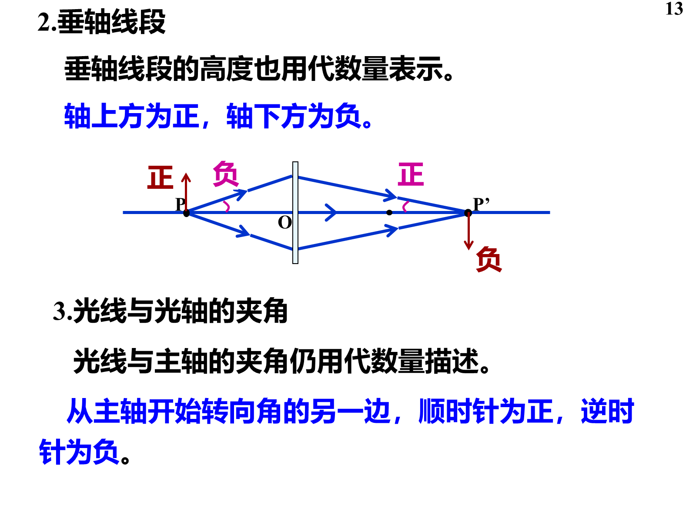

<!-- ORIGINAL-END -->

题意分析：判高度、倾角、物像距、曲率半径正负；为什么图中写$-s,-u$？

取入射光从左向右，当前顶点为零。左实物$s<0$，右虚物$s>0$；右折射实像$s'>0$，左折射虚像$s'<0$；反射则左实像$s'<0$、右虚像$s'>0$。球心在右$r>0$、在左$r<0$。高度在轴上方正、下方负。PPT角度从光轴/法线按小于$90^\circ$方向转向光线，顺时针正、逆时针负。

图中箭线长度通常标正几何量，所以左实物到顶点的长度写$-s$，不是将物距改成了正数；从左下向右上走的入射线有$u<0$，旁边画出的正夹角写$-u$。物空间指入射线所在空间，像空间指出射线所在空间，不能按物点或像点在哪一侧命名；平面镜的物空间和像空间可以在同一侧重叠。

## G03 球面折射参数、精确关系与近轴公式

来源：折射第4—8页，含“系统参数有哪些”“还依赖$u,u'$说明什么”。

<!-- ORIGINAL-BEGIN -->

**课件原题／原文与题图**

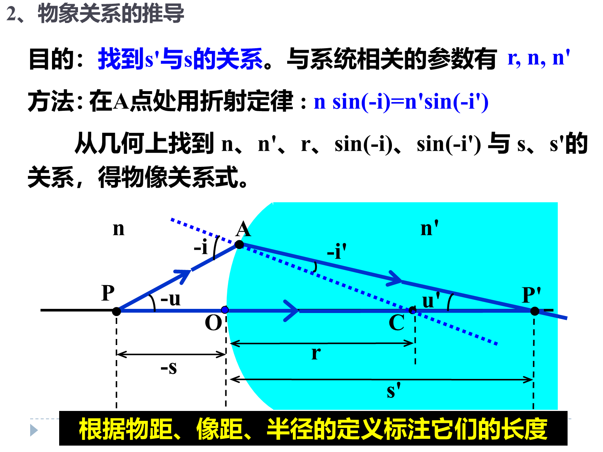

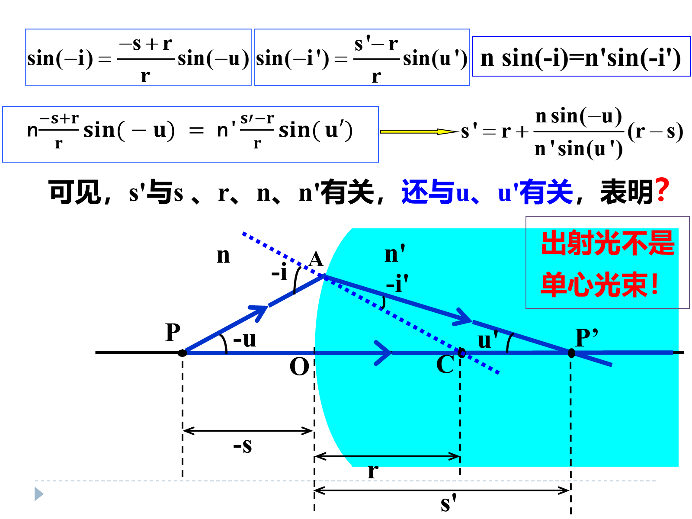

<!-- ORIGINAL-END -->

系统参数是$n,n',r$，物距$s$还须另给。光线在球面的高度不同，法线方向不同；精确折射后一般不交于共同像点，这就是球差的来源，不能先宣称任意宽光束严格单心。近轴要求孔径高度、光线倾角足够小；离轴小物还另需物高/视场足够小。

图中$O$为顶点，$C$为球心，$h$是入射点高度。用普通几何斜率$\vartheta$（与PPT顺时针角符号相反），法线倾角近似$\alpha=-h/r$。近轴折射$n(\vartheta-\alpha)=n'(\vartheta'-\alpha)$，且轴上物像给$\vartheta=-h/s,\vartheta'=-h/s'$。消去$h$：

$$\frac{n'}{s'}-\frac n s=\frac{n'-n}{r}=\Phi.$$

$\Phi$称光焦度；半径用米时单位D。公式不再含光线高度，表示一级近似下各近轴光线具有共同像点，而不是证明实际系统从此没有像差。角必须用弧度做小量近似。

## G04 焦距、高斯、牛顿、横向与角放大率

来源：折射第9—17、33页的推导与性质提问。

<!-- ORIGINAL-BEGIN -->

**课件原题／原文与题图**

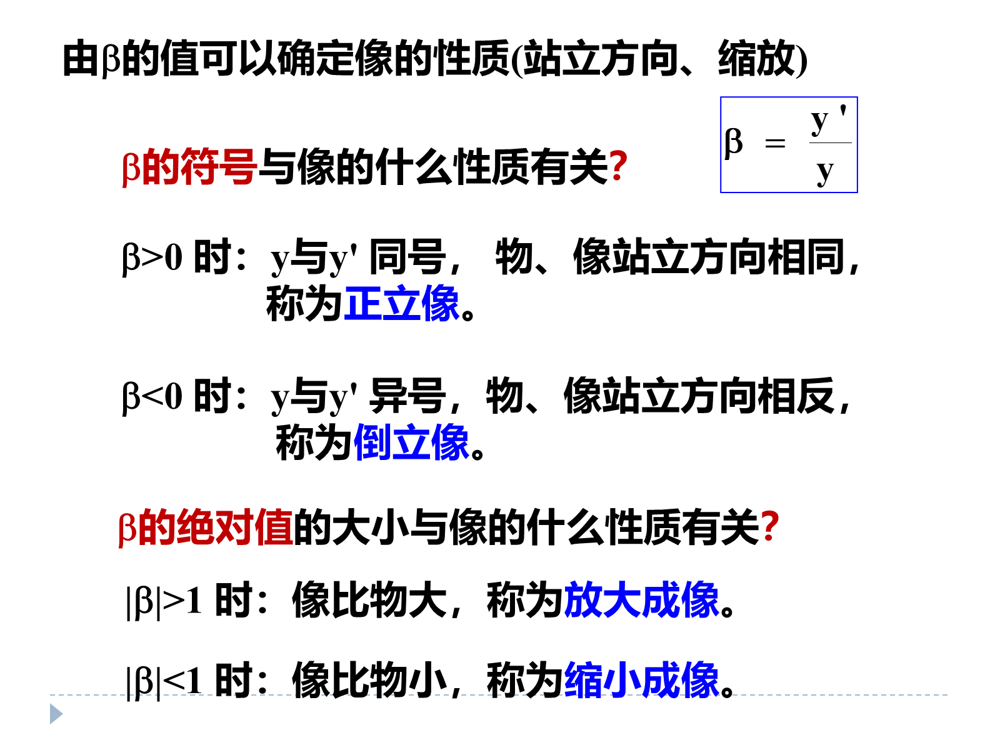

<!-- ORIGINAL-END -->

**推导：** 在G03令$s\to-\infty$得到$f'=n'/\Phi$，令$s'\to\infty$得到$f=-n/\Phi$，故$f'/f=-n'/n$。用$\Phi$除物像式即得$f/s+f'/s'=1$。再定义$x=s-f,x'=s'-f'$，代入并去分母得$xx'=ff'$。

过球心的光线沿法线不偏折，相似三角形给$\beta=(r-s')/(r-s)$；结合G03可化为

$$\beta=\frac{y'}y=\frac{ns'}{n's}=-\frac f x=-\frac{x'}{f'}.$$

因而$\beta>0$正立、$\beta<0$倒立，$|\beta|>1$放大、$<1$缩小；实虚由光束是否实际会聚决定，不能由$\beta$单独确定。对于同一轴上共轭点的孔径光线，近轴$\gamma=u'/u=s/s'=n/(n'\beta)$。这里比较的是同一条入射、出射对应光线的倾角，不是任意两条光线的角度比。

## G05 两次球面折射的玻璃棒例题

来源：折射第18—21页。

<!-- ORIGINAL-BEGIN -->

**课件原题／原文与题图**

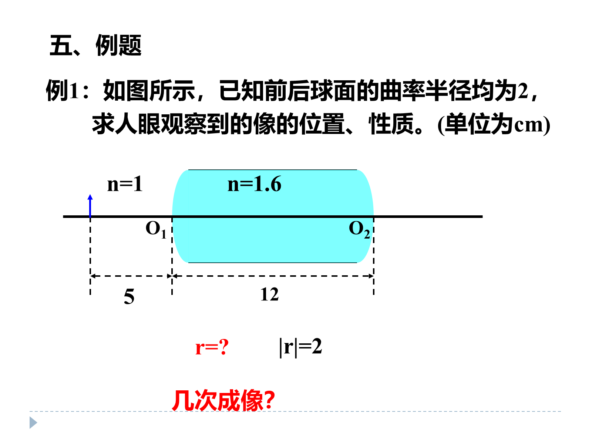

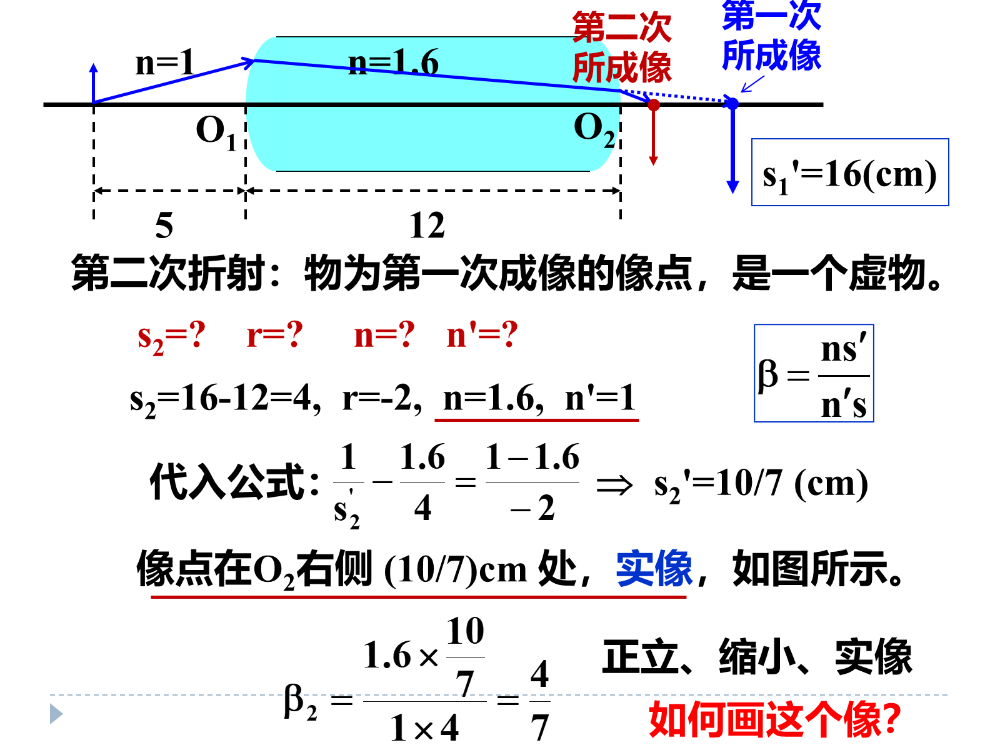

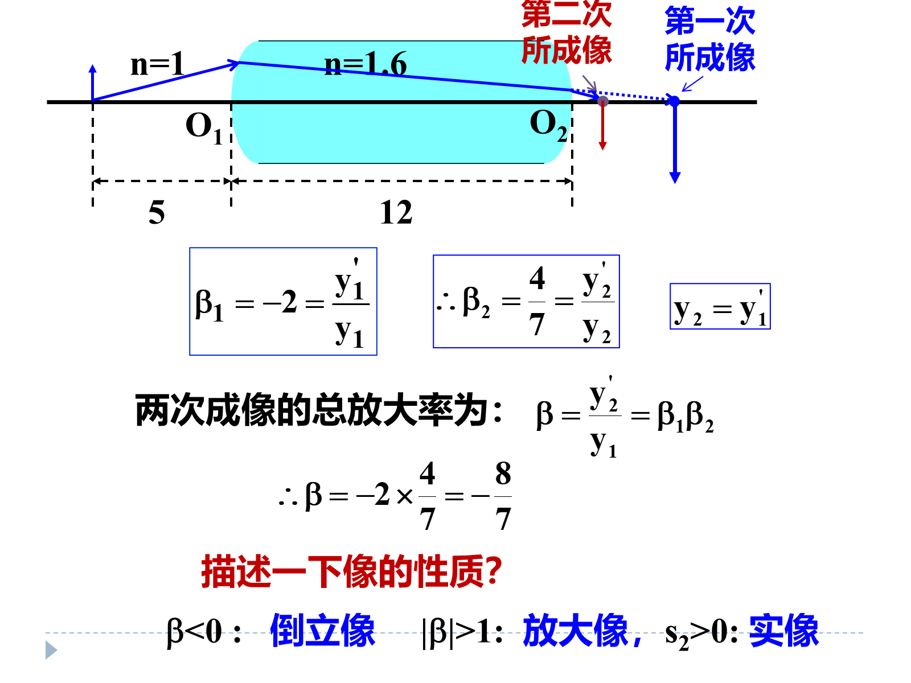

<!-- ORIGINAL-END -->

题意分析：空气中玻璃棒$n=1.6$，两球面半径大小均2 cm，顶点间距12 cm，物在左顶点前5 cm，求最后像的位置与性质，并说明中间像。

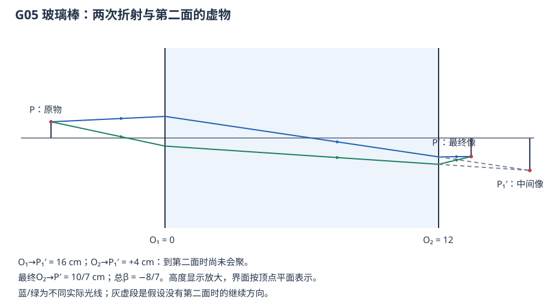

两表面用同一向右坐标，$r_1=+2,r_2=-2$。表中距离单位cm：

| 次序 | $n\to n'$ | $s$ | $r$ | 由公式算得$s'$ | 放大率 |
| --- | --- | --- | --- | --- | --- |
| 左面 | $1\to1.6$ | $-5$ | $+2$ | $16$ | $-2$ |
| 右面 | $1.6\to1$ | $16-12=+4$ | $-2$ | $10/7$ | $4/7$ |

例如第一面$1.6/s_1'-1/(-5)=0.6/2$，得$s_1'=16$。中间像在第二面右4 cm，入射第二面时还未会聚，所以是第二面的虚物；$s_2$必须取$+4$。第二面$1/s_2'-1.6/4=(-0.6)/(-2)$，得$s_2'=10/7$。

最终在右顶点右$10/7$ cm，实像；$\beta=(-2)(4/7)=-8/7$，相对原物倒立、略放大。第二步本身的正立缩小是相对中间像说的，不能拿来描述最终像。图中灰虚线为若移去第二面才会到达的中间像方向，蓝线是真实折射后的光路。

## G06 平面折射中的折射率是谁的

来源：折射第22—26页。

<!-- ORIGINAL-BEGIN -->

**课件原题／原文与题图**

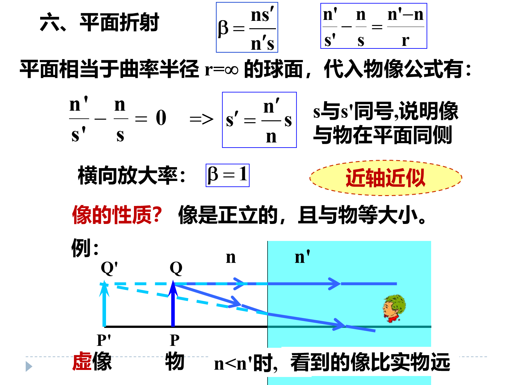

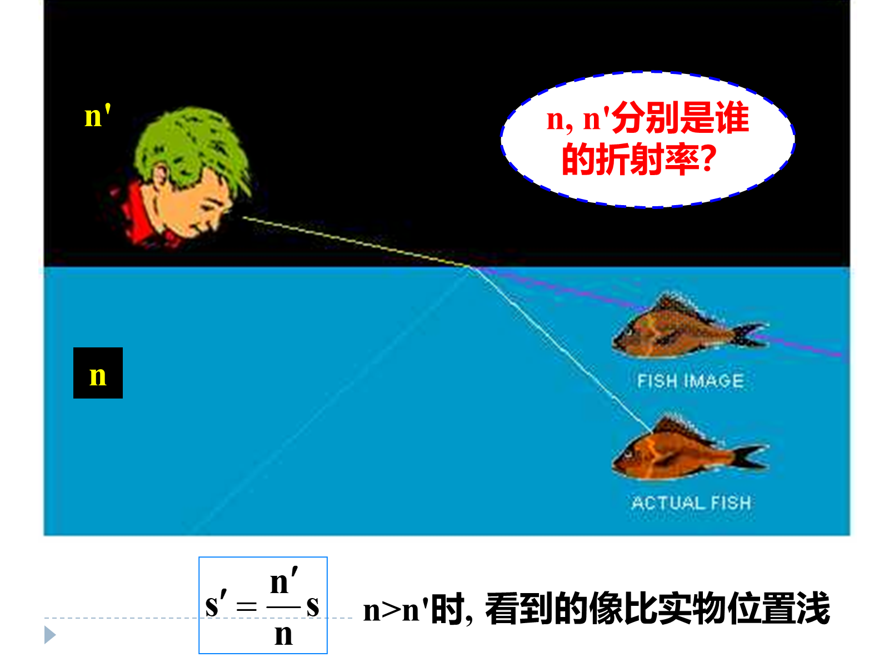

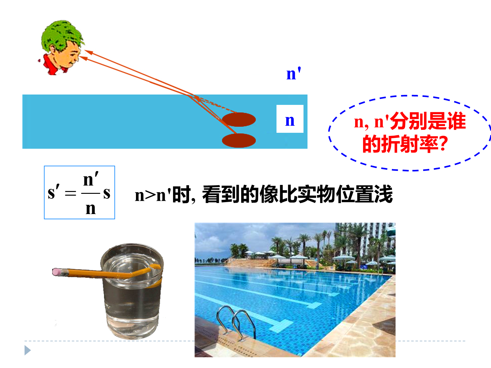

<!-- ORIGINAL-END -->

题意分析：平面像的性质？人在岸上看鱼、鱼看岸上物，$n,n'$分别指谁？

令$r\to\infty$，得$s'=(n'/n)s,\beta=1$。$n$始终是沿物到眼睛传播时的入射介质，$n'$是出射介质。岸上看鱼，$n=n_\mathrm水,n'=n_\mathrm气$，近竖直观察的视深为真深的$n'/n$，像变浅；水下看岸上物顺序相反，视高度增大。左实物$s<0$给$s'<0$，虚像、正立、横向等大。

上述等大与深度比例是近轴/近法线观察结果；大角度斜视会出现子午/弧矢像差，不能对整片大视场机械使用一个视深。

## G07 玻璃平板的像移

来源：折射第30页例题；指定作业B03为数值特例。

<!-- ORIGINAL-BEGIN -->

**课件原题／原文与题图**

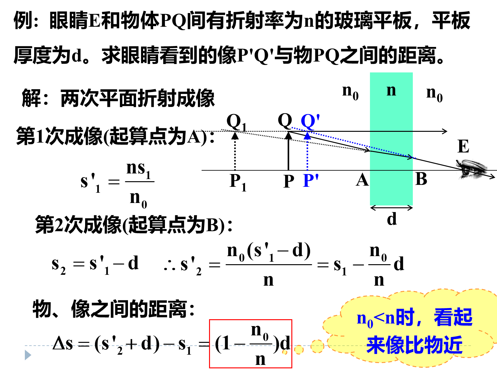

<!-- ORIGINAL-END -->

题意分析：外界$n_0$，板$n$、厚$d$，求看到的像与物之间距离。

第一面$s_1'=(n/n_0)s_1$；换到第二面$s_2=s_1'-d$，第二面$s_2'=(n_0/n)s_2=s_1-(n_0/n)d$。把像坐标换回第一面原点，多加$d$，故

$$\Delta x=(s_2'+d)-s_1=d(1-n_0/n),\qquad\beta=1.$$

当$n>n_0$时像沿传播方向移向观察者，正立等大虚像。关键是先换起算点；不能把$s_1'$直接当$s_2$。$n=n_0$或$d=0$时像移为零，作为检查。

## G08 球面折射怎样作图，角放大率怎样读

来源：折射第31—33页，含“其他例子自己练习”。

<!-- ORIGINAL-BEGIN -->

**课件原题／原文与题图**

<!-- ORIGINAL-END -->

从物点画平行轴的线，折射线通过$F'$；画通过$F$的入射线，折射后平行轴；再用过$C$的法线入射线核对。两条出射实线相交得实像，反向延长相交得虚像。图的蓝、紫、绿三线各自对应同一条入/出射光线，不能把不同颜色半条拼起来。过$C$不偏折与薄透镜“过光心”是不同的几何理由。

近轴曲线分类：对会聚球面$\Phi>0$且左实物，$s<f<0$（物在物方焦点以外）得右实像；$s=f$出射平行；$f<s<0$得左虚像。对发散球面$\Phi<0$、左实物，一般得左虚像。具体正倒和倍率仍按G04计算。第33页角放大率为$\gamma=s/s'$；两侧介质不同时不能误写成$1/\beta$。

## G09 斯涅耳窗口为何约97度（配套整理）

依据：折射第27—29页图。水下光线从法线量的最大折射角满足$\sin\theta_{\max}=n_\mathrm气/n_\mathrm水$；整个外界半球压缩进全顶角$2\theta_{\max}$的圆锥。取$n_\mathrm水=4/3$，全角$2\arcsin(3/4)=97.18^\circ$。这个角是水下光锥全角，不是空气一侧的入射角，也不是近轴视深公式。窗口以外主要对应水下景物的反射光，不是“空气那边没有电磁场”。

<!-- ORIGINAL-BEGIN -->

**补充整理题（非教师原题）**：本题为帮助理解而整理的问答，来源见上方。

<!-- ORIGINAL-END -->

---

# 四、反射与光路应用

## R01 自行推导球面镜成像公式

来源：反射第2—4、10—11页。

<!-- ORIGINAL-BEGIN -->

**课件原题／原文与题图**

<!-- ORIGINAL-END -->

题意分析：仿照球面折射讨论反射成像、焦距、牛顿式与放大率。

以$n'=-n$作代数形式变换，折射关系$n\sin i=n'\sin i'$变成$i'=-i$，即反射定律。代入折射物像式得

$$\frac1s+\frac1{s'}=\frac2r,\qquad f=f'=r/2,\qquad\beta=-\frac{s'}s.$$

这里负折射率只是把反射统一进代数算法的技巧，不是宣称镜后真的有负折射率材料。以$s=f+x,s'=f+x'$代入，得$xx'=f^2$。同一左入射坐标下，凹面镜$r<0$，平行入射成左实焦点；凸面镜$r>0$，成右虚焦点。作图用平行轴线经焦点反射、过球心线沿原线返回，见B06实例。

## R02 1米反射镜聚多少太阳光，能否点燃木块

来源：反射第7页两道思考题，含扩大到数百米的提问。

<!-- ORIGINAL-BEGIN -->

**课件原题／原文与题图**

<!-- ORIGINAL-END -->

**题意转量：** 直径$D$对应接收面积$A=\pi D^2/4$。题目未给太阳辐照度、反射率、吸收率、焦斑和材料热参数，不能求唯一能量或唯一点燃口径。设入射辐照度为$S_\odot$（W/m²），有效反射效率$\eta$，则焦区功率$P=\eta S_\odot\pi D^2/4$，时间$t$内能量$Q=Pt$。

若仅作题外估算，取$S_\odot=1000\,\mathrm{W/m^2},\eta=1,D=1$ m，得$P\approx785$ W；1秒能量785 J。瓦是功率，不能直接回答成“能量785瓦”。口径加至100 m时同条件接收功率增加$10^4$倍，但焦斑和焦距也决定功率密度，不能仅由口径判温度。

**点燃条件：** 木块吸收率$\alpha$、有效加热质量$m$、比热$c_p$及热损失$P_\mathrm{loss}$确定加热过程。简化预算$\alpha\eta S_\odot\pi D^2t/4\ge mc_p(T_\mathrm{ign}-T_0)+\int P_\mathrm{loss}\,dt$，还需达到足够局部温度和持续时间。若题给维持点燃所需净功率$P_*$，才可反求$D\ge\sqrt{4P_*/(\pi\alpha\eta S_\odot)}$。有限太阳视角、球差及散热都使“任意大镜把光聚成数学点”不成立。

## R03 平面镜、街边建筑与虚像

来源：反射第16—17页，含“街边的建筑？”提问。

<!-- ORIGINAL-BEGIN -->

**课件原题／原文与题图**

<!-- ORIGINAL-END -->

令$r\to\infty$，$s'=-s$、$\beta=1$。每条反射线按反射定律走，反向延长都到镜后与原点对称的位置，故正立、等大虚像。对于街景平面反射装置，应找实际反射面，用入眼光反向延长定位；没有屏可以在镜后的虚像位置接到这些光线。“左右反了”是观察坐标/朝向的比较，不意味着$\beta=-1$；横向放大率在所取垂轴方向为$+1$。

## R04 手机悬浮显示的面倾角

来源：反射第18—20页，含第19页“角度为多大”。

<!-- ORIGINAL-BEGIN -->

**课件原题／原文与题图**

<!-- ORIGINAL-END -->

题意分析：水平屏幕经倾斜透明面反射，怎样得到近竖直的虚像？

**解析：** 平面反射把一个方向关于镜面作对称。要把水平物平面变成竖直虚像平面，反射面取两平面的角平分面，因此理想倾角$45^\circ$。图中的梯形片短边约1 cm、长边约6 cm，**片面内的高**约3.5 cm；装配后中央截面的水平投影为$(6-1)/2=2.5$ cm，斜长为3.5 cm，竖直高度才是$\sqrt{3.5^2-2.5^2}=\sqrt6$ cm。倾角$\arctan(\sqrt6/2.5)\approx44.42^\circ$；这些只是接近45度的制作尺寸，不能当成精确45度的尺寸组。

虚像来自反射线的反向延长，透明片允许同时看见背景，形成“悬浮”观感；这类装置不因标题写“全息”就自动成为记录并重建完整波前的全息术。题图未给精确装配朝向时应说明测的是片面与屏幕的夹角，不能报一个无基准的角。

## R05 彩虹为何弯曲，虹与霓的光路（配套整理）

来源：反射第22—33页，含第33页“彩虹为什么是弯的”链接标题所问的物理问题；这里给出解析，不要求另看链接。

<!-- ORIGINAL-BEGIN -->

**课件原题／原文与题图**

Lect 31 – Rainbows：第31讲——彩虹；Triple rainbows exist, photo evidence shows：照片证据表明三重彩虹确实存在。链接地址本身保留原样。

<!-- ORIGINAL-END -->

图中Primary/Rainbow为主虹，Secondary为副虹/霓，Raindrops为雨滴，Measured from anti-solar point表示角从反太阳点方向量。主虹在滴内反射一次，副虹反射两次。若外部入射角$i$、内部折射角$r$，$\sin i=n\sin r$，内部反射$p$次的展开偏向角为$D_p=p\pi+2i-2(p+1)r$。主虹$p=1$，驻值要求$dr/di=1/2$，由折射定律求得其强光集中在反太阳方向附近约42度的圆锥上；副虹约51度。

雨滴沿这个圆锥方向都能将相应光送到眼睛，因此看到圆/圆弧，地平线遮去一部分；不是某一滴弯成了彩虹。不同波长的$n$使角度略异；主虹红外紫内，副虹色序相反。这里各角随波长变，42、51度是典型近似，不是所有材料和波长的固定精确值。

---

# 五、薄透镜

## L01 放大率的牛顿形式怎样由图得到

来源：薄透镜第10页问号；第11—12页性质提问。

<!-- ORIGINAL-BEGIN -->

**课件原题／原文与题图**

<!-- ORIGINAL-END -->

题意分析：说明$\beta=-f/x=-x'/f'$并判断成像性质。

同介质中$f=-f'$，$x=s-f,x'=s'-f'$。一条从物顶经$F$的光线出射平行轴，另一条平行轴入射后经$F'$，两侧相似三角形直接给$\beta=-f/x=-x'/f'$；也可由$\beta=s'/s$与牛顿式$xx'=ff'$验证。必须从相应焦点量$x,x'$，不能直接拿顶点物距代入。

令会聚透镜$f'=F>0$、实物距大小$u=-s>0$：

| 物的位置 | 像距 | 性质 |
| --- | --- | --- |
| $u>2F$ | $F<s'<2F$ | 倒立、缩小实像 |
| $u=2F$ | $s'=2F$ | 倒立、等大实像 |
| $F<u<2F$ | $s'>2F$ | 倒立、放大实像 |
| $u=F$ | 无穷远 | 出射平行，无有限共轭像 |
| $0<u<F$ | $s'<0$ | 正立、放大虚像 |
| 虚物$s>0$ | $0<s'<F$ | 正立、缩小实像 |

课件“虚像一定放大”仅适用于该会聚透镜的相应分支，不能推广到所有透镜。上述结果都可由$s'=Fs/(s+F)$及$\beta=F/(s+F)$检查。

## L02 任意入射光线如何作出射线

来源：薄透镜第13—16页，含第15页“仿照前面例子”练习。

<!-- ORIGINAL-BEGIN -->

**课件原题／原文与题图**

<!-- ORIGINAL-END -->

设题给光线$AB$在$B$穿过透镜，$O$为光心。**像方焦面法：** 过$O$作与$AB$平行的辅助线，方向不变；它与像方焦平面交于$C$。同方向入射平行光共轭于$C$，所以所求出射线是$BC$，虚焦点时用延长线。

**物方焦面法：** 将$AB$与物方焦平面交于$A_0$；过$O$作$A_0O$，它方向不变。由焦面点出发的光经透镜后互相平行，故从$B$作平行于$A_0O$的线即得出射线。相反倾斜方向、实/虚交点都按相同程序构造，不靠猜折向。两侧介质不同时，薄透镜顶点的光线一般不能假定方向不变，应改用一般光具组的节点和主面。

## L03 从镜片中轮廓判近视镜还是远视镜

来源：薄透镜第20页照片提问。

<!-- ORIGINAL-BEGIN -->

**课件原题／原文与题图**

<!-- ORIGINAL-END -->

题意分析：照片中镜片后的面部轮廓缩小意味着什么？

在常用空气中薄透镜、实物模型下，凹/负透镜使实物成正立缩小虚像，故镜片内轮廓缩小对应负透镜，常用于近视的光学矫正；凸/正透镜在物位于焦内时给正立放大虚像。照片没有物距、像距和镜片参数，不能反推出度数，也不能据照片代替对实际眼睛的检查。本题检验成像性质的识别，定量模型见I01、I02。

## L04 两次物距反求焦距

来源：薄透镜第21页例2。

<!-- ORIGINAL-BEGIN -->

**课件原题／原文与题图**

<!-- ORIGINAL-END -->

题意分析：实像高为物高一半，物向透镜靠近10 cm后，像物等大，求$f'$。

**思路：** 实物经会聚薄透镜成实像时倒立，所以第一次$\beta_1=-1/2$，不能将“一半”只当成$+1/2$。由$s_1'=-s_1/2$代入$1/s_1'-1/s_1=1/f'$，得$s_1=-3f'$。第二次仍为实物，等大像为$\beta_2=-1$，得$s_2=-2f'$。向右靠近10 cm表示$s_2=s_1+10$：

$$-2f'=-3f'+10\quad\Rightarrow\quad f'=10\ \mathrm{cm}.$$

检查：第一次物在左30 cm、像在右15 cm；第二次物左20 cm、像右20 cm，确实向透镜靠近10 cm。会聚透镜的左实物不可能在另一个有限位置成正立等大的虚像，故不能任意增加$\beta=+1$的分支。

## L05 平凸透镜镀银后反求材料和半径

来源：薄透镜第22—23页例3。

<!-- ORIGINAL-BEGIN -->

**课件原题／原文与题图**

<!-- ORIGINAL-END -->

题意分析：平行光垂直入射平面，未镀银时在镜后48 cm会聚；凸面镀反射膜后在镜前8 cm会聚，求$n$和曲面半径大小$R$。

**条件转化：** 薄透镜$r_1=\infty,r_2=-R$，空气中$f'=R/(n-1)=48$ cm。镀银后次序为平面折射→从玻璃内部看凹面的球面反射→返回的平面折射，不能当作只过一次透镜。

第一步平行仍平行；第二步在玻璃中反射聚于曲面左$R/2$；第三步由玻璃到空气，近轴平面折射使这个会聚距离变为$R/(2n)$。薄厚度忽略，因此

$$\frac R{n-1}=48,\qquad\frac R{2n}=8\quad\Rightarrow\quad n=1.5,\quad R=24\ \mathrm{cm}.$$

检查：$24/(1.5-1)=48$，$24/(2\times1.5)=8$。这题的最终光返回入射侧，为实焦点；“镜前8 cm”在原来向右坐标中是$-8$ cm，不能因换传播方向而混用正负。

## L06 薄正透镜实物实像的最小间距

来源：薄透镜第24页思考1。

<!-- ORIGINAL-BEGIN -->

**课件原题／原文与题图**

末页两道思考题原样保留；本题对应其中第1问。

<!-- ORIGINAL-END -->

题意分析：求物像最小距离，画随物距变化的曲线。

取正物距大小$u=-s>F=f'>0$，像距$v=s'>0$，$v=Fu/(u-F)$。物像分在两侧，总间距

$$L(u)=u+v=u+F+\frac{F^2}{u-F}.$$

令$t=u-F>0$，有$L=t+2F+F^2/t\ge4F$，等号$t=F$，即$u=v=2F$。也可求导$L'=1-F^2/(u-F)^2$，在$2F$前负、后正。$u\to F^+$和$u\to\infty$时$L\to\infty$，故曲线有单个最低点。

图以$u/F$作横轴、$L/F$作纵轴，最低点$(2,4)$。不能把虚像分支的两点距离拿来突破实物实像条件。

## L07 薄负透镜的实物能成实像吗；虚物呢

来源：薄透镜第19页作图补全、第24页思考2。

<!-- ORIGINAL-BEGIN -->

**课件原题／原文与题图**

末页两道思考题原样保留；本题对应其中第2问，另保留第19页作图。

<!-- ORIGINAL-END -->

令$f'=-a<0$，$a>0$。

**实物：** $s=-u<0$，$s'=-au/(a+u)<0$，$\beta=a/(a+u)$在0和1之间。因此任何有限左实物都成正立缩小虚像，不能成实像；分别用平行轴线反向延长过$F'$、过光心线作图即可。

**虚物：** 入射光已经会聚于透镜右方$s>0$，则$s'=as/(a-s)$。若$0<s<a$，仍能会聚成正立放大实像；$s=a$时出射平行；$s>a$时出射发散成倒立虚像。最后一支$|\beta|=a/(s-a)$，在$a<s<2a$放大、$s=2a$等大、$s>2a$缩小。结论是“负透镜不能把实物成实像”，不能省略“实物”。

每幅图先看透镜左侧的入射线，再看右侧出射线；虚物右侧的$P$是入射光若未被系统截住才会会聚的位置。红虚线找的是出射束的虚像，不能将两类延长线混读。

---

# 六、厚透镜与理想光具组

## T01 厚透镜中的起算点为什么要移动

来源：共轴第6—8、14页，部分版同页。

<!-- ORIGINAL-BEGIN -->

**课件原题／原文与题图**

<!-- ORIGINAL-END -->

题意分析：消去中间像得物像关系，解释$p,p'$，判断主面上的物成像在哪。

空气中厚透镜$n$、厚$d$，两界面光焦度$\Phi_1=(n-1)/r_1,\Phi_2=(1-n)/r_2$。由两面物像式及$s_2=s_1'-d$消去中间量，可整理为

$$\Phi=\Phi_1+\Phi_2-\frac d n\Phi_1\Phi_2,\quad f'=\frac1\Phi,\quad p=\frac{d\Phi_2}{n\Phi},\quad p'=-\frac{d\Phi_1}{n\Phi}.$$

其中$p=\overline{O_1H},p'=\overline{O_2H'}$都是有向距离。若顶点物像坐标为$\bar s,\bar s'$，改从主点量就是$s=\bar s-p,s'=\bar s'-p'$，于是$1/s'-1/s=1/f'$。厚度影响主面，不能把主面默认放在透镜表面或中间。

**消元的可核验方式：** 用高度$y$与约化斜率$q=n\vartheta$表示一条近轴光线；折射使$q'=q-\Phi_j y$，介质内传播$d$使$y'=y+(d/n)q$。依次实施“折射1→传播→折射2”，得到

$$\begin{pmatrix}y_2\\q_2\end{pmatrix}=\begin{pmatrix}1-d\Phi_1/n&d/n\\-\Phi&1-d\Phi_2/n\end{pmatrix}\begin{pmatrix}y_1\\q_1\end{pmatrix}.$$

矩阵只是把两条线性关系压缩记号，不是新物理假设。将其写成“从$O_1$到$H$传播$p$→在主面改变斜率$-\Phi y$→从$H'$到$O_2$传播$-p'$”，比较系数即得上面的$p,p'$。$\Phi=0$时有限焦距与这组主点式失效，应按无焦系统另算。

主面物$s\to0$时$s'=sf'/(s+f')\to0$，且$\beta=s'/s\to1$。故$H,H'$及两主面互为等高的共轭，而不是说两主面物理上重合。

## T02 双凸厚透镜求焦距和主点

来源：共轴第9—10页，部分版同页。

<!-- ORIGINAL-BEGIN -->

**课件原题／原文与题图**

<!-- ORIGINAL-END -->

题意分析：$r_1=+4$ cm、$r_2=-6$ cm、$d=2$ cm、$n=1.5$，求$p,p',f'$。

**代入：** $\Phi_1=1/8\ \mathrm{cm^{-1}},\Phi_2=1/12\ \mathrm{cm^{-1}}$，所以

$$\Phi=\frac18+\frac1{12}-\frac2{1.5}\frac1{8\times12}=\frac7{36}\ \mathrm{cm^{-1}},\qquad f'=\frac{36}7=5.142857\ \mathrm{cm},$$

$$p=\frac47=0.571429\ \mathrm{cm},\qquad p'=-\frac67=-0.857143\ \mathrm{cm}.$$

即$H$在左顶点右0.571429 cm，$H'$在右顶点左0.857143 cm。取$O_1$全局坐标0，$O_2=2$，则$H=4/7,H'=8/7,F=-32/7,F'=44/7$ cm；这样每个基点起点清楚。PPT标题只写$f$，该处给出的正数实际是像方焦距$f'$，空气中物方焦距$f=-36/7$ cm。

## T03 同一厚透镜，物在左顶点前8厘米

来源：共轴第17—18页，部分版同页。

<!-- ORIGINAL-BEGIN -->

**课件原题／原文与题图**

<!-- ORIGINAL-END -->

题意分析：求像的位置，补齐图中问号代表的距离。

**主面法：** 由T02，$s=-8-4/7=-60/7$ cm。代入$1/s'-1/s=7/36$，得$s'=90/7$ cm（从$H'$量）。从右顶点量须再加$p'$：

$$\bar s'=s'+p'=\frac{90}7-\frac67=12\ \mathrm{cm}.$$

像在$O_2$右12 cm，是实像；$\beta=s'/s=-3/2$，倒立放大。图中两主点偏移为$4/7,-6/7$，物至$H$的长度$60/7$，$H'$至像$90/7$，物至$O_1$为8，$O_2$至像为12 cm。

**逐面复核：** 第一面$1.5/s_1'-1/(-8)=0.5/4$，故$s_1'=\infty$，内部恰平行；第二面$1/s_2'=(1-1.5)/(-6)=1/12$，直接给$s_2'=12$ cm。两种方法相同。PPT第18页的11.94 cm与题设的近轴精确计算不符，本册不照抄该结果；从中间数据过早舍入也不应改变“第一面恰平行”的检查。

## T04 节点在哪，什么时候与主点重合

来源：共轴第20—22页，含第21页“节点在哪”。

<!-- ORIGINAL-BEGIN -->

**课件原题／原文与题图**

<!-- ORIGINAL-END -->

节点是轴上角放大率为1的一对共轭点。一般系统有$\beta=-f/x$、$\gamma=n/(n'\beta)=x/f'$，故$\gamma=1$给$x=f'$；牛顿式又给$x'=f$。所以

$$\overline{FK}=f',\quad\overline{F'K'}=f,\quad\overline{HK}=\overline{H'K'}=f+f'.$$

物方节点从$F$向右$f'$，像方节点从$F'$沿有向距离$f$找。两侧$n=n'$时$f'=-f$，节点分别与主点重合。等高传递属于主面，方向保持属于节点；不同介质中不能将过主点的线直接画成方向不变。

## T05 平面镀银玻璃半球：镜像展开与实际像

来源：共轴第23—27页；第23、24页为同题重复；薄透镜第24页“镜像法”专题的现有具体例题。

<!-- ORIGINAL-BEGIN -->

**课件原题／原文与题图**

<!-- ORIGINAL-END -->

题意分析：半球曲率半径$R$、$n=1.5$，平面镀银，物在凸面顶点前$2R$，求位置和性质。沿平面镜展开返回段，将半球补成完整球；展开空间中物在前顶点左$2R$，球直径$2R$。

图上方是展开模型，右半球和右侧像为辅助空间；下方蓝色返回线才是实际反射后的光，不能把辅助球后的像当最终答案。

对整球，$f'=nR/[2(n-1)]=1.5R$，主点都在球心。物距$s=-3R$，故$s'=3R$，$\beta=-1$。若前顶点为0、平面镜为$R$，展开像全局坐标为$R+3R=4R$。折回镜面：$x_\mathrm{actual}=2R-4R=-2R$。最终像与原物的轴向位置重合，倒立等大实像，物顶的像在轴下方，并非与物顶重合。

逐次法检查：物恰在第一球面的物方焦点，进入玻璃后平行；平面反射后仍平行，返回经球面在前方$2R$会聚，位置一致。

## T06 两侧介质不同的理想光具组例题

来源：作图第3—5页。

<!-- ORIGINAL-BEGIN -->

**课件原题／原文与题图**

<!-- ORIGINAL-END -->

题意分析：$f=-5$ cm、$f'=6$ cm，物在$H$左20 cm，求像的位置性质并判断能否用空气式。

物顶发出平行轴线到$H$，在$H'$等高转接后过$F'$；另一条过$F$的线在$H'$等高转接后平行轴；过$K$的线从$K'$同方向出射用于复核。两主面间的虚辅助连接不是实际内部光路。

从$F$量$x=-20-(-5)=-15$ cm，牛顿式$x'=ff'/x=2$ cm。因此像在$F'$右2 cm，也即$H'$右8 cm。高斯式$(-5)/(-20)+6/s'=1$给$s'=8$ cm，独立复核。

$\beta=-f/x=-1/3$，倒立缩小实像。由$f'/f=-n'/n$得$n'/n=6/5$，两侧介质不同；不能用$1/s'-1/s=1/f'$，也不能用$\beta=s'/s=-0.4$。本题节点相对各自主点向右$f+f'=1$ cm。

---

# 七、常用仪器与像差

## I01 远点0.5米的近视眼，眼镜怎样取焦距

来源：仪器第3、5页例4，含焦距、度数、光路图提问。

<!-- ORIGINAL-BEGIN -->

**课件原题／原文与题图**

<!-- ORIGINAL-END -->

**光学模型：** 忽略眼镜到眼睛的距离，目标是将无穷远实物成虚像在眼前远点$L=0.5$ m。取$s\to-\infty,s'=-0.5$ m，$1/f'=1/s'=-2\ \mathrm{m^{-1}}$。

故$f'=-0.5$ m，是负透镜，光焦度$-2$ D，通常写作近视200度（带符号镜片度数为$-200$度）。作图时画两条平行入射线，经负透镜后发散，将出射线向左反延，交于左侧0.5 m处；眼睛接收的仍是发散光，不能把那里画成实际会聚点。若远点分别为1 m、0.5 m，度数大小为100、200度。这里是课件理想成像计算，不是个体配镜处方。

## I02 近点0.5米，怎样看清25厘米处物体

来源：仪器第6页例5，含$s,s'$与作图提问。

<!-- ORIGINAL-BEGIN -->

**课件原题／原文与题图**

<!-- ORIGINAL-END -->

题意分析：按课件近点模型求眼镜焦度。

**条件转量：** 实物在眼前25 cm，镜片应成虚像于眼前50 cm，故$s=-0.25$ m、$s'=-0.50$ m：

$$\frac1{f'}=\frac1{-0.50}-\frac1{-0.25}=2\ \mathrm{m^{-1}},\qquad f'=+0.50\ \mathrm m.$$

是正透镜、$+2$ D（$+200$度）。画物在正透镜焦内，出射发散、向左反延成放大虚像；不能将$s'$误取正50 cm而算成别的焦度。课件用近点后移说明这一矫正模型；近点后移本身不等于足以诊断所有真实远视或老视情况。

## I03 放大镜的放大率到底比较什么

来源：仪器第10页的公式推导整理。

<!-- ORIGINAL-BEGIN -->

**课件原文（讲授整理依据，无独立题干）**

<!-- ORIGINAL-END -->

物高$h$，裸眼参考距离$D=25$ cm，裸眼视角$\theta\approx h/D$；放大率$M=\theta'/\theta$，不是随意拿虚像高除物高。

眼睛贴近薄正透镜，放松观察时物在物方焦平面，出射平行，$\theta'\approx h/f'$，故$M_\infty=D/f'$。若最终虚像在明视距离$D$，$s'=-D$，成像式给物距大小$u=Df'/(D+f')$，此时$M_D=D/u=1+D/f'$。

所以$D/f'$与$1+D/f'$分别对应不同的调节条件，不能见“放大镜”就任选一个。焦距变短会增大视角放大率，但像差、视场、工作距离和分辨率也限制可用性，不能把几何倍率无限增加当成无限清晰。

## I04 显微镜作图及与两个焦距、光学间隔的关系

来源：仪器第16—18、37—38页例题。

<!-- ORIGINAL-BEGIN -->

**课件原题／原文与题图**

<!-- ORIGINAL-END -->

题意分析：物在物镜焦点外、靠近焦点，画两次成像，分析与$f_o',f_e',\Delta$的关系。

上图蓝线先经物镜形成倒立放大的中间实像，再由目镜放大观察；红虚线是目镜出射束的反向延长，最终为倒立放大虚像。$\Delta=\overline{F_o'F_e}$为两焦点间距，不等于两个镜片间距$L=f_o'+\Delta+f_e'$。

**最终像在无穷远：** 中间像恰在$F_e$，物镜像距$v_o=f_o'+\Delta$，由薄透镜式得$\beta_o=-(v_o-f_o')/f_o'=-\Delta/f_o'$；目镜视角放大率$D/f_e'$，所以

$$M_\infty=-\frac\Delta{f_o'}\frac D{f_e'}.$$

**最终像在眼前$D$：** 目镜物距大小$u_e=Df_e'/(D+f_e')$，则$v_o=L-u_e=f_o'+\Delta+f_e'^2/(D+f_e')$。精确薄透镜乘积为

$$M_D=-\frac{\Delta+f_e'^2/(D+f_e')}{f_o'}\left(1+\frac D{f_e'}\right).$$

课件第38页的$-\Delta(1+D/f_e')/f_o'$还近似忽略了$f_e'^2/(D+f_e')$相对$\Delta$的修正；第18页则使用放松眼公式。定性上，通常增大光学间隔、缩短两焦距会增大倍率大小，负号表示相对原物倒立，但不能忽略实际调焦与像差条件。

## I05 惠更斯目镜求主点和焦点

来源：仪器第40—42页。

<!-- ORIGINAL-BEGIN -->

**课件原题／原文与题图**

Huygens eyepiece：惠更斯目镜。

<!-- ORIGINAL-END -->

题意分析：场镜$f_1'=3f_2'$，间距$d=(f_1'+f_2')/2$，求$d$及物方主点、焦点。

令$f_2'=a>0$，则$f_1'=3a,d=2a$。两薄透镜串联的总焦度$1/F'=1/f_1'+1/f_2'-d/(f_1'f_2')$，主点偏移$p=dF'/f_2',p'=-dF'/f_1'$。代入得

$$F'=\frac{3a}2,\qquad p=3a,\qquad p'=-a.$$

取场镜坐标0、视镜坐标$2a$，则$H=3a,H'=a$。物方焦点$F=H-F'=1.5a$，在两镜之间；像方焦点在$H'+F'=2.5a$。这里$F'$在公式中表示总像方焦距大小，坐标表中的焦点另以位置说明，不能把主点与场镜位置混同。

**检查：** 让入射束朝$F=1.5a$会聚（对整个目镜是虚物），两镜后应为平行光。这种物方焦点在内部、使用虚物的构型称**负目镜**；这里“负”不表示组合焦距为负，本例总焦距为正。平常用作放大观察时需物镜产生适当会聚束，不能像单片正放大镜那样随意在它左侧放实物。

## I06 冉斯登目镜求主点和焦点

来源：仪器第43—44页。

<!-- ORIGINAL-BEGIN -->

**课件原题／原文与题图**

Ramsden eyepiece：冉斯登目镜；next：下一步。

<!-- ORIGINAL-END -->

题意分析：两平凸透镜凸面相对，$f_1'=f_2'=a$，$d=2a/3$，求物方主点与焦点。

用I05同一组组合式：$1/F'=2/a-(2a/3)/a^2=4/(3a)$，所以$F'=3a/4$；$p=dF'/a=a/2$，$p'=-a/2$。以场镜为0，视镜为$2a/3$：

$$H=a/2,\quad H'=a/6,\quad x_F=H-F'=-a/4,\quad x_{F'}=H'+F'=11a/12.$$

物方焦点在场镜左$a/4$处，也就是**总焦距$F'$的三分之一**。PPT第44页文字写“$f'/4$”，与图和公式中的单片焦距$f_1'/4$混淆；若$f'$指总焦距，该文字不正确，应按上述坐标。此构型物方焦点在系统外，可在其附近放分划板；与I05的焦点内外位置区别正是这两题的考查重点。

## I07 开普勒与伽利略望远镜的光路、角倍率和扩束

来源：仪器第68—74页，含第71页两道作图题。

<!-- ORIGINAL-BEGIN -->

**课件原题／原文与题图**

<!-- ORIGINAL-END -->

题意分析：远处斜入射平行光与轴夹角$u$，画出两种望远镜光路，求出射角$u'$关系。

看I04图的中、下两图。两系统都令物镜像方焦点与目镜物方焦点重合，入射平行、出射仍平行。斜入射束先由物镜指向公共焦平面点$P$；开普勒的$P$是两镜之间真实中间像，伽利略的$P$在目镜后，只是未被目镜截住时才会到达的交点，画成虚辅助线。

为与图中向上的高度一致，先用逆时针为正的几何倾角$\theta,\theta'$；课件的顺时针倾角则是$u=-\theta,u'=-\theta'$。中间像高近似$h=f_o'\theta$，目镜出射角$\theta'=-h/f_e'$，故

$$M=\frac{\theta'}\theta=\frac{u'}u=-\frac{f_o'}{f_e'},\qquad L=f_o'+f_e'.$$

开普勒两焦距正，$M<0$、倒立，筒长为两焦距之和，实中间像可放分划板。伽利略目镜焦距负，$M>0$、正立，$L=f_o'-|f_e'|$；图示成立通常需物镜正焦距更长，保证正筒长。

**扩束：** 将准直光从短焦镜一侧输入，经过长焦镜后仍准直，光束直径放大$D/d=|f_\mathrm{long}'/f_\mathrm{short}'|$，反向则缩束。无损近轴系统的光束直径倍率与相应角倍率互为倒数，不是光束直径和发散角同时扩大同倍。扩束原理图中的内部会聚点，开普勒构型实际存在，伽利略构型不存在。

## I08 数值孔径、油浸和分辨率（推导整理）

依据：仪器第33—36页。定义$NA=n\sin\theta$，$\theta$为物点处可接收光锥的半角、$n$为其物方介质。物空间分辨距离量级$d\sim\lambda_0/(2NA)$；具体系数随照明和分辨判据改变。$NA$大意味着可分辨间距更小，而不是“大间距才看得清”。

<!-- ORIGINAL-BEGIN -->

**课件原题／原文与题图**

<!-- ORIGINAL-END -->

在一个平面界面，角从共同法线量，折射定律给$n_1\sin\theta_1=n_2\sin\theta_2$；这不等于任意弯曲界面、任意物像空间的NA都相同。油浸提高工作介质折射率并减少玻片到空气界面的角度限制，可接收更多高角光；空气中$NA\le1$，油中可大于1。光阑缩小可减少几何像差，却会减小NA、加重衍射斑，不能说越小越清晰。

第33页把典型0.14—0.7称为“焦比”，应结合第34页区分：NA无量纲；摄影焦比为$f'/D$，与NA不是同一数值。放大倍数也不决定分辨率，无新细节的放大称空放大。

## I09 不同显微成像机制辨认（应用整理）

依据：仪器第32、36、47—67页，无独立指定计算题。

<!-- ORIGINAL-BEGIN -->

**补充整理题（非教师原题）**：本题为帮助理解而整理的问答，来源见上方。

<!-- ORIGINAL-END -->

| 机制 | 把什么变化转成可见图像 | 检查点 |
| --- | --- | --- |
| 明场、暗场 | 明场收直透光为主；暗场挡掉直射背景、收散射/衍射光 | 暗场亮点不意味着样品主动发光 |
| 相衬 | 透明样品引起的相位差，通过相位板等与参考背景干涉转成强度差 | 不能把“相位直接被眼睛看到”作为机制 |
| 偏振 | 偏振态改变或双折射，经检偏器转成强度变化 | 依赖样品与偏振元件的相对方向 |
| 荧光 | 特定激发后检测样品发射的荧光，滤掉激发背景 | 多通道图是不同激发/检测条件的合成，不是一个颜色对应一种几何倍率 |
| 共聚焦 | 点照明加共轭针孔抑制离焦光，作光学切片 | 不是仅把普通灯换成激光就完成共聚焦 |
| 无限远校正 | 物镜先输出平行束，管镜形成中间像 | 中间可放附件，但物镜与管镜是成像系统的一部分 |
| 光镊 | 光与介质微粒交换动量，梯度力使合适粒子趋向强光区，与散射力竞争 | 需适当折射率、聚焦和力平衡，不是任意光束都稳定抓粒子 |

正置/倒置描述物镜相对样品的摆放，不直接保证最终像正立；眼睛视觉方向还取决于全系统。第61页标“回头有时间讲”的扩展术语不据此虚构新的计算要求。

# 八、像差辨析整理题

4-9课件15页未发现独立的例题、问号或作业页。以下A01—A06为依据课件整理的概念问答，不冒充教师原题；帮助准备概念辨析。

## A01 理想成像的三个要求各管什么

依据：像差第1—2页。单心光束出射仍单心，要求一点成一点；垂轴物成垂轴像，要求平面成像而非弯曲最佳像面；平面内横向放大率为常数，要求形状相似、没有畸变。这些条件彼此有关但不能互相代替；清晰不保证形状无畸变，单色也不保证没有几何像差。

<!-- ORIGINAL-BEGIN -->

**补充整理题（非教师原题）**：本题为帮助理解而整理的问答，来源见上方。

<!-- ORIGINAL-END -->

## A02 球差与彗差怎样区分，缩光阑能做什么

依据：像差第3—6页。球差在轴上物点也存在，边缘和近轴孔径区的光交点不同，不能在一张屏上全聚成点；彗差是离轴点宽光束不同孔径区的倍率不同，形成不对称彗星状斑。课件写“慧差”，规范名称为“彗差”。缩光阑减小所用孔径区，通常降低这两类几何像差，但同时损失光通量与NA，衍射影响增大。

<!-- ORIGINAL-BEGIN -->

**补充整理题（非教师原题）**：本题为帮助理解而整理的问答，来源见上方。

<!-- ORIGINAL-END -->

正负像差组合、合理弯曲和非球面设计可以校正；“曲率比1:6、凸面朝物”依赖折射率与共轭条件，不能当通用定理。平凸镜用于平行光聚焦时，较弯的一面通常朝平行光一侧。普通菲涅耳透镜只是将面分区压薄，本身不自动等于任意共轭下消球差的非球面设计。

## A03 像散的两条焦线与最小模糊圆

依据：像差第7—10页。一个斜光束在子午与弧矢截面的会聚位置不同，沿轴移动屏可依次见椭圆、焦线、较圆斑及正交焦线。两焦线的轴向间隔衡量纵向像散；中间有最小模糊圆，仍不是理想几何点。

<!-- ORIGINAL-BEGIN -->

**补充整理题（非教师原题）**：本题为帮助理解而整理的问答，来源见上方。

<!-- ORIGINAL-END -->

子午面由主光线与系统光轴确定，弧矢面通过主光线并与子午面垂直。焦线在纸面上呈“水平/竖直”取决于坐标摆放，不能将这个页面方向当成永久定义。图中Airy Diffraction Pattern是艾里衍射图样，Focal Plane是焦平面，Circle of Least Confusion是最小模糊圆；实际斑还含衍射，不能把几何像散与衍射当同一原因。

## A04 场曲与像散、离焦有什么不同

依据：像差第11页。场曲指垂轴平面物的最佳清晰像落在曲面，故平屏中心对焦时边缘不清、边缘对焦时中心不清；像散则是同一个斜入射物点本身有两种截面的焦位。即使像散得到校正，最佳像面也仍可能弯曲；整体移动屏幕只能改变离焦，不能让任意曲面像同时落在一个平面。

<!-- ORIGINAL-BEGIN -->

**补充整理题（非教师原题）**：本题为帮助理解而整理的问答，来源见上方。

<!-- ORIGINAL-END -->

## A05 畸变会让点像一定模糊吗

依据：像差第12—13页。不会。畸变主要是倍率随视场位置变化，直线网格因此弯曲，点像仍可清晰。以相对于理想像高的放大率大小为准，边缘放大更强为枕形，边缘相对压缩为桶形；不能只按有符号$\beta$“增大/减小”判，也不能仅凭透镜正负判所有组合系统的畸变。中置光阑的对称设计在相应对称共轭条件下可抵消某些畸变，并非任意物距下自动无畸变。

<!-- ORIGINAL-BEGIN -->

**补充整理题（非教师原题）**：本题为帮助理解而整理的问答，来源见上方。

<!-- ORIGINAL-END -->

## A06 纵向色差与横向色差怎样识别

依据：像差第14—15页。纵向色差是不同波长像距/焦位不同，沿轴调焦不能让所有颜色同时最清晰；横向色差是不同波长横向倍率不同，离轴像边缘位置/尺寸不同。用不同色散材料的正负透镜适当组合，可让选定两波长共焦，不能因此宣称全连续光谱无残余色差。纯反射几何镜面没有由材料折射率导致的透镜色差，但仍可能有其他像差及镀膜色效应。

<!-- ORIGINAL-BEGIN -->

**补充整理题（非教师原题）**：本题为帮助理解而整理的问答，来源见上方。

<!-- ORIGINAL-END -->

---

# 九、指定教材作业完整解析

指定题共20道：3.3、3.6、3.7、3.8、3.9*、3.10、3.12*、3.13、3.14、3.15、3.17、3.18、3.19、3.21*、3.22*、3.23*、3.25*、3.26、3.28*、3.29*。星号按收到的记录保留；3.25在历史记录与课件中标注不完全一致，本册按已有重点处理。两道透镜思考题见L06、L07，镜像法见T05；未收到另一本独立“习题课”题单。B04、B05是讲义原有配套题，单独标识，未算入20道指定题。

## B03 3.3 玻璃平板的视位置

来源：教材书页160—161；折射第34页指定。

<!-- ORIGINAL-BEGIN -->

**教材原题（原文及原图）**

<!-- ORIGINAL-END -->

题意分析：空气中物与眼之间有$n=1.5$、厚$d=30$ cm的平板，求像与物之间距离。

**考查：** 两次平面折射与换原点，不是透镜聚焦。由G07，$\Delta=d(1-1/n)=30(1-2/3)=10$ cm，像向眼睛方向移动10 cm，正立等大虚像。若需展开：第一面$s_1'=1.5s_1$；第二面$s_2=s_1'-30$、$s_2'=(2/3)s_2=s_1-20$，回到第一面原点的位置$s_2'+30=s_1+10$。任意物到板的距离都消掉，说明答案不依赖该未给距离。检查$n\to1$时像移为零。

## B04 3.4 两种“最小”（配套，未确认指定）

来源：教材书页161。

<!-- ORIGINAL-BEGIN -->

**教材原题（原文及原图）**

<!-- ORIGINAL-END -->

题意分析：$A=60^\circ,n=1.6$的玻璃棱镜，求(1)最小偏向角，(2)此时入射角，(3)可从另一面透出的最小入射角。取外界空气。

**前两问：** 最小偏向对称，$r_1=r_2=30^\circ$，$i=e=\arcsin(1.6\sin30^\circ)=53.13^\circ$，故$\delta_{\min}=2i-A=46.26^\circ$。

**第三问：** 第二面临界时$e=90^\circ$，$r_2=r_c=\arcsin(1/1.6)=38.68^\circ$，$r_1=A-r_c=21.32^\circ$。第一面倒推$i_{\mathrm{lim}}=\arcsin[1.6\sin21.32^\circ]=35.57^\circ$。严格离开第二面的非掠射透射需$i>35.57^\circ$；等号是教材常用的临界极限。$53.13^\circ$问偏折最少，$35.57^\circ$问透射门槛，不是同一角。

## B05 3.5 恒偏向棱镜（配套，未确认指定）

来源：教材书页161。

<!-- ORIGINAL-BEGIN -->

**教材原题（原文及原图）**

<!-- ORIGINAL-END -->

题意分析：30°—60°—90°与45°—45°—90°棱镜按题图组合，入射$i$、出射$r$；证$\sin\theta_1=n/2$时$\theta_2=\theta_1$且两方向垂直。

**读图与选法：** 题图左面竖直、底面水平，入射角$\theta_1$从左面水平法线量，出射角$\theta_2$从底面竖直法线量。先沿实际光线数界面：一次入射折射、一次内部反射、一次出射折射，不能套普通两面透射的最小偏向式。

由第一面折射$\sin r_1=\sin\theta_1/n=1/2$，内部$r_1=30^\circ$。从左面进入的光相对水平上倾30°。题图中上方反射斜面与竖直的夹角为$30^\circ+45^\circ=75^\circ$，因此相对水平向右下倾15°。以向右水平为方向角零、逆时针为正，反射方向角是“2×镜面方向角−入射方向角”，所以内部反射后的方向为$2(-15^\circ)-30^\circ=-60^\circ$。

这条光线直接走到底面，与底面向下的法线（方向角$-90^\circ$）夹30°，故$r_2=30^\circ$。**实际路径为左面折射→上方斜面反射一次→底面折射**；图中内部拼接线和虚法线不是额外反射面。末面折射给$\sin\theta_2=n\sin30^\circ=n/2=\sin\theta_1$，在所示$0\le\theta_{1,2}<90^\circ$分支，$\theta_2=\theta_1$。外部入射方向角为$\theta_1$，出射为$-90^\circ+\theta_2$，相差$90^\circ$，故$i\perp r$。上方内部反射入射角为45°；若依靠向空气全反射，需$n>\sqrt2$，且非掠射进出需$n<2$。镀反射膜时另按膜的反射条件处理。

## B06 3.6 凹面镜像的位置、高度与作图

来源：教材书页161；反射第21页指定。

<!-- ORIGINAL-BEGIN -->

**教材原题（原文及原图）**

<!-- ORIGINAL-END -->

题意分析：物高5 cm，距凹面镜顶点12 cm，镜焦距大小10 cm，求像的位置、高度并画光路。

**条件转量：** 左入射坐标下$s=-12$ cm，凹面镜$r=-20$ cm、$f'=r/2=-10$ cm。$1/s'=2/r-1/s=-1/10+1/12=-1/60$，所以$s'=-60$ cm。

$$\beta=-s'/s=-5,\qquad y'=\beta y=-25\ \mathrm{cm}.$$

像在镜前60 cm、倒立放大5倍实像，像高大小25 cm。不能将镜前实像写成正像距再代同一笛卡尔式。

从物顶画蓝色平行轴线，反射后过焦点；绿色线先经过焦点，反射后平行轴。两反射线在左侧相交于像顶；图下方列轴向坐标，物像高度按示意比例显示，不按图量角。题设物高相对焦距不很小，这里按教材指定的理想近轴成像模型作答，不据此宣称真实大孔径球面镜严格单心。

## B07 3.7 由虚像的缩小率判断镜面

来源：教材书页161；反射第21页指定。

<!-- ORIGINAL-BEGIN -->

**教材原题（原文及原图）**

<!-- ORIGINAL-END -->

题意分析：5 cm高物在球面镜前10 cm，成1 cm高虚像，求半径及凸凹。

实物虚像在镜后，$s=-10$ cm、$s'>0$；普通球面镜该虚像正立，$\beta=1/5=-s'/s$，得$s'=2$ cm。代入$1/(-10)+1/2=2/r$，得$r=+5$ cm，是凸面镜，焦距$f'=+2.5$ cm。反例检查：凹面镜实物虚像应正立放大，不符合本题缩小率，因此不能用$\beta=-1/5$硬凑另一解。

## B08 3.8 薄玻璃片与凹面镜中的眼像重合

来源：教材书页161；反射第21页指定。

<!-- ORIGINAL-BEGIN -->

**教材原题（原文及原图）**

<!-- ORIGINAL-END -->

题意分析：凹面镜焦距大小10 cm，眼距镜顶点40 cm；移动薄玻璃片，使片中与凹面镜中眼像重合，求片到眼距离。

以凹面镜为0、眼为$-40$ cm，$r=-20$ cm。镜像$s_m'$满足$1/s_m'=-1/10+1/40=-3/40$，故$s_m'=-40/3$ cm。薄片按平面反射面处理，若其坐标$x_g$，眼的像为$2x_g-(-40)=2x_g+40$。重合要求

$$2x_g+40=-40/3\quad\Rightarrow\quad x_g=-80/3\ \mathrm{cm}.$$

片到眼距离$x_g-(-40)=40/3=13.33$ cm。检查薄片位于眼与凹面镜之间；片中像是反射虚像，凹面镜眼像是实像，位置可重合而实虚判据不同。题目“薄”允许忽略玻璃厚度、前后表面反射像的分离。

## B09 3.9* 平板为何等效于移动凹面镜

来源：教材书页161；反射第21页指定。

<!-- ORIGINAL-BEGIN -->

**教材原题（原文及原图）**

<!-- ORIGINAL-END -->

题意分析：实物在凹面镜焦点以外，焦点与镜之间放垂轴平行平板，厚$d_1$、折射率$n$；证像移效果与把凹面镜向物体移动$d_1(1-1/n)$相同。

**思路：** 比较整个往返系统，不能把单程像移乘2就当答案。令$\Delta=d_1(1-1/n)$，原物距大小$u>F$。第一遍平板使到镜面的入射束等效来自靠近镜面$\Delta$的物，故镜面有效物距为$u-\Delta$。若镜面不动，按镜式应给返回像距大小$v_1=F(u-\Delta)/(u-\Delta-F)$。返回时再穿板，使会聚位置沿返回传播方向延后$\Delta$，最终全局像坐标为$-v_1-\Delta$。

若去掉平板而把镜面向左移$\Delta$，其顶点坐标$-\Delta$，相对物距同为$u-\Delta$，像相对新镜面仍距$v_1$，故全局坐标也是$-\Delta-v_1$。两种系统成像相同，命题得证。若$u-\Delta=F$，两者都给平行出射；其他边界可用有向坐标延续，不在分母为零处硬代。

所谓像移$d_2$一般不是$2\Delta$；相对原像$-Fu/(u-F)$，应由两像坐标相减求出，具体取决于原物距。关键是等效移动镜面，而非等效移动原物。

图用$u=30$ cm、$F=10$ cm、$d_1=6$ cm、$n=1.5$作验算，$\Delta=2$ cm；同一物点的两条蓝/绿实际光线在两个系统中都交于全局$-17.555\ldots$ cm。图中高度放大，镜面按顶点平面表示；上图在玻璃内的角度确有改变，下图没有虚构玻璃。

## B10 3.10 透明球把平行光聚在后顶点

来源：教材书页162；折射第34页指定。

<!-- ORIGINAL-BEGIN -->

**教材原题（原文及原图）**

<!-- ORIGINAL-END -->

题意分析：左无穷远近轴光通过透明球，并成像在右半球面的顶点，求球折射率。

令半径$R$。到达右顶点之前，只需第一面把平行光在玻璃中聚到距前顶点$2R$处。第一面$s=-\infty,r=R$，所以$n/s_1'=(n-1)/R$。代$s_1'=2R$，得$n/2=n-1$，故$n=2$（外界空气）。检查：球两表面的近轴追迹在$n=2$时后焦距为零。该结论只对近轴焦点成立，不保证整球宽光束无球差。

## B12 3.12* 两气泡的真实位置

来源：教材书页162；折射第34页指定。

<!-- ORIGINAL-BEGIN -->

**教材原题（原文及原图）**

<!-- ORIGINAL-END -->

题意分析：球折射率1.53、直径20 cm；从近的一侧看，一个泡像在球心，另一个像在近表面与球心中点，求实际位置。

小气泡作为点物处理，观察方向上玻璃到空气$n=1.53,n'=1,r=-10$ cm，近顶点为原点、向眼方向为正。设真实深度$u>0$，则$s=-u$；表观深度$d>0$对应$s'=-d$：

$$-\frac1d+\frac{1.53}u=\frac{1-1.53}{-10}=0.053\ \mathrm{cm^{-1}}.$$

第一泡$d=10$ cm，$u=1.53/(0.1+0.053)=10$ cm，确在球心。第二泡$d=5$ cm，$u=1.53/(0.2+0.053)=6.04743$ cm，在靠眼一侧、距近表面约6.05 cm，即距球心约3.95 cm。球面曲率不能当平面忽略，否则会得到错误的$1.53\times5$。

## B13 3.13 球形鱼缸中心的小鱼

来源：教材书页162；折射第34页指定。

<!-- ORIGINAL-BEGIN -->

**教材原题（原文及原图）**

<!-- ORIGINAL-END -->

题意分析：直径1 m球形鱼缸，忽略玻璃壁，小鱼在中心，近轴观察表观位置与横向放大率。

令$R=0.5$ m，水到空气，$s=-R,r=-R,n=n_w,n'=1$。物像式给$1/s'+n_w/R=(n_w-1)/R$，所以$s'=-R$；像仍在球心。$\beta=n_ws'/s=n_w\approx1.33$，正立放大虚像。取$4/3$作为水的近似值则倍率$4/3$。位置不变是球心出发的轴上光沿法线出射；小鱼的横向邻点仍受折射影响，所以“不移位”不等于“等大”。

## B14 3.14 水中半球端玻璃棒

来源：教材书页162；折射第34页指定。

<!-- ORIGINAL-BEGIN -->

**教材原题（原文及原图）**

<!-- ORIGINAL-END -->

题意分析：玻璃棒一端半球，曲率半径2 cm，水平浸在$n_w=1.33$水中；水中物在该顶点前8 cm，求像的位置和倍率并作图。

**条件核对：** 原题这一段没有写玻璃折射率。先保留$n_g$给出完整参数解；若课堂约定玻璃取1.50，可代入数值。不能把补充假设冒充题目已知。

水到棒内玻璃，$s=-8,r=+2$ cm：

$$\frac{n_g}{s'}-\frac{1.33}{-8}=\frac{n_g-1.33}{2}\quad\Rightarrow\quad s'=\frac{8n_g}{4n_g-6.65}\ \mathrm{cm},\qquad\beta=-\frac{1.33}{4n_g-6.65}.$$

若$n_g=1.50$，$s'=-18.4615$ cm，$\beta=+2.04615$，正立放大虚像，在顶点前18.46 cm的水侧。像方焦距$n_gR/(n_g-n_w)=17.6471$ cm，物方焦距$-n_wR/(n_g-n_w)=-15.6471$ cm，物位于物方焦点内；作平行轴线折射后过像方焦点、过球心线不偏折，反向延长交于虚像。$n_g=6.65/4$时出射平行，不能用有限像距式直接除零。未确认课堂玻璃取值前，数值分支保持这个明确前提。

蓝线平行轴入射后向$F'$，绿线是另一条经近轴折射计算的光线；两出射束红色反延交于$P'$。这是$n_g=1.50$分支的作图，参数解仍以正文为准。

## B15 3.15 两块玻璃薄透镜浸水

来源：教材书页162；薄透镜第24页指定。

<!-- ORIGINAL-BEGIN -->

**教材原题（原文及原图）**

<!-- ORIGINAL-END -->

题意分析：原文写“两块玻璃薄透镜的两表面均各为凸球面及凹球面”，半径大小均10 cm；物在镜前20 cm，物镜均浸水，$n_g=1.5,n_w=1.33$，分别作图计算。

**读题：** 按“两块”“分别”讨论双凸与双凹两镜，不能读成一块弯月透镜。用相对折射率$m=1.5/1.33$，两侧同为水：

$$\frac1{f'}=(m-1)\left(\frac1{r_1}-\frac1{r_2}\right),\qquad\frac1{s'}=\frac1{f'}+\frac1s,\quad s=-20\ \mathrm{cm}.$$

| 形状 | $r_1,r_2$（cm） | $f'$（cm） | $s'$（cm） | $\beta=s'/s$ | 像 |
| --- | --- | --- | --- | --- | --- |
| 双凸 | $+10,-10$ | $+39.11765$ | $-40.92308$ | $+2.04615$ | 正立放大虚像 |
| 双凹 | $-10,+10$ | $-39.11765$ | $-13.23383$ | $+0.66169$ | 正立缩小虚像 |

作图时使用各自在水中的焦点，画平行轴线折射后过/反向延长过$F'$，再画过光心的线，反向延长交于表中的左侧像。两镜均需画成各自的一幅图；不可用空气中的$\pm10$ cm焦距代替水中焦距。

## B17 3.17 空气双凹透镜浸水

来源：教材书页162；薄透镜第24页指定。

<!-- ORIGINAL-BEGIN -->

**教材原题（原文及原图）**

<!-- ORIGINAL-END -->

题意分析：两片极薄表面玻璃围成空气双凹透镜，半径大小20、25 cm，置水中，求焦距。

玻璃壳厚度忽略，起作用的是空气相对水的折射率$m=1/1.33<1$。双凹几何决定$r_1=-20,r_2=+25$ cm：

$$\frac1{f'}=\left(\frac1{1.33}-1\right)\left(-\frac1{20}-\frac1{25}\right)=0.02233083\ \mathrm{cm^{-1}},\qquad f'=+44.78114\ \mathrm{cm}.$$

是会聚透镜；形状凹不保证发散，关键是内外相对折射率。旧答案取$r_1>0,r_2<0$，算的是双凸几何，必须纠正。数值采用水1.33；若课堂统一近似为4/3，应相应得$44.44$ cm，不能混用两组精度。

## B18 3.18 斜平行光与左焦平面点源

来源：教材书页162；薄透镜第24页指定。

<!-- ORIGINAL-BEGIN -->

**教材原题（原文及原图）**

<!-- ORIGINAL-END -->

题意分析：会聚、发散透镜焦距大小均10 cm。(1)一束与轴成30°的平行光入射，像在哪？(2)各镜左焦平面上离轴1 cm置点源，像在哪？均作图。

**第(1)问：** 取入射向右上30°。过光心辅助线斜率$\tan30^\circ$，与相应像方焦平面相交：会聚镜$s'=+10$ cm、$y'=+10\tan30^\circ=+5.7735$ cm，实像；发散镜$s'=-10$ cm、$y'=-5.7735$ cm，虚像。若改为向右下入射，两像高度符号反转。30°已非严格近轴小角，以上为题目理想薄透镜作图模型的$\tan$几何值，不宣称真实球面镜片在大视场无像差。

**第(2)问：** 两点源都在几何左焦平面$x=-10$ cm、$y=+1$ cm。会聚镜出射平行，$\tan\theta'=-1/10$，方向向右下、约$-5.7106^\circ$，像在无穷远。发散镜左焦点是像方焦点，而非物方焦点；取$s=-10,f'=-10$，得$s'=-5$ cm、$\beta=1/2,y'=+0.5$ cm，为左侧正立缩小虚像。

作图：斜平行束用过光心平行线找到焦面点；点源题用过光心线及平行轴线。不能因两点都叫“左焦平面”就都判出射平行。

## B19 3.19 从一对物像点找薄透镜及焦点

来源：教材书页162图3.19(a)(b)；共轴第2页重复练习。

<!-- ORIGINAL-BEGIN -->

**教材原题（原文及原图）**

<!-- ORIGINAL-END -->

题给主轴$MM'$、光源$S$与像$S'$，求光心和焦点。两侧同介质的薄透镜，过光心线不偏折，故$O=SS'\cap MM'$，过$O$垂直轴作镜面。过$S$平行轴到镜面于$A$，直线$AS'$与轴交于$F'$；若$S'$是虚像，真实出射方向与指向$S'$相反，但同一延长直线仍可用。再过$S'$平行轴到镜面于$B$，直线$BS$与轴交于$F$。

原图(a)物像分在轴两侧，对应倒立实像、会聚透镜；(b)同在轴上方且像更靠近透镜，正立缩小虚像，对应发散透镜。检查空气中$OF=-OF'$、两焦距大小相等。只连接$S,S'$定位$O$而没作出两个焦点，不算完成题目。

## B21 3.21* 切去中间1厘米再拼接

来源：教材书页162—163；薄透镜第24页指定。

<!-- ORIGINAL-BEGIN -->

**教材原题（原文及原图）**

<!-- ORIGINAL-END -->

题意分析：会聚透镜$f'=10$ cm，切去中间宽1 cm区域，将剩下上下两部分粘合；点源在对称轴上、前方5 cm，求像位置。

**思路：** 每块仍保留原曲率和焦距，但它们各自原光心的位置发生横向平移。单块对$s=-5$ cm成$s'=-10$ cm、$\beta=2$的虚像。

取拼合后对称轴为$y=0$，上半片原光心随平移到$c_\mathrm上=-0.5$ cm，下半片原光心到$c_\mathrm下=+0.5$ cm。相对各自光心成像，再换回全局高度：$y'=c+\beta(0-c)=-c$。因此两虚像分别在镜前10 cm、高$+0.5$和$-0.5$ cm处，间隔1 cm。

黑色线标两半片的实际孔径，灰点是各自原光心平移后的位置，不一定在玻璃实体内。蓝实线为经两片后的光，虚线反延到两个虚像。不能把拼合后的整个元件当作一个光心未变的完整透镜。两束来自同一点源，有重叠和相干条件时可干涉；原题未给波长和观察面，不能编造唯一条纹间距。

## B22 3.22* 镀银弯月镜为何等效平面镜

来源：教材书页163；薄透镜第24页指定。

<!-- ORIGINAL-BEGIN -->

**教材原题（原文及原图）**

<!-- ORIGINAL-END -->

题意分析：$n=1.5$薄透镜，凸面半径5 cm、凹面半径15 cm并镀银，从凸面入射，证$s'=-s,\beta=1$。

**条件与推导：** 按题图同一左入射坐标，$r_1=+5,r_2=+15$ cm。将返回段镜像展开，在薄厚度极限三次作用发生于近似同一高度：两次前面折射总贡献$2(n-1)/r_1$，后面从玻璃内反射的展开贡献$-2n/r_2$。合成焦度

$$\Phi_\mathrm{round}=\frac{2(n-1)}{r_1}-\frac{2n}{r_2}=\frac{1}{5}-\frac{3}{15}=0.$$

因而返回展开束没有额外的会聚/发散角改变，折回后与平面镜的物像关系相同：$s'=-s$、$\beta=1$，左实物给右虚像。不能只把镜面当空气中的$r_2$球面镜：反射发生在玻璃中，两次折射也不可漏掉。该等效是在近轴、薄透镜条件下，不意味着厚透镜或大孔径也严格无像差。

## B23 3.23* 直角棱镜加两片透镜

来源：教材书页163图3.23；薄透镜第24页指定。

<!-- ORIGINAL-BEGIN -->

**教材原题（原文及原图）**

<!-- ORIGINAL-END -->

题意分析：等腰直角棱镜$n=1.5$、图示边长6 cm；正透镜$f_1'=20$ cm、负透镜$f_2'=-10$ cm，镜距5 cm，正镜距棱镜10 cm；棱镜上方物长1 cm，近端距上表面6 cm，求最终像位置、大小。

依图，物沿入射轴的1 cm经过转向后是**沿后续光轴的长度**，不是横向物高；必须分别追踪两个端点。把45°全反射后的返回方向展开，棱镜等效厚6 cm平行板；其像移$6(1-1/1.5)=2$ cm。近端到正透镜的几何展开距离$6+6+10=22$ cm，等效物距大小$22-2=20$ cm；远端为21 cm。

| 端点 | 正镜$s_1$ | 正镜$s_1'$ | 负镜$s_2=s_1'-5$ | 最终$s_2'$ |
| --- | --- | --- | --- | --- |
| 近端A | $-20$ | $+\infty$（平行） | 入射平行 | $-10$ |
| 远端B | $-21$ | $+420$ | $+415$（虚物） | $-830/81=-10.2469136$ |

远端第一步$1/s_1'-1/(-21)=1/20$，第二步$1/s_2'-1/415=-1/10$，逐步得到表值。最终两端在负镜左10.0000和10.2469 cm，轴向虚像长$20/81=0.246914$ cm。用两端像距相减，不能用一个横向放大率乘1 cm代替有限纵向物长。若实物箭头所指另一端为近端，只交换A/B名称，两个位置和像长不变。

## B25 3.25* 已知一条折射路径，求另一条

来源：教材书页163—164图3.25；共轴第3页重复练习。

<!-- ORIGINAL-BEGIN -->

**教材原题（原文及原图）**

<!-- ORIGINAL-END -->

题给透镜位置$L$、轴$MM'$和完整路径$ABC$，求$DE$出射路径。$O=L\cap MM'$。过$O$作平行于$AB$的线，与已知出射直线$BC$（必要时延长）交于$P$；同方向入射的光共轭于同一焦面点，所以过$P$垂直轴作像方焦平面。再过$O$作平行于$DE$的辅助线，与该焦面交于$Q$。所求出射光线经过$E,Q$，按真实从左到右的传播方向画箭头；若$Q$位于虚焦面，延长线通过$Q$。

关键不是先猜焦点，而是用已知一条完整路径恢复焦平面。过光心不偏折采用题目薄透镜、两侧同介质模型；换成一般厚光具组则需用主面/节点转接。

## B26 3.26 已知两主面和一对物像点

来源：教材书页163—164图3.26；作图第6页指定。

<!-- ORIGINAL-BEGIN -->

**教材原题（原文及原图）**

<!-- ORIGINAL-END -->

题给$H,H'$及共轭点$S_1,S_1'$，求任意物$S_2$的像$S_2'$；图中并未直接给出焦点。

灰线先用已知点恢复焦点：从$S_1$画平行轴线到$H$的$A$，转接到$H'$等高的$A'$；$A'S_1'$与轴交于$F'$。反过来从$S_1'$平行轴到$H'$的$B'$，转接到$H$等高的$B$；$BS_1$与轴交于$F$。这个步骤用的是理想主面的等高共轭，焦点由已知条件构造出来，没有擅自假设未知焦点。

再画蓝色$S_2$平行轴入射线：在$H'$等高转接后通过$F'$；另一条从$S_2$经$F$入射线：在$H'$等高转接后平行轴。两出射线交点为$S_2'$，必要时延长取虚像。原题无数值，答案是这个作图结果；教学重绘展示关系，不据图测出任意厘米值。只用一个“过光心不偏折”的薄镜套路忽略两主面，会漏掉主面间距。

## B28 3.28* 两次清晰成像的位移法

来源：教材书页163；薄透镜第24页指定。

<!-- ORIGINAL-BEGIN -->

**教材原题（原文及原图）**

<!-- ORIGINAL-END -->

题意分析：固定实物与屏距$l$，正透镜移动$d$后第二次清晰成像。(1)两像大小比；(2)证$f'=(l^2-d^2)/(4l)$；(3)证$l$不能小于$4f'$。

取第一次为大像位置，正物像距大小$u,v$满足$u+v=l$、$v-u=d\ge0$，故$u=(l-d)/2,v=(l+d)/2$。第二个位置交换$u,v$，两次横向倍率大小分别$v/u,u/v$，所以

$$\frac{|y_\mathrm大'|}{|y_\mathrm小'|}=\left(\frac{l+d}{l-d}\right)^2.$$

由$1/f'=1/u+1/v$，$f'=uv/(u+v)=(l^2-d^2)/(4l)$。又$d^2=l(l-4f')\ge0$、$l>0$，故$l\ge4f'$。**两个不同透镜位置**须$l>4f'$；$l=4f'$时$d=0$，两个位置合并，只剩一次等大清晰成像。若题目把第一次称小像，大小比取倒数。这里$l,d$同单位，焦距仍为长度，不能写成像高比的一次方。

## B29 3.29* 厚透镜三种物的位置

来源：教材书页164；作图第6页指定。

<!-- ORIGINAL-BEGIN -->

**教材原题（原文及原图）**

<!-- ORIGINAL-END -->

题意分析：厚透镜$f'=60$ mm、两焦点相距125 mm；(1)物在物方焦点左20 mm；(2)物在物方焦点右20 mm；(3)虚物在像方焦点右20 mm，求各像并画光路。

按教材题通常的两侧空气条件，$f=-60$ mm，$HH'=125-120=5$ mm。以$H=0$，则$H'=5,F=-60,F'=65$ mm。该外介质条件需保留：若两侧介质不同，仅给$f'$与两焦点间距不足以作以下唯一数值计算。

| 情形 | 物全局坐标 | $x=\overline{FP}$ | $x'=ff'/x$ | $s'=x'+f'$（从$H'$） | $\beta=-f/x$ |
| --- | --- | --- | --- | --- | --- |
| (1) | $-80$ | $-20$ | $180$ | $240$ | $-3$ |
| (2) | $-40$ | $+20$ | $-180$ | $-120$ | $+3$ |
| (3) | $+85$ | $145$ | $-720/29$ | $1020/29$ | $12/29$ |

所以(1)像在$H'$右240 mm（全局245），倒立放大3倍实像；(2)在$H'$左120 mm（全局$-115$），正立放大3倍虚像；(3)在$H'$右$35.1724$ mm（全局$40.1724$），正立缩小实像。第(3)问物距从$H$量是85，不是从$H'$量的80，也不能把虚物距取负。

各图用平行轴入射线与过节点线交叉核验；本题两侧空气，节点与主点重合。中间主面间虚连接是等效转接；第(2)图反延得到左虚像；第(3)图入射线朝右虚物会聚，系统提前截住，因此画到虚物的段为辅助虚线，不能当作先到虚物再返回。

---

# 十、历史课件思考题附录

历史已被教师排除出本次期中，但用户要求汇总全部PPT题，故仍完整保留该课件末页的四问。以下开放题给参考答案与组织方法，不把个人感想写成唯一标准答案。

## H01 每个发展阶段列一项标志事件

来源：历史第65页第1问。

<!-- ORIGINAL-BEGIN -->

**课件原题／原文与题图**

本题对应末页第1问；原页四问原样保留。

<!-- ORIGINAL-END -->

题意分析：对各发展阶段列出物理事件、实验或理论。

| 阶段（按课件分期） | 可选答案 | 为什么有代表性 |
| --- | --- | --- |
| 古代，公元前至16世纪 | 《墨经》关于小孔成像、反射的记载 | 对宏观光学现象作观察与几何归纳 |
| 经典，17至19世纪 | 杨氏双缝干涉 | 用明暗条纹与波长联系，展示波的叠加 |
| 近现代，19世纪末至20世纪中叶 | 光量子对光电效应的解释 | 说明经典连续能量图景的局限，光与物质交换能量具有量子性 |
| 现代，20世纪60年代起 | 1960年红宝石激光器 | 受激辐射可形成相干、方向性强的光源，推进现代光学应用 |

答题应写“具体内容＋标志意义”，不只列年份。分期是教学组织，不表示某一新理论出现后旧理论在适用范围内就失效。

## H02 列三位光学科学家及贡献

来源：历史第65页第2问。

<!-- ORIGINAL-BEGIN -->

**课件原题／原文与题图**

本题对应末页第2问；原页四问原样保留。

<!-- ORIGINAL-END -->

可选：牛顿——棱镜色散实验说明白光可分为不同颜色；杨——双缝干涉揭示光的波动叠加；麦克斯韦——统一电磁理论，说明光的电磁波性质。三位各写一个准确贡献即可。也可替换为菲涅耳的衍射理论、爱因斯坦的光量子等；勿把“获诺奖”与“首次发现某现象”混为一事。

## H03 列三项光学相关获诺奖工作，含交叉学科

来源：历史第65页第3问；仪器第66页与历史第59—61页为相关实例。

<!-- ORIGINAL-BEGIN -->

**课件原题／原文与题图**

本题对应末页第3问；原页四问原样保留。

<!-- ORIGINAL-END -->

| 工作 | 获奖与人物 | 与光学的联系 |
| --- | --- | --- |
| 光纤通信与CCD成像 | 2009物理奖：高锟；博伊尔、史密斯 | 光的低损传输与光电成像信息技术 |
| 超分辨荧光显微 | 2014化学奖：贝齐格、赫尔、莫尔纳 | 光学、荧光分子和生命科学交叉 |
| 光镊与高强度超短脉冲 | 2018物理奖：阿什金；穆鲁、斯特里克兰 | 光的动量操控及啁啾脉冲放大 |

按诺奖官方资料核对：[2009奖背景](https://www.nobelprize.org/uploads/2018/06/popular-physicsprize2009-1.pdf)、[2014化学奖背景](https://www.nobelprize.org/uploads/2018/06/advanced-chemistryprize2014-2.pdf)、[2018物理奖说明](https://www.nobelprize.org/prizes/physics/2018/summary/)。不是把三位同获一奖的人列成三个彼此不同的工作；需要突出技术与学科联系。

## H04 调研光刻机等关键技术的发展现状并谈感想

来源：历史第65页第4问。

<!-- ORIGINAL-BEGIN -->

**课件原题／原文与题图**

本题对应末页第4问；原页四问原样保留。

<!-- ORIGINAL-END -->

开放题参考，资料查阅日期2026-10-24。

**事实入口：** ASML官网列出的EUV技术采用13.5 nm光源，High-NA平台数值孔径0.55，EXE:5000的成像分辨率标为8 nm。这是设备成像指标，不能直接与芯片工艺节点名称画等号。[ASML技术总览](https://www.asml.com/en/products/euv-lithography-systems)、[EXE:5000产品资料](https://www.asml.com/en/products/euv-lithography-systems/twinscan-exe-5000)。

**分析方法：** 用分辨率量级$R\sim k_1\lambda/NA$说明短波长、大NA和工艺因子的作用，再分别考察光源功率与稳定性、投影光学、掩模/材料、运动台定位、测量及系统协同。要区分实验演示、原型设备、交付、可靠量产和良率，不能凭一则论文或宣传就断言完整产业链已突破。

**可用感想：** “光刻机使我看到，理论上的分辨率只是起点。精密光学、材料、运动控制与测量必须同时达到可重复生产的标准，单点原理可行不等于整机成熟。学习时既要会算波长和NA，也要理解误差预算、可靠性与长期协作。”开放题可据所查资料组织自己的判断，不只有一种感想。

## H05 光的本质、粒子是否也能成波（课堂问题整理）

来源：历史第19、35页的物理提问；第36页“才子/疯子”是叙事修辞，非独立物理题。

<!-- ORIGINAL-BEGIN -->

**课件原题／原文与题图**

Wave theory was all; Newton was supplanted：波动理论取得了主导地位，牛顿的微粒说被取代。

<!-- ORIGINAL-END -->

现代量子理论中，光是量子电磁场的激发；干涉、衍射、偏振适合用波的相位与叠加描述，探测和能量交换可出现离散光子事件，$E=h\nu$。物质粒子的动量与德布罗意波长关联$\lambda=h/p$；$h$为普朗克常量（J·s），$p$为动量（kg·m/s）。不能把波粒二象性理解成光在某时刻是经典小球、另一时刻变成机械波，也不能沿用历史上“以太中的纵波”作为现代结论。宏观成像、波动光学、量子描述各有适用尺度。

---

# 十一、题型与方法总表

| 题干信号 | 对应题组 | 真正在考什么 | 可复用步骤 | 最容易漏的检查 |
| --- | --- | --- | --- | --- |
| 距离、传播滞后、平面/球面波 | W01—W04 | 把几何距离转成相位 | 先求$R$→用$t-R/v$→统一时间因子→必要时近轴展开 | 相位环不等于强度环；相位误差比路长相对误差严格 |
| 同频振动合成 | W05、W06 | 振幅与相位共同叠加 | 复振幅相加→实虚部或等比和→最后取模与相位 | 相位象限；振幅不能为负；$0/0$回原式 |
| 是否干涉、明暗、光程差 | W07—W12 | 场叠加和强度平均的区别 | 检查频率/偏振/相位稳定性→算总相位差→判极值 | 初相差与反射相位；强度不等时不能全暗 |
| 全反射、45°转向、光纤 | P01、P08—P10 | 临界条件与实际传播方向 | 确定两侧$n$→从法线量角→逐面反射/折射→反推像 | 临界边界与严格超临界；不能把全反射说成外侧场为零 |
| 棱镜偏向、最小偏向、折射率 | P02—P05、B04 | 几何关系、对称光路、可透射区间 | 第一面折射→$r_2=A-r_1$→检查出射→算$\delta=i+e-A$ | 最小偏向与最小可透射入射角不同；小角式有条件 |
| 分色、谱线间距、角色散 | P06、P07 | 材料色散如何被装置转成位置差 | $n(\lambda_0)$→角偏转→焦面位置；中心处求导 | 负的导数与绝对分色能力；固定入射不等于各色都最小偏向 |
| 物像点、实虚、符号判断 | G01、G02 | 入射与出射光束分别属于谁 | 圈定系统→看入射束找物→看出射束找像→标有向坐标 | 虚物不是虚像；镜前实像坐标可负 |
| 一个球面、玻璃棒、两次成像 | G03—G05、B10、B12—B14 | 球心符号、近轴成像、换原点 | 写$n,n',r,s$→解$s'$→换$s_2=s_1'-d$→倍率相乘 | 中间像到下一面前未形成时是虚物；水与玻璃不能混 |
| 看鱼、平板、透明片 | G06、G07、B03、B09 | 平面折射、视位置、往返效果 | 每面用$s'=(n'/n)s$→换原点→比较全局坐标 | 横向等大不等于轴向不移动；往返不是把像移直接乘2 |
| 球面镜、眼像重合、镜像展开 | R01、B06—B09、T05 | 反射后的传播与几何对称 | 入射坐标列镜式→判实虚倍率→平面镜取对称点 | 反射后不能只改物距或像距的一个符号 |
| 太阳能聚焦、点燃 | R02 | 功率、能量、能流密度的区别 | 面积乘辐照度得功率→乘时间得能量→列热预算 | 缺散热/焦斑/材料条件时没有唯一口径答案 |
| 薄透镜焦距、倍率、焦内外 | L01、L03、L04、L07、B15、B17 | 介质决定功能，物位决定像 | 由相对折射率求$f'$→有向物像式→$\beta$→两线作图 | “凹即发散”只适用常见内高外低介质；负镜虚物可成实像 |
| 任意光线、已知物像找元件 | L02、B18、B19、B25、B26 | 焦平面与主面的几何构造 | 有光心用平行辅助线；有主面先恢复焦点，再等高转接 | 焦点与焦面点不同；厚系统不能强套过一个光心不偏折 |
| 两次成像位置、固定物屏距 | L06、B28 | 共轭交换与焦距测量 | $u+v=l,v-u=d$→解$u,v$→物像式→倍率平方比 | 两个不同位置须$l>4f'$；$l=4f'$时合并 |
| 镀银透镜、半球、折返复合 | L05、T05、B22、B23 | 传播次序、镜像展开、复合成像 | 列全部界面→可展开则展开→逐次算→折回真实空间 | 反射在玻璃中；纵向有限物长应逐端追迹 |
| 厚透镜、主点、节点 | T01—T04、T06、B29 | 起算点与不同外介质 | 求总焦度与主面→改$s,s'$起点→牛顿/高斯→还原顶点位置 | $H'$像距与后顶点像距不同；$f'\ne-f$不能用空气式 |
| 切割、拼合、偏心 | B21 | 各片原光轴平移而焦距不变 | 每片独立成像→相对各片光心算高度→换回全局 | 剩余孔径不等于原光心；不能当完整单镜 |
| 眼镜、放大镜、显微镜 | I01—I04 | 把物像距离转成眼睛可接收的光束与视角 | 指定最终虚像在远点/近点/无穷远→分次成像→视角倍率 | 明视距离与光学间隔不等于筒长；不同调节条件公式不同 |
| 组合目镜、望远镜、扩束 | I05—I07 | 基点计算与无焦结构 | 两镜组合→求主点焦点；共焦时$M=-f_o'/f_e'$ | 惠更斯焦点在内部；伽利略没有真实中间焦点 |
| 清晰度、孔径、分辨率、像差 | I08、I09、A01—A06 | 几何像差、衍射、倍率和清晰的边界 | 先分波长、孔径、视场→识别失真来源→再选校正办法 | 缩光阑有衍射代价；畸变可清晰，色差不等于单色像差 |

这里的方法只覆盖已收到的题目，不把“出现次数少”解释成“不考”。PPT和指定作业均应独立做一遍；概念题尤其先说成立条件，再判断陈述是否正确。
